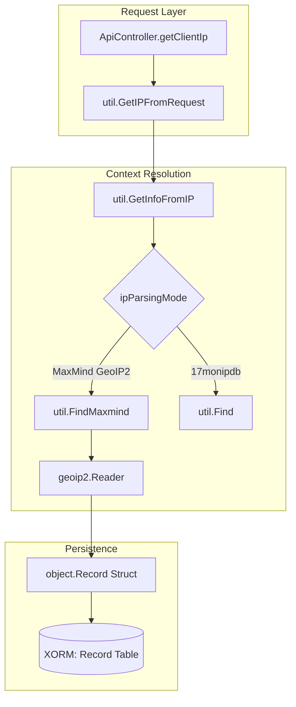
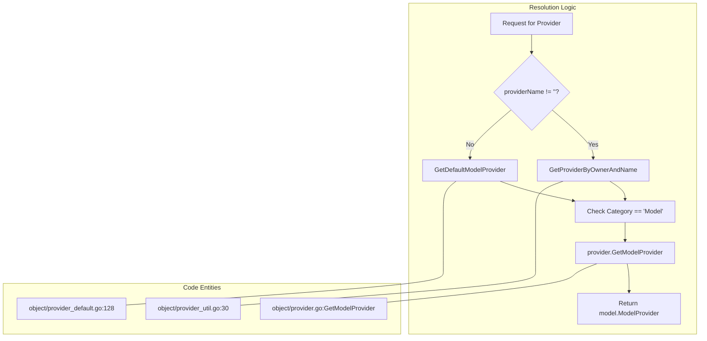

<!-- source: DeepWiki mcp.deepwiki.com · repo the-open-agent/openagent · page 10.2 Activity Records & Audit Logging · fetched 2026-10-26 -->

# Activity Records & Audit Logging

Relevant source files

The following files were used as context for generating this wiki page:

- [chain/chainmaker.go](chain/chainmaker.go)
- [chain/chainmaker_tencent.go](chain/chainmaker_tencent.go)
- [chain/chainmaker_tencent_demo.go](chain/chainmaker_tencent_demo.go)
- [chain/chainmaker_util.go](chain/chainmaker_util.go)
- [chain/client.go](chain/client.go)
- [chain/ethereum.go](chain/ethereum.go)
- [controllers/form_data.go](controllers/form_data.go)
- [controllers/openai_api.go](controllers/openai_api.go)
- [controllers/openai_writer.go](controllers/openai_writer.go)
- [controllers/record.go](controllers/record.go)
- [controllers/record_chain.go](controllers/record_chain.go)
- [object/message_cleanup.go](object/message_cleanup.go)
- [object/provider_default.go](object/provider_default.go)
- [object/provider_util.go](object/provider_util.go)
- [object/record.go](object/record.go)
- [object/record_chain.go](object/record_chain.go)
- [object/record_test.go](object/record_test.go)
- [proxy/proxy.go](proxy/proxy.go)
- [routers/record.go](routers/record.go)
- [util/file.go](util/file.go)
- [util/header.go](util/header.go)
- [util/ip.go](util/ip.go)
- [util/ip_maxmind.go](util/ip_maxmind.go)
- [util/network.go](util/network.go)
- [web/src/RecordListPage.js](web/src/RecordListPage.js)
- [web/src/backend/FormDataBackend.js](web/src/backend/FormDataBackend.js)
- [web/src/backend/RecordBackend.js](web/src/backend/RecordBackend.js)

Activity records provide a comprehensive audit trail of system interactions within OpenAgent. This system tracks request metadata, user actions, and geographic information, with the capability to persist these logs onto a blockchain for immutable verification.

## Record Data Model

The `Record` struct is the central entity for logging. It captures environmental data (IP, User-Agent), organizational context, and the specific action performed.

### Core Attributes
| Field | Type | Description |
|:---|:---|:---|
| `ClientIp` | `string` | The IP address of the requester [object/record.go:36](). |
| `UserAgent` | `string` | The browser/client identifier [object/record.go:37](). |
| `Organization` | `string` | The organization context for the record [object/record.go:35](). |
| `Action` | `string` | The specific API or system action (e.g., "login", "update-chat") [object/record.go:41](). |
| `Region`/`City` | `string` | Geographic location resolved from the IP [object/record.go:44-45](). |
| `Object`/`Response` | `string` | The request payload and the system's response [object/record.go:49-50](). |
| `Provider`/`Block` | `string` | Blockchain provider name and the resulting block ID after commitment [object/record.go:54-55](). |

### Geographic Resolution
OpenAgent uses the MaxMind GeoIP2 database to resolve IP addresses into location data. The system automatically downloads the necessary `.mmdb` files (`GeoLite2-City` and `GeoLite2-ASN`) from a configured data repository if they are missing [util/file.go:161-214](). Initialization is controlled by the `ipParsingMode` configuration [util/ip.go:54-77]().

**Record Context Resolution Diagram**

**Sources:** [object/record.go:28-69](), [util/ip.go:79-100](), [util/ip_maxmind.go:58-114](), [util/file.go:218-231]()

## Blockchain-Backed Audit Trails

For high-integrity environments, OpenAgent supports "Record Chaining," where records are committed to a blockchain. This creates a tamper-proof audit trail.

### Implementation Details
- **Provider Resolution**: The system retrieves active `Blockchain` category providers via `GetActiveBlockchainProvider` or `GetTwoActiveBlockchainProvider` for cross-chain redundancy [object/provider_util.go:96-144]().
- **Commit Process**: The `CommitRecord` function takes a record, serializes it via `toParam()`, and uses a `ChainClient` to submit the data [object/record_chain.go:127-177]().
- **Chain Clients**: The `chain` package provides a `ChainClientInterface` implemented by `ChainChainmakerClient` [chain/chainmaker.go:33-39](), `EthereumClient`, and others.

### Key Functions
- `record.toParam()`: Clears internal blockchain fields (like existing block IDs) to ensure the hash represents only the record data, then converts it to a JSON string wrapped in a `Param` struct [object/record_chain.go:108-125]().
- `CommitRecords()`: A batch processing function that iterates through a slice of records and commits them to the configured chain, protected by `scanNeedCommitRecordsMutex` to prevent concurrent race conditions [object/record_chain.go:208-250]().
- `CommitRecordSecond()`: Specifically handles the second chain in a cross-chain configuration, updating `Provider2`, `Block2`, and `Transaction2` fields [object/record_chain.go:179-205]().

**Sources:** [object/record_chain.go:65-80](), [object/record_chain.go:127-177](), [object/record.go:54-62](), [chain/chainmaker.go:61-69]()

## Provider Utilities & Resolution

The `provider_util.go` and `provider_default.go` files handle the logic for selecting which provider (Model, Embedding, or Blockchain) should be used when none is explicitly specified.

### Default Provider Logic
The system queries the database for providers marked as `IsDefault` within specific categories:
- **Model**: `GetDefaultModelProvider` [object/provider_default.go:128-164]().
- **Embedding**: `GetDefaultEmbeddingProvider` [object/provider_default.go:166-185]().
- **Blockchain**: `GetDefaultBlockchainProvider` [object/provider_default.go:187-206]().
- **Speech**: `GetDefaultTextToSpeechProvider` [object/provider_default.go:208-227]() and `GetDefaultSpeechToTextProvider` [object/provider_default.go:229-248]().

### Provider Resolution Flow

**Sources:** [object/provider_util.go:26-60](), [object/provider_default.go:128-185]()

## Administrative View: RecordListPage

The `RecordListPage` component in the React frontend provides an interface for administrators to browse and manage audit logs.

### Features
- **Filtering & Search**: Supports searching by Organization, User, Method, and Action via `getColumnSearchProps` [web/src/RecordListPage.js:206-213]().
- **Blockchain Interaction**: Includes buttons to "Commit" a record to the blockchain or "Query" the chain to verify existing data against the local database [web/src/RecordListPage.js:152-195]().
- **Cross-Chain Support**: A toggle for `enableCrossChain` allows administrators to manage records across multiple blockchain providers simultaneously [web/src/RecordListPage.js:61-67]().

### Request Recording Filters
The backend utilizes controllers and internal logic to automatically create `Record` entries.
- **Action Filtering**: Certain actions ending in `-record`, `-record-second`, or `-records` are excluded during preparation to prevent infinite loops where logging an action triggers another log entry [object/record.go:176-186]().
- **Record Preparation**: The `prepareRecord` function resets internal IDs and generates a new unique name for each logged event, ensuring the record is ready for insertion or blockchain commitment [object/record.go:171-208]().
- **Batch Insertion**: `AddRecords` supports both synchronous and asynchronous processing of multiple records, automatically populating missing `ClientIp` and `UserAgent` from the current request context [controllers/record.go:153-191]().

**Sources:** [web/src/RecordListPage.js:28-40](), [web/src/RecordListPage.js:152-195](), [object/record.go:171-208](), [controllers/record.go:123-143]()

---

