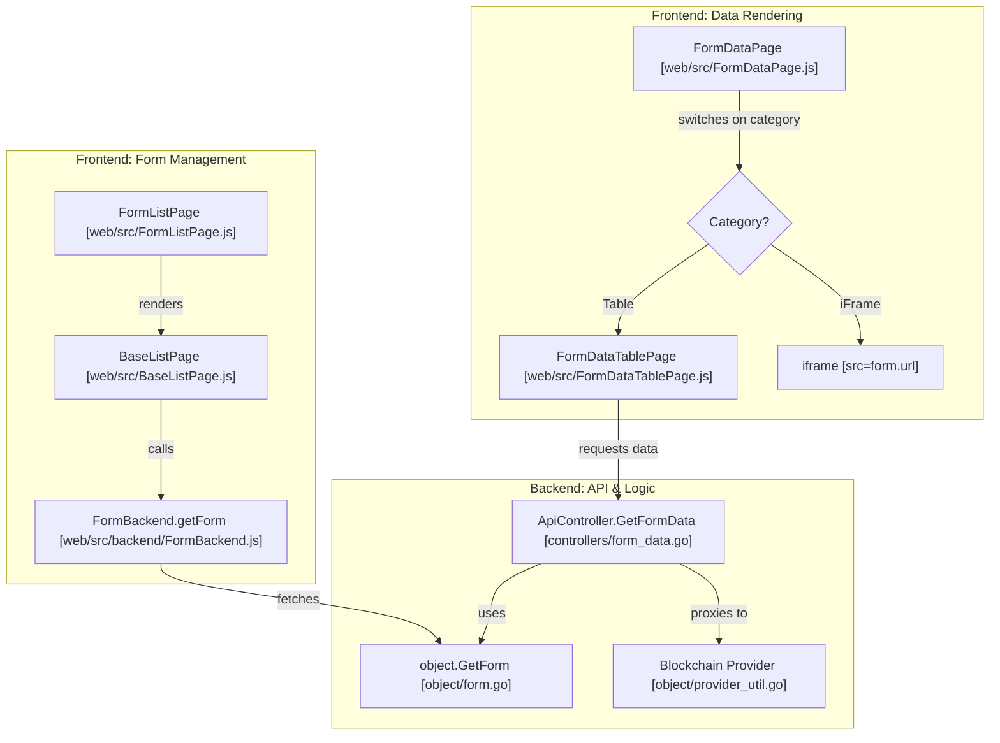
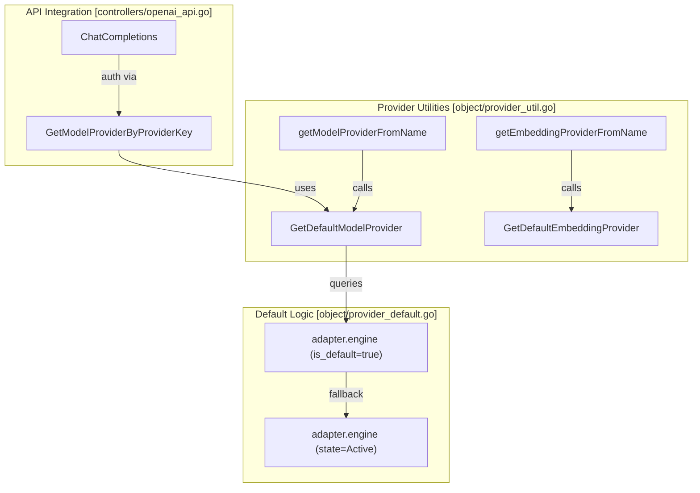

<!-- source: DeepWiki mcp.deepwiki.com · repo the-open-agent/openagent · page 11.1 Articles, Forms & Graphs · fetched 2026-10-26 -->

# Articles, Forms & Graphs

Relevant source files

The following files were used as context for generating this wiki page:

- [controllers/form_data.go](controllers/form_data.go)
- [controllers/openai_api.go](controllers/openai_api.go)
- [controllers/openai_writer.go](controllers/openai_writer.go)
- [object/form.go](object/form.go)
- [object/provider_default.go](object/provider_default.go)
- [object/provider_util.go](object/provider_util.go)
- [web/.gitignore](web/.gitignore)
- [web/README.md](web/README.md)
- [web/src/BaseListPage.js](web/src/BaseListPage.js)
- [web/src/FormDataPage.js](web/src/FormDataPage.js)
- [web/src/FormDataTablePage.js](web/src/FormDataTablePage.js)
- [web/src/FormListPage.js](web/src/FormListPage.js)
- [web/src/StoreSelect.js](web/src/StoreSelect.js)
- [web/src/backend/FormDataBackend.js](web/src/backend/FormDataBackend.js)

This section covers the management and visualization of structured and semi-structured knowledge within OpenAgent. It details the **Article** system for document processing, the **Form** system for data collection and UI embedding, and the **Graph** engine for relationship visualization.

## 1. Article Entity & Processing Pipeline

The `Article` entity represents knowledge documents that can be processed into structured blocks. It is often used in conjunction with Workflows for translation or refinement tasks.

### 1.1 Data Model
An `Article` consists of raw text and a collection of `Block` objects.
- **Block**: Represents a segment of an article (e.g., Title, Abstract, Header, Text) [object/article.go:24-30]().
- **Article**: Contains metadata, the raw `Text`, and a slice of `Content` (Blocks) [object/article.go:32-44]().

### 1.2 Frontend Logic: Text Parsing
The `ArticleEditPage` implements complex client-side parsing to convert raw LaTeX or plain text into structured blocks.
- **Preprocessing**: `preprocessText` removes LaTeX commands like `\documentclass` and comments [web/src/ArticleEditPage.js:108-124]().
- **Block Splitting**: `splitTextBlocks` ensures text segments do not exceed a `textMaxLength` (default 1000 characters) for optimal LLM processing [web/src/ArticleEditPage.js:132-173]().
- **Pattern Matching**: `parseText` uses Regex to identify sections such as `\title{}`, `\begin{abstract}`, and `\section{}` [web/src/ArticleEditPage.js:175-204]().

**Sources:** [object/article.go:24-44](), [web/src/ArticleEditPage.js:108-204]()

---

## 2. Form & FormData System

The Form system provides a flexible way to collect data or embed external interfaces (iFrames) and existing OpenAgent list pages into custom views.

### 2.1 Form Categories
Forms are categorized into types that determine their rendering logic in the frontend [web/src/FormDataPage.js:58-66]():
1.  **Table**: A structured data collection form defined by `FormItems` [web/src/FormEditPage.js:131-146]().
2.  **iFrame**: Embeds an external URL via an HTML iframe [web/src/FormDataPage.js:60-63]().
3.  **List Page**: Dynamically renders standard OpenAgent entity lists within the form context [web/src/FormEditPage.js:104-115]().

### 2.2 Form Implementation Flow

The following diagram maps the relationship between the frontend UI components and the backend data structures.

### 2.3 Blockchain Proxying
For forms requiring high integrity, `GetFormData` in the backend proxies requests to a blockchain-backed server. It identifies the active `Blockchain` provider and forwards the form configuration to the `ProviderUrl` [controllers/form_data.go:57-69]().

**Sources:** [web/src/FormListPage.js:27-106](), [web/src/FormDataPage.js:22-68](), [controllers/form_data.go:35-84](), [object/form.go:33-46]()

---

## 3. Graph Entity & Visualization

The Graph system visualizes relationships between entities. It supports manual JSON-based graph definitions and automated generation from system assets or chat history.

### 3.1 Data Structure
- **GraphNode**: Defines a node with `Id`, `Name`, `Value` (size), and `Weight` [object/graph.go:24-31]().
- **Graph**: Stores the configuration, including `Category` (Default, Assets, Chats), `Layout` (force, circular), and the `Text` field containing the JSON representation of nodes and links [object/graph.go:33-47]().

### 3.2 Automated Graph Generation
The system can dynamically generate graphs based on the `Category`:
- **Assets**: Fetches system assets via `AssetBackend.getAssets` and transforms them using `transformAssetsToGraph` [web/src/GraphDataPage.js:124-142]().
- **Chats**: Aggregates chat sessions within a specific time range (`startTime` to `endTime`) and store [web/src/GraphEditPage.js:126-137]().

### 3.3 Rendering Engine
Graphs are rendered using `echarts-for-react` [web/src/GraphDataPage.js:16](). The `getOption` function configures the ECharts force-directed graph, mapping `GraphNode` values to symbol sizes and categories to colors [web/src/GraphDataPage.js:219-250]().

**Sources:** [object/graph.go:24-47](), [web/src/GraphDataPage.js:124-142](), [web/src/GraphEditPage.js:126-137]()

---

## 4. Provider Resolution Logic

The system relies on utility functions to resolve model and storage providers, ensuring that entities like Forms or Chats have access to the necessary AI capabilities.

### 4.1 Default Provider Resolution
Providers are retrieved based on category and priority (Default flag > Active state).

### 4.2 Key Functions

| Function | File | Description |
| :--- | :--- | :--- |
| `GetDefaultModelProvider` | [object/provider_default.go:128]() | Returns the system-wide default LLM provider. |
| `GetDefaultEmbeddingProvider` | [object/provider_default.go:166]() | Returns the default embedding provider for RAG tasks. |
| `GetActiveBlockchainProvider` | [object/provider_util.go:96]() | Identifies an active blockchain provider for audit/form tasks. |
| `GetProviderByProviderKey` | [object/provider_default.go:25]() | Retrieves a provider using an API key (used in OpenAI-compatible API). |

**Sources:** [object/provider_util.go:26-114](), [object/provider_default.go:25-248](), [controllers/openai_api.go:46-50]()

---

## 5. Summary of Frontend Infrastructure for Lists

Many entities (Forms, Articles, Graphs) inherit behavior from `BaseListPage`, which provides standardized filtering, store selection, and pagination.

- **Store Filtering**: `BaseListPage` listens for `storeChanged` events to refresh data based on the current `StoreSelect` context [web/src/BaseListPage.js:85-90]().
- **Dynamic Form Loading**: The `getForm` function in `BaseListPage` checks for custom form layouts (tags) to render the list view differently for specific users or organizations [web/src/BaseListPage.js:104-121]().
- **Store Selection**: `StoreSelect` component manages the global store context, often binding users to specific stores via their `homepage` attribute [web/src/StoreSelect.js:84-93]().

**Sources:** [web/src/BaseListPage.js:34-121](), [web/src/StoreSelect.js:21-154]()

---

