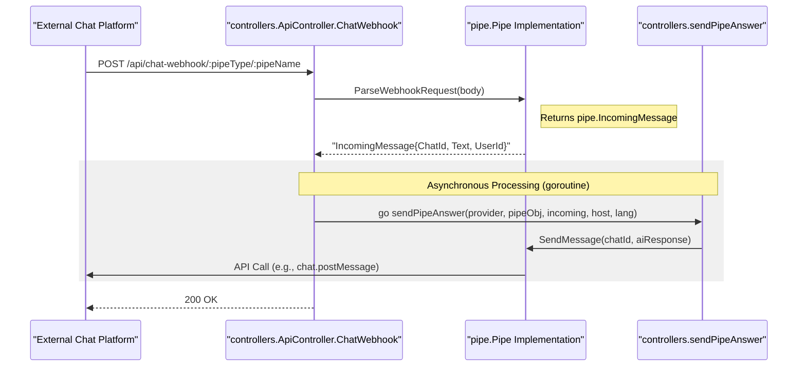
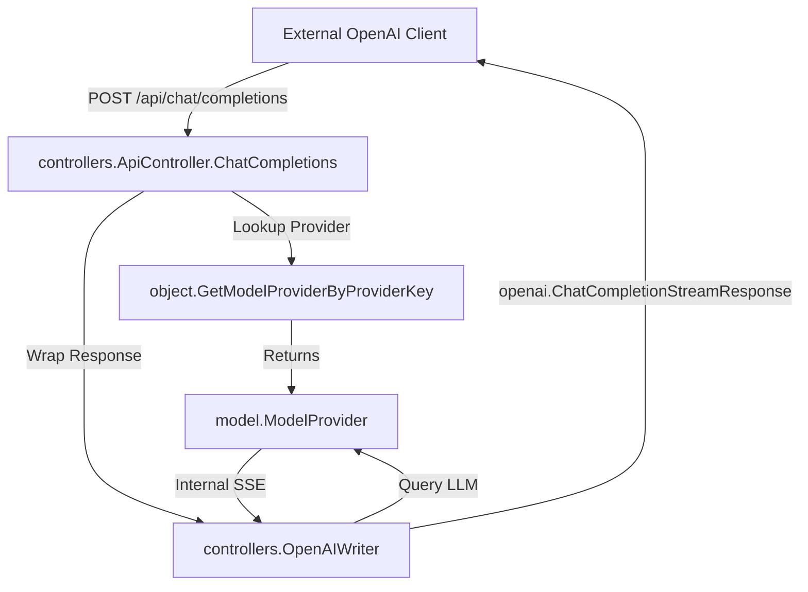

<!-- source: DeepWiki mcp.deepwiki.com · repo the-open-agent/openagent · page 11.2 Bot Integrations & Messaging · fetched 2026-10-26 -->

# Bot Integrations & Messaging

Relevant source files

The following files were used as context for generating this wiki page:

- [controllers/form_data.go](controllers/form_data.go)
- [controllers/openai_api.go](controllers/openai_api.go)
- [controllers/openai_writer.go](controllers/openai_writer.go)
- [controllers/pipe.go](controllers/pipe.go)
- [controllers/pipe_webhook.go](controllers/pipe_webhook.go)
- [object/pipe.go](object/pipe.go)
- [object/provider_default.go](object/provider_default.go)
- [object/provider_util.go](object/provider_util.go)
- [pipe/discord.go](pipe/discord.go)
- [pipe/facebook_messenger.go](pipe/facebook_messenger.go)
- [pipe/pipe.go](pipe/pipe.go)
- [pipe/slack.go](pipe/slack.go)
- [pipe/telegram.go](pipe/telegram.go)
- [pipe/wechat.go](pipe/wechat.go)
- [pipe/x_dm.go](pipe/x_dm.go)
- [web/src/PipeEditPage.js](web/src/PipeEditPage.js)
- [web/src/PipeListPage.js](web/src/PipeListPage.js)
- [web/src/backend/FormDataBackend.js](web/src/backend/FormDataBackend.js)

OpenAgent provides a robust infrastructure for external connectivity, allowing the platform to serve as a backend for third-party messaging applications. This is achieved through the "Pipe" system, which abstracts various chat platforms into a unified interface, and an OpenAI-compatible API for standardized LLM access.

## The Pipe Integration System

The `Pipe` system is the core abstraction for integrating with external messaging platforms like Telegram, Slack, Discord, and WeChat. It allows OpenAgent to receive incoming messages via webhooks and send AI-generated responses back to the respective platforms.

### Core Interface and Architecture
Every messaging platform integration must implement the `Pipe` interface defined in `pipe/pipe.go`.

*   **Pipe Interface**: Defines basic operations: `SendMessage`, `ParseWebhookRequest`, and `SetWebhook` [pipe/pipe.go:34-39]().
*   **StreamPipe**: Implemented by pipes that can progressively update an in-flight response, such as Slack or Telegram, via the `SendStreamMessage` method [pipe/pipe.go:48-50]().
*   **Webhook Handling**: The system handles verification challenges via `WebhookVerifier` (GET) and actual message delivery (POST) via the `ChatWebhookVerify` and `ChatWebhook` controllers [controllers/pipe_webhook.go:55-154]().
*   **Immediate Response**: The `ImmediateWebhookResponder` interface is used by platforms like Discord that require an immediate HTTP response before the AI processes the message [pipe/pipe.go:60-62]().

### Supported Messaging Platforms
OpenAgent supports a wide range of integrations, each handled by a specific implementation in the `pipe/` package.

| Platform | Type | Implementation Features |
| :--- | :--- | :--- |
| **Telegram** | `Telegram` | Uses Bot API for message delivery and webhook registration [pipe/telegram.go:25-28](). Supports streaming [pipe/telegram.go:149-177](). |
| **Slack** | `Slack` | Supports `StreamPipe` for real-time updates and HMAC-SHA256 signature verification [pipe/slack.go:31-35](), [pipe/slack.go:236-269](). |
| **WeChat** | `WeChat` | Integrates with WeChat Official Accounts; handles signature verification and message parsing [pipe/pipe.go:91](). |
| **Discord** | `Discord` | Implements `ImmediateWebhookResponder` to acknowledge interactions and `verifyWebhookSignature` using Ed25519 [pipe/discord.go:37-41](), [pipe/discord.go:233-242](). |
| **X (Twitter)** | `X Direct Messages` | Supports OAuth 2.0 and handles CRC challenges for webhook validation [pipe/x_dm.go:32-36](), [pipe/x_dm.go:151-174](). |

### Messaging Data Flow
The following diagram traces a message from an external platform through the OpenAgent backend and back.

**Title: Pipe Webhook Message Flow (Natural Language to Code Entity)**

**Sources:** [controllers/pipe_webhook.go:101-154](), [pipe/pipe.go:26-32](), [pipe/slack.go:60-78](), [pipe/telegram.go:67-74]()

---

## OpenAI-Compatible API

OpenAgent exposes an endpoint at `/api/chat/completions` that adheres to the OpenAI Chat Completion API specification. This allows users to point existing OpenAI-compatible tools and SDKs to OpenAgent.

### Implementation Details
*   **API Key Mapping**: The system uses the `Authorization: Bearer <API_KEY>` header. The `GetModelProviderByProviderKey` function maps this key (stored as `provider_key` in the database) to a specific `ModelProvider` [object/provider_default.go:54-78]().
*   **Provider Key Generation**: API keys for external access are generated using `generateProviderKey` which prefixes keys with `sk-` [object/provider_util.go:146-148]().
*   **OpenAIWriter**: This struct handles the conversion of internal SSE (Server-Sent Events) formats into the specific `chat.completion.chunk` format expected by OpenAI clients [controllers/openai_writer.go:28-37]().

**Title: OpenAI API Compatibility Layer**

**Sources:** [controllers/openai_api.go:85-111](), [object/provider_default.go:54-78](), [controllers/openai_writer.go:40-70]()

---

## Configuration & Management

Integrations are managed through the "Pipes" administrative interface, which allows for the configuration of credentials, webhooks, and default stores.

### Pipe Data Model
The `Pipe` struct in the object layer stores the persistence data for these integrations [object/pipe.go:27-44]().

| Field | Description |
| :--- | :--- |
| `Type` | The platform type (Telegram, Slack, Discord, WhatsApp, etc.) [object/pipe.go:33](). |
| `Token` | The API token or access key for the platform [object/pipe.go:34](). |
| `SecretKey` | Mapped to `provider_key` in DB; used for signature verification [object/pipe.go:35](). |
| `Store` | The AI Store that will process messages received via this pipe [object/pipe.go:36](). |
| `Domain` | The external domain of the OpenAgent instance for webhook URLs [object/pipe.go:37](). |

### Management UI
The frontend provides a dedicated interface for managing these connections:
*   **PipeListPage**: Displays all configured pipes with their status and type logos [web/src/PipeListPage.js:91-194]().
*   **PipeEditPage**: Allows editing pipe properties and performing connectivity tests via `chatTest` [web/src/PipeEditPage.js:112-139]().
*   **Webhook Setup**: The `setPipeWebhook` function triggers the backend to register the OpenAgent URL with the external platform (e.g., calling Telegram's `setWebhook`) [web/src/PipeEditPage.js:94-110]().

**Sources:** [object/pipe.go:27-44](), [web/src/PipeEditPage.js:27-43](), [web/src/PipeListPage.js:25-45](), [pipe/telegram.go:105-111]()

---

