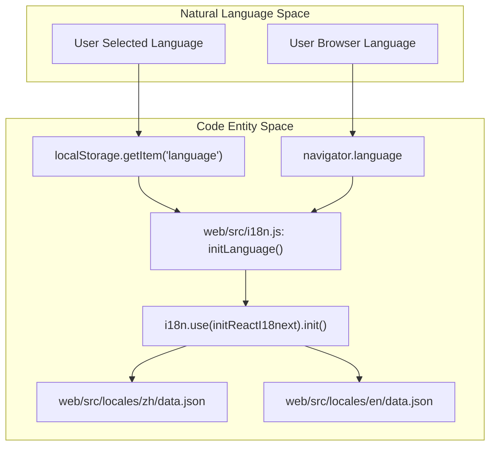
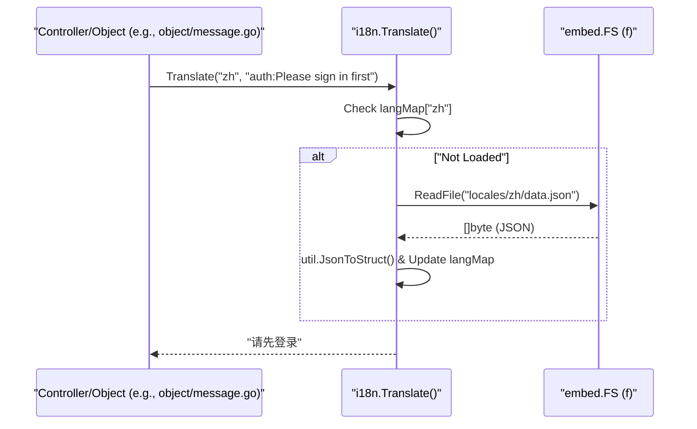

<!-- source: DeepWiki mcp.deepwiki.com · repo the-open-agent/openagent · page 12.1 Internationalization (i18n) · fetched 2026-10-26 -->

# Internationalization (i18n)

Relevant source files

The following files were used as context for generating this wiki page:

- [i18n/generate_test.go](i18n/generate_test.go)
- [i18n/locales/en/data.json](i18n/locales/en/data.json)
- [i18n/locales/zh/data.json](i18n/locales/zh/data.json)
- [i18n/util.go](i18n/util.go)
- [web/src/Setting.js](web/src/Setting.js)
- [web/src/i18n.js](web/src/i18n.js)
- [web/src/locales/en/data.json](web/src/locales/en/data.json)
- [web/src/locales/zh/data.json](web/src/locales/zh/data.json)

OpenAgent implements a comprehensive internationalization system covering both the React frontend and the Go backend. The system relies on `i18next` for the client-side and a custom embedding-based translation package for the server-side. It supports English (`en`) and Chinese (`zh`) by default, with automated tooling for key generation and synchronization.

## Frontend Implementation

The frontend uses `i18next` and `react-i18next` to manage translations [web/src/i18n.js:15-18](). Translation data is stored in JSON files organized by language and namespace.

### Configuration and Initialization
The i18n system is initialized in `web/src/i18n.js`. It determines the initial language via `initLanguage()` based on the following priority:
1. `localStorage` value for "language" [web/src/i18n.js:28-29]().
2. Browser's `navigator.language` mapped to supported codes [web/src/i18n.js:30-47]().
3. Fallback to "en" [web/src/i18n.js:50-53]().

The configuration sets `keySeparator` to `false` and enables `saveMissing` to facilitate development [web/src/i18n.js:64-70]().

### Component Integration Diagram
The following diagram bridges the user's environmental settings to the code entities responsible for localized rendering.

Sources: [web/src/i18n.js:20-71]()

### Usage in Components
Components use the `i18next.t()` function to retrieve translated strings. Namespaces (e.g., `general`, `chat`, `account`) are used to categorize keys within the JSON files.

*   **UI Labels:** `i18next.t("general:Successfully saved")` [web/src/Setting.js:220-220]().
*   **Error Messages:** `i18next.t("general:Failed to save")` [web/src/Setting.js:222-226]().
*   **Dynamic URLs:** Functions like `getSigninUrl()` append the current language as a query parameter to external Casdoor URLs to maintain locale consistency across services [web/src/Setting.js:62-68](), [web/src/Setting.js:81-86]().

### Language Selection UI
The language switching logic is centralized in the frontend settings and selection components.
*   **Storage:** When a language is selected, the application updates `localStorage` and typically reloads to apply the change.
*   **Utility:** `getLanguage()` is used to retrieve the active locale for API requests and external links [web/src/Setting.js:21-21](), [web/src/Setting.js:64-66]().

Sources: [web/src/Setting.js:15-228](), [web/src/i18n.js:15-73]()

## Backend Implementation

The backend i18n logic resides in the `i18n` package. It provides translation capabilities for error messages, logs, and API responses generated by the Go server.

### Translation Mechanism
The backend uses a global `langMap` to cache translation data [i18n/util.go:28-28](). Translation files are embedded into the Go binary using `go:embed` for production portability, ensuring the backend can serve translations without relying on external file system paths [i18n/util.go:25-26]().

**Key Function:** `Translate(language string, errorText string) string` [i18n/util.go:81-107]()
This function expects an `errorText` in the format `Namespace:Key` (e.g., `auth:Invalid username or password`).
1. Splits the input into `tokens` using the colon separator [i18n/util.go:82-82]().
2. Loads the requested language from embedded FS `f` if not already cached in `langMap` [i18n/util.go:87-100]().
3. Returns the translated string from the mapped namespace and key, or the original key if the translation is missing [i18n/util.go:102-106]().

### Backend Translation Flow
This diagram illustrates how a Go entity requests a translation through the `i18n` package.

Sources: [i18n/util.go:15-108]()

## Translation Data Structure

Both frontend and backend share a similar JSON structure, organized by namespace. Frontend files are located in `web/src/locales/`, while backend files are in `i18n/locales/`.

| Namespace | Purpose | Example Key/Value (EN) |
| :--- | :--- | :--- |
| `account` | User and store account errors | `"The store: %s is not found"` [i18n/locales/en/data.json:4-4]() |
| `auth` | Authentication and permission messages | `"Unauthorized operation"` [i18n/locales/en/data.json:21-21]() |
| `chat` | Chat interface labels and errors | `"Type message here"` [web/src/locales/en/data.json:82-82]() |
| `general` | Common UI labels and generic errors | `"Failed to save"` [web/src/locales/en/data.json:178-178]() |
| `model` | LLM and Provider related errors | `"unsupported model: %s"` [i18n/locales/en/data.json:111-111]() |
| `object` | Backend entity validation errors | `"The MCP server: %s is not found"` [i18n/locales/en/data.json:126-126]() |

Sources: [web/src/locales/en/data.json:1-178](), [i18n/locales/en/data.json:1-126](), [web/src/locales/zh/data.json:1-178](), [i18n/locales/zh/data.json:1-126]()

## Tooling and Maintenance

OpenAgent includes specialized Go tests to automate the maintenance of translation files. These tools ensure consistency between the source keys and localized JSON files.

### Generation and Synchronization
The file `i18n/generate_test.go` contains test functions that act as CLI tools for developers:
*   `TestGenerateI18nFrontend`: Parses translation keys used in the frontend and applies them to `en` and `zh` JSON files [i18n/generate_test.go:22-27]().
*   `TestGenerateI18nBackend`: Performs the same synchronization for backend translation keys [i18n/generate_test.go:30-35]().

### File Operations and Formatting
The `i18n/util.go` file provides helper functions for these maintenance tools:
*   `getI18nFilePath`: Determines the path to JSON files based on category (`frontend` vs `backend`) and language [i18n/util.go:30-36]().
*   `readI18nFile`: Reads and unmarshals translation data from the local file system [i18n/util.go:38-47]().
*   `writeI18nFile`: Writes structured JSON back to files. It includes logic to replace escaped characters (like `\u003c` for `<`) to keep the translation files human-readable [i18n/util.go:49-60]().
*   `applyData`: Merges keys from one data set into another, ensuring new keys are added without overwriting existing translations [i18n/util.go:62-79]().

Sources: [i18n/generate_test.go:18-36](), [i18n/util.go:30-79]()

---

