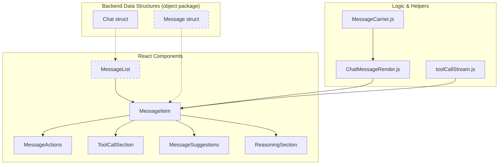
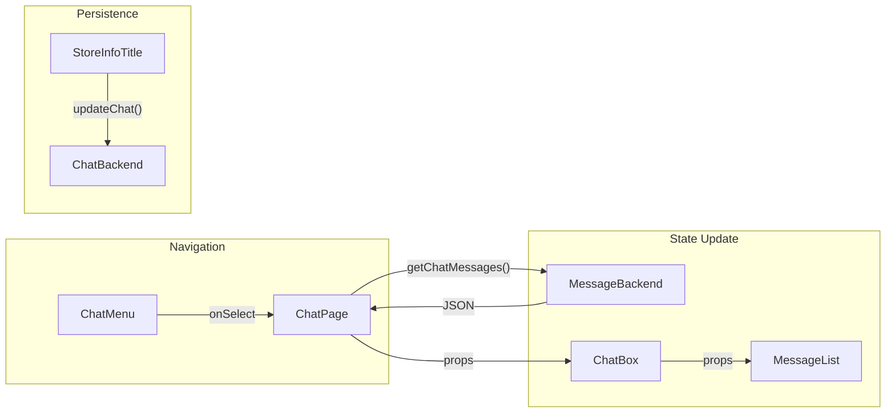

<!-- source: DeepWiki mcp.deepwiki.com · repo the-open-agent/openagent · page 2.1 Chat UI & Session Management · fetched 2026-10-26 -->

# Chat UI & Session Management

Relevant source files

The following files were used as context for generating this wiki page:

- [web/src/ChatBox.js](web/src/ChatBox.js)
- [web/src/ChatExampleQuestions.js](web/src/ChatExampleQuestions.js)
- [web/src/ChatMenu.js](web/src/ChatMenu.js)
- [web/src/ChatMessageRender.js](web/src/ChatMessageRender.js)
- [web/src/ChatMessageRender.test.js](web/src/ChatMessageRender.test.js)
- [web/src/ChatPage.js](web/src/ChatPage.js)
- [web/src/LoadSkillModal.js](web/src/LoadSkillModal.js)
- [web/src/MultiPaneManager.js](web/src/MultiPaneManager.js)
- [web/src/StoreInfoTitle.js](web/src/StoreInfoTitle.js)
- [web/src/backend/MessageBackend.js](web/src/backend/MessageBackend.js)
- [web/src/chat/ChatFileInput.js](web/src/chat/ChatFileInput.js)
- [web/src/chat/ChatInput.js](web/src/chat/ChatInput.js)
- [web/src/chat/ChatInputMenu.js](web/src/chat/ChatInputMenu.js)
- [web/src/chat/KnowledgeSourcesDrawer.js](web/src/chat/KnowledgeSourcesDrawer.js)
- [web/src/chat/MessageActions.js](web/src/chat/MessageActions.js)
- [web/src/chat/MessageEdit.js](web/src/chat/MessageEdit.js)
- [web/src/chat/MessageItem.js](web/src/chat/MessageItem.js)
- [web/src/chat/MessageList.js](web/src/chat/MessageList.js)
- [web/src/chat/MessageSuggestions.js](web/src/chat/MessageSuggestions.js)
- [web/src/chat/SearchSourcesDrawer.js](web/src/chat/SearchSourcesDrawer.js)
- [web/src/chat/WelcomeHeader.js](web/src/chat/WelcomeHeader.js)
- [web/src/common/ChatWidget.js](web/src/common/ChatWidget.js)

The OpenAgent frontend provides a comprehensive React-based interface for interacting with AI models. It manages the lifecycle of chat sessions, handles complex message rendering (including reasoning steps and tool calls), and integrates multimedia capabilities like Text-to-Speech (TTS) and Speech-to-Text (STT).

## ChatPage & State Management

`ChatPage` is the primary container for the conversation interface. It inherits from `BaseListPage` and manages the high-level state of the chat session, including store selection, message loading states, and UI layout.

### Key State Properties
- `chat`: The current active chat object [web/src/ChatPage.js:159-160]().
- `messages`: An array of message objects for the current session [web/src/ChatPage.js:231]().
- `chatMenuCollapsed`: Boolean determining the sidebar state, persisted in `localStorage` [web/src/ChatPage.js:45-46]().
- `paneCount`: Controls the multi-pane mode for side-by-side model comparison [web/src/ChatPage.js:65]().
- `generationMode`: Toggles between "text" and "image" modes [web/src/ChatPage.js:69-70]().

### Polling & Status Tracking
`ChatPage` implements a polling mechanism via `startPolling()` to track the status of chats currently generating responses [web/src/ChatPage.js:84-147](). It uses `ChatBackend.getChatStatus` to refresh the `isGenerating` and `isUnread` flags every 2 seconds [web/src/ChatPage.js:34-36](), [web/src/ChatPage.js:97]().

**Sources:** [web/src/ChatPage.js:36-163](), [web/src/BaseListPage.js:1-50]()

## ChatBox Interaction Layer

`ChatBox` acts as the functional bridge between the input components and the message display. It handles internal state for the current input value, uploaded files, and active TTS reading status.

### Interaction Components
- **ChatInput**: A specialized input area using `@ant-design/x` `Sender` for handling text and file attachments [web/src/chat/ChatInput.js:185-198]().
- **MessageList**: A virtualized list that renders `MessageItem` components [web/src/chat/MessageList.js:60-77]().
- **WelcomeHeader**: Displays store-specific greetings and icons when a chat is empty [web/src/chat/WelcomeHeader.js:20-48]().

### Session Persistence
`ChatBox` uses a local `inputStore` (a `Map`) to preserve unsent input text when a user switches between different chat sessions, ensuring no progress is lost during navigation [web/src/ChatBox.js:30-32](), [web/src/ChatBox.js:84-91]().

**Sources:** [web/src/ChatBox.js:32-169](), [web/src/chat/ChatInput.js:25-198](), [web/src/chat/MessageList.js:20-83]()

## Multi-Pane Mode

The `MultiPaneManager` allows administrators to compare different models or stores side-by-side.

### Implementation
- **Pane Management**: It maintains an array of `panes`, each containing its own `chat` and `messages` state [web/src/MultiPaneManager.js:46]().
- **Global Input**: A single text area can broadcast a message to all active panes simultaneously via `handleGlobalSend` [web/src/MultiPaneManager.js:220-240]().
- **Dynamic Creation**: If a pane does not have an active chat, the manager creates one on-the-fly using `createNewChat` [web/src/MultiPaneManager.js:75-93]().

### UI/Code Entity Mapping: Multi-Pane Workflow

| Logical Step | Code Entity | Function/Method |
| :--- | :--- | :--- |
| **Broadcast Message** | `MultiPaneManager` | `handleGlobalSend()` [web/src/MultiPaneManager.js:220]() |
| **Backend Init** | `ChatBackend` | `addChat()` [web/src/MultiPaneManager.js:95]() |
| **Response Stream** | `MessageBackend` | `getMessageAnswer()` [web/src/MultiPaneManager.js:141]() |
| **Tool Event Sync** | `toolCallStream.js` | `applyToolEvent()` [web/src/MultiPaneManager.js:191]() |

**Sources:** [web/src/MultiPaneManager.js:32-240](), [web/src/StoreInfoTitle.js:66-68]()

## Message Rendering & Pipeline

Messages are rendered via `MessageItem`, which supports complex AI outputs including reasoning phases and tool calls.

### Rendering Features
1. **Reasoning Phase**: Displays a "Thinking" animation [web/src/chat/MessageItem.js:106-148]() and renders `reasonText` via `ReasoningSection` [web/src/chat/MessageItem.js:31]().
2. **Tool Calls**: Integrated via `ToolCallSection`, showing the tool name, arguments, and execution results [web/src/chat/MessageItem.js:230-234]().
3. **Markdown & Carriers**: `ChatMessageRender` uses `MessageCarrier` to parse specialized tags (like `<title>`) from the stream [web/src/chat/MessageCarrier.js:1-50]().
4. **Suggestions**: `MessageSuggestions` renders interactive buttons for follow-up questions provided by the AI [web/src/chat/MessageSuggestions.js:20-63]().

### UI/Code Entity Mapping: Message Components

**Sources:** [web/src/chat/MessageItem.js:34-234](), [web/src/chat/MessageActions.js:41-141](), [web/src/chat/MessageSuggestions.js:20-63]()

## TTS & STT Integration

The UI provides voice interaction through dedicated helper classes and backend endpoints.

### Text-to-Speech (TTS)
- **TtsHelper**: Manages the audio lifecycle, initialized in `ChatBox` [web/src/ChatBox.js:51]().
- **UI Control**: `MessageActions` provides a play/pause/loading button for each message, tracking state via `isReading` and `isLoadingTTS` [web/src/chat/MessageActions.js:60-82]().
- **Cleanup**: `ChatBox` ensures speech synthesis is cancelled on component unmount [web/src/ChatBox.js:75-77]().

### Speech-to-Text (STT)
- **SpeechToTextHelper**: Handles browser-side recognition and voice input lifecycle [web/src/ChatBox.js:52]().
- **Integration**: Stops recognition when the user manually interacts with the input field [web/src/ChatBox.js:131-133]().

**Sources:** [web/src/ChatBox.js:51-53](), [web/src/chat/MessageActions.js:57-82](), [web/src/TextToSpeech.js:1-50]()

## Navigation & Session Management

The `ChatMenu` provides the navigation structure for multiple conversations, categorized by their `category` field [web/src/ChatMenu.js:83-88]().

- **CRUD Operations**: Users can create new chats, rename existing ones via an inline input [web/src/ChatMenu.js:131-153](), and delete sessions with a confirmation pop-up [web/src/ChatMenu.js:182-195]().
- **Status Indicators**: Renders a spinning `LoadingOutlined` icon if a chat is generating, or a dot if it is unread [web/src/ChatMenu.js:45-71]().
- **Store Switching**: `StoreInfoTitle` allows users to dynamically switch the model provider or the underlying Store for an active session, persisting changes via `ChatBackend.updateChat` [web/src/StoreInfoTitle.js:142-182]().

### Session State Flow

**Sources:** [web/src/ChatMenu.js:22-195](), [web/src/ChatPage.js:210-224](), [web/src/StoreInfoTitle.js:23-191]()

---

