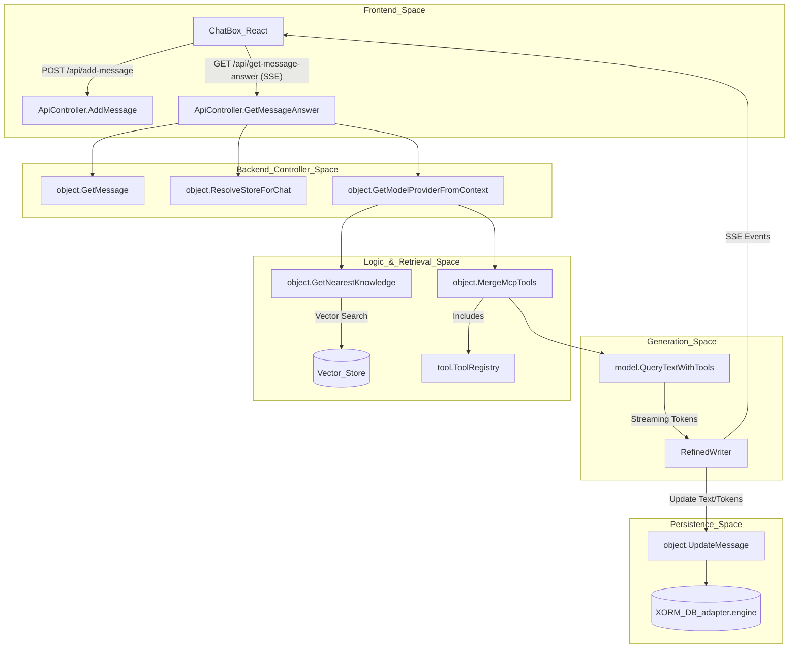
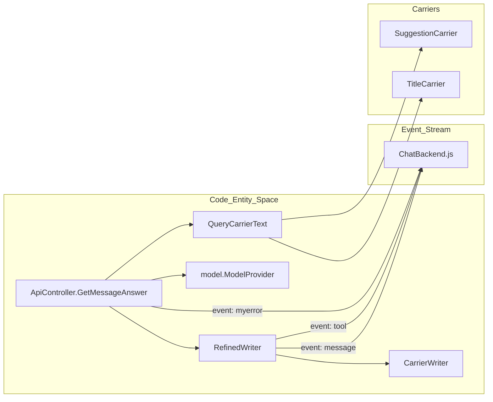

<!-- source: DeepWiki mcp.deepwiki.com · repo the-open-agent/openagent · page 2.2 Message Pipeline & AI Response Generation · fetched 2026-10-26 -->

# Message Pipeline & AI Response Generation

Relevant source files

The following files were used as context for generating this wiki page:

- [carrier/carrier.go](carrier/carrier.go)
- [carrier/suggestion.go](carrier/suggestion.go)
- [carrier/title.go](carrier/title.go)
- [controllers/account.go](controllers/account.go)
- [controllers/chat.go](controllers/chat.go)
- [controllers/message.go](controllers/message.go)
- [controllers/message_answer.go](controllers/message_answer.go)
- [controllers/message_carrier.go](controllers/message_carrier.go)
- [controllers/message_util.go](controllers/message_util.go)
- [controllers/message_writer.go](controllers/message_writer.go)
- [controllers/util.go](controllers/util.go)
- [model/mcp.go](model/mcp.go)
- [object/chat.go](object/chat.go)
- [object/merge_agent_tools.go](object/merge_agent_tools.go)
- [object/message.go](object/message.go)
- [object/message_email.go](object/message_email.go)
- [object/message_email_test.go](object/message_email_test.go)
- [object/message_tool.go](object/message_tool.go)
- [object/resource_archive_tool.go](object/resource_archive_tool.go)
- [web/src/backend/ChatBackend.js](web/src/backend/ChatBackend.js)
- [web/src/carrier/TitleCarrier.js](web/src/carrier/TitleCarrier.js)
- [web/src/carrier/titleUtils.js](web/src/carrier/titleUtils.js)
- [web/src/chat/GeneratedResourceList.js](web/src/chat/GeneratedResourceList.js)
- [web/src/chat/MessageCarrier.js](web/src/chat/MessageCarrier.js)
- [web/src/chat/ToolCallSection.js](web/src/chat/ToolCallSection.js)
- [web/src/chat/toolCallStream.js](web/src/chat/toolCallStream.js)

This page provides a technical deep dive into the backend message lifecycle within OpenAgent. It covers the flow from receiving a user request to generating a streamed AI response using Server-Sent Events (SSE), including Retrieval-Augmented Generation (RAG), tool orchestration, carrier parsing, and message persistence.

## Message Lifecycle Overview

The message pipeline is primarily orchestrated by the `GetMessageAnswer` function in `controllers/message_answer.go`. This endpoint handles the complexity of context assembly, provider resolution, security checks, and real-time streaming.

### 1. Request Initialization & Context Resolution
When a user sends a message, the frontend first calls `AddMessage` [controllers/message.go:238-254]() to persist the user's input. Subsequently, it invokes the SSE endpoint `GetMessageAnswer` [controllers/message_answer.go:42-64]().

The backend performs several resolution steps:
*   **Message Validation**: Ensures the message exists, is authored by "AI", and is a reply to a valid user message [controllers/message_answer.go:148-171]().
*   **Store Resolution**: The `Store` is the central configuration hub. The system resolves the appropriate store for the chat via `object.ResolveStoreForChat(chat)` [controllers/message_answer.go:189-205]().
*   **Provider Loading**: Resolves the `ModelProvider` (LLM) and `EmbeddingProvider` based on the store or chat-specific overrides [controllers/message_answer.go:300-315]().

### 2. Security & Billing Hooks
Before generation begins, the pipeline executes safety and financial checks:
*   **Frequency Limiting**: For non-signed-in users, the system checks `GetNearMessageCount` against the store's `Frequency` and `LimitMinutes` settings [controllers/message_answer.go:283-294]().
*   **Dry Run & Billing**: Calls `validateTransactionBeforeAIGeneration` to perform a "dry run" validation, ensuring the user has sufficient balance in the linked Casdoor account before initiating expensive LLM calls [controllers/message_answer.go:318-322]().

### 3. RAG & Tool Orchestration
If configured, the system augments the prompt with external data and capabilities:
*   **RAG (Knowledge Retrieval)**: If `KnowledgeCount` is non-zero, the system performs a vector search across the store's `VectorStores` via `object.GetNearestKnowledge` [controllers/message_answer.go:351-372]().
*   **Tool Preparation**: MCP (Model Context Protocol) tools and built-in tools are merged into a toolset via `object.MergeMcpTools` [object/merge_agent_tools.go:69-93]().
*   **Skill Integration**: Prompt fragments from the store's `Skills` are loaded via `tool.NewLoadSkillBuiltin` and appended to the registry [object/merge_agent_tools.go:30-34]().

### Data Flow Diagram: Message Pipeline

This diagram maps the logical flow of a message request to the specific Go entities responsible for processing.

Title: Message Pipeline Data Flow

Sources: [controllers/message_answer.go:42-412](), [controllers/message.go:238-254](), [object/message.go:176-207](), [object/merge_agent_tools.go:69-93]()

---

## Response Generation & Streaming

OpenAgent uses a specialized writer pattern to handle SSE streaming while simultaneously buffering the response for database persistence.

### Carrier Parsing & Multi-Stage Generation
To provide advanced features like follow-up suggestions and automatic topic titling, the system uses "Carriers":
*   **SuggestionCarrier**: Appends instructions to the prompt to generate follow-up questions [carrier/suggestion.go:32-75]().
*   **TitleCarrier**: Instructs the model to generate a concise title for the conversation at the end of the response [carrier/title.go:28-44]().
*   **QueryCarrierText**: Orchestrates the main answer generation and the carrier generation (suggestions/titles) in parallel using goroutines [controllers/message_carrier.go:154-203]().

### RefinedWriter and Event Types
The `RefinedWriter` [controllers/message_writer.go:27-35]() wraps the standard response writer to intercept tokens and categorize them into distinct SSE events:

| Event Type | Purpose | Implementation |
| :--- | :--- | :--- |
| `message` | Standard AI text response. | `RefinedWriter.Write` [controllers/message_writer.go:79-83]() |
| `reason` | Chain-of-thought or reasoning tokens. | `RefinedWriter.Write` [controllers/message_writer.go:53-57]() |
| `tool` | Tool execution results. | `RefinedWriter.Write` [controllers/message_writer.go:68-72]() |
| `myerror` | Custom error stream for graceful UI failure. | `writeMessageErrorStream` [controllers/message_util.go:34-71]() |

### Diagram: Streaming Entity Relationship
This diagram shows how the streaming entities interact to provide real-time updates.

Title: Streaming Response Orchestration

Sources: [controllers/message_answer.go:421-435](), [controllers/message_carrier.go:154-203](), [controllers/message_util.go:34-123](), [controllers/message_writer.go:41-138]()

---

## Tool Execution Loop

When tools are available, the pipeline enters an orchestration loop in `QueryTextWithTools` [model/mcp.go:162-230]().

1.  **LLM Call**: The LLM receives the prompt and tool definitions.
2.  **Tool Call Detection**: If the LLM returns `tool_calls`, the system intercepts them [model/mcp.go:179-183]().
3.  **Execution**: `callMcpTool` executes the requested tool (either built-in or via MCP server) [model/mcp.go:205-212]().
4.  **Feedback**: The tool result is appended to the message history, and the LLM is called again to generate a final answer or further tool calls [model/mcp.go:215-221]().

Sources: [model/mcp.go:162-230](), [object/merge_agent_tools.go:23-65]()

---

## Message Persistence & Post-Processing

Once the stream is complete, the system performs final persistence and content refinement.

### Final Update & Notification
The `GetMessageAnswer` function collects the full text and updates the `Message` object in the database [object/message.go:176-207]().
*   **Email Notifications**: If `NeedNotify` is true, `UpdateMessage` triggers `message.SendEmail` [controllers/message.go:210-220]().
*   **Error Reporting**: If a generation fails, `writeMessageErrorStream` calls `message.SendErrorEmail` [controllers/message_util.go:34-42]().

### Content Refinement
The system includes utility functions to handle multimedia and external links:
*   **URL Content Extraction**: `refineQuestionTextViaParsingUrlContent` detects URLs in the user's question and replaces them with parsed text [controllers/message_util.go:131-148]().
*   **Image Storage**: `tryStoreRemoteImage` handles identifying remote image URLs or base64 data and uploading them to permanent storage [controllers/message_util.go:192-207]().
*   **Base64 Refinement**: `RefineMessageFiles` identifies inline base64 data and converts it to file assets [controllers/message_util.go:225-232]().

### Regeneration Logic
When a user requests a regeneration, the `isRegenerated` flag is set on the message [object/message.go:64](). This allows the system to track manual retries and potentially adjust provider parameters.

Sources: [controllers/message.go:194-229](), [controllers/message_util.go:131-232](), [object/message.go:176-207](), [model/mcp.go:162-230]()

---

