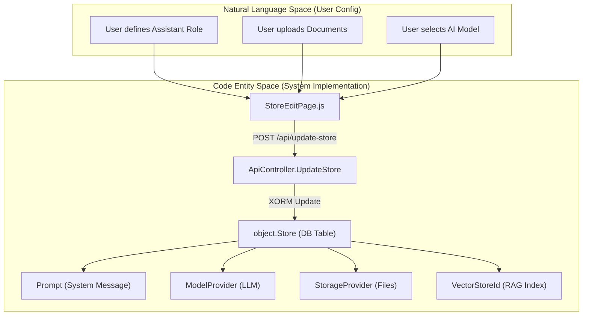
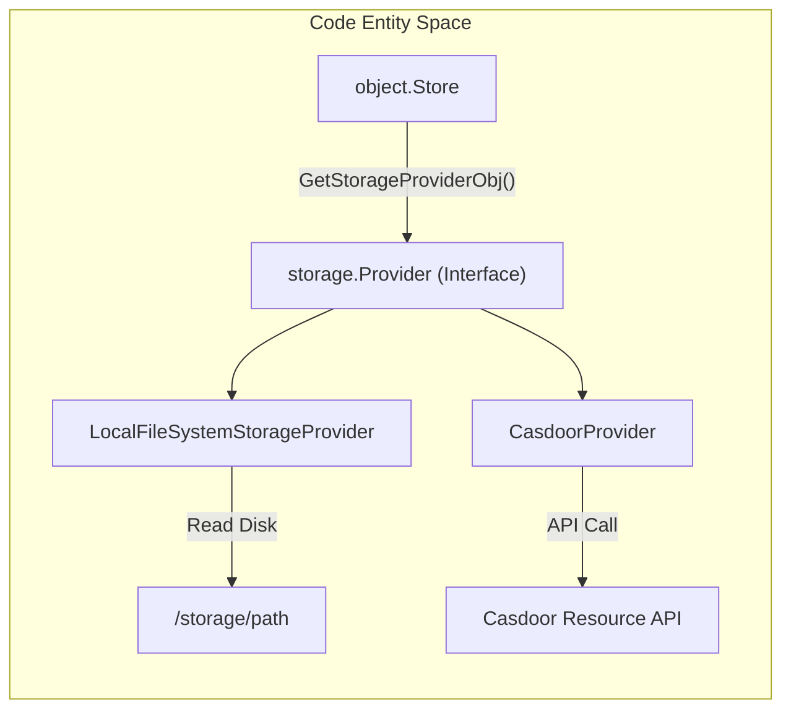

<!-- source: DeepWiki mcp.deepwiki.com · repo the-open-agent/openagent · page 2.3 Store Configuration · fetched 2026-10-26 -->

# Store Configuration

Relevant source files

The following files were used as context for generating this wiki page:

- [controllers/store.go](controllers/store.go)
- [object/site.go](object/site.go)
- [object/site_endpoint.go](object/site_endpoint.go)
- [object/store.go](object/store.go)
- [object/store_provider.go](object/store_provider.go)
- [object/store_test.go](object/store_test.go)
- [routers/endpoint_filter.go](routers/endpoint_filter.go)
- [storage/casdoor.go](storage/casdoor.go)
- [storage/local_file_system.go](storage/local_file_system.go)
- [web/src/SiteEditPage.js](web/src/SiteEditPage.js)
- [web/src/StoreEditPage.js](web/src/StoreEditPage.js)
- [web/src/StoreHubDrawer.js](web/src/StoreHubDrawer.js)
- [web/src/StoreHubPage.js](web/src/StoreHubPage.js)
- [web/src/StoreListPage.js](web/src/StoreListPage.js)
- [web/src/backend/StoreBackend.js](web/src/backend/StoreBackend.js)

The `Store` entity is the central configuration container in OpenAgent. It acts as a logical "Agent" or "Knowledge Base" definition, binding together AI models, knowledge sources (vector stores), interaction tools, and system prompts into a single manageable unit.

## The Store Entity

In the backend, a `Store` is defined in `object/store.go`. It encapsulates the behavior and appearance of the AI assistant for a specific context.

### Key Data Structure
The `Store` struct includes fields for provider bindings, UI customization, and RAG strategies:

| Category | Field | Description |
| :--- | :--- | :--- |
| **Identity** | `Owner`, `Name`, `DisplayName` | Unique identifiers and human-readable name. [object/store.go:59-62]() |
| **Model Providers** | `ModelProvider`, `EmbeddingProvider` | Primary LLM and embedding model used by the store. [object/store.go:69-70]() |
| **Knowledge/RAG** | `StorageProvider`, `VectorStoreId`, `SplitProvider`, `SearchProvider` | Configuration for file storage and vector retrieval logic. [object/store.go:64-77]() |
| **Capabilities** | `Tools`, `McpServer`, `Skills` | List of functional extensions and MCP integrations. [object/store.go:74-76]() |
| **Interaction** | `Prompt`, `Welcome`, `MemoryLimit` | The system prompt, greeting, and conversation history window. [object/store.go:78-86]() |
| **Audio** | `TextToSpeechProvider`, `SpeechToTextProvider` | Voice interaction settings and streaming toggle. [object/store.go:71-73]() |
| **Metadata** | `Author`, `Affiliation`, `Subject` | Used for categorization in the Store Hub. [object/store.go:104-107]() |

**Sources:** [object/store.go:58-123]()

## Provider Bindings and Data Flow

The `Store` acts as a router, directing requests to specific providers. When a store is created via `AddStore`, the system can automatically sync default providers if none are specified using `SyncDefaultProvidersToStore` [object/store_provider.go:136-159]().

### Configuration Flow Diagram
This diagram shows how the `Store` entity in the Go backend relates to the configuration UI in the React frontend.

**Sources:** [web/src/StoreEditPage.js:35-70](), [controllers/store.go:183-248](), [object/store.go:58-78]()

## RAG and File Integration

A `Store` is often associated with a set of files. The `Populate` function in `object/store_provider.go` scans the linked `StorageProvider` (such as `LocalFileSystemStorageProvider` or `CasdoorProvider`) to build a `TreeFile` structure for the UI, which allows users to browse the knowledge base contents [object/store_provider.go:81-134]().

### Storage Provider Abstraction
The `Store` interacts with storage via the `storage.Provider` interface.

**Sources:** [object/store_provider.go:82-87](), [storage/local_file_system.go:28-35](), [storage/casdoor.go:26-36]()

## Ownership and Sharing Model

OpenAgent implements a claim/share model for stores. Stores are typically owned by an `owner` (user or organization) [object/store.go:59]().

1.  **Default Stores**: The system can resolve a default store for an owner via `GetDefaultStore`, which looks for the `IsDefault` flag or the most recent `Active` store [object/store.go:155-182]().
2.  **Store Admins**: Non-global admins can manage stores they own. In `GetGlobalStores`, the system filters results based on whether the user is a `GlobalAdmin` or a `StoreAdmin` [controllers/store.go:78-95]().
3.  **Sharing**: Stores can be shared via the `SharedBy` field, allowing cross-user access to specific agent configurations [object/store.go:102](). The `addSharedStore` API facilitates this [web/src/backend/StoreBackend.js:125-135]().
4.  **Discovery**: The `StoreHubPage` allows users to browse "Published" stores globally [web/src/StoreHubPage.js:47-59]().

**Sources:** [object/store.go:145-182](), [controllers/store.go:49-113](), [web/src/StoreListPage.js:45-51](), [web/src/backend/StoreBackend.js:125-135]()

## MCP and Tool Integration

The `Store` configuration defines which external capabilities are available during a chat session:
*   **MCP Servers**: Linked via the `McpServer` field to provide dynamic tool discovery via the Model Context Protocol [object/store.go:74]().
*   **Tools**: Array of strings (e.g., `web_search`, `shell`) enabled for the agent. Users can select specific tools or "All" [object/store.go:76]().
*   **Skills**: Custom defined prompts or logic chains associated with the store to enhance model behavior in specific domains [object/store.go:75]().

The `StoreEditPage` component fetches these available assets during initialization using dedicated backend services like `ServerBackend` and `ToolBackend` to populate selection menus [web/src/StoreEditPage.js:62-70]().

**Sources:** [web/src/StoreEditPage.js:178-205](), [object/store.go:74-76]()

---

