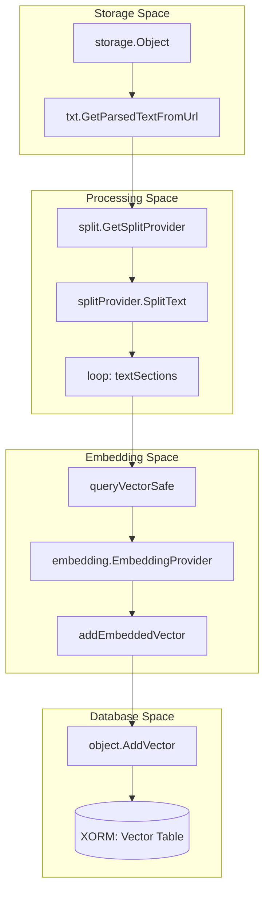
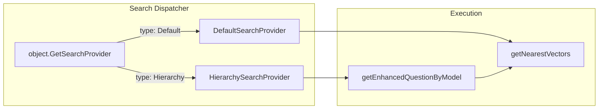

<!-- source: DeepWiki mcp.deepwiki.com · repo the-open-agent/openagent · page 3.2 Embedding & Vector Pipeline · fetched 2026-10-26 -->

# Embedding & Vector Pipeline

Relevant source files

The following files were used as context for generating this wiki page:

- [contest/rag_contest.go](contest/rag_contest.go)
- [contest/rag_contest_test.go](contest/rag_contest_test.go)
- [embedding/alibabacloud.go](embedding/alibabacloud.go)
- [embedding/azure_openai.go](embedding/azure_openai.go)
- [embedding/cohere.go](embedding/cohere.go)
- [embedding/gemini.go](embedding/gemini.go)
- [embedding/huggingface.go](embedding/huggingface.go)
- [embedding/local.go](embedding/local.go)
- [embedding/openai.go](embedding/openai.go)
- [embedding/provider.go](embedding/provider.go)
- [embedding/util.go](embedding/util.go)
- [model/alibabacloud.go](model/alibabacloud.go)
- [model/azure_openai.go](model/azure_openai.go)
- [model/gemini_util.go](model/gemini_util.go)
- [model/silicon_flow.go](model/silicon_flow.go)
- [model/volcengine.go](model/volcengine.go)
- [object/message_ai.go](object/message_ai.go)
- [object/search.go](object/search.go)
- [object/search_default.go](object/search_default.go)
- [object/search_default_util.go](object/search_default_util.go)
- [object/search_hierarchy.go](object/search_hierarchy.go)
- [object/vector.go](object/vector.go)
- [object/vector_embedding.go](object/vector_embedding.go)

The Embedding & Vector Pipeline is responsible for transforming unstructured text data into high-dimensional numerical vectors (embeddings). These vectors are the foundation of the platform's Retrieval-Augmented Generation (RAG) capabilities, enabling semantic search and context retrieval for AI models.

## EmbeddingProvider Interface

All embedding backends implement the `EmbeddingProvider` interface, which abstracts the specific API calls and data formats of different providers.

### Supported Backends
The system supports a wide range of embedding providers via the `GetEmbeddingProvider` factory [embedding/provider.go:34-69]():
*   **OpenAI**: Standard embeddings (e.g., `text-embedding-3-small`) [embedding/openai.go:22-28]().
*   **Gemini**: Google's generative AI embeddings [embedding/provider.go:39-40]().
*   **Cohere**: High-performance multilingual embeddings [embedding/provider.go:43-44]().
*   **Alibaba Cloud**: DashScope embeddings using the `AlibabacloudEmbeddingProvider` [embedding/provider.go:55-56]().
*   **Baidu Cloud**: Support for Wenxin embeddings [embedding/provider.go:45-46]().
*   **Azure**: Enterprise-grade OpenAI deployments [embedding/provider.go:51-52]().
*   **Word2Vec**: Traditional static word embeddings [embedding/provider.go:61-63]().
*   **Local/Ollama**: Support for self-hosted OpenAI-compatible endpoints via `LocalEmbeddingProvider` [embedding/local.go:40-51]().

### Core Interface and Data Structure
The `Vector` struct represents the persisted embedding in the database, containing both the raw text and its numerical representation [object/vector.go:24-42]().

| Field | Type | Description |
| :--- | :--- | :--- |
| `Name` | `string` | Unique identifier for the vector [object/vector.go:26](). |
| `Store` | `string` | The knowledge store this vector belongs to [object/vector.go:30](). |
| `Text` | `string` | The original text segment [object/vector.go:34](). |
| `Data` | `[]float32` | The numerical embedding vector [object/vector.go:40](). |
| `Dimension` | `int` | Length of the vector (e.g., 1536 for OpenAI) [object/vector.go:41](). |
| `TokenCount` | `int` | Number of tokens in the text [object/vector.go:35](). |

Sources: [embedding/provider.go:29-32](), [object/vector.go:24-42](), [object/vector_embedding.go:88-103]()

---

## Vector Embedding Pipeline

The pipeline processes files from a `StorageProvider` and converts them into searchable `Vector` entities through a multi-stage workflow defined in `object/vector_embedding.go`.

### Data Flow Diagram: File to Vector
This diagram shows the transition from a file in storage to a searchable vector in the database, mapping system components to code entities.

Sources: [object/vector_embedding.go:108-172](), [object/vector_embedding.go:53-106](), [object/vector.go:143-155]()

### Implementation Details
1.  **File Filtering**: The system identifies compatible files using `txt.GetSupportedFileTypes()` and filters the object list in `filterTextFiles` [object/vector_embedding.go:36-51]().
2.  **Text Extraction**: `txt.GetParsedTextFromUrl` converts various formats (PDF, DOCX, etc.) into plain text [object/vector_embedding.go:115-118]().
3.  **Splitting**: Based on the file type or configuration, a `split.SplitProvider` (Default, QA, or Markdown) chunks the text [object/vector_embedding.go:120-141]().
4.  **Embedding Generation**: The system calls `queryVectorSafe` with exponential backoff via the `backoff` package to handle rate limits or transient API errors [object/vector_embedding.go:150-161]().
5.  **Persistence**: The resulting vector is stored via `AddVector` with metadata including token count and pricing [object/vector_embedding.go:88-104](). Pricing is calculated per-provider, such as in `LocalEmbeddingProvider.calculatePrice` [embedding/local.go:79-98]().

---

## Search Strategies

When a user queries the knowledge base, the system uses a `SearchProvider` to retrieve the most relevant segments [object/search.go:21-23]().

### 1. Default Search (Flat)
Uses standard cosine similarity to find the top-K nearest neighbors in a flat vector space.
*   **Mechanism**: Retrieves all vectors for the related stores via `getRelatedVectors`, embeds the user query, and calculates the similarity against all candidates [object/search_default.go:32-64]().
*   **Similarity Logic**: It uses `getNearestVectors` to perform the search [object/search_default.go:51-54]().

### 2. Hierarchy Search
A more advanced strategy that uses an LLM to "enhance" the query before searching, particularly effective for structured Markdown documentation [object/search_hierarchy.go:26-34]().
*   **Mechanism**: 
    1. Extracts titles/headers from Markdown files to create a `titleMap` [object/search_hierarchy.go:44-56]().
    2. Calls `getEnhancedQuestionByModel` which uses an LLM (via `GetAnswerWithContext`) to select the most relevant titles based on the user's question [object/search_hierarchy.go:86-99]().
    3. Combines the original query with these titles to create an `enhancedQuestion` [object/search_hierarchy.go:97]().
    4. Performs the final vector search using this enhanced query [object/search_hierarchy.go:63-83]().

### Strategy Selection Logic
The system resolves the provider via `GetSearchProvider` based on the store configuration [object/search.go:25-40]().

Sources: [object/search.go:25-40](), [object/search_hierarchy.go:34-84](), [object/search_default.go:32-64]()

---

## Management and Visualization

The platform provides mechanisms for managing the lifecycle of vectors and ensuring data integrity.

### Data Integrity and Status Tracking
The system tracks the status of the embedding process for each file using `withFileStatus`, updating the state from `FileStatusProcessing` to `FileStatusFinished` or `FileStatusError` [object/vector_embedding.go:174-197](). This allows users to monitor the progress of knowledge base indexing.

### Vector Refresh and Updates
When a `Vector` is updated via `UpdateVector`, the system checks if the `Text` has changed. If it has, `refreshVector` is triggered to re-generate the numerical embedding data [object/vector.go:110-132]().

### Pricing and Token Usage
Each embedding provider includes a `GetPricing` method to return model-specific cost information [embedding/local.go:65-77](). For Alibaba Cloud and Volcengine models, detailed pricing tables are maintained within the model providers [model/alibabacloud.go:53-84](), [model/volcengine.go:58-99](). Token usage is tracked using `model.GetTokenSize` or provider-specific usage fields [embedding/provider.go:71-89](), [embedding/local.go:127-128]().

Sources: [object/vector_embedding.go:174-197](), [object/vector.go:110-141](), [embedding/provider.go:23-27](), [embedding/local.go:79-98]()

---

