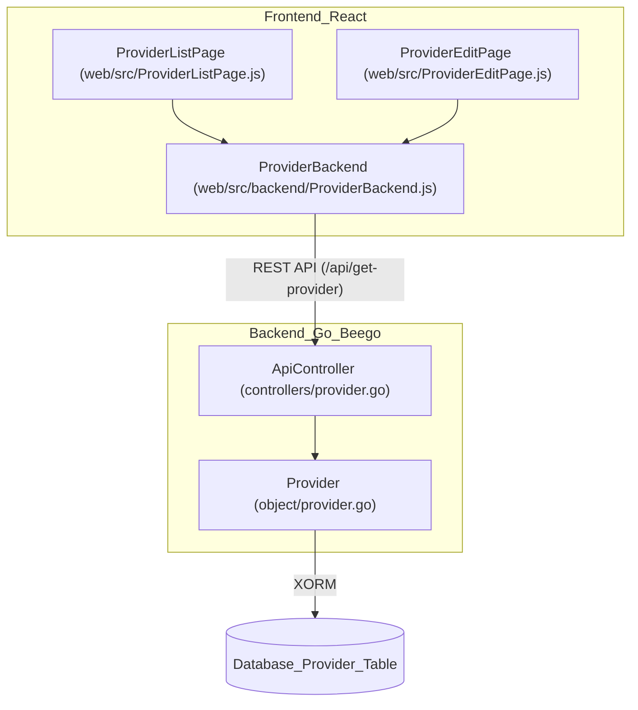
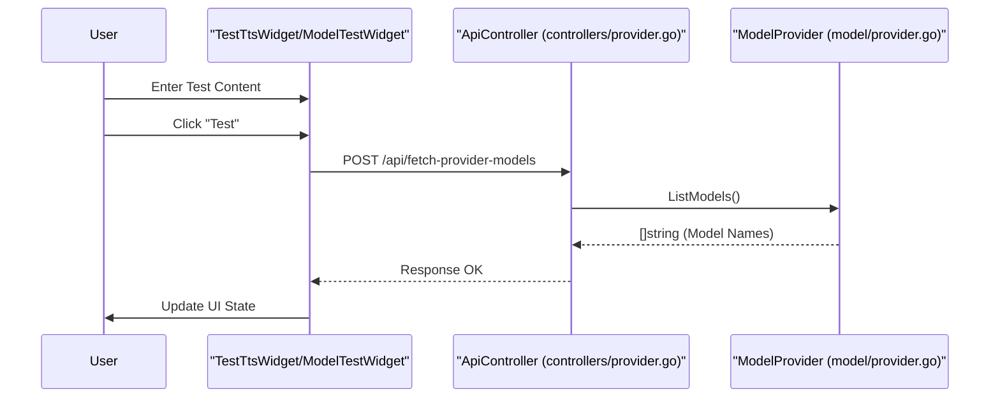

<!-- source: DeepWiki mcp.deepwiki.com · repo the-open-agent/openagent · page 3.3 Provider Management UI · fetched 2026-10-26 -->

# Provider Management UI

Relevant source files

The following files were used as context for generating this wiki page:

- [controllers/provider.go](controllers/provider.go)
- [controllers/vector.go](controllers/vector.go)
- [object/provider.go](object/provider.go)
- [web/src/Provider.js](web/src/Provider.js)
- [web/src/ProviderEditPage.js](web/src/ProviderEditPage.js)
- [web/src/ProviderListPage.js](web/src/ProviderListPage.js)
- [web/src/VectorListPage.js](web/src/VectorListPage.js)
- [web/src/backend/ProviderBackend.js](web/src/backend/ProviderBackend.js)
- [web/src/backend/VectorBackend.js](web/src/backend/VectorBackend.js)
- [web/src/common/ProviderWidget.js](web/src/common/ProviderWidget.js)
- [web/src/common/TestModelWidget.js](web/src/common/TestModelWidget.js)
- [web/src/common/TestTtsWidget.js](web/src/common/TestTtsWidget.js)

The Provider Management UI provides a centralized interface for administrators to configure, manage, and validate various AI and infrastructure service integrations. This includes LLM providers, embedding models, storage backends, and specialized tools like MCP (Model Context Protocol) servers.

## Provider Architecture Overview

The UI is built around the `Provider` entity, which serves as a polymorphic container for configuration data across different categories.

### Data Flow and Management
1.  **Frontend**: `ProviderListPage` and `ProviderEditPage` use `ProviderBackend` to communicate with the Beego API [web/src/backend/ProviderBackend.js:17-81]().
2.  **Backend**: `controllers/provider.go` handles requests, enforcing store isolation via `EnforceStoreIsolation` and performing credential masking before sending data to the client [controllers/provider.go:59-64](), [controllers/provider.go:115]().
3.  **Persistence**: The `object.Provider` struct is mapped to the database via XORM [object/provider.go:33-83]().

### Code Entity Relationship
The following diagram illustrates how the UI components interact with the backend services and the underlying data model.

**Provider UI to Backend Mapping**

Sources: [web/src/ProviderListPage.js:27-131](), [web/src/ProviderEditPage.js:33-61](), [controllers/provider.go:105-116](), [object/provider.go:33-83]()

## ProviderListPage

`ProviderListPage` inherits from `BaseListPage` and provides a tabular view of all configured providers. It supports filtering by category (e.g., Model, Embedding, Storage, Agent, Blockchain) and searching by display name [web/src/ProviderListPage.js:177-193]().

### Key Features
*   **Dynamic Creation**: Supports specialized templates for adding new providers, such as default LLM configurations or local file system storage via `newProvider()` and `newStorageProvider()` [web/src/ProviderListPage.js:32-87]().
*   **Visual Identification**: Uses the `ProviderLogo` component which attempts to resolve icons via `Setting.getProviderLogoURL` and falls back to a CDN-hosted default via `getDefaultLogoURL` if the local resource fails [web/src/Provider.js:32-75]().

Sources: [web/src/ProviderListPage.js:19-220](), [web/src/Provider.js:32-75]()

## ProviderEditPage

`ProviderEditPage` is a dynamic configuration form that adapts its fields based on the provider's `category` and `type`.

### Dynamic Property Generation
The UI uses helper functions to relabel generic fields to match the terminology of the specific service provider [web/src/ProviderEditPage.js:85-159]():

| Category | Type | Field | UI Label Function |
| :--- | :--- | :--- | :--- |
| Model/Embedding | Tencent Cloud | `ClientId` | `getClientIdLabel` -> "Secret ID" [web/src/ProviderEditPage.js:87-88]() |
| Model/Embedding | Baidu Cloud | `ClientId` | `getClientIdLabel` -> "API key" [web/src/ProviderEditPage.js:89-90]() |
| Model/Embedding | Azure | `ClientId` | `getClientIdLabel` -> "Deployment name" [web/src/ProviderEditPage.js:91-92]() |
| Storage | Alibaba Cloud OSS | `ClientId` | `getClientIdLabel` -> "Client ID" [web/src/ProviderEditPage.js:98-99]() |
| Model | Any | `ClientSecret` | `getClientSecretLabel` -> "API key" [web/src/ProviderEditPage.js:151-152]() |

### Credential Masking
To protect sensitive information, the backend masks secrets before sending them to the UI unless the user has specific administrative privileges.
*   **Implementation**: `GetMaskedProvider` in `object/provider.go` replaces `ClientSecret`, `ProviderKey`, `UserKey`, `ConfigText`, and `SignKey` with `***` [object/provider.go:85-114]().
*   **Enforcement**: This logic is applied in the `GetGlobalProviders`, `GetProviders`, and `GetProvider` controllers [controllers/provider.go:41](), [controllers/provider.go:75](), [controllers/provider.go:117]().
*   **Model Fetching**: When fetching models for an existing provider, the backend temporarily restores masked credentials from the database to perform the API handshake [controllers/provider.go:215-225]().

Sources: [object/provider.go:85-114](), [controllers/provider.go:31-225]()

## Live Validation Widgets

The UI includes specialized widgets for real-time testing of provider configurations. These widgets allow administrators to verify connectivity and credentials directly from the `ProviderEditPage`.

### TestModelWidget & EmbedTestWidget
*   **Model Validation**: `ModelTestWidget` renders a `ChatWidget` locked to the current provider, allowing for immediate conversational testing [web/src/common/TestModelWidget.js:21-58]().
*   **Embedding Validation**: `EmbedTestWidget` is used for vectorization providers to ensure text can be successfully converted into numerical vectors [web/src/ProviderEditPage.js:26]().

### TtsTestWidget
The `TtsTestWidget` allows for testing Text-to-Speech providers:
1.  **Test Content**: Uses `provider.testContent` or a default string [web/src/common/TestTtsWidget.js:34-36]().
2.  **Validation**: Before testing, it calls `checkProvider` to ensure any unsaved configuration changes are synchronized to the backend [web/src/common/TestTtsWidget.js:69](), [web/src/common/ProviderWidget.js:19-27]().
3.  **Audio Generation**: Calls `TtsBackend.generateTextToSpeechAudio` to receive an audio blob [web/src/common/TestTtsWidget.js:79]().
4.  **Playback**: Creates a local URL for the blob and plays it via a browser `Audio` object [web/src/common/TestTtsWidget.js:82-101]().

### TestMcpWidget
Used for Model Context Protocol (MCP) servers. It facilitates tool discovery and execution validation [web/src/ProviderEditPage.js:27]().

**Validation Sequence**

Sources: [web/src/common/TestTtsWidget.js:68-108](), [web/src/common/TestModelWidget.js:38-51](), [controllers/provider.go:203-252]()

## Provider Data Model

The `Provider` struct in `object/provider.go` contains fields that serve different purposes depending on the `Category` [object/provider.go:33-83]().

| Field | Description |
| :--- | :--- |
| `Category` | High-level type: Model, Embedding, Storage, Text-to-Speech, etc. [object/provider.go:40]() |
| `Type` | Specific implementation: OpenAI, Azure, Baidu Cloud, etc. [object/provider.go:41]() |
| `Temperature`, `TopP` | Hyperparameters for generative LLM providers [object/provider.go:57-58]() |
| `InputPricePerThousandTokens` | Pricing data used for billing and usage tracking [object/provider.go:63]() |
| `ProviderUrl` | Endpoint for API calls (e.g., OpenAI base URL) [object/provider.go:48]() |
| `IsDefault` | Flag to mark the provider as the default for its category [object/provider.go:79]() |

Sources: [object/provider.go:33-83]()

---

