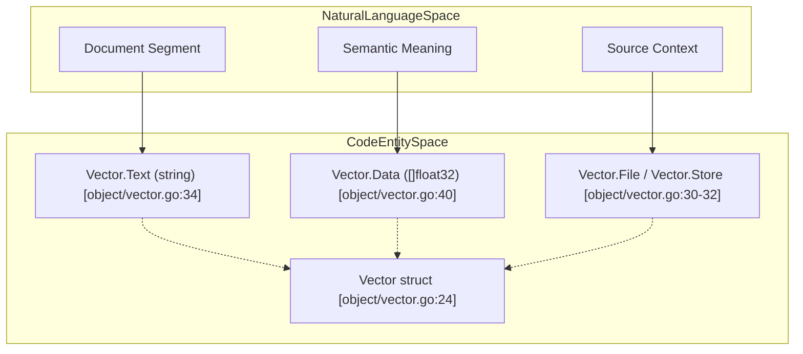
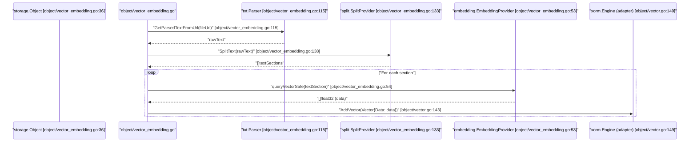

<!-- source: DeepWiki mcp.deepwiki.com · repo the-open-agent/openagent · page 4.3 Vector Store & Search · fetched 2026-10-26 -->

# Vector Store & Search

Relevant source files

The following files were used as context for generating this wiki page:

- [contest/rag_contest.go](contest/rag_contest.go)
- [contest/rag_contest_test.go](contest/rag_contest_test.go)
- [controllers/provider.go](controllers/provider.go)
- [controllers/vector.go](controllers/vector.go)
- [object/search.go](object/search.go)
- [object/search_default.go](object/search_default.go)
- [object/search_default_util.go](object/search_default_util.go)
- [object/search_hierarchy.go](object/search_hierarchy.go)
- [object/vector.go](object/vector.go)
- [object/vector_embedding.go](object/vector_embedding.go)
- [web/src/VectorListPage.js](web/src/VectorListPage.js)
- [web/src/VectorTooltip.js](web/src/VectorTooltip.js)
- [web/src/backend/ProviderBackend.js](web/src/backend/ProviderBackend.js)
- [web/src/backend/VectorBackend.js](web/src/backend/VectorBackend.js)

The **Vector Store** subsystem is responsible for the persistence and retrieval of high-dimensional embeddings derived from document segments. It acts as the "long-term memory" for RAG (Retrieval-Augmented Generation) by bridging raw text data and the mathematical representations required for semantic search.

## 1. Vector Data Model

Vectors are stored as persistent entities in the database via the XORM layer. Each `Vector` object contains the embedding data, the source text, and metadata linking it back to a specific `Store` and `File`.

### Vector Entity Definition
Defined in `object/vector.go`, the `Vector` struct includes:
*   **Data**: A slice of `float32` representing the embedding values [object/vector.go:40]().
*   **Text**: The original raw text segment [object/vector.go:34]().
*   **Metadata**: `Store`, `Provider` (embedding provider), `File` (source file key), and `Index` (segment order) [object/vector.go:30-33]().
*   **Metrics**: `TokenCount`, `Price`, and `Currency` for billing and usage tracking [object/vector.go:35-37]().
*   **Score**: A transient field used during search to hold the similarity score [object/vector.go:38]().

### Diagram: Natural Language to Vector Entity Mapping
This diagram shows how natural language concepts are mapped to specific code structures in the `object` package.

Sources: [object/vector.go:24-42]()

---

## 2. Embedding-to-Vector Pipeline

The pipeline transforms uploaded files into searchable vectors through a multi-stage process involving parsing, splitting, and embedding generation.

### Pipeline Execution Flow
1.  **File Filtering**: The system filters for supported text-based files using `filterTextFiles` [object/vector_embedding.go:36]().
2.  **Text Extraction**: `txt.GetParsedTextFromUrl` extracts raw string content [object/vector_embedding.go:115]().
3.  **Splitting**: Based on file type (e.g., Markdown, QA docx), a `split.SplitProvider` segments the text [object/vector_embedding.go:121-138]().
4.  **Embedding Generation**: For each segment, `addEmbeddedVector` calls the `embedding.EmbeddingProvider` to get the vector data [object/vector_embedding.go:53-54]().
5.  **Persistence**: The resulting `Vector` is saved via `AddVector` [object/vector.go:143]().
6.  **Status Tracking**: The process is wrapped in `withFileStatus`, which updates the file status to `Processing`, `Finished`, or `Error` [object/vector_embedding.go:174-197]().

### Diagram: Vector Ingestion Pipeline
This diagram traces the flow from a file URL to the database using specific function names and entities.

Sources: [object/vector_embedding.go:108-172](), [object/vector.go:143-155]()

---

## 3. Vector CRUD & Administration

OpenAgent provides both backend logic and frontend interfaces for managing vectors, including support for store-level isolation.

### Backend Operations
*   **AddVector**: Inserts a new vector record [object/vector.go:143]().
*   **UpdateVector**: Refreshes the embedding data via `refreshVector` if the text content changes [object/vector.go:110-132]().
*   **DeleteVectorsByStore/File**: Batch deletion when knowledge bases are cleared or files removed [object/vector.go:166-182]().
*   **Pagination**: `GetPaginationVectors` and `GetPaginationVectorsByStoreNames` support filtered administrative views [object/vector.go:202-230]().

### Frontend Management
*   **VectorListPage**: A table view for administrators to browse all vectors. It includes columns for Store, Name, Provider, File, Index, and Text [web/src/VectorListPage.js:134-221]().
*   **VectorTooltip**: A React component that fetches and displays detailed vector metadata and the full text segment when hovering over a search result [web/src/VectorTooltip.js:21-55]().
*   **VectorBackend**: The frontend API client module that handles communication with the `/api/get-vectors` and related endpoints [web/src/backend/VectorBackend.js:17-81]().

Sources: [object/vector.go:102-182](), [web/src/VectorListPage.js:26-113](), [controllers/vector.go:47-120]()

---

## 4. Search Provider Strategies

The system abstracts retrieval logic into the `SearchProvider` interface [object/search.go:21-23](). The strategy is resolved via `GetSearchProvider` [object/search.go:25]().

### Default Search Strategy (`DefaultSearchProvider`)
This provider performs a flat semantic search across all vectors associated with the store.
1.  Retrieves all vectors for the `relatedStores` and `provider` via `getRelatedVectors` [object/search_default.go:33]().
2.  Generates a query vector for the user input using `queryVectorSafe` [object/search_default.go:38]().
3.  Calculates cosine similarity using `getNearestVectors` [object/search_default.go:51]().
4.  Returns the top `knowledgeCount` results with their calculated scores [object/search_default.go:56-60]().

### Hierarchy Search Strategy (`HierarchySearchProvider`)
An advanced strategy that uses an LLM to pre-select relevant document sections (titles) before performing vector search.
1.  **Title Extraction**: Extracts titles from Markdown files (`.md`) to create a candidate list [object/search_hierarchy.go:45-56]().
2.  **LLM Enhancement**: Calls `getEnhancedQuestionByModel`, which asks an LLM to select the most relevant titles based on the user's question [object/search_hierarchy.go:58, 86]().
3.  **Refined Search**: Performs vector search using an "enhanced" question that combines the original query with the LLM-selected context [object/search_hierarchy.go:63, 97]().

### Search Implementation Table

| Feature | Default Search | Hierarchy Search |
| :--- | :--- | :--- |
| **Class** | `DefaultSearchProvider` [object/search_default.go:24]() | `HierarchySearchProvider` [object/search_hierarchy.go:26]() |
| **Logic Site** | `object/search_default.go` | `object/search_hierarchy.go` |
| **Strategy** | Direct similarity check | LLM-assisted context refinement |
| **Use Case** | Standard RAG | Large-scale or structured Markdown knowledge bases |

Sources: [object/search_default.go:24-64](), [object/search_hierarchy.go:26-99](), [object/search.go:15-40]()

---

