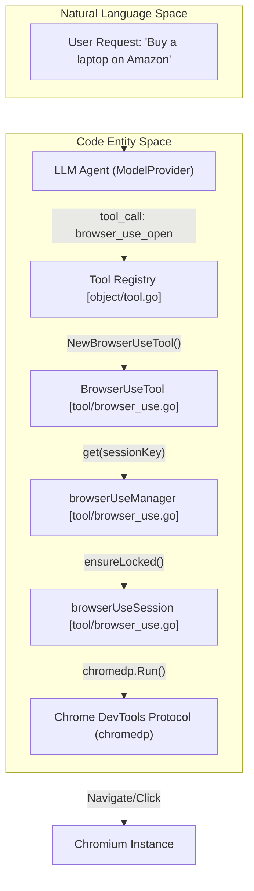
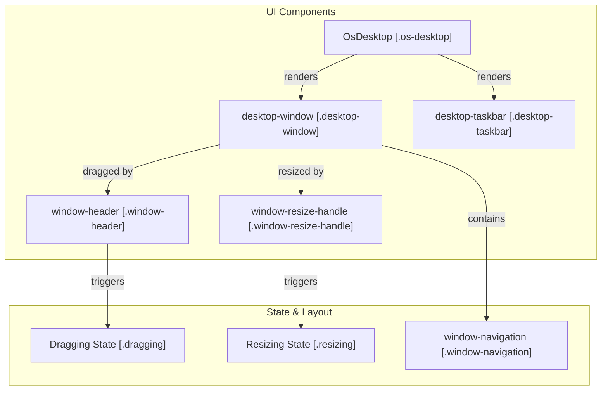

<!-- source: DeepWiki mcp.deepwiki.com · repo the-open-agent/openagent · page 5.3 Browser & Computer-Use Agent · fetched 2026-10-26 -->

# Browser & Computer-Use Agent

Relevant source files

The following files were used as context for generating this wiki page:

- [controllers/chrome_connect.go](controllers/chrome_connect.go)
- [routers/cors_filter.go](routers/cors_filter.go)
- [tool/browser_use.go](tool/browser_use.go)
- [tool/browser_use_chrome_ext.go](tool/browser_use_chrome_ext.go)
- [web/src/OsDesktop.css](web/src/OsDesktop.css)

The Browser & Computer-Use Agent subsystem provides OpenAgent with the capability to interact with web environments and remote desktops. This is achieved through a combination of the `browser_use` tool for automated web navigation, a Chrome extension for direct browser integration, and a windowed OS-style desktop UI.

## Browser Use Tool

The `BrowserUseTool` is a built-in tool (Type: `browser_use`) that enables the agent to control a visible, persistent Chromium instance [tool/browser_use.go:49-51](). It supports multiple execution modes, including using the local system's Chrome or a dedicated "Chrome for Testing" binary [tool/browser_use.go:194-208]().

### Session Management
Browser sessions are managed by a `browserUseManager` which maintains a map of active `browserUseSession` objects indexed by a session key [tool/browser_use.go:91-108](). This allows for persistent state (cookies, local storage) across tool calls by utilizing a dedicated user data directory [tool/browser_use.go:63-70]().

### Built-in Actions
The tool exposes several discrete actions to the LLM via `BuiltinTool` implementations [tool/browser_use.go:73-89]():
*   **Open**: Launches the browser and navigates to a URL (`browserUseOpenBuiltin`).
*   **Snapshot**: Captures the current page state, visible text, and DOM elements (`browserUseSnapshotBuiltin`).
*   **Click/Type/Press**: Simulates human interactions with specific coordinates or elements.
*   **Tab Management**: Handles multiple tabs via `browserUseTabsBuiltin` and `browserUseSwitchTabBuiltin`.

### Data Flow: Browser Interaction
The following diagram illustrates how a natural language request is translated into browser actions via the `BrowserUseTool`.

**Diagram: Browser Action Execution Flow**

Sources: [tool/browser_use.go:112-128](), [tool/browser_use.go:142-154](), [tool/browser_use.go:174-185](), [object/tool.go:233-241]()

## OS Desktop UI & Window Management

The `OsDesktop` component provides a web-based desktop environment within OpenAgent. It simulates a multi-window operating system interface where different OpenAgent features (Chat, Usages, Providers) are treated as "Apps" [web/src/OsDesktop.css:1-8]().

### Window Management
OpenAgent implements a windowing system with the following characteristics:
*   **Taskbar**: A `desktop-taskbar` that tracks active applications and allows switching between them [web/src/OsDesktop.css:10-18]().
*   **Window Controls**: The `desktop-window` supports resizing via handles (top, bottom, left, right, and corners) and dragging via the `window-header` [web/src/OsDesktop.css:171-260]().
*   **Visual Feedback**: Icons use CSS gradients and shadows to simulate a modern OS feel, with `:hover` and `.clicked` states for interactivity [web/src/OsDesktop.css:81-123]().
*   **Dynamic Rendering**: Windows load content dynamically based on the application route, identified by the `.window-app-info` and `.window-title` classes [web/src/OsDesktop.css:284-305]().

**Diagram: Desktop Window Management**

Sources: [web/src/OsDesktop.css:1-8](), [web/src/OsDesktop.css:171-195](), [web/src/OsDesktop.css:261-274](), [web/src/OsDesktop.css:307-311]()

## Chrome Extension Integration

The Chrome extension integration allows OpenAgent to control a user's existing browser instance via a WebSocket bridge.

*   **WebSocket Bridge**: The `browserUseChromeExtBridge` manages the connection between the OpenAgent backend and the browser extension [tool/browser_use_chrome_ext.go:42-50]().
*   **CORS Exemption**: The `/api/chrome-connect` endpoint is specifically exempted from standard Casdoor CORS filters to allow `chrome-extension://` origins [routers/cors_filter.go:57-59]().
*   **Security**: The bridge only accepts localhost connections and validates an optional `OPENAGENT_CHROME_EXTENSION_TOKEN` [tool/browser_use_chrome_ext.go:124-133]().
*   **Controller Integration**: The `ChromeConnect` method in `ApiController` upgrades the connection to the WebSocket bridge [controllers/chrome_connect.go:21-24]().

### Extension Communication Protocol
The bridge uses a structured JSON message format to communicate with the extension [tool/browser_use_chrome_ext.go:52-62]().
*   **Type**: Message category (e.g., `hello`, `ping`, `result`, `error`).
*   **ID**: Sequence identifier for correlating requests and responses.
*   **Command**: The specific browser action to perform (e.g., `snapshot`, `click`).

## Key Functions and Classes

| Entity | Location | Role |
| :--- | :--- | :--- |
| `BrowserUseTool` | `tool/browser_use.go` | Main implementation of the Chromium automation tool using `chromedp`. |
| `browserUseChromeExtBridge` | `tool/browser_use_chrome_ext.go` | Manages WebSocket communication with the Chrome Extension. |
| `HandleChromeConnectWebSocket` | `tool/browser_use_chrome_ext.go` | Upgrades HTTP to WebSocket and validates extension origins. |
| `ChromeConnect` | `controllers/chrome_connect.go` | API endpoint for extension bridge initialization. |
| `CorsFilter` | `routers/cors_filter.go` | Handles CORS logic, specifically exempting the extension bridge path. |
| `.desktop-window` | `web/src/OsDesktop.css` | CSS definition for the draggable/resizable UI windows. |

Sources: [tool/browser_use.go:49-51](), [tool/browser_use_chrome_ext.go:42-50](), [tool/browser_use_chrome_ext.go:119-121](), [controllers/chrome_connect.go:21-24](), [routers/cors_filter.go:50-59](), [web/src/OsDesktop.css:171-185]()

---

