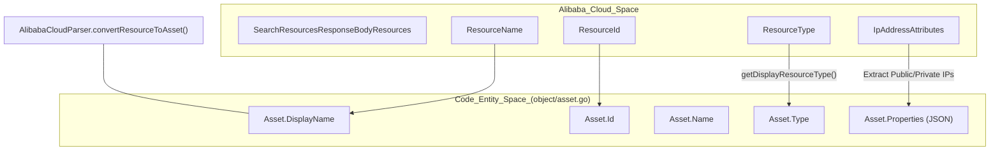
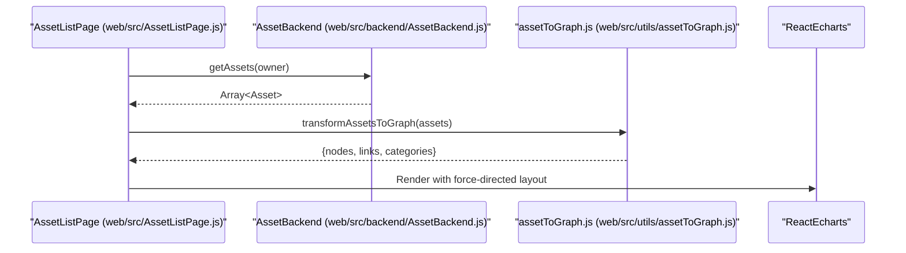
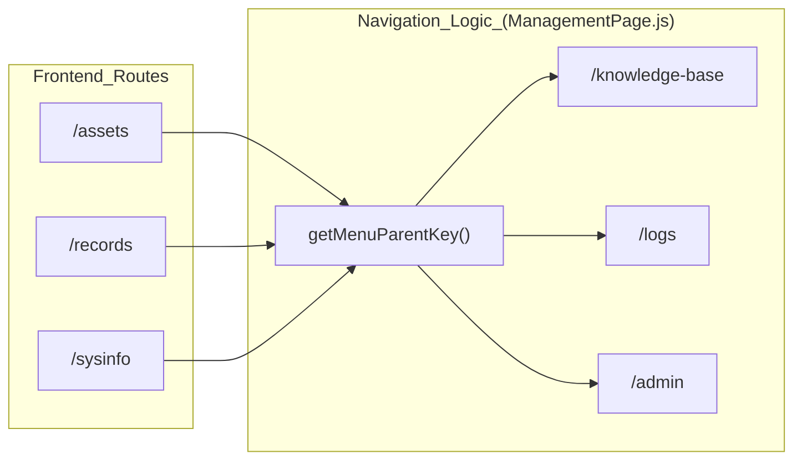

<!-- source: DeepWiki mcp.deepwiki.com · repo the-open-agent/openagent · page 6.2 Asset & Cloud Inventory · fetched 2026-10-26 -->

# Asset & Cloud Inventory

Relevant source files

The following files were used as context for generating this wiki page:

- [object/adapter.go](object/adapter.go)
- [routers/router.go](routers/router.go)
- [web/src/App.js](web/src/App.js)
- [web/src/ManagementPage.js](web/src/ManagementPage.js)
- [web/src/component/nav-item-tree/NavItemTree.js](web/src/component/nav-item-tree/NavItemTree.js)

The Asset subsystem in OpenAgent provides a centralized inventory for multi-cloud resources and local infrastructure. It supports automated discovery of cloud assets (specifically Alibaba Cloud), visualizes infrastructure relationships through graph views, and serves as the target repository for security scanning operations.

## Asset Data Model

The `Asset` entity represents a discrete piece of infrastructure, such as a Virtual Machine, VPC, or Disk. It contains metadata for identification, location, and authentication.

| Field | Type | Description |
| :--- | :--- | :--- |
| `Owner` | `string` | The organization/owner of the asset. |
| `Name` | `string` | Unique identifier within the owner scope. |
| `Type` | `string` | Resource type (e.g., "Virtual Machine", "VPC", "Disk"). |
| `Provider` | `string` | The cloud provider name associated with this asset. |
| `Id` | `string` | The native cloud provider ID (e.g., InstanceId). |
| `Region`/`Zone` | `string` | Geographic location metadata. |
| `Properties` | `string` | A JSON string containing provider-specific metadata. |

## Cloud Provider Parsing (Alibaba Cloud)

OpenAgent utilizes a `CloudParser` interface to synchronize assets from external providers. Currently, `AlibabaCloudParser` is the primary implementation.

### Scan & Sync Flow
1. **Trigger**: The frontend calls `AssetBackend.scanAssets`.
2. **Controller**: `ApiController.ScanAssets` receives the request [routers/router.go:121-125]().
3. **Purge**: Existing assets for that provider are deleted before the new scan.
4. **Discovery**: The `AlibabaCloudParser` uses the `resourcecenter` API to find all resources.
5. **Enrichment**: The parser makes secondary calls to the ECS API to fetch specific details for "Virtual Machine", "Disk", and "VPC" types.

### Asset Conversion Diagram

This diagram shows how native Alibaba Cloud resource attributes are mapped to the OpenAgent `Asset` entity.

**Sources:** [routers/router.go:72-78](), [routers/router.go:121-125]()

## Asset List & Visualization

The `AssetListPage` provides two primary views: a standard table and a relationship graph. Access to these views is controlled by the user's role and account type, which is determined via backend authentication filters and frontend session management [web/src/App.js:171-184]().

### Graph Visualization
The system transforms flat asset lists into a relational graph using `transformAssetsToGraph`. It establishes links based on shared properties:
* **VM to Network Interface**: Linked via matching IP addresses.
* **Disk to VM**: Linked via `instanceId` stored in the disk's properties.
* **Subnet to VPC**: Linked via `region` and `zone` matching.

### Graph Rendering Logic
The `GraphDataPage` component handles the rendering of these relationships using ECharts. It supports different categories of graphs, including "Assets" and "Chats".

**Sources:** [web/src/ManagementPage.js:82-83](), [web/src/App.js:107-156]()

## Assets and Scan Targets

Assets serve as the source of truth for security scans. The relationship is managed through target resolution logic in the backend.

### Scan Target Resolution
When a scan is initiated against an asset, the system must resolve a network-accessible target (IP or hostname):
1. For `Virtual Machine` types, the system attempts to parse the `publicIp` from the `Properties` JSON.
2. If no public IP is found, or for other asset types, it defaults to the `Asset.Id`.

### Scan Detail Popover
The `ScanDetailPopover` component is used throughout the Asset UI to provide a quick view of security scan results associated with a specific asset. It uses a renderer to display formatted output from tools like Nmap or Nuclei.

**Sources:** [web/src/ManagementPage.js:82-95](), [web/src/App.js:125-138](), [web/src/component/nav-item-tree/NavItemTree.js:23-97]()

## Navigation & UI Integration

Assets are integrated into the main management interface via the `ManagementPage` [web/src/ManagementPage.js:145-202](). The navigation menu identifies Asset-related routes and groups them under relevant parent keys [web/src/ManagementPage.js:108-118]().

### Sidebar Mapping
The sidebar menu structure is defined in `NavItemTree.js`, which maps internal paths to localized display names [web/src/component/nav-item-tree/NavItemTree.js:18-112]().

| Path | Menu Group | Role Required |
| :--- | :--- | :--- |
| `/assets` | Knowledge Base | Admin/User |
| `/records` | Auditing Logs | Admin [web/src/ManagementPage.js:114-114]() |
| `/sysinfo` | Admin | Global Admin [web/src/ManagementPage.js:116-116]() |

**Sources:** [web/src/ManagementPage.js:108-118](), [web/src/component/nav-item-tree/NavItemTree.js:23-97](), [web/src/App.js:107-156]()

## Key Implementation Files

| File | Role |
| :--- | :--- |
| `web/src/App.js` | Application initialization and menu key state management [web/src/App.js:34-156]() |
| `web/src/ManagementPage.js` | Main management layout and route handling [web/src/ManagementPage.js:145-202]() |
| `web/src/component/nav-item-tree/NavItemTree.js` | Definition of the navigation hierarchy [web/src/component/nav-item-tree/NavItemTree.js:18-112]() |
| `routers/router.go` | Backend API route definitions for Assets and Providers [routers/router.go:72-98]() |
| `object/adapter.go` | Database persistence layer for Assets using XORM [object/adapter.go:194-226]() |

**Sources:** [web/src/App.js:1](), [web/src/ManagementPage.js:1](), [web/src/component/nav-item-tree/NavItemTree.js:1](), [routers/router.go:1](), [object/adapter.go:1]()

---

