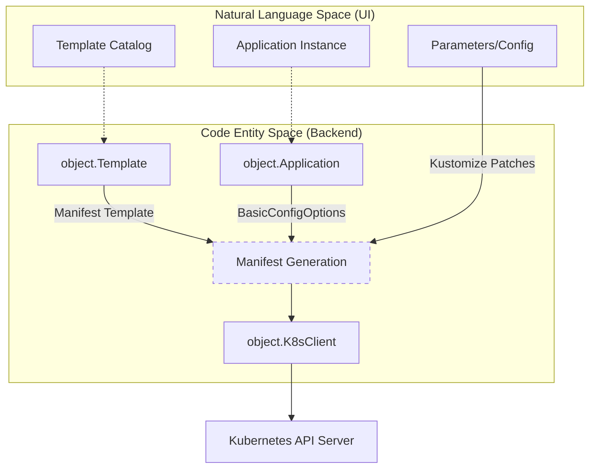
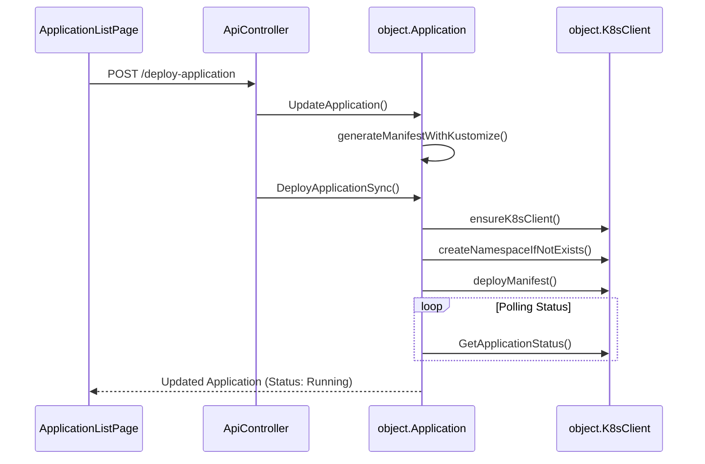
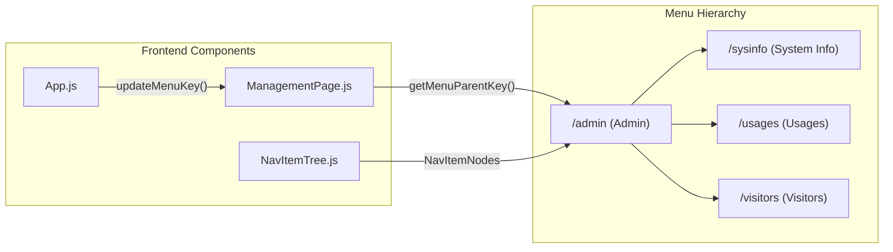

<!-- source: DeepWiki mcp.deepwiki.com · repo the-open-agent/openagent · page 7.2 Kubernetes Application Deployment · fetched 2026-10-26 -->

# Kubernetes Application Deployment

Relevant source files

The following files were used as context for generating this wiki page:

- [object/adapter.go](object/adapter.go)
- [routers/router.go](routers/router.go)
- [web/src/App.js](web/src/App.js)
- [web/src/ManagementPage.js](web/src/ManagementPage.js)
- [web/src/component/nav-item-tree/NavItemTree.js](web/src/component/nav-item-tree/NavItemTree.js)

OpenAgent provides a robust system for managing containerized applications on Kubernetes. This system is built around two primary entities: **Templates**, which define the blueprint for a deployment, and **Applications**, which represent specific instances of those templates deployed into a cluster.

## System Overview

The deployment architecture bridges the gap between high-level application definitions and low-level Kubernetes manifests. It supports dynamic manifest generation using Go templates and Kustomize overlays, allowing users to customize deployments without manually editing YAML for every instance.

### Core Entities

| Entity | Description | Code Reference |
| :--- | :--- | :--- |
| `Template` | A catalog item containing a base Kubernetes manifest and configuration options. | [object/template.go:25-40]() |
| `Application` | A specific deployment instance linked to a template, containing parameters and status. | [object/application.go:26-44]() |
| `ApplicationView` | A transient object providing real-time K8s status, metrics, and connection details. | [object/application_view.go:36-45]() |

### Data Flow: From Template to Pods

The following diagram illustrates the relationship between the Natural Language configuration in the UI and the underlying Code Entities during the deployment lifecycle.

**Deployment Entity Mapping**

Sources: [object/application.go:112-132](), [object/template.go:146-163](), [object/application_k8s.go:140-167]()

---

## Template Catalog and Manifest Generation

Templates serve as the source of truth for deployments. A template can define `BasicConfigOptions` [object/template.go:39](), which are rendered into the base manifest using Go's `text/template` engine.

### Manifest Pipeline
1.  **Base Rendering**: If `EnableBasicConfig` is true, the system calls `generateManifestWithBasicConfig` [object/application.go:186](). This executes the template's `Manifest` string against the `BasicConfigOptions` provided by the application.
2.  **Kustomize Overlay**: The resulting manifest is then passed through `generateManifestWithKustomize` [object/application_k8s.go:65](). This function uses the `krusty` library [object/application_k8s.go:125]() to apply the application's `Parameters` (formatted as a Kustomize patch) to the base resources.
3.  **Final YAML**: The output is a complete, multi-resource Kubernetes YAML manifest stored in `Application.Manifest` [object/application.go:36]().

Sources: [object/application.go:117-132](), [object/application_k8s.go:65-138]()

---

## Deployment Pipeline (object/application_k8s.go)

The deployment logic is handled by the `object` package, specifically focusing on interactions with the Kubernetes cluster via `client-go`.

### Key Functions
*   `DeployApplication`: Initializes the K8s client, creates a dedicated namespace (format: `openagent-{name}`), and applies the manifest [object/application_k8s.go:140-167]().
*   `DeployApplicationSync`: A wrapper that calls `DeployApplication` and then enters a polling loop to wait for the deployment to reach "Ready" status or timeout after 60 seconds [object/application_k8s.go:197-230]().
*   `UndeployApplication`: Removes the application by deleting its entire Kubernetes namespace [object/application_k8s.go:169-195]().

**Deployment Sequence Diagram**

Sources: [routers/router.go:36-41](), [object/application_k8s.go:140-167](), [object/application_k8s.go:197-230]()

---

## Observability and Monitoring

The `ApplicationView` provides a detailed look at the running state of a Kubernetes application. It aggregates data from multiple Kubernetes resources into a single view.

### Cache Manager (`object/cache_manager.go`)
To avoid overwhelming the Kubernetes API, OpenAgent uses a `CacheManager` based on `SharedInformerFactory` [object/cache_manager.go:84](). It maintains local caches for:
*   **Services & Ingresses**: For networking and URL discovery.
*   **Deployments**: For replica counts and container status.
*   **Events**: For troubleshooting (Normal/Warning events).
*   **Nodes**: For external IP resolution.

### Metrics Integration
The system retrieves resource usage (CPU/Memory) via the `metrics.k8s.io` API. `getNamespaceMetrics` [object/application_view.go:132]() calculates aggregate usage across all pods in the application's namespace.

| Component | Code Entity | Purpose |
| :--- | :--- | :--- |
| Event List | `EventTable` | Displays K8s events like `Pulled`, `Started`, or `Failed`. |
| Deployment List | `DeploymentTable` | Shows replica status (Ready/Total). |
| Resource Usage | `ResourceMetrics` | Displays CPU/Memory progress bars in the UI. |

Sources: [object/application_view.go:36-54]()

---

## User Interface Components

### ApplicationListPage
The primary dashboard for managing deployments. It provides actions for `deploy` and `undeploy`. Navigation is handled via the `/admin` menu section in `ManagementPage` [web/src/ManagementPage.js:116]().

### ApplicationEditPage
Allows users to configure application details. If the selected template has `enableBasicConfig` set to true, it renders a table where users fill in parameters defined by the template.

### TemplateEditPage
Used by administrators to create blueprints. Key fields include:
*   **Manifest**: The base YAML with placeholders.
*   **Basic Config Options**: A JSON-defined table of parameters (type: string, number, boolean, or option) that the application creator must provide [object/template.go:42-49]().

### Navigation Integration
The application management interface is integrated into the `ManagementPage` sidebar under the "Admin" section [web/src/ManagementPage.js:116](). The `App.js` router handles path updates to ensure the correct menu item is highlighted. Specifically, the system info and admin-related paths are grouped under the `/admin` parent key [web/src/ManagementPage.js:116]().

**UI Navigation Mapping**

Sources: [web/src/App.js:107-158](), [web/src/ManagementPage.js:108-118](), [web/src/component/nav-item-tree/NavItemTree.js:87-97]()

---

