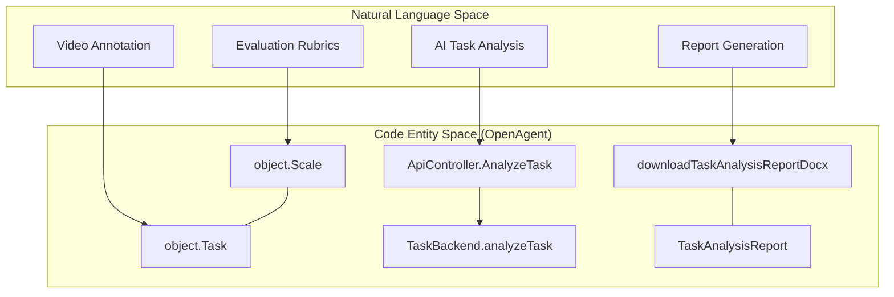
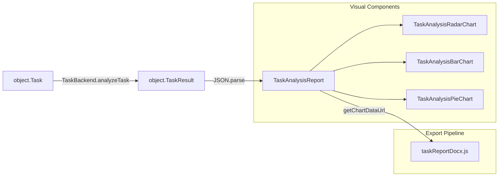

<!-- source: DeepWiki mcp.deepwiki.com · repo the-open-agent/openagent · page 8 Video & Multimedia · fetched 2026-10-26 -->

# Video & Multimedia

Relevant source files

The following files were used as context for generating this wiki page:

- [controllers/scale.go](controllers/scale.go)
- [controllers/task.go](controllers/task.go)
- [object/task.go](object/task.go)
- [web/src/TaskAnalysisBarChart.js](web/src/TaskAnalysisBarChart.js)
- [web/src/TaskAnalysisPieChart.js](web/src/TaskAnalysisPieChart.js)
- [web/src/TaskAnalysisRadarChart.js](web/src/TaskAnalysisRadarChart.js)
- [web/src/TaskAnalysisReport.js](web/src/TaskAnalysisReport.js)
- [web/src/TaskEditPage.js](web/src/TaskEditPage.js)
- [web/src/TaskListPage.js](web/src/TaskListPage.js)
- [web/src/backend/TaskBackend.js](web/src/backend/TaskBackend.js)
- [web/src/taskAnalysisScoreBands.js](web/src/taskAnalysisScoreBands.js)
- [web/src/taskReportDocx.js](web/src/taskReportDocx.js)
- [web/src/taskResultFormat.js](web/src/taskResultFormat.js)

OpenAgent provides a comprehensive subsystem for managing, annotating, and analyzing multimedia content, specifically focusing on video and structured task evaluation. This system integrates cloud-based Video on Demand (VOD) services with local AI-driven analysis to facilitate a structured workflow for video review, educational assessment, and automated reporting.

The subsystem is primarily built around the `Video` and `Task` [object/task.go:53-79]() entities, which track metadata, cloud storage identifiers, time-stamped annotations, and AI-generated scoring results.

### Video Management Architecture

The architecture bridges frontend React components with a backend powered by the Beego framework and external storage/analysis providers.

#### System Entity Mapping
The following diagram illustrates how high-level multimedia concepts map to specific code entities and services within the OpenAgent ecosystem.

"Video & Task Management System Mapping"

**Sources:** [object/task.go:53-79](), [controllers/task.go:256-270](), [web/src/TaskEditPage.js:130-141](), [web/src/TaskAnalysisReport.js:54-102](), [web/src/taskReportDocx.js:127-140]()

### Video Lifecycle & Annotation
The lifecycle begins with the upload of video files and associated documents. While videos are managed via the VOD pipeline, the `Task` entity allows for the association of documents through `DocumentUrl` [object/task.go:77]() and extracted text in `DocumentText` [object/task.go:78](). The `TaskEditPage` handles document uploads via `uploadTaskDocument` [web/src/backend/TaskBackend.js:83-96]().

Once multimedia data is ingested, users can:
*   **Labeling:** Create time-synced entries and tags to categorize video segments. The system supports different task modes like `Labeling` or `PBL` [web/src/TaskListPage.js:126-127]().
*   **Multi-stage Review:** Transition content through review states, with ownership and permissions enforced by the backend [controllers/task.go:108-130]().
*   **Scale Binding:** Associate specific evaluation rubrics (`Scale`) to a task to guide the AI analysis [object/task.go:69](). The `GetTaskEffectiveScale` function retrieves the actual rubric text for the AI prompt [object/task.go:155-170]().

For details, see [Video Lifecycle & Annotation](#8.1).

**Sources:** [object/task.go:68-79](), [controllers/task.go:108-133](), [web/src/TaskListPage.js:116-133](), [web/src/backend/TaskBackend.js:83-96]()

### Task Analysis & Reporting
OpenAgent leverages AI to perform structured analysis on video and document content. This is primarily handled via the `AnalyzeTask` endpoint [controllers/task.go:256](), which processes the `Task` data and generates a `TaskResult` [object/task.go:38-51]().

#### Data Flow: From Analysis to Visualization
The system converts raw task data and AI logs into structured insights and visual reports.

"Task Analysis Data Flow"

**Sources:** [web/src/TaskEditPage.js:73-89](), [web/src/TaskAnalysisReport.js:151-181](), [web/src/TaskAnalysisRadarChart.js:106-119](), [web/src/backend/TaskBackend.js:98-106]()

Key features of the analysis subsystem include:
*   **AI Analysis:** Utilizing LLM providers [web/src/TaskEditPage.js:184-195]() to interpret labels and documents, generating a `TaskResult` containing categories, scores, advantages, and suggestions [object/task.go:24-36]().
*   **Visualizations:** Rendering complex charts using ECharts:
    *   **Radar Charts:** Compare performance across multiple dimensions [web/src/TaskAnalysisRadarChart.js:179-211]().
    *   **Bar/Pie Charts:** Visualize score distributions and item counts [web/src/TaskAnalysisBarChart.js:76-90](), [web/src/TaskAnalysisPieChart.js:43-53]().
*   **Score Banding:** Scores are automatically categorized into color-coded bands (e.g., success, warning, error) for quick visual assessment [web/src/taskAnalysisScoreBands.js:16-29]().
*   **Document Generation:** The `taskReportDocx` module captures chart images as PNGs using `getDataURL` [web/src/TaskAnalysisReport.js:145-149]() and embeds them into a structured Word document for export [web/src/taskReportDocx.js:162-190]().

For details, see [Task Analysis & Reporting](#8.2).

**Sources:** [object/task.go:24-51](), [web/src/TaskEditPage.js:118-156](), [web/src/TaskAnalysisReport.js:151-181](), [web/src/taskReportDocx.js:15-24](), [web/src/taskAnalysisScoreBands.js:16-69]()

---

