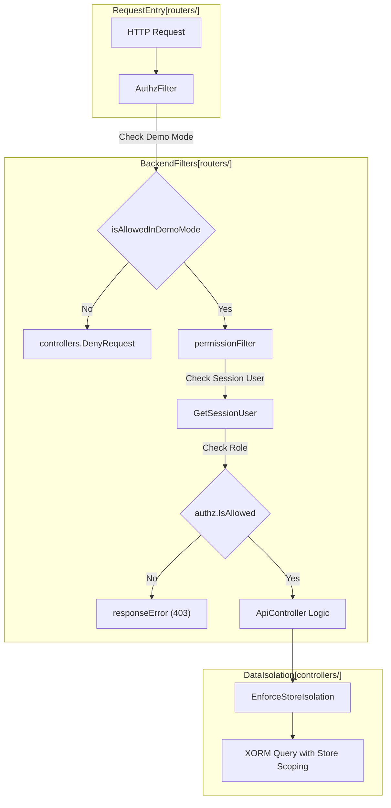
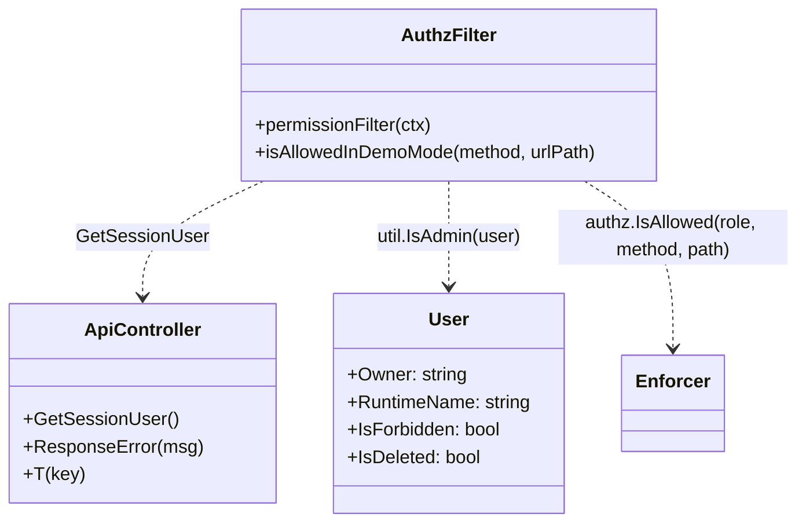

<!-- source: DeepWiki mcp.deepwiki.com · repo the-open-agent/openagent · page 9 Authentication, Permissions & Multi-tenancy · fetched 2026-10-26 -->

# Authentication, Permissions & Multi-tenancy

Relevant source files

The following files were used as context for generating this wiki page:

- [authz/authz.go](authz/authz.go)
- [controllers/casdoor_user.go](controllers/casdoor_user.go)
- [controllers/message_answer_job.go](controllers/message_answer_job.go)
- [controllers/permission.go](controllers/permission.go)
- [controllers/signin.go](controllers/signin.go)
- [controllers/storage_provider.go](controllers/storage_provider.go)
- [object/store_share.go](object/store_share.go)
- [object/user.go](object/user.go)
- [routers/authz_filter.go](routers/authz_filter.go)
- [web/src/StoreShareModal.js](web/src/StoreShareModal.js)
- [web/src/backend/AccountBackend.js](web/src/backend/AccountBackend.js)
- [web/src/backend/OrganizationUserBackend.js](web/src/backend/OrganizationUserBackend.js)

OpenAgent implements a robust security model centered around **Casdoor SSO** for authentication and a tiered **Role-Based Access Control (RBAC)** system. The architecture ensures multi-tenant safety through **Store Isolation**, where users and administrators are restricted to data associated with their specific AI configurations (Stores).

## Security Architecture Overview

The security model is enforced through a multi-layered pipeline in the Beego backend and supported by permission helpers in the React frontend.

### Request Authorization Flow
The following diagram illustrates how a request is processed from the frontend through the security filters to the final controller logic.

**Security Filter Pipeline**

**Sources:** [routers/authz_filter.go:27-37](), [routers/authz_filter.go:51-81](), [authz/authz.go:120-126]()

---

## Authentication & Session Management

OpenAgent relies on [Casdoor](https://casdoor.org) for identity management but also provides a built-in authentication system when Casdoor is unavailable.

### Key Components:
*   **Casdoor SSO**: The system integrates with Casdoor to handle sign-in and account management. The frontend uses `AccountBackend.js` to trigger these flows [web/src/backend/AccountBackend.js:50-58]().
*   **Built-in Auth**: If `casdoorEndpoint` is empty, OpenAgent enables internal sign-in [object/user.go:50-52](). It uses an `object.User` model with `bcrypt` for password hashing [object/user.go:195-200]().
*   **Session Management**: Successful authentication sets session claims, including the user object and sign-in method [controllers/signin.go:184-195](). Sessions can also be tracked in the `object.Session` table [controllers/signin.go:200-208]().
*   **Initial Setup**: Upon sign-in, the system can automatically provision initial chats and messages for the user [controllers/signin.go:190-193]().

For details on SSO integration and session lifecycle, see **[Authentication & Session Management](#9.1)**.

**Sources:** [controllers/signin.go:151-211](), [object/user.go:208-223](), [web/src/backend/AccountBackend.js:60-70]()

---

## Authorization & RBAC

The system utilizes a tiered RBAC model managed via Casbin to distinguish between platform-wide administrators and end-users.

### Role Hierarchy & Casbin
The `authz` package defines a role hierarchy where `admin` inherits from `user`, and `user` inherits from `anonymous` [authz/authz.go:101-102](). This is enforced using a Casbin enforcer initialized with a model and policy text [authz/authz.go:105-118]().

| Role | Code Identifier | Capabilities |
| :--- | :--- | :--- |
| **Admin** | `admin` | Full access to all API endpoints (`*`, `*`, `*`) [authz/authz.go:48-48](). |
| **User** | `user` | Inherits anonymous paths and has access to user-level features [authz/authz.go:102-102](). |
| **Anonymous** | `anonymous` | Limited access to public endpoints like `/api/signin`, `/api/get-store`, and `/api/health` [authz/authz.go:50-99](). |

### Store Isolation & Sharing
Multi-tenancy is primarily enforced through store ownership. Users can only access resources belonging to their "Owner" (organization or username). The system supports **Store Sharing**, which duplicates a store record for a target user while maintaining a `SharedBy` reference to the original owner [object/store_share.go:59-117](). The `StoreShareModal` component provides the UI for selecting users within the same organization to share stores with [web/src/StoreShareModal.js:65-88]().

For details on role definitions and path exemptions, see **[Authorization & Role-Based Access Control](#9.2)**.

**Sources:** [authz/authz.go:47-103](), [object/store_share.go:115-118](), [web/src/StoreShareModal.js:29-51]()

---

## Authorization Filter Pipeline

The `AuthzFilter` acts as a gatekeeper for all `/api/` routes. It identifies the user's role and validates the request against the Casbin policy.

**Authorization Logic Mapping**

### Key Security Entities:
*   **`routers.AuthzFilter`**: The primary middleware checking if a path is public or requires a specific role. It specifically exempts the OpenAI-compatible `/api/chat/completions` endpoint which uses Bearer tokens [routers/authz_filter.go:51-64]().
*   **`authz.Enforcer`**: A Casbin enforcer that evaluates the `(sub, method, urlPath)` tuple [authz/authz.go:23-40]().
*   **`object.User`**: Defines user state including `IsForbidden` and `IsDeleted` flags which are checked during password verification [object/user.go:214-217]().

**Sources:** [routers/authz_filter.go:66-81](), [authz/authz.go:25-40](), [object/user.go:34-48]()

---

## Child Pages
*   **[Authentication & Session Management](#9.1)**: Casdoor configuration, internal `signinWithPassword`, session persistence, and organization user discovery via `GetOrganizationUsers`.
*   **[Authorization & Role-Based Access Control](#9.2)**: Casbin RBAC implementation details, `AuthzFilter` role mapping, and Store isolation enforcement logic.

---

