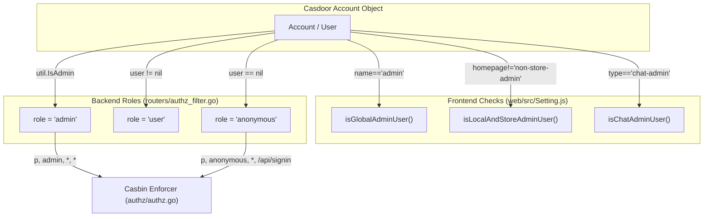
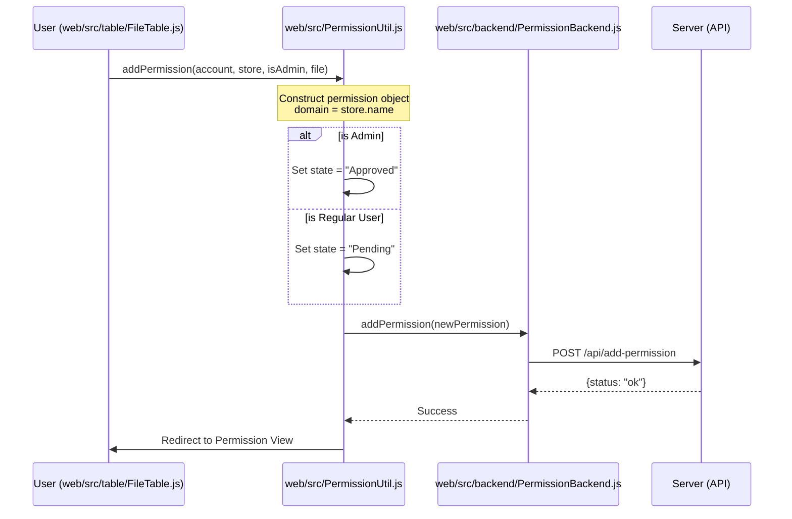

<!-- source: DeepWiki mcp.deepwiki.com · repo the-open-agent/openagent · page 9.2 Authorization & Role-Based Access Control · fetched 2026-10-26 -->

# Authorization & Role-Based Access Control

Relevant source files

The following files were used as context for generating this wiki page:

- [authz/authz.go](authz/authz.go)
- [controllers/message_answer_job.go](controllers/message_answer_job.go)
- [routers/authz_filter.go](routers/authz_filter.go)
- [web/src/PermissionUtil.js](web/src/PermissionUtil.js)
- [web/src/Setting.js](web/src/Setting.js)
- [web/src/backend/PermissionBackend.js](web/src/backend/PermissionBackend.js)
- [web/src/backend/StorageProviderBackend.js](web/src/backend/StorageProviderBackend.js)
- [web/src/locales/en/data.json](web/src/locales/en/data.json)
- [web/src/locales/zh/data.json](web/src/locales/zh/data.json)
- [web/src/table/FileTable.js](web/src/table/FileTable.js)

OpenAgent implements a multi-tiered Authorization and Role-Based Access Control (RBAC) model. The system integrates **Casdoor** for identity management and uses a high-performance **Casbin** enforcer for path-based access control, while backend filters and frontend helpers ensure store-level isolation and resource security.

## RBAC Model & Roles

The system categorizes users into functional roles that dictate access to administrative interfaces and resource management. These roles are determined by attributes synced from Casdoor or defined within the OpenAgent user object.

### Key Roles
*   **GlobalAdmin**: Identified via `isGlobalAdminUser(account)`. This role is strictly reserved for the user named `admin` with the `isAdmin` flag set to true [web/src/Setting.js:115-120]().
*   **StoreAdmin**: Identified via `isLocalAndStoreAdminUser(account)`. These users manage specific `Store` configurations. A user is excluded from this role if their `homepage` attribute is explicitly set to `non-store-admin` [web/src/Setting.js:167-181]().
*   **chat-admin-user**: A specialized role identified by `account.type === "chat-admin"` or `account.tag === "教师"`. They possess the authority to view all users in the system [web/src/Setting.js:129-141]().
*   **video-admin-user**: Roles related to the video and multimedia subsystem, often distinguished by specific owner suffixes or types [web/src/Setting.js:197-203]().
*   **Anonymous**: Users without an active session. They are restricted to public endpoints defined in the Casbin policy [authz/authz.go:50-97]().

### Code-to-Role Association
The following diagram maps backend logic and frontend checks to the conceptual RBAC roles.

**Diagram: Role Determination and Permission Mapping**

**Sources:**
* [web/src/Setting.js:115-181]()
* [routers/authz_filter.go:68-76]()
* [authz/authz.go:47-101]()

## Authorization Filter Pipeline

The backend enforces security through the `AuthzFilter` and the `Casbin` enforcer. This layer intercepts requests before they reach the controllers.

### AuthzFilter and Casbin Enforcer
The `AuthzFilter` acts as a middleware. It first checks if the system is in `DemoMode` to restrict certain POST operations [routers/authz_filter.go:31-35](). It then invokes the `permissionFilter` [routers/authz_filter.go:51-81]().

*   **Enforcer Initialization**: The `InitEnforcer` function loads a `modelText` (RBAC with domain support) and a `policyText` containing the access rules [authz/authz.go:105-118]().
*   **Role Hierarchy**: The policy defines a clear inheritance: `admin` inherits all permissions from `user`, and `user` inherits from `anonymous` [authz/authz.go:101-102]().
*   **Exempted Paths**: The `anonymous` role is granted access to over 40 endpoints, including `/api/get-store`, `/api/get-message-answer`, and `/api/add-chat`, allowing public interaction with specific AI bots while protecting administrative functions [authz/authz.go:50-97]().

### Request Deny Logic
If `authz.IsAllowed` returns false, the filter terminates the request with a `403 Forbidden` equivalent error message: `"auth:this operation requires admin privilege"` [routers/authz_filter.go:78-81]().

**Sources:**
* [routers/authz_filter.go:27-81]()
* [authz/authz.go:25-126]()

## Store Isolation & Frontend Helpers

### Store Isolation Enforcement
OpenAgent uses a "Store-centric" isolation model. Users are often "bound" to a store via their `homepage` attribute [web/src/Setting.js:205-212](). 
*   **Backend Validation**: While the frontend checks for the presence of a store binding, the backend performs the actual validation during request processing.
*   **Store Administration**: `StoreAdmin` users can update store configurations using `submitStoreEdit`, which strips complex objects like `fileTree` before sending the update to the backend [web/src/Setting.js:214-228]().

### PermissionUtil Helpers
The frontend uses `PermissionUtil.js` to programmatically request or grant access to resources like knowledge base files.
*   **addPermission**: This function constructs a Casdoor permission object. It includes the `store.name` as the domain and the file keys as the resources [web/src/PermissionUtil.js:20-40]().
*   **Auto-Approval**: If the current user `isAdmin`, the permission is created with `state: "Approved"` and an `approver` timestamp. Otherwise, it is set to `Pending` [web/src/PermissionUtil.js:42-49]().

**Diagram: Permission Request Flow**

**Sources:**
* [web/src/PermissionUtil.js:20-62]()
* [web/src/Setting.js:205-228]()
* [web/src/backend/PermissionBackend.js:59-69]()

## SSE and Async Authorization
For streaming responses (Server-Sent Events), authorization is checked at the start of the job.
*   **Job Management**: The `messageAnswerJobManager` tracks active AI response generations [controllers/message_answer_job.go:33-42]().
*   **Session Context**: When a job starts via `getOrStart`, it captures the `signedIn` status of the user, which is then passed to the generation logic to ensure the user has the right to receive the stream [controllers/message_answer_job.go:44-86]().
*   **Cancellation**: Users can only cancel jobs they own, enforced via the `cancel` method in the manager [controllers/message_answer_job.go:88-98]().

**Sources:**
* [controllers/message_answer_job.go:44-111]()
* [routers/authz_filter.go:62-64]() (OpenAI Bearer token exemption)

---

