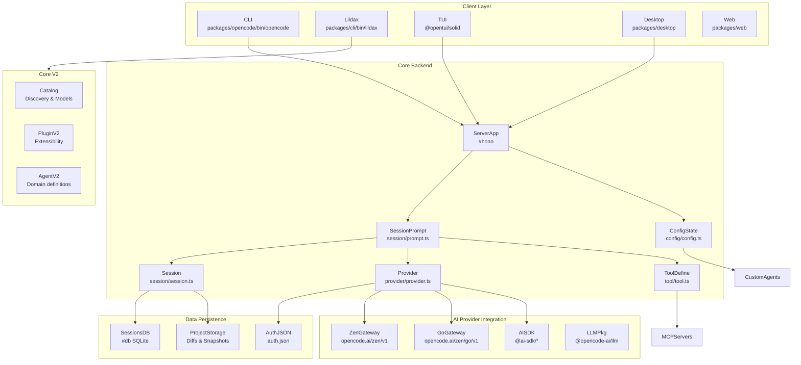
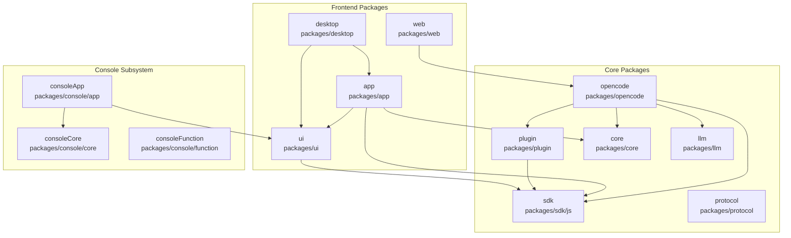
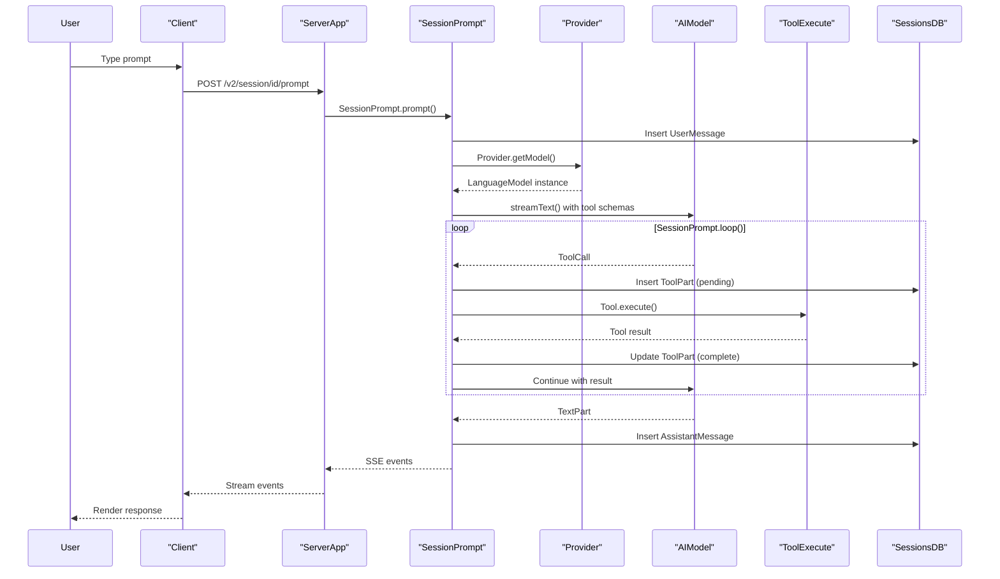

<!-- source: DeepWiki mcp.deepwiki.com · repo sst/opencode · page 1 Overview · fetched 2026-10-26 -->

# Overview

Relevant source files

The following files were used as context for generating this wiki page:

- [.github/workflows/containers.yml](.github/workflows/containers.yml)
- [README.md](README.md)
- [bun.lock](bun.lock)
- [package.json](package.json)
- [packages/console/app/package.json](packages/console/app/package.json)
- [packages/console/core/package.json](packages/console/core/package.json)
- [packages/console/function/package.json](packages/console/function/package.json)
- [packages/console/mail/package.json](packages/console/mail/package.json)
- [packages/containers/README.md](packages/containers/README.md)
- [packages/containers/base/Dockerfile](packages/containers/base/Dockerfile)
- [packages/containers/bun-node/Dockerfile](packages/containers/bun-node/Dockerfile)
- [packages/containers/publish/Dockerfile](packages/containers/publish/Dockerfile)
- [packages/containers/rust/Dockerfile](packages/containers/rust/Dockerfile)
- [packages/containers/script/build.ts](packages/containers/script/build.ts)
- [packages/containers/tauri-linux/Dockerfile](packages/containers/tauri-linux/Dockerfile)
- [packages/containers/tsconfig.json](packages/containers/tsconfig.json)
- [packages/desktop/package.json](packages/desktop/package.json)
- [packages/enterprise/package.json](packages/enterprise/package.json)
- [packages/function/package.json](packages/function/package.json)
- [packages/opencode/package.json](packages/opencode/package.json)
- [packages/plugin/package.json](packages/plugin/package.json)
- [packages/sdk/js/package.json](packages/sdk/js/package.json)
- [packages/slack/package.json](packages/slack/package.json)
- [packages/ui/package.json](packages/ui/package.json)
- [packages/web/package.json](packages/web/package.json)
- [packages/web/src/assets/web/web-homepage-active-session.png](packages/web/src/assets/web/web-homepage-active-session.png)
- [packages/web/src/assets/web/web-homepage-new-session.png](packages/web/src/assets/web/web-homepage-new-session.png)
- [packages/web/src/assets/web/web-homepage-see-servers.png](packages/web/src/assets/web/web-homepage-see-servers.png)
- [packages/web/src/components/Lander.astro](packages/web/src/components/Lander.astro)
- [packages/web/src/content/docs/index.mdx](packages/web/src/content/docs/index.mdx)
- [packages/web/src/content/docs/models.mdx](packages/web/src/content/docs/models.mdx)
- [packages/web/src/content/docs/troubleshooting.mdx](packages/web/src/content/docs/troubleshooting.mdx)
- [packages/web/src/content/docs/web.mdx](packages/web/src/content/docs/web.mdx)
- [packages/web/src/content/docs/windows-wsl.mdx](packages/web/src/content/docs/windows-wsl.mdx)
- [script/upgrade-opentui.ts](script/upgrade-opentui.ts)

OpenCode is an open-source AI coding agent that enables developers to interact with large language models for code generation, analysis, and editing tasks. The system provides a terminal-based interface (TUI), desktop application, VS Code extension, and web interface, all communicating with a central backend server that manages AI provider integration, tool execution, and conversation state.

This document provides a high-level overview of OpenCode's architecture, monorepo structure, and core systems. For detailed information about specific subsystems, see the child pages:
- [Package Structure](#1.1) — Document the monorepo organization, workspace packages, and dependency relationships.
- [Architecture Overview](#1.2) — Present high-level system architecture diagrams showing session processing pipeline and data flow.
- [Installation and Setup](#1.3) — Guide users through installation methods and initial configuration.

---

## System Purpose and Scope

OpenCode is designed to be:

- **Provider-agnostic**: Supports 75+ AI providers including Anthropic, OpenAI, Google, local models via Ollama, and curated services called OpenCode Zen and OpenCode Go [packages/opencode/package.json:58-76]().
- **Client-server architecture**: A backend server handles AI interactions while multiple client types (TUI, desktop, web) connect to it [packages/opencode/package.json:18-23]().
- **Extensible**: Includes a plugin system, skills, MCP (Model Context Protocol) servers, and custom tools [packages/opencode/package.json:83-95]().
- **Open source**: MIT licensed, with a focus on developer-centric workflows [packages/opencode/package.json:6-6]().

Sources: [README.md:1-129](), [packages/opencode/package.json:1-157]()

---

## High-Level System Architecture

**System Architecture with Code Entities**

This diagram bridges natural language concepts to concrete code entities. The server implementation uses the `#hono` alias to resolve environment-specific adapters. `SessionPrompt` (`session/prompt.ts`) orchestrates the agent loop, calling `Provider` (`provider/provider.ts`) to invoke AI models via the Vercel `ai` SDK [packages/opencode/package.json:113-113](). Session state persists via the `#db` alias using Drizzle ORM [packages/opencode/package.json:25-29](). The V2 architecture introduces domain primitives in `packages/core` and an Effect-native LLM abstraction in `packages/llm` [packages/opencode/package.json:34-88]().

Sources: [packages/opencode/package.json:1-157](), [bun.lock:1-100](), [packages/cli/package.json:36]()

---

## Monorepo Structure

OpenCode is organized as a Bun workspace monorepo [bun.lock:4-5]() managed with Turbo [bun.lock:27-27]().

**Monorepo Package Dependency Graph**

This diagram outlines workspace relationships. Core packages provide the CLI, SDK, and shared utilities. Frontend packages implement user interfaces with a shared component library. The console subsystem operates as a separate platform for managing OpenCode Zen and team services [packages/console/core/package.json:1-20]().

Sources: [bun.lock:4-210](), [packages/opencode/package.json:87-95](), [packages/sdk/js/package.json:12-21](), [packages/plugin/package.json:11-19](), [packages/desktop/package.json:36-40](), [packages/console/core/package.json:8-20]()

---

## Package Manifest Overview

| Package | Purpose | Key Dependencies |
|---------|---------|------------------|
| `opencode` | Main CLI and server implementation | `ai`, `drizzle-orm`, `@ai-sdk/*` [packages/opencode/package.json:58-153]() |
| `@opencode-ai/sdk` | Client SDK with TypeScript types | `cross-spawn` [packages/sdk/js/package.json:12-35]() |
| `@opencode-ai/plugin` | Plugin interface for extensions | `zod`, `effect` [packages/plugin/package.json:23-28]() |
| `@opencode-ai/ui` | Component library for UIs | `solid-js`, `tailwindcss` [packages/ui/package.json:74-75]() |
| `@opencode-ai/app` | Core UI application logic | `@opencode-ai/ui`, `@opencode-ai/sdk` [packages/app/package.json:40-44]() |
| `@opencode-ai/desktop` | Electron desktop application | `electron`, `@opencode-ai/app` [packages/desktop/package.json:39-51]() |
| `@opencode-ai/web` | Documentation website | `astro`, `solid-js` [packages/web/package.json:14-37]() |
| `@opencode-ai/cli` | New V2 CLI implementation (`lildax`) | `effect`, `@opencode-ai/core` [packages/cli/package.json:36]() |
| `@opencode-ai/core` | V2 Domain layer (Catalog, Agents) | `effect`, `drizzle-orm` [packages/console/core/package.json:8-19]() |
| `@opencode-ai/llm` | Effect-native LLM abstraction | `effect`, `@ai-sdk/provider` [packages/opencode/package.json:88-88]() |

Sources: [bun.lock:1-210](), [packages/opencode/package.json:54-154](), [packages/sdk/js/package.json:1-36](), [packages/plugin/package.json:1-54](), [packages/desktop/package.json:1-76](), [packages/console/core/package.json:1-52]()

---

## Agent Processing Pipeline

**Agent Processing Pipeline with Code Methods**

This sequence diagram details the agent execution loop. Requests enter via the server adapter, retrieve a `LanguageModel` instance via `Provider.getModel()`, execute necessary tools, and persist state changes through Drizzle ORM [packages/opencode/package.json:113-120]().

Sources: [packages/opencode/package.json:18-154](), [packages/sdk/js/package.json:12-21]()

---

## Installation Methods

OpenCode can be installed through multiple channels:

| Method | Command | Platform |
|--------|---------|----------|
| Install script | `curl -fsSL https://opencode.ai/install \| bash` | macOS, Linux |
| npm | `npm install -g opencode-ai` | All platforms |
| Homebrew | `brew install anomalyco/tap/opencode` | macOS, Linux |
| Nix | `nix run nixpkgs#opencode` | NixOS, Linux, macOS |

The legacy CLI entry point is defined in `./bin/opencode` [packages/opencode/package.json:19-19](), while the V2 architecture utilizes the `lildax` binary [packages/cli/package.json:36]().

Sources: [README.md:43-59](), [packages/opencode/package.json:18-20](), [packages/cli/package.json:36]()

---

## Provider Integration

OpenCode integrates 75+ AI providers through the `Provider` module utilizing the Vercel `ai` SDK and specific adapters [packages/opencode/package.json:58-76]().

**Provider Categories:**

| Category | Examples | Package |
|----------|----------|---------|
| OpenCode Services | Zen (curated), Go (open models) | Managed via `console` [packages/console/function/package.json:20-22]() |
| Cloud Providers | Anthropic, OpenAI, Google, Bedrock | `@ai-sdk/*` packages [packages/opencode/package.json:58-76]() |
| Local | Ollama, LM Studio | `@ai-sdk/openai-compatible` [packages/opencode/package.json:71-71]() |

Sources: [packages/opencode/package.json:58-76](), [packages/console/function/package.json:1-29]()

---

## Key Technologies and Dependencies

| Technology | Purpose | Package |
|------------|---------|---------|
| **Bun** | Runtime and package manager | Global [bun.lock:1-10]() |
| **Solid.js** | Reactive UI framework | `solid-js` [packages/app/package.json:75-75]() |
| **Effect** | Functional programming & concurrency | `effect` [packages/opencode/package.json:121-121]() |
| **Hono** | HTTP framework | `hono` [packages/function/package.json:17-17]() |
| **Drizzle ORM** | Database ORM | `drizzle-orm` [packages/opencode/package.json:120-120]() |
| **Electron** | Desktop framework | `electron` [packages/desktop/package.json:51-51]() |
| **Astro** | Static site generator | `astro` [packages/web/package.json:24-24]() |
| **AI SDK** | AI provider integration | `ai`, `@ai-sdk/*` [packages/opencode/package.json:58-113]() |

Sources: [bun.lock:1-100](), [packages/opencode/package.json:1-157](), [packages/desktop/package.json:1-76](), [packages/web/package.json:1-44]()

---

