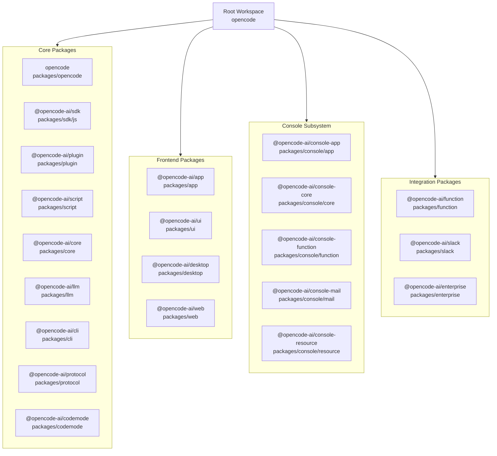
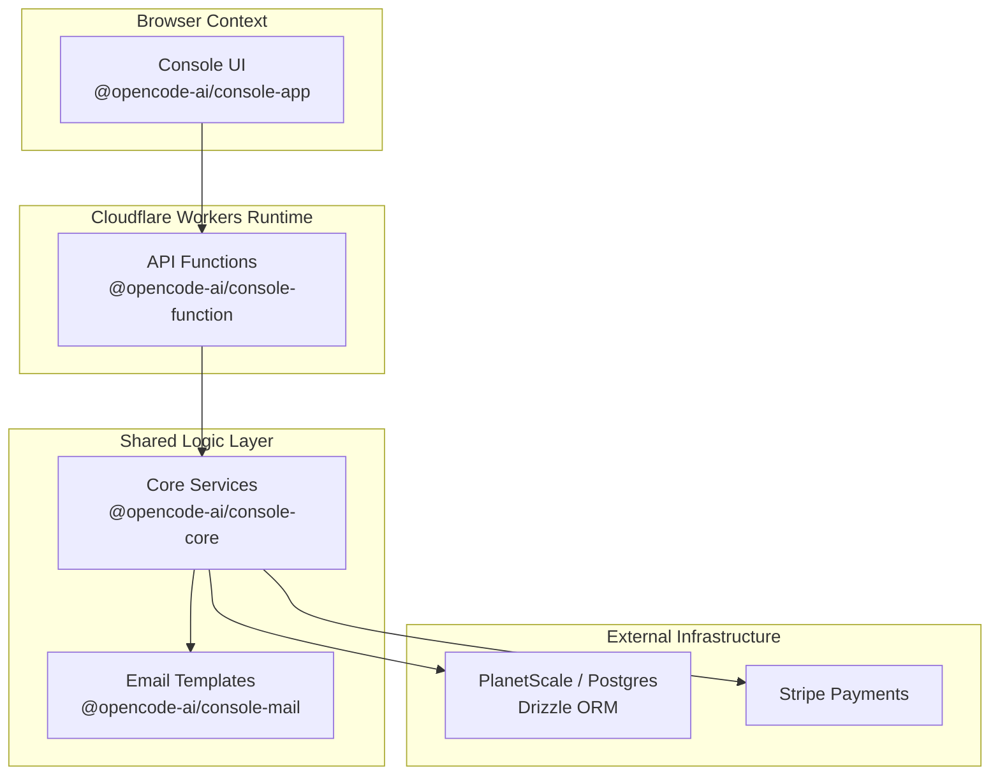
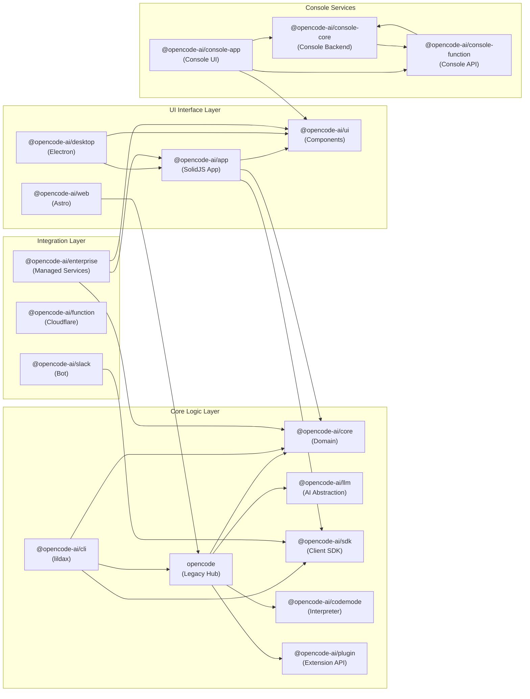

<!-- source: DeepWiki mcp.deepwiki.com · repo sst/opencode · page 1.1 Package Structure · fetched 2026-10-26 -->

# Package Structure

<details>
<summary>Relevant source files</summary>

The following files were used as context for generating this wiki page:

- [bun.lock](bun.lock)
- [packages/app/package.json](packages/app/package.json)
- [packages/console/app/package.json](packages/console/app/package.json)
- [packages/console/core/package.json](packages/console/core/package.json)
- [packages/console/function/package.json](packages/console/function/package.json)
- [packages/console/mail/package.json](packages/console/mail/package.json)
- [packages/core/package.json](packages/core/package.json)
- [packages/desktop/package.json](packages/desktop/package.json)
- [packages/enterprise/package.json](packages/enterprise/package.json)
- [packages/function/package.json](packages/function/package.json)
- [packages/opencode/package.json](packages/opencode/package.json)
- [packages/plugin/package.json](packages/plugin/package.json)
- [packages/sdk/js/package.json](packages/sdk/js/package.json)
- [packages/slack/package.json](packages/slack/package.json)
- [packages/ui/package.json](packages/ui/package.json)
- [packages/web/package.json](packages/web/package.json)

</details>


## Purpose and Scope

This document describes the physical organization of the OpenCode monorepo, detailing all workspace packages, their roles, and interdependencies. For details on the architecture and runtime behavior of these packages, see [Architecture Overview](#1.2). For build and deployment processes, see [Build System and Monorepo](#9.1).

Sources: [bun.lock:4-13](), [packages/opencode/package.json:1-23]()

## Monorepo Overview

OpenCode is organized as a Bun workspace monorepo containing 20+ packages across multiple categories. The workspace configuration is defined at the root level (`bun.lock`) and uses the `workspace:*` protocol for internal package linking [bun.lock:4-13]().

**Workspace Structure**



Sources: [bun.lock:1-14](), [packages/opencode/package.json:1-157](), [packages/sdk/js/package.json:1-31](), [packages/plugin/package.json:1-29]()

## Core Packages

The core packages provide the fundamental functionality of OpenCode, including the CLI, server, SDK, and plugin system.

### opencode

**Location:** `packages/opencode`  
**Package Name:** `opencode`  
**Entry Point:** `./bin/opencode` [packages/opencode/package.json:19]()  
**Type:** Legacy application package (private)

The original package containing the CLI, HTTP server, session management, tool system, and AI provider integration. While newer logic is migrating to `packages/core`, this remains a central hub for the current implementation.

**Key Responsibilities:**
- CLI commands via `yargs` [packages/opencode/package.json:152]()
- Database management (SQLite via Drizzle ORM) [packages/opencode/package.json:120]()
- Provider integration (75+ AI providers) [packages/opencode/package.json:58-76]()
- MCP integration via `@modelcontextprotocol/sdk` [packages/opencode/package.json:83]()

Sources: [packages/opencode/package.json:1-157]()

### @opencode-ai/cli

**Location:** `packages/cli`  
**Package Name:** `@opencode-ai/cli`  
**Binary:** `lildax` [bun.lock:101]()

The V2 CLI implementation, providing the `lildax` binary. It bridges the TUI and the server/core logic.

**Major Dependencies:**
- `@opencode-ai/core`: Domain layer [bun.lock:105]()
- `@opencode-ai/server`: V2 Server [bun.lock:107]()
- `@opencode-ai/tui`: Terminal User Interface [bun.lock:108]()
- `effect`: Functional programming library [bun.lock:112]()

Sources: [bun.lock:97-120]()

### @opencode-ai/core

**Location:** `packages/core`  
**Package Name:** `@opencode-ai/core`  
**Type:** Core Domain Layer

The V2 domain layer containing the Catalog service for model discovery, PluginV2 hook system, and Agent definitions. It serves as a dependency for the newer CLI and server implementations.

Sources: [bun.lock:41](), [packages/cli/package.json:36]()

### @opencode-ai/sdk

**Location:** `packages/sdk/js`  
**Package Name:** `@opencode-ai/sdk`  
**Type:** Published library

Generated TypeScript SDK providing type-safe client access to the OpenCode HTTP API.

**Exports:**
```typescript
".": "./src/index.ts"           // Main SDK exports
"./client": "./src/client.ts"   // Client-only exports
"./server": "./src/server.ts"   // Server-only exports
"./v2": "./src/v2/index.ts"     // V2 API (typed)
"./v2/client": "./src/v2/client.ts"
"./v2/gen/client": "./src/v2/gen/client/index.ts"  // Generated client [packages/sdk/js/package.json:18]()
"./v2/server": "./src/v2/server.ts"
"./v2/types": "./src/v2/gen/types.gen.ts" // Generated types [packages/sdk/js/package.json:20]()
```

Sources: [packages/sdk/js/package.json:1-36]()

### @opencode-ai/plugin

**Location:** `packages/plugin`  
**Package Name:** `@opencode-ai/plugin`  
**Type:** Published library

Plugin interface defining the hook system and tool creation API for extending OpenCode functionality.

**Exports:**
```typescript
".": "./src/index.ts"       
"./tool": "./src/tool.ts"   
"./tui": "./src/tui.ts"     
"./v2/effect": "./src/v2/effect/index.ts" // V2 Effect-based plugins [packages/plugin/package.json:15]()
"./v2/effect/integration": "./src/v2/effect/integration.ts" // Integration hooks [packages/plugin/package.json:16]()
```

Sources: [packages/plugin/package.json:1-54]()

### @opencode-ai/codemode

**Location:** `packages/codemode`  
**Package Name:** `@opencode-ai/codemode`  
**Type:** Internal Utility

Provides the tool interpreter and code analysis capabilities using `acorn` and `typescript` [bun.lock:149-151]().

Sources: [packages/codemode/package.json:1-26]()

## Frontend Packages

### @opencode-ai/app

**Location:** `packages/app`  
**Package Name:** `@opencode-ai/app`  
**Type:** Shared UI application logic

Core UI application logic shared between desktop and web applications. Implements session rendering and state management using SolidJS [bun.lock:75]().

**Major Dependencies:**
- `@opencode-ai/core`: Domain layer [bun.lock:41]()
- `@opencode-ai/sdk`: API client [bun.lock:43]()
- `@opencode-ai/ui`: Component library [bun.lock:45]()
- `ghostty-web`: Terminal integration [bun.lock:69]()

Sources: [bun.lock:30-95]()

### @opencode-ai/ui

**Location:** `packages/ui`  
**Package Name:** `@opencode-ai/ui`  
**Type:** Shared Component Library

A comprehensive library of SolidJS components, styles, and assets used across all OpenCode frontends.

**Key Exports:**
- `./*`: Component files [packages/ui/package.json:37]()
- `./theme`: Theme definitions [packages/ui/package.json:46]()
- `./styles/tailwind`: Tailwind CSS configuration [packages/ui/package.json:45]()
- `./v2/*`: V2-specific components [packages/ui/package.json:55]()

Sources: [packages/ui/package.json:1-113]()

### @opencode-ai/desktop

**Location:** `packages/desktop`  
**Package Name:** `@opencode-ai/desktop`  
**Type:** Electron desktop application (private)

Desktop application built with Electron, providing native platform integration. It uses `electron-vite` for the build process [packages/desktop/package.json:17]().

Sources: [packages/desktop/package.json:1-76]()

## Console Subsystem

The console subsystem is a self-contained platform for account, team, and billing management.

**Console Data Flow**



Sources: [packages/console/app/package.json:1-49](), [packages/console/core/package.json:1-52](), [packages/console/function/package.json:1-30]()

### @opencode-ai/console-app

**Location:** `packages/console/app`  
**Package Name:** `@opencode-ai/console-app`  

Frontend for the OpenCode Console, built with SolidJS and Solid Start [bun.lock:175,176](). It manages subscriptions via Stripe [bun.lock:177,183]().

Sources: [packages/console/app/package.json:1-49]()

### @opencode-ai/console-core

**Location:** `packages/console/core`  
**Package Name:** `@opencode-ai/console-core`  

Core business logic and database layer for the console using Drizzle ORM [bun.lock:15](). It handles interactions with PlanetScale and Postgres [bun.lock:13,16]().

Sources: [packages/console/core/package.json:1-52]()

## Package Dependency Graph

This diagram illustrates the relationship between the core domain logic and the various interface implementations.



Sources: [bun.lock:30-194](), [packages/opencode/package.json:34,87-93](), [packages/cli/package.json:36](), [packages/desktop/package.json:39-40](), [packages/web/package.json:39](), [packages/enterprise/package.json:15-18](), [packages/console/app/package.json:19-22](), [packages/console/core/package.json:11-12](), [packages/console/function/package.json:24-25]()

---

