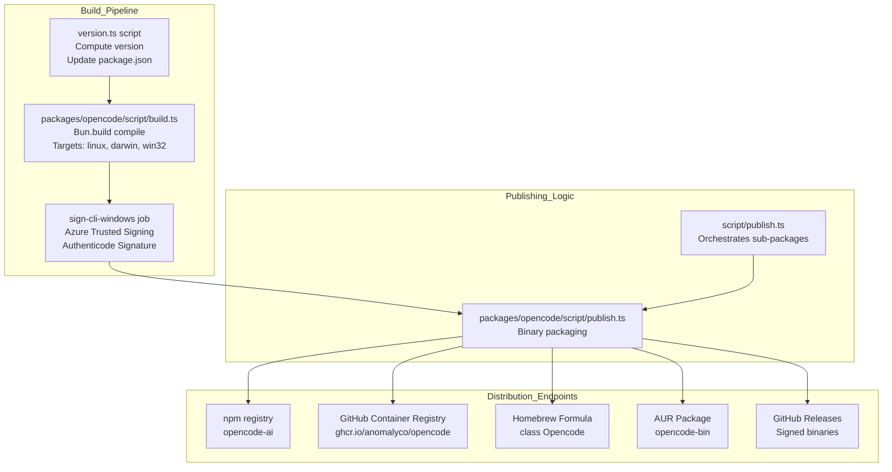
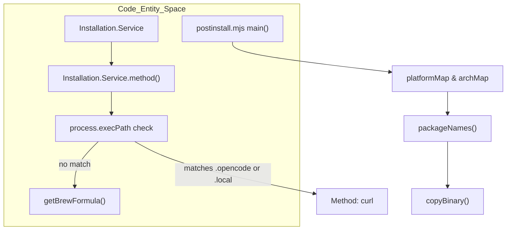
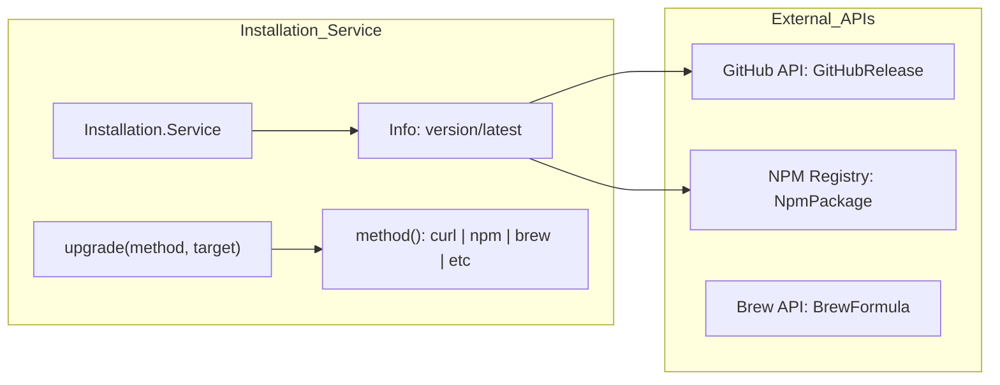

<!-- source: DeepWiki mcp.deepwiki.com · repo sst/opencode · page 1.3 Installation and Setup · fetched 2026-10-26 -->

# Installation and Setup

<details>
<summary>Relevant source files</summary>

The following files were used as context for generating this wiki page:

- [.github/workflows/nix-hashes.yml](.github/workflows/nix-hashes.yml)
- [.github/workflows/test.yml](.github/workflows/test.yml)
- [README.md](README.md)
- [flake.lock](flake.lock)
- [flake.nix](flake.nix)
- [install](install)
- [nix/desktop.nix](nix/desktop.nix)
- [nix/hashes.json](nix/hashes.json)
- [nix/node_modules.nix](nix/node_modules.nix)
- [nix/opencode.nix](nix/opencode.nix)
- [packages/app/playwright.config.ts](packages/app/playwright.config.ts)
- [packages/function/src/api.ts](packages/function/src/api.ts)
- [packages/function/src/github.ts](packages/function/src/github.ts)
- [packages/function/test/github.test.ts](packages/function/test/github.test.ts)
- [packages/opencode/bin/opencode](packages/opencode/bin/opencode)
- [packages/opencode/script/postinstall.mjs](packages/opencode/script/postinstall.mjs)
- [packages/opencode/src/cli/cmd/debug/agent.handler.ts](packages/opencode/src/cli/cmd/debug/agent.handler.ts)
- [packages/opencode/src/cli/cmd/github.handler.ts](packages/opencode/src/cli/cmd/github.handler.ts)
- [packages/opencode/src/cli/cmd/github.shared.ts](packages/opencode/src/cli/cmd/github.shared.ts)
- [packages/web/src/assets/web/web-homepage-active-session.png](packages/web/src/assets/web/web-homepage-active-session.png)
- [packages/web/src/assets/web/web-homepage-new-session.png](packages/web/src/assets/web/web-homepage-new-session.png)
- [packages/web/src/assets/web/web-homepage-see-servers.png](packages/web/src/assets/web/web-homepage-see-servers.png)
- [packages/web/src/components/Lander.astro](packages/web/src/components/Lander.astro)
- [packages/web/src/content/docs/index.mdx](packages/web/src/content/docs/index.mdx)
- [packages/web/src/content/docs/models.mdx](packages/web/src/content/docs/models.mdx)
- [packages/web/src/content/docs/troubleshooting.mdx](packages/web/src/content/docs/troubleshooting.mdx)
- [packages/web/src/content/docs/web.mdx](packages/web/src/content/docs/web.mdx)
- [packages/web/src/content/docs/windows-wsl.mdx](packages/web/src/content/docs/windows-wsl.mdx)
- [script/beta.ts](script/beta.ts)
- [turbo.json](turbo.json)

</details>


This document provides a technical guide to the installation methods, distribution architecture, and initial configuration of OpenCode. OpenCode is an open-source AI coding agent available as a Terminal User Interface (TUI), desktop application, and IDE extension.

---

## Installation Distribution Channels

OpenCode's release pipeline is designed to distribute consistent binaries across multiple package managers and platforms. The build process uses Bun's compilation capabilities and platform-specific bundlers to generate artifacts.

### Release Pipeline Architecture

The following diagram maps the high-level release stages to the specific CI/CD jobs and distribution endpoints defined in the project's automation scripts and metadata.



**Sources:** [packages/opencode/script/postinstall.mjs:14-27]()

---

## CLI Installation Methods

### Unified Install Script

The recommended installation method uses a bash script that automates platform detection and binary retrieval.

```bash
curl -fsSL https://opencode.ai/install | bash
```

**Technical Implementation of `install`**
The script performs the following logic:
1.  **Platform Detection**: Uses `uname -s` and `uname -m` to identify the OS (Darwin, Linux, Windows) and architecture (x64, arm64) [install:79-94]().
2.  **Instruction Set Check**: For x64 systems, it checks for `avx2` support. If missing, it selects a `baseline` build to ensure compatibility with older CPUs [install:131-163]().
3.  **Binary Resolution**: Fetches the latest version tag from the GitHub API and constructs a download URL for the specific platform-arch-abi combination, including `musl` detection for Alpine Linux and other musl-based distributions [install:160-185]().

**Installation Directory Precedence**
The script defaults to `$HOME/.opencode/bin` [install:68-68]().

**Sources:** [install:1-205]()

---

### Node.js Package Managers

OpenCode is published to npm as `opencode-ai`. The package structure uses a wrapper strategy to deliver native binaries via a JavaScript shim. During the `postinstall` phase, the script `postinstall.mjs` detects the environment and links the appropriate native binary from `optionalDependencies` to the local `bin/opencode` path [packages/opencode/script/postinstall.mjs:119-156]().

```bash
npm install -g opencode-ai@latest
# or bun/pnpm/yarn equivalents
```

**Installation Method Detection (Code Entity Space)**
The following diagram bridges natural language installation concepts to the concrete code entities within `packages/opencode/src/installation/index.ts` and `postinstall.mjs`.



**Implementation Details:**
The `Installation.Service` uses the `method` function to determine the installation source by checking file paths and executing shell commands like `npm list -g` or `brew list` [packages/opencode/src/installation/index.ts:174-182]().

**Sources:** [packages/opencode/src/installation/index.ts:17-190](), [packages/opencode/script/postinstall.mjs:167-182]()

---

### Native Package Managers and Nix

OpenCode supports native package managers through specific publishing scripts and metadata.

*   **Homebrew**: Supported via `brew install anomalyco/tap/opencode`. The installation service checks for the presence of the formula using `brew list --formula` [packages/opencode/src/installation/index.ts:125-131]().
*   **Arch Linux**: Available via `pacman -S opencode` (Stable) or `paru -S opencode-bin` (AUR).
*   **Nix**: Can be run directly via `nix run nixpkgs#opencode` or by adding `github:anomalyco/opencode` to your Nix flake inputs for the latest development branch.
    The Nix packaging system uses `nix/opencode.nix` to define the `opencode` derivation, which builds the CLI tool. The `nix/node_modules.nix` file handles the canonicalization of `node_modules` for different platforms, ensuring reproducible builds. Hashes for `node_modules` are stored in `nix/hashes.json` and are updated by the `.github/workflows/nix-hashes.yml` workflow.

```mermaid
graph TD
    A[Nix Flake (flake.nix)] --> B{forEachSystem}
    B --> C[nixpkgs.legacyPackages.${system}]
    C --> D[opencode derivation (nix/opencode.nix)]
    D --> E[node_modules derivation (nix/node_modules.nix)]
    E --> F[nix/hashes.json]
    F --> G[nix-hashes.yml workflow]
    G --> H[Compute node_modules hash]
    H --> I[Update hashes.json]
```
**Sources:** [flake.nix:1-73](), [nix/opencode.nix:1-109](), [nix/node_modules.nix:1-85](), [nix/hashes.json:1-8](), [.github/workflows/nix-hashes.yml:1-162]()

*   **Windows**: Supported via `scoop install opencode` or `choco install opencode`.

**Sources:** [packages/opencode/src/installation/index.ts:125-131]()

---

## Upgrade System

OpenCode includes an internal upgrade mechanism via the `Installation.Service` and a CLI command (`packages/opencode/src/cli/upgrade.ts`).

**Upgrade Workflow:**
1. **Version Comparison**: The `getReleaseType` utility compares `semver` versions to determine if an update is a "patch", "minor", or "major" release [packages/opencode/src/installation/index.ts:24-33]().
2. **Latest Check**: The `latest` function queries external APIs (GitHub, npm, Brew, etc.) based on the detected installation method [packages/opencode/src/installation/index.ts:78-78]().
3. **Execution**: The `upgrade` function executes the appropriate package manager command (e.g., `npm install -g`, `brew upgrade`) or downloads and runs the install script via `curl` [packages/opencode/src/installation/index.ts:79-79]().
4. **Auto-update**: The `upgrade()` function in `packages/opencode/src/cli/upgrade.ts` checks global configuration and performs automatic updates for patch releases if `autoupdate` is not disabled [packages/opencode/src/cli/upgrade.ts:8-53]().



**Sources:** [packages/opencode/src/installation/index.ts:24-82](), [packages/opencode/src/cli/upgrade.ts:8-53]()

---

## Initial Configuration and Workspace Setup

Upon installation and initial run within a directory, OpenCode initializes its environment. Two critical systems govern this initial phase: project snapshotting (`Snapshot.Service`) and formatting setup (`Format.Service`).

### Snapshot Initialization

The `Snapshot.Service` handles the lifecycle of project worktrees and git-based state tracking.
*   **Git Detection**: It verifies if the project uses Git and if snapshotting is enabled in the configuration [packages/opencode/src/snapshot/index.ts:167-170]().
*   **Worktree Management**: It computes a specific `gitdir` within the OpenCode data directory (usually `~/.opencode/snapshot/[project-id]/[worktree-hash]`) to track changes without polluting the user's primary `.git` directory [packages/opencode/src/snapshot/index.ts:71-75]().
*   **State Tracking**: The `track` function stages changes using `git add --all --sparse` and creates a commit-like hash to represent the current state [packages/opencode/src/snapshot/index.ts:39-39](), [packages/opencode/src/snapshot/index.ts:146-160]().

### Formatter Initialization

The `Format.Service` (`packages/opencode/src/format/index.ts`) initializes project formatters based on configuration settings:
*   Resolves built-in formatters (such as `gofmt`, `ruff`, etc.) via `Format.Service.status()` [packages/opencode/src/format/index.ts:174-186]().
*   Evaluates enablement rules asynchronously across matching file extensions [packages/opencode/src/format/index.ts:57-71]().

**Sources:** [packages/opencode/src/snapshot/index.ts:36-170](), [packages/opencode/src/format/index.ts:31-192]()

---

