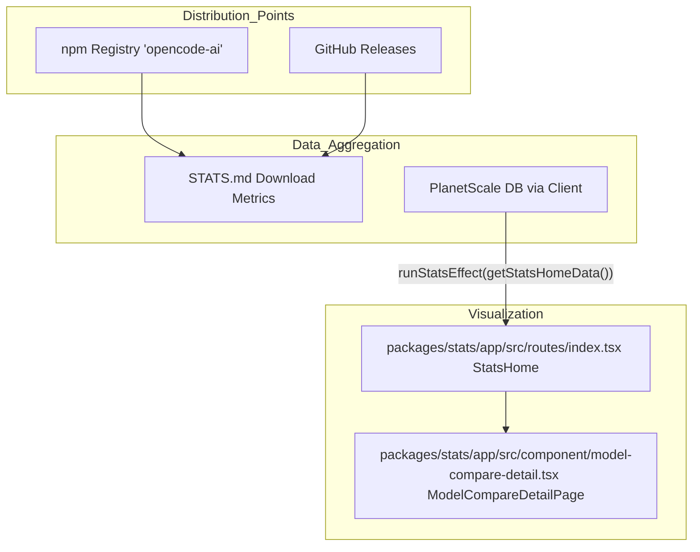
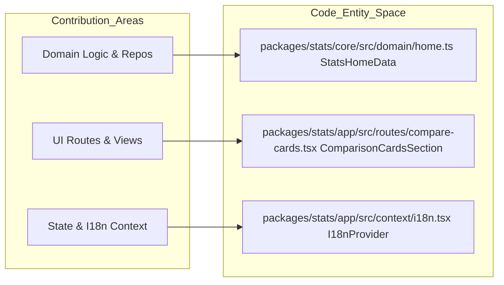

<!-- source: DeepWiki mcp.deepwiki.com · repo sst/opencode · page 10 Reference · fetched 2026-10-26 -->

# Reference

Relevant source files

The following files were used as context for generating this wiki page:

- [STATS.md](STATS.md)

This page provides high-level reference materials for the OpenCode project, including adoption metrics, licensing, and community contribution frameworks.

## Download Statistics

OpenCode monitors adoption trends by aggregating daily download metrics from GitHub (representing desktop releases and direct binaries) and npm (representing the CLI package and programmatic SDK). As of the latest recorded entry, the project has reached **657,340** total downloads [STATS.md:88]().

### Distribution and Tracking Flow

The system tracks downloads across multiple platforms to provide a comprehensive view of the user base. Recent growth shows significant acceleration, with daily increases reaching peaks of over 10,000 total downloads [STATS.md:84](). The stats application provides a visual dashboard for these metrics, alongside AI model usage data fetched from the `PlanetScale` database via the `getStatsHomeData` query [packages/stats/app/src/routes/index.tsx:80-94]().

**Natural Language to Code Entity Mapping**

| Natural Language Concept | Code Entity / Symbol | Role |
| :--- | :--- | :--- |
| **CLI Package** | `opencode-ai` | The primary npm package for terminal usage. |
| **Metric Store** | `STATS.md` | Flat-file database for historical download tracking [STATS.md:1-88](). |
| **Stats Application** | `packages/stats/app` | SolidJS-based dashboard for visualizing model usage and download trends [packages/stats/app/src/app.tsx:15-35](). |
| **Usage Domain** | `getStatsHomeData` | Effect-based service for retrieving market, cost, and usage metrics [packages/stats/core/src/domain/home.ts:167-175](). |

**Distribution and Stats Flow Diagram**

Titled: Data Flow from Distribution to Visualization

**Sources:** [STATS.md:1-88](), [packages/stats/app/src/routes/index.tsx:80-162](), [packages/stats/app/src/component/model-compare-detail.tsx:110-152](), [packages/stats/core/src/domain/home.ts:167-175]()

For a detailed breakdown of daily growth, platform-specific spikes, and historical milestones, see [Stats Platform and Download Statistics](#10.1).

## License and Contributing

OpenCode is built on a foundation of open-source principles, ensuring that the tool remains provider-agnostic and community-driven.

### Licensing

The software is distributed under the MIT license. The project maintains a high level of transparency regarding its development process, with the core logic residing in the `packages/` workspace.

### Contribution Framework

The project encourages contributions ranging from new AI provider integrations to improved terminal UI components. The `packages/stats` directory demonstrates how the community can extend the project by building analytical tools on top of the core domain. The frontend utilizes a `LanguageProvider` and `I18nProvider` to support global contributions and usage across multiple locales [packages/stats/app/src/app.tsx:22-29]().

**System Extension Map**

Titled: Code Entity Mapping for Contribution Areas

**Sources:** [packages/stats/core/src/domain/home.ts:1-118](), [packages/stats/app/src/app.tsx:1-35](), [packages/stats/app/src/routes/index.tsx:1-126](), [packages/stats/app/src/routes/compare-cards.tsx:53-82]()

For specific guidelines on pull requests, code standards, and local development setup, see [License and Contributing](#10.2).

## Additional Resources

### Technical Reference Pointers
- **Stats Routing:** The stats dashboard uses `@solidjs/router` with file-based routing and a `transformUrl` for locale stripping [packages/stats/app/src/app.tsx:17-33]().
- **Data Fetching:** Server-side data fetching is handled via `Effect` and `runStatsEffect` to interface with PlanetScale via the `Client` [packages/stats/app/src/stats-runtime.ts:1-5](), [packages/stats/core/src/domain/home.ts:1-3]().
- **Theming:** The stats interface utilizes a comprehensive CSS variable system for theming, supporting light, dark, and system preferences [packages/stats/app/src/routes/index.css:50-89](), [packages/stats/app/src/routes/stats-shell.tsx:46-54]().
- **Model Comparison:** Supports comparing multiple models (up to 6) across benchmarks, costs, and token efficiency [packages/stats/app/src/component/model-compare-detail.tsx:68-142]().
- **Geographic Data:** Visualized using `d3-scale` and localized country markers [packages/stats/app/src/routes/index.tsx:3-24]().
- **GitHub Integration:** Fetches repository stars dynamically via `getGitHubStars` query [packages/stats/app/src/routes/stats-shell.tsx:25-40]().

**Sources:** [packages/stats/app/src/routes/index.css:1-122](), [packages/stats/app/src/component/model-compare-detail.tsx:1-152](), [packages/stats/core/src/domain/home.ts:1-118](), [packages/stats/app/src/routes/stats-shell.tsx:1-182]()

---

