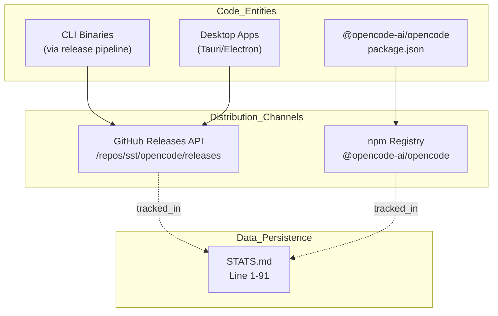
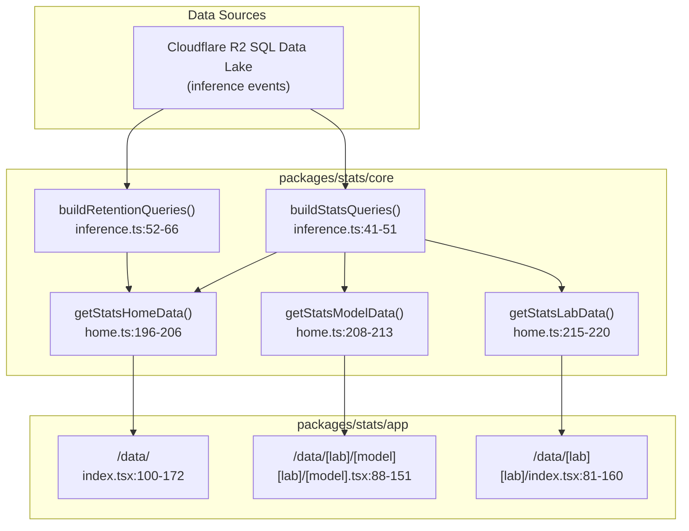

<!-- source: DeepWiki mcp.deepwiki.com · repo sst/opencode · page 10.1 Stats Platform and Download Statistics · fetched 2026-10-26 -->

# Stats Platform and Download Statistics

<details>
<summary>Relevant source files</summary>

The following files were used as context for generating this wiki page:

- [.github/actions/setup-bun/action.yml](.github/actions/setup-bun/action.yml)
- [STATS.md](STATS.md)
- [packages/stats/app/package.json](packages/stats/app/package.json)
- [packages/stats/app/src/app.tsx](packages/stats/app/src/app.tsx)
- [packages/stats/app/src/component/model-compare-detail.tsx](packages/stats/app/src/component/model-compare-detail.tsx)
- [packages/stats/app/src/routes/[lab]/[model].tsx](packages/stats/app/src/routes/[lab]/[model].tsx)
- [packages/stats/app/src/routes/[lab]/index.tsx](packages/stats/app/src/routes/[lab]/index.tsx)
- [packages/stats/app/src/routes/api/health.ts](packages/stats/app/src/routes/api/health.ts)
- [packages/stats/app/src/routes/compare-cards.tsx](packages/stats/app/src/routes/compare-cards.tsx)
- [packages/stats/app/src/routes/compare-radar.tsx](packages/stats/app/src/routes/compare-radar.tsx)
- [packages/stats/app/src/routes/compare/[firstLab]/[firstModel]/[secondLab]/[secondModel].tsx](packages/stats/app/src/routes/compare/[firstLab]/[firstModel]/[secondLab]/[secondModel].tsx)
- [packages/stats/app/src/routes/compare/index.tsx](packages/stats/app/src/routes/compare/index.tsx)
- [packages/stats/app/src/routes/index.css](packages/stats/app/src/routes/index.css)
- [packages/stats/app/src/routes/index.tsx](packages/stats/app/src/routes/index.tsx)
- [packages/stats/app/src/routes/model-catalog.ts](packages/stats/app/src/routes/model-catalog.ts)
- [packages/stats/app/src/routes/stats-shell.tsx](packages/stats/app/src/routes/stats-shell.tsx)
- [packages/stats/app/src/stats-runtime.ts](packages/stats/app/src/stats-runtime.ts)
- [packages/stats/app/test/compare-radar.test.ts](packages/stats/app/test/compare-radar.test.ts)
- [packages/stats/core/migrations/20260826000000_model_retention/migration.sql](packages/stats/core/migrations/20260826000000_model_retention/migration.sql)
- [packages/stats/core/package.json](packages/stats/core/package.json)
- [packages/stats/core/src/database/schema.ts](packages/stats/core/src/database/schema.ts)
- [packages/stats/core/src/domain/geo.ts](packages/stats/core/src/domain/geo.ts)
- [packages/stats/core/src/domain/home.test.ts](packages/stats/core/src/domain/home.test.ts)
- [packages/stats/core/src/domain/home.ts](packages/stats/core/src/domain/home.ts)
- [packages/stats/core/src/domain/inference.test.ts](packages/stats/core/src/domain/inference.test.ts)
- [packages/stats/core/src/domain/inference.ts](packages/stats/core/src/domain/inference.ts)
- [packages/stats/core/src/domain/model-normalization.ts](packages/stats/core/src/domain/model-normalization.ts)
- [packages/stats/core/src/domain/model.ts](packages/stats/core/src/domain/model.ts)
- [packages/stats/core/src/domain/provider.ts](packages/stats/core/src/domain/provider.ts)
- [packages/stats/core/src/domain/retention.ts](packages/stats/core/src/domain/retention.ts)
- [packages/stats/core/src/domain/stat.ts](packages/stats/core/src/domain/stat.ts)
- [packages/stats/core/src/honeycomb-backfill.ts](packages/stats/core/src/honeycomb-backfill.ts)
- [packages/stats/core/src/index.ts](packages/stats/core/src/index.ts)
- [packages/stats/core/src/r2-sql.test.ts](packages/stats/core/src/r2-sql.test.ts)
- [packages/stats/core/src/r2-sql.ts](packages/stats/core/src/r2-sql.ts)
- [packages/stats/core/src/resource.d.ts](packages/stats/core/src/resource.d.ts)
- [packages/stats/core/src/runtime.ts](packages/stats/core/src/runtime.ts)
- [packages/stats/core/src/stat-sync.ts](packages/stats/core/src/stat-sync.ts)
- [packages/stats/server/package.json](packages/stats/server/package.json)

</details>


## Purpose and Scope

This document details OpenCode's download statistics tracking system (`STATS.md`) and the full-stack analytics platform located in `packages/stats`. The analytics platform (`packages/stats/app`, `packages/stats/core`, and `packages/stats/server`) ingests inference events from R2 SQL and Athena, normalizes model identifiers, computes retention cohorts, and powers public comparison and telemetry dashboards.

For information about software distribution channels, see **9.3 Distribution Channels**. For details on the release automation pipeline, see **9.2 Release Pipeline**.

**Sources:** [STATS.md:1-91](), [packages/stats/app/src/routes/index.tsx:1-174](), [packages/stats/core/package.json:1-18]()

---

## Download Statistics Tracking

OpenCode tracks adoption metrics from two primary distribution channels: GitHub Releases (CLI binaries and desktop installers) and the npm registry (`@opencode-ai/opencode`). This data is maintained in a chronological markdown table.

### Data Structure and Format

| Column | Description |
|--------|-------------|
| `Date` | Calendar date in `YYYY-MM-DD` format [STATS.md:3-5]() |
| `GitHub Downloads` | Cumulative downloads from GitHub Releases, with daily delta in parentheses [STATS.md:3-6]() |
| `npm Downloads` | Cumulative downloads from npm registry, with daily delta in parentheses [STATS.md:3-6]() |
| `Total` | Combined cumulative downloads, with daily delta in parentheses [STATS.md:3-6]() |

```markdown
| Date | GitHub Downloads | npm Downloads | Total |
| ---------- | -------------------- | -------------------- | --------------------- |
| 2025-09-21 | 377,079 (+4,987) | 280,261 (+3,344) | 657,340 (+8,331) |
```

### Download Sources Architecture



**Sources:** [STATS.md:1-91]()

---

## Analytics Platform Architecture (`packages/stats`)

The `packages/stats` package is structured into three sub-packages:
- `packages/stats/core`: Contains domain logic, R2 SQL query builders, model normalization rules, and aggregation functions [packages/stats/core/src/domain/home.ts:1-129](), [packages/stats/core/src/domain/inference.ts:41-66]().
- `packages/stats/app`: A SolidStart application providing the public frontend dashboards, model catalog lookups, and comparison views [packages/stats/app/src/routes/index.tsx:82-98](), [packages/stats/app/src/routes/[lab]/[model].tsx:68-86]().
- `packages/stats/server`: Server deployment wrappers and runtime bindings [packages/stats/server/package.json:1-18]().

### Inference Ingestion and Query Pipeline

The stats platform uses Cloudflare R2 SQL for data ingestion and querying. The `buildStatsQueries` function in `packages/stats/core/src/domain/inference.ts` constructs SQL queries to retrieve usage and geographical data. Similarly, `buildRetentionQueries` generates queries for retention analysis. These queries are executed against the R2 SQL data lake.



**Sources:** [packages/stats/core/src/domain/inference.ts:41-66](), [packages/stats/core/src/domain/home.ts:196-220](), [packages/stats/app/src/routes/index.tsx:82-98](), [packages/stats/app/src/routes/[lab]/[model].tsx:68-86](), [packages/stats/app/src/routes/[lab]/index.tsx:56-71]()

---

## Model Normalization and Domain Rules

Due to variations in router suffixes, provider prefixes, and renamed models, `packages/stats/core/src/domain/model-normalization.ts` provides strict normalization functions to unify raw telemetry into public canonical identifiers.

### Key Normalization Functions

- `normalizeInferenceModel(value)`: Trims trailing suffixes like `-free`, `:free`, or `:global` [packages/stats/core/src/domain/model-normalization.ts:34-36]().
- `modelAuthor(value)`: Maps canonical models to public labs (e.g., `anthropic`, `openai`, `deepseek`, `zhipu`, `xai`) via `MODEL_AUTHOR_RULES` [packages/stats/core/src/domain/model-normalization.ts:1-16](), [packages/stats/core/src/domain/model-normalization.ts:38-43]().
- `statModel(model, providerModel)`: Resolves route-specific aliases using `MODEL_NAME_ALIASES` (e.g., mapping `ox-alpha` to `glm-5.3-flash`) [packages/stats/core/src/domain/model-normalization.ts:21-30](), [packages/stats/core/src/domain/model-normalization.ts:45-50]().
- `statProvider(model, providerModel, provider)`: Determines the effective public provider while excluding retired or stealth entries like `RETIRED_STAT_PROVIDERS` and `STEALTH_MODELS` (`omen-alpha`) [packages/stats/core/src/domain/model-normalization.ts:18-18](), [packages/stats/core/src/domain/model-normalization.ts:19-19](), [packages/stats/core/src/domain/model-normalization.ts:31-31](), [packages/stats/core/src/domain/model-normalization.ts:52-68]().

**Sources:** [packages/stats/core/src/domain/model-normalization.ts:1-68](), [packages/stats/core/src/domain/inference.test.ts:1-125]()

---

## Retention Metrics and Cohort Queries

Retention tracking calculates eligible user weekly activity using `buildRetentionQueries()` in `packages/stats/core/src/domain/inference.ts` [packages/stats/core/src/domain/inference.ts:52-66]().

### Retention Pipeline Mechanics
1.  **Normalization Table (`normalized`)**: Selects `generation.completed` events from `inference` and `inference-legacy` datasets, applying `LIVE_SOURCE_START` boundaries to prevent double-counting [packages/stats/core/src/domain/inference.ts:104-124]().
2.  **User Filtering (`filtered`)**: Filters out excluded models (`EXCLUDED_MODELS`) and requires non-empty user keys [packages/stats/core/src/domain/inference.ts:125-135]().
3.  **Cohort Aggregation (`primary_models`, `returned`)**: Identifies primary model usage per user where a model accounts for $\ge 80\%$ of their weekly requests (with a minimum threshold of 10 requests), then tracks whether the user returns in subsequent week cohorts [packages/stats/core/src/domain/inference.ts:136-180]().

**Sources:** [packages/stats/core/src/domain/inference.ts:52-180]()

---

## Frontend Routes and Comparison Views

The `packages/stats/app` interface is organized into several key view components:

-   **`StatsHome` (`packages/stats/app/src/routes/index.tsx`)**: The main overview dashboard aggregating usage trends, unique users, token costs, cache ratios, and market share via `getStatsHomeData()` [packages/stats/app/src/routes/index.tsx:82-98]().
-   **`StatsModel` (`packages/stats/app/src/routes/[lab]/[model].tsx`)**: Detailed metrics for an individual model, including momentum, token mix, geo breakdown, and peer comparisons fetched through `getStatsModelData()` [packages/stats/app/src/routes/[lab]/[model].tsx:68-86]().
-   **`StatsLab` (`packages/stats/app/src/routes/[lab]/index.tsx`)**: Provider/lab-level telemetry summarizing model distribution and aggregate token share via `getStatsLabData()` [packages/stats/app/src/routes/[lab]/index.tsx:56-71]().
-   **`ModelCompareDetailPage` (`packages/stats/app/src/component/model-compare-detail.tsx`)**: Side-by-side comparison table and radar charts for multi-model evaluation using `getStatsModelsComparisonData()` [packages/stats/app/src/component/model-compare-detail.tsx:113-116]().

The styling for the stats application is defined in `packages/stats/app/src/routes/index.css`, which includes font definitions for "IBM Plex Mono" and various CSS variables for theming [packages/stats/app/src/routes/index.css:1-89]().

**Sources:** [packages/stats/app/src/routes/index.tsx:82-98](), [packages/stats/app/src/routes/[lab]/[model].tsx:68-86](), [packages/stats/app/src/routes/[lab]/index.tsx:56-71](), [packages/stats/app/src/component/model-compare-detail.tsx:113-116](), [packages/stats/app/src/routes/index.css:1-89]()

---

