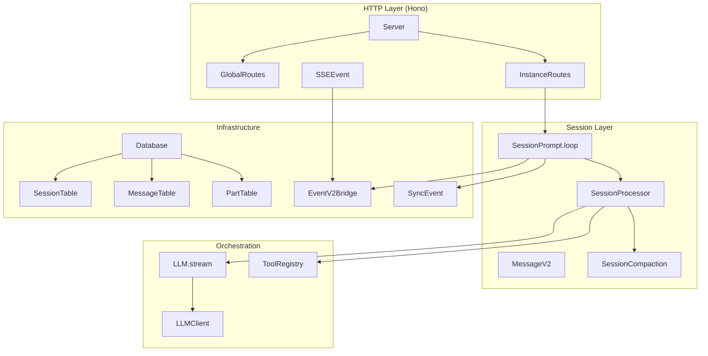
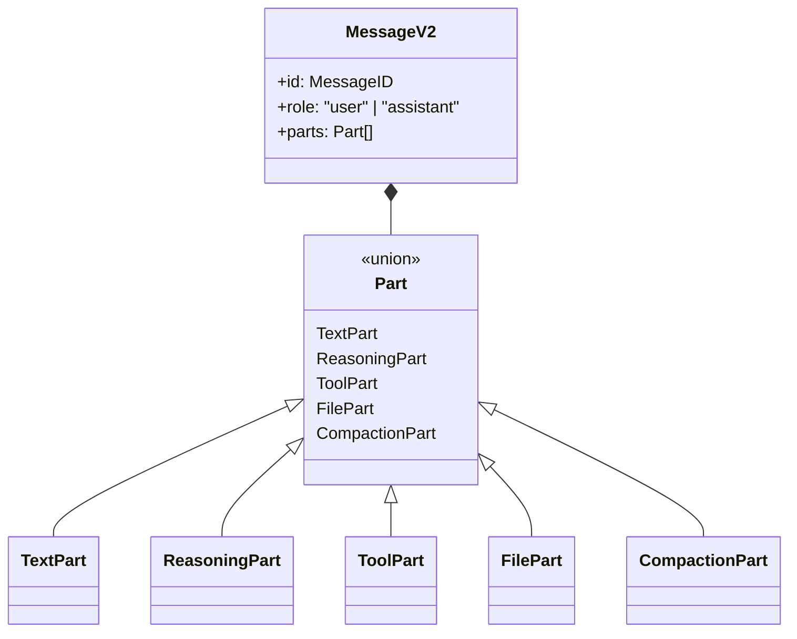
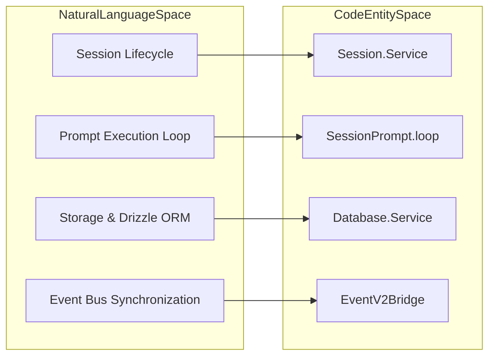

<!-- source: DeepWiki mcp.deepwiki.com · repo sst/opencode · page 2 Core Systems · fetched 2026-10-26 -->

# Core Systems

Relevant source files

The following files were used as context for generating this wiki page:

- [packages/opencode/src/session/compaction.ts](packages/opencode/src/session/compaction.ts)
- [packages/opencode/src/session/llm.ts](packages/opencode/src/session/llm.ts)
- [packages/opencode/src/session/llm/ai-sdk.ts](packages/opencode/src/session/llm/ai-sdk.ts)
- [packages/opencode/src/session/message-v2.ts](packages/opencode/src/session/message-v2.ts)
- [packages/opencode/src/session/processor.ts](packages/opencode/src/session/processor.ts)
- [packages/opencode/src/session/prompt.ts](packages/opencode/src/session/prompt.ts)
- [packages/opencode/src/session/session.ts](packages/opencode/src/session/session.ts)
- [packages/opencode/src/session/summary.ts](packages/opencode/src/session/summary.ts)
- [packages/opencode/src/tool/registry.ts](packages/opencode/src/tool/registry.ts)
- [packages/opencode/test/session/compaction.test.ts](packages/opencode/test/session/compaction.test.ts)
- [packages/opencode/test/session/llm.test.ts](packages/opencode/test/session/llm.test.ts)
- [packages/opencode/test/session/messages-pagination.test.ts](packages/opencode/test/session/messages-pagination.test.ts)
- [packages/opencode/test/session/processor-effect.test.ts](packages/opencode/test/session/processor-effect.test.ts)
- [packages/opencode/test/session/prompt.test.ts](packages/opencode/test/session/prompt.test.ts)
- [packages/opencode/test/session/snapshot-tool-race.test.ts](packages/opencode/test/session/snapshot-tool-race.test.ts)
- [packages/opencode/test/tool/registry.test.ts](packages/opencode/test/tool/registry.test.ts)
- [packages/plugin/src/tool.ts](packages/plugin/src/tool.ts)

The Core Systems comprise the backend infrastructure of OpenCode, providing session orchestration, AI provider integration, message processing, and API services. These systems coordinate between user interfaces, AI models, and development tools to enable agentic coding workflows.

For AI provider configuration and authentication, see [AI Provider Integration](#4). For user-facing interfaces, see [User Interfaces](#6). For tool execution and permissions, see [Tool System](#5).

## Architecture Overview

The core backend is organized around session-based orchestration, where each session maintains conversation state, coordinates tool execution, and manages interactions with AI providers via an iterative processing loop.

**System Component Diagram**

Sources: [packages/opencode/src/session/prompt.ts:113-143](), [packages/opencode/src/session/processor.ts:81-96](), [packages/opencode/src/session/message-v2.ts:30-30](), [packages/opencode/src/session/session.ts:29-30]()

## 2.1. Session Management

The `Session` service provides session lifecycle management, storing metadata and coordinating message history in SQLite via Drizzle ORM. It handles session hierarchy (parent/child relationships) and state persistence. For details, see [Session Management](#2.1).

| Function | Purpose | Reference |
|----------|---------|-----------|
| `Session.fromRow` | Converts DB row to typed Info object | [packages/opencode/src/session/session.ts:59-118]() |
| `Session.toRow` | Converts Info object to DB row | [packages/opencode/src/session/session.ts:120-159]() |
| `Session.Info` | Schema definition for session state | [packages/opencode/src/session/session.ts:206-235]() |

Sources: [packages/opencode/src/session/session.ts:59-235](), [packages/opencode/src/session/message-v2.ts:30-30]()

## 2.2. Message and Part Structure

Messages follow a role-based structure (`user` | `assistant`) and are composed of multiple "parts" representing different content types (text, files, tool calls, reasoning). For details, see [Message and Part Structure](#2.2).

**Message Content Model**

Sources: [packages/opencode/src/session/message-v2.ts:7-17](), [packages/opencode/src/session/message-v2.ts:80-93]()

## 2.3. Prompt Processing Pipeline

The `SessionPrompt` service orchestrates the agentic loop. It manages the flow from user input to LLM streaming and iterative tool execution via `SessionProcessor`. For details, see [Prompt Processing Pipeline](#2.3).

- **Loop**: `SessionPrompt.loop` maintains the state machine for agent turns, managing retries and tool resolution [packages/opencode/src/session/prompt.ts:105-105]().
- **Streaming**: `LLM.stream` handles the multi-provider abstraction, using `LLMRequestPrep` to format payloads for specific providers [packages/opencode/src/session/llm.ts:55-55](), [packages/opencode/src/session/llm.ts:106-113]().
- **LLM Client**: `LLMClient` (from `@opencode-ai/llm`) provides the low-level transport for LLM requests [packages/opencode/src/session/llm.ts:11-12]().

Sources: [packages/opencode/src/session/prompt.ts:102-109](), [packages/opencode/src/session/llm.ts:85-113](), [packages/opencode/src/session/processor.ts:32-48]()

## 2.4. Context Management and Compaction

OpenCode automatically manages the LLM context window by summarizing history or pruning old parts when token limits are approached. For details, see [Context Management and Compaction](#2.4).

- **Overflow Detection**: `SessionCompaction.isOverflow` checks if the current session exceeds model limits based on token counts [packages/opencode/src/session/compaction.ts:166-169]().
- **Compaction Loop**: `SessionCompaction.process` determines if a session needs to be compacted and triggers the summary generation [packages/opencode/src/session/compaction.ts:171-177]().
- **Tool Truncation**: Large tool outputs are truncated during the serialization process to save tokens [packages/opencode/src/session/compaction.ts:49-52]().

Sources: [packages/opencode/src/session/compaction.ts:165-187](), [packages/opencode/src/session/compaction.ts:49-52]()

## 2.5. Permission and Question System

OpenCode implements a human-in-the-loop workflow for sensitive operations. For details, see [Permission and Question System](#2.5).

- **Interactive Approval**: `LLM.run` handles tool approval workflows using an `approvalHandler` that bridges to the UI [packages/opencode/src/session/llm.ts:156-185]().
- **Tool Failures**: `SessionProcessor.failToolCall` manages tool execution errors, ensuring the state is updated for the assistant to see the failure [packages/opencode/src/session/processor.ts:186-200]().
- **Permission Service**: The `Permission` service manages rulesets and user replies for sensitive actions [packages/opencode/src/session/processor.ts:89-89]().

Sources: [packages/opencode/src/session/processor.ts:123-200](), [packages/opencode/src/session/llm.ts:149-185]()

## 2.6. HTTP Server and API

The backend exposes an HTTP API that facilitates communication between the core and various clients. For details, see [HTTP Server and API](#2.6).

- **Workspace Isolation**: Requests are scoped to specific projects and worktrees using the `InstanceState` context [packages/opencode/src/effect/instance-state.ts:1-20]().
- **Event V2 Bridge**: Provides a bridge between internal system events (like message updates) and the SSE streams consumed by clients [packages/opencode/src/session/prompt.ts:50-50](), [packages/opencode/src/session/llm.ts:20-21]().

Sources: [packages/opencode/src/session/session.ts:32-33](), [packages/opencode/src/session/prompt.ts:140-140]()

## 2.7. Project and Worktree Management

OpenCode manages codebases as Projects, utilizing Git-based worktrees to provide isolated environments for agent operations. For details, see [Project and Worktree Management](#2.7).

- **Session Context**: Sessions are bound to specific directories and workspaces, tracked via `SessionTable.directory` and `SessionTable.workspace_id` [packages/opencode/src/session/session.ts:29-30](), [packages/opencode/src/session/session.ts:121-125]().
- **Worktree Integration**: The `Session` service calculates relative paths within worktrees to ensure file operations are correctly scoped [packages/opencode/src/session/session.ts:171-173]().

Sources: [packages/opencode/src/session/session.ts:78-117](), [packages/opencode/src/session/session.ts:120-159]()

## 2.8. Event Bus and Sync Architecture

Internal state changes are broadcast via a global bus and synchronized across clients. For details, see [Event Bus and Sync Architecture](#2.8).

- **Event Types**: The system emits events for `MessageUpdated`, `PartDelta`, and `PartRemoved` to keep UIs in sync [packages/opencode/src/session/message-v2.ts:55-61]().
- **Event V2**: `EventV2Bridge` facilitates listening to and emitting events across the session lifecycle, including LLM streaming events [packages/opencode/src/session/llm.ts:20-21](), [packages/opencode/src/session/llm.ts:81-81]().

Sources: [packages/opencode/src/session/message-v2.ts:55-61](), [packages/opencode/src/session/llm.ts:20-21]()

## 2.9. Storage and Database

The system uses SQLite as the primary data store, managed through Drizzle ORM. For details, see [Storage and Database](#2.9).

- **Schema**: Tables like `SessionTable`, `MessageTable`, and `PartTable` are defined in the core database layer [packages/opencode/src/session/message-v2.ts:30-30]().
- **Hydration**: `MessageV2.hydrate` reconstructs full message objects (including parts) from database rows efficiently [packages/opencode/src/session/message-v2.ts:98-123]().
- **Token Tracking**: The database stores detailed token usage (input, output, reasoning, cache) per session [packages/opencode/src/session/session.ts:98-106]().

Sources: [packages/opencode/src/session/session.ts:29-30](), [packages/opencode/src/session/message-v2.ts:98-123](), [packages/opencode/src/session/session.ts:139-144]()

## Natural Language to Code Mapping

To bridge natural language concepts to concrete code entities across core backend systems, reference the following mapping diagram:

**Concept to Entity Mapping**

Sources: [packages/opencode/src/session/session.ts:31-41](), [packages/opencode/src/session/prompt.ts:102-109](), [packages/opencode/src/session/message-v2.ts:30-30]()

---

