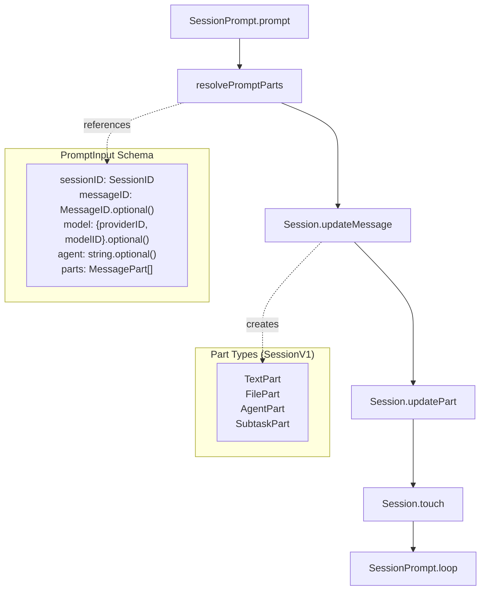
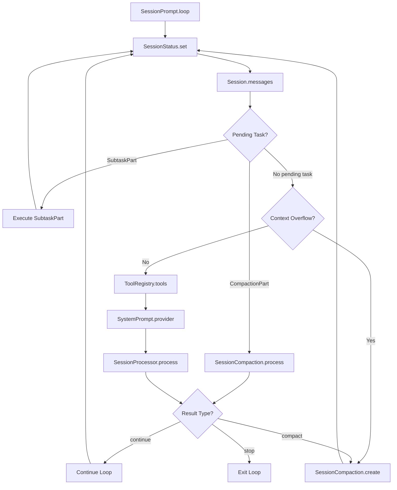
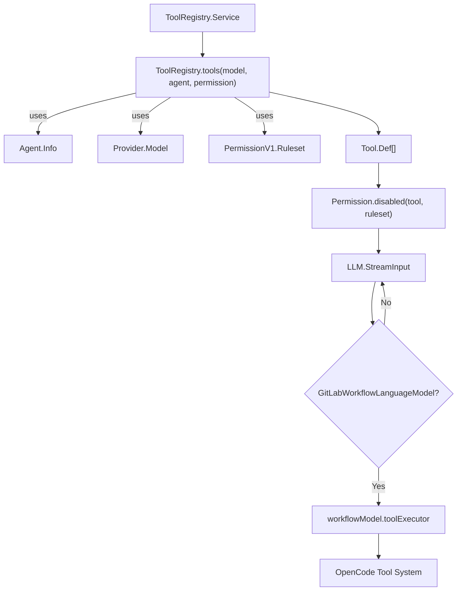
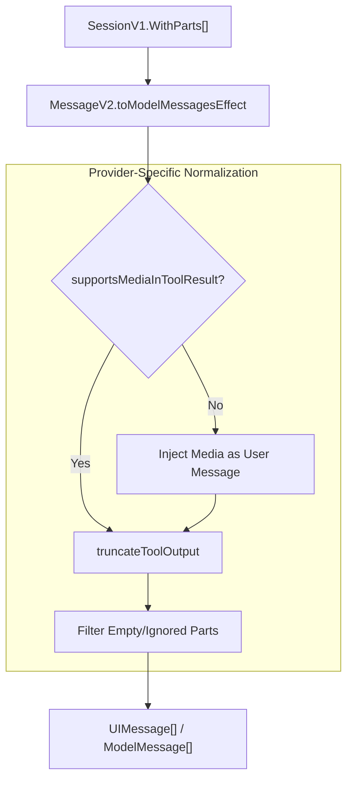
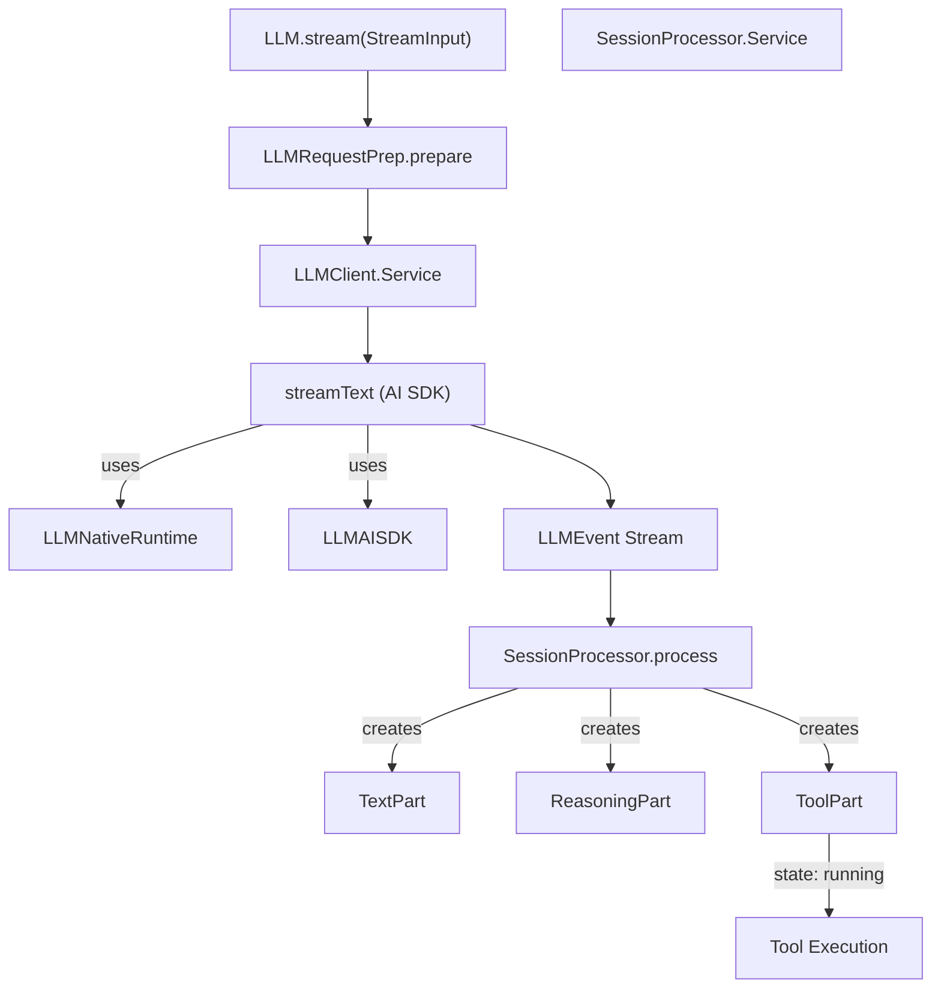
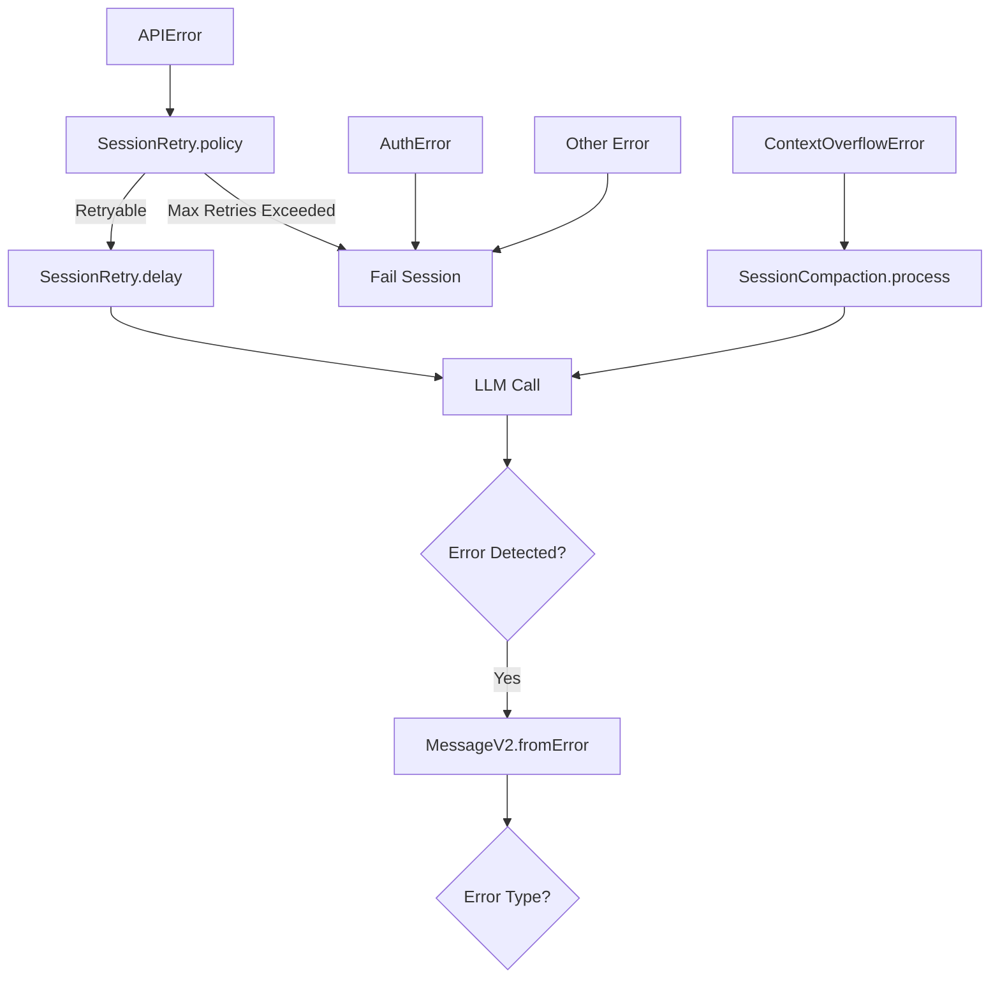

<!-- source: DeepWiki mcp.deepwiki.com · repo sst/opencode · page 2.3 Prompt Processing Pipeline · fetched 2026-10-26 -->

# Prompt Processing Pipeline

Relevant source files

The following files were used as context for generating this wiki page:

- [packages/core/src/flag/flag.ts](packages/core/src/flag/flag.ts)
- [packages/opencode/src/command/index.ts](packages/opencode/src/command/index.ts)
- [packages/opencode/src/effect/runtime-flags.ts](packages/opencode/src/effect/runtime-flags.ts)
- [packages/opencode/src/provider/error.ts](packages/opencode/src/provider/error.ts)
- [packages/opencode/src/session/compaction.ts](packages/opencode/src/session/compaction.ts)
- [packages/opencode/src/session/llm.ts](packages/opencode/src/session/llm.ts)
- [packages/opencode/src/session/llm/ai-sdk.ts](packages/opencode/src/session/llm/ai-sdk.ts)
- [packages/opencode/src/session/message-v2.ts](packages/opencode/src/session/message-v2.ts)
- [packages/opencode/src/session/processor.ts](packages/opencode/src/session/processor.ts)
- [packages/opencode/src/session/prompt.ts](packages/opencode/src/session/prompt.ts)
- [packages/opencode/src/session/prompt/codex.txt](packages/opencode/src/session/prompt/codex.txt)
- [packages/opencode/src/session/prompt/meta.txt](packages/opencode/src/session/prompt/meta.txt)
- [packages/opencode/src/session/retry.ts](packages/opencode/src/session/retry.ts)
- [packages/opencode/src/session/session.ts](packages/opencode/src/session/session.ts)
- [packages/opencode/src/session/summary.ts](packages/opencode/src/session/summary.ts)
- [packages/opencode/src/session/system.ts](packages/opencode/src/session/system.ts)
- [packages/opencode/src/skill/index.ts](packages/opencode/src/skill/index.ts)
- [packages/opencode/src/tool/registry.ts](packages/opencode/src/tool/registry.ts)
- [packages/opencode/test/effect/runtime-flags.test.ts](packages/opencode/test/effect/runtime-flags.test.ts)
- [packages/opencode/test/preload.ts](packages/opencode/test/preload.ts)
- [packages/opencode/test/provider/error.test.ts](packages/opencode/test/provider/error.test.ts)
- [packages/opencode/test/session/compaction.test.ts](packages/opencode/test/session/compaction.test.ts)
- [packages/opencode/test/session/llm.test.ts](packages/opencode/test/session/llm.test.ts)
- [packages/opencode/test/session/message-v2.test.ts](packages/opencode/test/session/message-v2.test.ts)
- [packages/opencode/test/session/messages-pagination.test.ts](packages/opencode/test/session/messages-pagination.test.ts)
- [packages/opencode/test/session/processor-effect.test.ts](packages/opencode/test/session/processor-effect.test.ts)
- [packages/opencode/test/session/prompt.test.ts](packages/opencode/test/session/prompt.test.ts)
- [packages/opencode/test/session/retry.test.ts](packages/opencode/test/session/retry.test.ts)
- [packages/opencode/test/session/snapshot-tool-race.test.ts](packages/opencode/test/session/snapshot-tool-race.test.ts)
- [packages/opencode/test/session/structured-output-integration.test.ts](packages/opencode/test/session/structured-output-integration.test.ts)
- [packages/opencode/test/session/system.test.ts](packages/opencode/test/session/system.test.ts)
- [packages/opencode/test/skill/skill.test.ts](packages/opencode/test/skill/skill.test.ts)
- [packages/opencode/test/tool/registry.test.ts](packages/opencode/test/tool/registry.test.ts)
- [packages/plugin/src/tool.ts](packages/plugin/src/tool.ts)

This page describes how user prompts flow through OpenCode from initial input to AI response generation. It covers the orchestration loop, message transformation, tool resolution, LLM streaming, and retry logic.

## Overview

The prompt processing pipeline is a multi-stage system that transforms user input into AI responses while managing tool execution, context windows, and multi-turn conversations. The core orchestration happens in `SessionPrompt.loop`, which coordinates between message creation, tool resolution, LLM streaming, and response processing.

**Core Pipeline Stages:**
1.  **Input Reception**: User submits prompt via API or UI [packages/opencode/src/session/prompt.ts:102-109]().
2.  **Message Creation**: User message persisted with constituent parts [packages/opencode/src/session/prompt.ts:140-160]().
3.  **Orchestration Loop**: Multi-turn conversation management and task execution via `SessionPrompt.loop` [packages/opencode/src/session/prompt.ts:105]().
4.  **Tool Resolution**: Available tools assembled based on agent permissions [packages/opencode/src/tool/registry.ts:81-86]().
5.  **System Prompt Assembly**: Environment context and instructions prepared by `SystemPrompt` [packages/opencode/src/session/system.ts:53-57]().
6.  **Message Transformation**: Internal data models converted to Provider-specific formats by `MessageV2.toModelMessagesEffect` [packages/opencode/src/session/message-v2.ts:131-135]().
7.  **LLM Streaming**: Request sent to AI provider via `LLM.stream` [packages/opencode/src/session/llm.ts:54-56]().
8.  **Response Processing**: Stream parsed into parts, tools executed by `SessionProcessor` [packages/opencode/src/session/processor.ts:32-48]().
9.  **Loop Continuation**: Repeat until the model issues a terminal finish reason [packages/opencode/src/session/processor.ts:30-31]().

Sources: [packages/opencode/src/session/prompt.ts:102-160](), [packages/opencode/src/session/processor.ts:30-48](), [packages/opencode/src/tool/registry.ts:81-86](), [packages/opencode/src/session/system.ts:53-57](), [packages/opencode/src/session/message-v2.ts:131-135](), [packages/opencode/src/session/llm.ts:54-56]()

## Input Reception and Message Creation

**Input Structure:**
The `SessionPrompt.prompt` function handles initial user input [packages/opencode/src/session/prompt.ts:102-104](). Key logic includes:
*   **Part Resolution**: `resolvePromptParts` expands file paths and handles mentions [packages/opencode/src/session/prompt.ts:108](). It uses `ConfigMarkdown` to extract referenced files and verifies them via `FSUtil` [packages/opencode/src/session/prompt.ts:30-40]().
*   **Persistence**: Messages are saved using `Session.updateMessage` and parts are stored individually via `Session.updatePart` [packages/opencode/src/session/message-v2.ts:98-123]().
*   **Session State**: The system maintains the session hierarchy and active model configuration [packages/opencode/src/session/message-v2.ts:80-93]().

Sources: [packages/opencode/src/session/prompt.ts:30-40](), [packages/opencode/src/session/prompt.ts:102-108](), [packages/opencode/src/session/message-v2.ts:80-123]()

## Orchestration Loop Architecture

The `SessionPrompt.loop` is the central engine of the agent [packages/opencode/src/session/prompt.ts:105](). It manages the state machine that decides whether to call the LLM, execute a tool, or perform maintenance like compaction.

**Key Loop Responsibilities:**
1.  **Task Prioritization**: The loop handles `SubtaskPart` (recursive agent calls) or `CompactionPart` (maintenance) before new LLM turns [packages/opencode/src/session/compaction.ts:171-184]().
2.  **Context Management**: It monitors token usage. If `SessionCompaction.isOverflow` returns true, it triggers history summarization [packages/opencode/src/session/compaction.ts:166-169]().
3.  **Structured Output**: If the user requested JSON output, the loop injects the `STRUCTURED_OUTPUT_DESCRIPTION` and `STRUCTURED_OUTPUT_SYSTEM_PROMPT` to force compliance [packages/opencode/src/session/prompt.ts:74-82]().
4.  **Loop Termination**: The loop exits when the assistant message has a terminal `finish` reason (e.g., "stop") or the processor returns "stop" [packages/opencode/src/session/processor.ts:30-48]().

Sources: [packages/opencode/src/session/prompt.ts:74-82](), [packages/opencode/src/session/prompt.ts:105](), [packages/opencode/src/session/compaction.ts:166-184](), [packages/opencode/src/session/processor.ts:30-48]()

## Tool Resolution and Execution

Tools are resolved dynamically based on the active agent's permissions.

1.  **Resolution**: `ToolRegistry.tools` gathers tools based on the provider, model, and agent configuration [packages/opencode/src/tool/registry.ts:81-86]().
2.  **Permission Filtering**: Tools are filtered based on the agent's `PermissionV1.Ruleset`. Tools marked with `ask` action require explicit user approval [packages/opencode/src/session/llm.ts:149-154]().
3.  **Workflow Integration**: For specialized providers like `GitLabWorkflowLanguageModel`, tool execution is bridged via a `toolExecutor` to the local tool system [packages/opencode/src/session/llm.ts:119-147]().

Sources: [packages/opencode/src/tool/registry.ts:81-86](), [packages/opencode/src/session/llm.ts:119-154]()

## Message Transformation Pipeline

Before messages are sent to an LLM, `MessageV2.toModelMessagesEffect` ensures compatibility with specific provider requirements [packages/opencode/src/session/message-v2.ts:131-135]().

*   **Normalization**: Handles provider quirks, such as checking if a provider supports specific media types (e.g., PDFs) in tool results [packages/opencode/src/session/message-v2.ts:147-159]().
*   **Output Management**: Tool outputs can be truncated for compaction to stay within context limits [packages/opencode/src/session/message-v2.ts:49-53]().
*   **Media Injection**: For providers that don't support media in tool results (like standard OpenAI-compatible APIs), OpenCode extracts the media and injects it as a subsequent user message [packages/opencode/src/session/message-v2.ts:138-143]().
*   **Part Filtering**: User messages with only empty text parts or ignored parts are filtered out before being sent to the LLM [packages/opencode/src/session/message-v2.ts:131-135]().

Sources: [packages/opencode/src/session/message-v2.ts:49-53](), [packages/opencode/src/session/message-v2.ts:131-159]()

## LLM Streaming and Response Processing

The `LLM.stream` function handles the actual communication with the AI provider [packages/opencode/src/session/llm.ts:54-56]().

1.  **Request Preparation**: `LLMRequestPrep.prepare` merges configuration from global config, agent-specific options, and model variants [packages/opencode/src/session/llm.ts:106-113]().
2.  **Streaming**: Uses `llmClient` and `streamText` (via `LLMNativeRuntime` or `LLMAISDK`) to handle real-time response generation [packages/opencode/src/session/llm.ts:29-31]().
3.  **Chunk Processing**: `SessionProcessor` iterates over the stream, creating `TextPart`, `ReasoningPart`, or `ToolPart` entries as deltas arrive [packages/opencode/src/session/processor.ts:98-114]().
4.  **Tool Execution**: When a tool call is received, the processor updates the `ToolPart` state to `running` and begins execution [packages/opencode/src/session/processor.ts:144-158]().

Sources: [packages/opencode/src/session/llm.ts:29-31](), [packages/opencode/src/session/llm.ts:54-56](), [packages/opencode/src/session/llm.ts:106-113](), [packages/opencode/src/session/processor.ts:98-158]()

## Retry and Error Logic

OpenCode implements logic to handle transient API errors and context window overflows.

*   **Detection**: `MessageV2.fromError` identifies the type of error (API, Auth, Context Overflow, etc.) to determine the next step [packages/opencode/src/session/message-v2.ts:117-122]().
*   **Backoff Strategy**: `SessionRetry` implements exponential backoff with jitter. It respects `retry-after` and `retry-after-ms` headers from providers [packages/opencode/src/session/retry.ts:47-78]().
*   **Retry Policy**: The system allows up to 5 retries (`RETRY_MAX_RETRIES`) for retryable errors like `too_many_requests` or `resource_exhausted` [packages/opencode/src/session/retry.ts:31]().
*   **Context Overflow**: `isOverflow` checks if token usage exceeds model limits. If detected, the `SessionCompaction` service is invoked to prune or summarize history [packages/opencode/src/session/compaction.ts:166-178]().
*   **Doom Loop Protection**: `SessionProcessor` uses a `DOOM_LOOP_THRESHOLD` of 3 to detect if the model is repeatedly calling tools without progress [packages/opencode/src/session/processor.ts:29-30]().

Sources: [packages/opencode/src/session/message-v2.ts:117-122](), [packages/opencode/src/session/processor.ts:29-30](), [packages/opencode/src/session/compaction.ts:166-178](), [packages/opencode/src/session/retry.ts:31](), [packages/opencode/src/session/retry.ts:47-78]()

---

