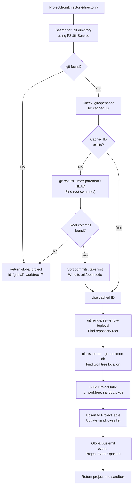
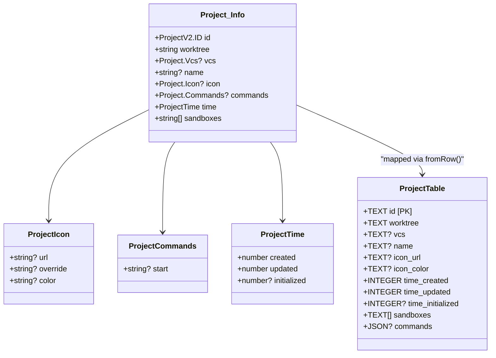
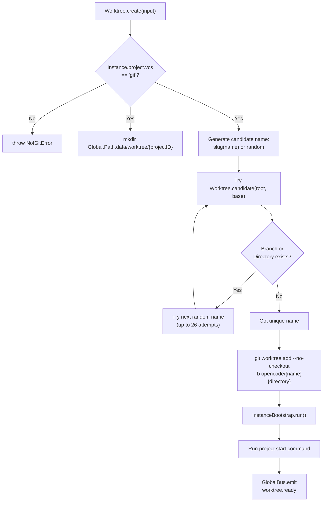
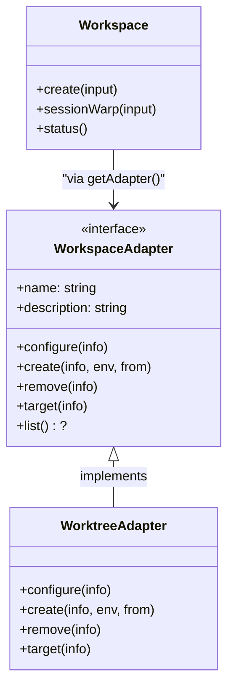

<!-- source: DeepWiki mcp.deepwiki.com · repo sst/opencode · page 2.7 Project and Worktree Management · fetched 2026-10-26 -->

# Project and Worktree Management

Relevant source files

The following files were used as context for generating this wiki page:

- [packages/app/src/utils/server.test.ts](packages/app/src/utils/server.test.ts)
- [packages/app/src/utils/terminal-websocket-url.test.ts](packages/app/src/utils/terminal-websocket-url.test.ts)
- [packages/app/src/utils/terminal-websocket-url.ts](packages/app/src/utils/terminal-websocket-url.ts)
- [packages/core/src/git.ts](packages/core/src/git.ts)
- [packages/core/src/project.ts](packages/core/src/project.ts)
- [packages/core/test/git.test.ts](packages/core/test/git.test.ts)
- [packages/core/test/project.test.ts](packages/core/test/project.test.ts)
- [packages/opencode/src/cli/cmd/debug/agent.ts](packages/opencode/src/cli/cmd/debug/agent.ts)
- [packages/opencode/src/cli/cmd/debug/index.ts](packages/opencode/src/cli/cmd/debug/index.ts)
- [packages/opencode/src/cli/cmd/debug/scrap.ts](packages/opencode/src/cli/cmd/debug/scrap.ts)
- [packages/opencode/src/cli/cmd/debug/startup.ts](packages/opencode/src/cli/cmd/debug/startup.ts)
- [packages/opencode/src/cli/cmd/pr.ts](packages/opencode/src/cli/cmd/pr.ts)
- [packages/opencode/src/control-plane/adapters/worktree.ts](packages/opencode/src/control-plane/adapters/worktree.ts)
- [packages/opencode/src/control-plane/types.ts](packages/opencode/src/control-plane/types.ts)
- [packages/opencode/src/control-plane/workspace-context.ts](packages/opencode/src/control-plane/workspace-context.ts)
- [packages/opencode/src/control-plane/workspace.ts](packages/opencode/src/control-plane/workspace.ts)
- [packages/opencode/src/effect/app-runtime.ts](packages/opencode/src/effect/app-runtime.ts)
- [packages/opencode/src/effect/bootstrap-runtime.ts](packages/opencode/src/effect/bootstrap-runtime.ts)
- [packages/opencode/src/effect/bridge.ts](packages/opencode/src/effect/bridge.ts)
- [packages/opencode/src/effect/instance-ref.ts](packages/opencode/src/effect/instance-ref.ts)
- [packages/opencode/src/effect/instance-state.ts](packages/opencode/src/effect/instance-state.ts)
- [packages/opencode/src/effect/run-service.ts](packages/opencode/src/effect/run-service.ts)
- [packages/opencode/src/git/index.ts](packages/opencode/src/git/index.ts)
- [packages/opencode/src/permission/index.ts](packages/opencode/src/permission/index.ts)
- [packages/opencode/src/plugin/tui/runtime.ts](packages/opencode/src/plugin/tui/runtime.ts)
- [packages/opencode/src/project/bootstrap.ts](packages/opencode/src/project/bootstrap.ts)
- [packages/opencode/src/project/project.ts](packages/opencode/src/project/project.ts)
- [packages/opencode/src/project/vcs.ts](packages/opencode/src/project/vcs.ts)
- [packages/opencode/src/question/index.ts](packages/opencode/src/question/index.ts)
- [packages/opencode/src/server/proxy-util.ts](packages/opencode/src/server/proxy-util.ts)
- [packages/opencode/src/server/routes/instance/httpapi/groups/workspace.ts](packages/opencode/src/server/routes/instance/httpapi/groups/workspace.ts)
- [packages/opencode/src/server/routes/instance/httpapi/handlers/tui.ts](packages/opencode/src/server/routes/instance/httpapi/handlers/tui.ts)
- [packages/opencode/src/server/routes/instance/httpapi/handlers/workspace.ts](packages/opencode/src/server/routes/instance/httpapi/handlers/workspace.ts)
- [packages/opencode/src/server/routes/instance/httpapi/middleware/proxy.ts](packages/opencode/src/server/routes/instance/httpapi/middleware/proxy.ts)
- [packages/opencode/src/server/routes/instance/httpapi/middleware/workspace-routing.ts](packages/opencode/src/server/routes/instance/httpapi/middleware/workspace-routing.ts)
- [packages/opencode/src/server/routes/instance/httpapi/websocket-tracker.ts](packages/opencode/src/server/routes/instance/httpapi/websocket-tracker.ts)
- [packages/opencode/src/server/shared/fence.ts](packages/opencode/src/server/shared/fence.ts)
- [packages/opencode/src/server/shared/tui-control.ts](packages/opencode/src/server/shared/tui-control.ts)
- [packages/opencode/src/tool/question.ts](packages/opencode/src/tool/question.ts)
- [packages/opencode/src/worktree/index.ts](packages/opencode/src/worktree/index.ts)
- [packages/opencode/test/control-plane/workspace.test.ts](packages/opencode/test/control-plane/workspace.test.ts)
- [packages/opencode/test/effect/app-runtime-logger.test.ts](packages/opencode/test/effect/app-runtime-logger.test.ts)
- [packages/opencode/test/effect/instance-state.test.ts](packages/opencode/test/effect/instance-state.test.ts)
- [packages/opencode/test/fixture/fixture.test.ts](packages/opencode/test/fixture/fixture.test.ts)
- [packages/opencode/test/fixture/fixture.ts](packages/opencode/test/fixture/fixture.ts)
- [packages/opencode/test/fixture/workspace.ts](packages/opencode/test/fixture/workspace.ts)
- [packages/opencode/test/git/git.test.ts](packages/opencode/test/git/git.test.ts)
- [packages/opencode/test/permission/next.test.ts](packages/opencode/test/permission/next.test.ts)
- [packages/opencode/test/project/migrate-global.test.ts](packages/opencode/test/project/migrate-global.test.ts)
- [packages/opencode/test/project/project.test.ts](packages/opencode/test/project/project.test.ts)
- [packages/opencode/test/project/vcs.test.ts](packages/opencode/test/project/vcs.test.ts)
- [packages/opencode/test/project/worktree-remove.test.ts](packages/opencode/test/project/worktree-remove.test.ts)
- [packages/opencode/test/project/worktree.test.ts](packages/opencode/test/project/worktree.test.ts)
- [packages/opencode/test/question/question.test.ts](packages/opencode/test/question/question.test.ts)
- [packages/opencode/test/server/httpapi-instance-context.test.ts](packages/opencode/test/server/httpapi-instance-context.test.ts)
- [packages/opencode/test/server/httpapi-mcp.test.ts](packages/opencode/test/server/httpapi-mcp.test.ts)
- [packages/opencode/test/server/httpapi-promptasync-context.test.ts](packages/opencode/test/server/httpapi-promptasync-context.test.ts)
- [packages/opencode/test/server/httpapi-provider.test.ts](packages/opencode/test/server/httpapi-provider.test.ts)
- [packages/opencode/test/server/httpapi-sdk.test.ts](packages/opencode/test/server/httpapi-sdk.test.ts)
- [packages/opencode/test/server/httpapi-workspace-routing.test.ts](packages/opencode/test/server/httpapi-workspace-routing.test.ts)
- [packages/opencode/test/server/httpapi-workspace.test.ts](packages/opencode/test/server/httpapi-workspace.test.ts)
- [packages/opencode/test/server/workspace-proxy.test.ts](packages/opencode/test/server/workspace-proxy.test.ts)
- [packages/tui/src/context/project.tsx](packages/tui/src/context/project.tsx)

This document explains OpenCode's project detection system and worktree management capabilities. OpenCode identifies projects using git repository metadata and provides isolated worktree environments for safe experimentation. For session management and storage, see [Session Management]() and [Storage and Database]().

## Purpose and Scope

OpenCode automatically detects projects based on git repository structure, identifies them uniquely using the root commit hash or remote URL, and manages multiple worktrees (isolated working directories) per project. This system enables:

-   **Stable Project Identity**: Projects maintain the same ID across machines and clones by deriving the ID from the repository's initial commit or normalized remote origin [packages/opencode/test/project/project.test.ts:151-171]().
-   **Worktree Isolation**: Create separate working directories on different branches for sandboxed execution [packages/opencode/src/worktree/index.ts:122]().
-   **VCS Integration**: Deep tracking of branch changes, diffs, and repository state via the `Vcs` service [packages/opencode/src/project/vcs.ts:1-205]().
-   **Control-Plane Adaptors**: Extensible workspace management via an adaptor system that supports local and remote environment types [packages/opencode/src/control-plane/workspace.ts:21-23]() [packages/opencode/src/control-plane/types.ts:1-30]().

Sources: [packages/opencode/src/project/project.ts:83-100](), [packages/opencode/src/worktree/index.ts:119-126](), [packages/opencode/src/control-plane/workspace.ts:131-147]()

## Project Detection Flow

When OpenCode starts in a directory, it determines the project context through a multi-step detection process that walks up the filesystem hierarchy looking for git repositories.

### Detection Algorithm

Title: "Project Detection Logic"

**Detection Process Details:**

1.  **Git Discovery**: `Project.fromDirectory` uses filesystem utilities to discover `.git` boundaries starting from the current directory [packages/opencode/src/project/project.ts:90]().
2.  **ID Caching**: It checks for a cached ID in the `opencode` file within the git metadata directory [packages/opencode/src/project/project.ts:248-264]().
3.  **Root Commit Query**: If no ID is cached, it executes `git rev-list --max-parents=0 HEAD` using `ChildProcessSpawner` to find the repository's initial commit [packages/opencode/src/project/project.ts:110-131]().
4.  **ID Generation**: The first root commit hash is used as the stable project ID and written to the cache [packages/opencode/src/project/project.ts:308-312](). The system also prefers normalized origin remote URLs over root commits if available [packages/opencode/test/project/project.test.ts:161-171]().
5.  **Worktree Resolution**: It determines the `worktree` path using `git rev-parse --git-common-dir` to ensure worktrees point back to the main repository [packages/opencode/src/project/project.ts:256-261]().

Sources: [packages/opencode/src/project/project.ts:106-346](), [packages/opencode/test/project/project.test.ts:109-179]()

### Path Resolution

The system distinguishes between directory types to manage isolation:

| Directory Type | Description | Resolution Method |
| :--- | :--- | :--- |
| **worktree** | Main repository location (the `.git` parent) | `git rev-parse --git-common-dir` [packages/opencode/src/project/project.ts:256-261]() |
| **sandbox** | Current working directory (toplevel) | `git rev-parse --show-toplevel` [packages/opencode/src/project/project.ts:324-328]() |
| **directory** | The specific path the server was started in | Provided as input to `Project.fromDirectory()` [packages/opencode/src/project/project.ts:90]() |

Sources: [packages/opencode/src/project/project.ts:256-346]()

## Project Data Model

### Project.Info Structure

Title: "Project Data Model Association"

**Field Descriptions:**

-   **id**: Stable identifier derived from the first git commit or normalized remote URL [packages/opencode/src/project/project.ts:45]() [packages/opencode/test/project/project.test.ts:161-171]().
-   **worktree**: Path to the main repository [packages/opencode/src/project/project.ts:46]().
-   **sandboxes**: Array of all active working directories associated with this project [packages/opencode/src/project/project.ts:55]().
-   **commands.start**: Startup script to run when creating a new workspace [packages/opencode/src/project/project.ts:56]().

Sources: [packages/opencode/src/project/project.ts:26-58](), [packages/opencode/src/project/project.ts:60-73]()

## Worktree System

Worktrees provide isolated working directories for experimentation. Each worktree operates on a separate git branch.

### Worktree Creation Flow

Title: "Worktree Creation Process"

**Worktree Naming:**

The `candidate()` function generates unique names using:
1.  **Custom Name**: Provided name if it doesn't conflict [packages/opencode/src/worktree/index.ts:182]().
2.  **Random Fallback**: Using `Slug.create()` for human-readable random slugs if the primary name exists [packages/opencode/src/worktree/index.ts:182]().
3.  **Branch Name**: Prefixed with `"opencode/"` [packages/opencode/src/worktree/index.ts:183]().

Sources: [packages/opencode/src/worktree/index.ts:142-242](), [packages/opencode/src/worktree/index.ts:175-197]()

### Start Commands

Projects can define a `start` command that runs when new worktrees are created. This enables setup tasks like installing dependencies.

-   **Project Start Command**: Defined in `Project.Info.commands.start` [packages/opencode/src/project/project.ts:56]().
-   **Worktree Start Command**: Provided in `Worktree.CreateInput.startCommand` [packages/opencode/src/worktree/index.ts:32-34]().

The system runs the project's start command followed by the worktree-specific command during `createFromInfo` [packages/opencode/src/worktree/index.ts:121]() [packages/opencode/src/worktree/index.ts:315-325]().

Sources: [packages/opencode/src/worktree/index.ts:119-126](), [packages/opencode/src/worktree/index.ts:315-325]()

## VCS and File Watching

### Branch Tracking
The `Vcs` system monitors the current git branch. It subscribes to filesystem events and publishes `VcsEvent` when a change to `HEAD` or refs is detected [packages/opencode/src/project/vcs.ts:7-10]().

### Patch and Diff Generation
The `Vcs` service provides high-performance diffing by batching git patch operations [packages/opencode/src/project/vcs.ts:97-120](). It supports:
-   **Batching**: Combining multiple file diffs into a single `git patch-all` call to reduce overhead [packages/opencode/src/project/vcs.ts:106-109]().
-   **Untracked Files**: Specifically handling new files using `git patch-untracked` [packages/opencode/src/project/vcs.ts:131-134]().
-   **Size Limits**: Capping total patch bytes via `MAX_TOTAL_PATCH_BYTES` (10MB) to prevent memory issues [packages/opencode/src/project/vcs.ts:13]().

Sources: [packages/opencode/src/project/vcs.ts:11-143](), [packages/opencode/src/project/vcs.ts:202-225]()

## Control-Plane Workspace System

OpenCode implements a workspace system that abstracts environment management. This allows the agent to interact with different execution environments (local or remote) via adaptors.

### Adaptor Architecture

Title: "Workspace Adaptor System"

The workspace management system uses an adaptor pattern to handle different workspace types. The `Workspace.create` function uses these adaptors to configure and instantiate the environment [packages/opencode/src/control-plane/workspace.ts:132](). Workspace status is tracked via `ConnectionStatus` and broadcast on the `GlobalBus` [packages/opencode/src/control-plane/workspace.ts:44-46]() [packages/opencode/src/control-plane/workspace.ts:168-182]().

### Session Warping
OpenCode supports "warping" a session between workspaces via `Workspace.sessionWarp`. This involves:
1.  **Event Migration**: Moving session events to the new workspace's event stream [packages/opencode/src/control-plane/workspace.ts:133]() [packages/opencode/src/control-plane/workspace.ts:265-270]().
2.  **Change Syncing**: Optionally applying uncommitted file changes (patches) from the source workspace to the target workspace using the `Vcs` service [packages/opencode/src/control-plane/workspace.ts:133]() [packages/opencode/src/control-plane/workspace.ts:275-288]().

Sources: [packages/opencode/src/control-plane/workspace.ts:38-60](), [packages/opencode/src/control-plane/workspace.ts:131-147](), [packages/opencode/src/control-plane/workspace.ts:232-300]()

## Summary of Key Functions

| Function | File | Purpose |
| :--- | :--- | :--- |
| `Project.fromDirectory` | `packages/opencode/src/project/project.ts` | Detects project ID and root paths from a directory [packages/opencode/src/project/project.ts:90](). |
| `Worktree.create` | `packages/opencode/src/worktree/index.ts` | Creates a new git worktree and initializes it [packages/opencode/src/worktree/index.ts:122](). |
| `Vcs.diffAgainstRef` | `packages/opencode/src/project/vcs.ts` | Generates a structured diff between current state and a git ref [packages/opencode/src/project/vcs.ts:202](). |
| `Workspace.create` | `packages/opencode/src/control-plane/workspace.ts` | High-level workspace instantiation via adaptors [packages/opencode/src/control-plane/workspace.ts:132](). |
| `Workspace.sessionWarp` | `packages/opencode/src/control-plane/workspace.ts` | Migrates a session and its changes between workspaces [packages/opencode/src/control-plane/workspace.ts:133](). |
| `InstanceBootstrap.run` | `packages/opencode/src/project/bootstrap.ts` | Orchestrates initialization of all instance-level services [packages/opencode/src/project/bootstrap.ts:32](). |

Sources: [packages/opencode/src/project/project.ts:90](), [packages/opencode/src/worktree/index.ts:122](), [packages/opencode/src/project/vcs.ts:202](), [packages/opencode/src/control-plane/workspace.ts:132-133](), [packages/opencode/src/project/bootstrap.ts:32]()

---

