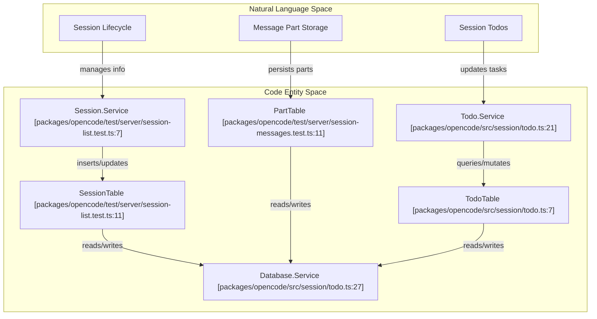
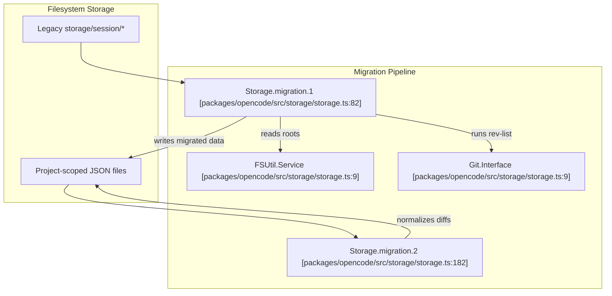

<!-- source: DeepWiki mcp.deepwiki.com · repo sst/opencode · page 2.9 Storage and Database · fetched 2026-10-26 -->

# Storage and Database

<details>
<summary>Relevant source files</summary>

The following files were used as context for generating this wiki page:

- [packages/core/src/global.ts](packages/core/src/global.ts)
- [packages/desktop/electron.vite.config.ts](packages/desktop/electron.vite.config.ts)
- [packages/desktop/src/main/apps.ts](packages/desktop/src/main/apps.ts)
- [packages/desktop/src/main/env.d.ts](packages/desktop/src/main/env.d.ts)
- [packages/desktop/src/main/sidecar.ts](packages/desktop/src/main/sidecar.ts)
- [packages/opencode/script/build-node.ts](packages/opencode/script/build-node.ts)
- [packages/opencode/script/generate.ts](packages/opencode/script/generate.ts)
- [packages/opencode/src/cli/cmd/db.ts](packages/opencode/src/cli/cmd/db.ts)
- [packages/opencode/src/index.ts](packages/opencode/src/index.ts)
- [packages/opencode/src/node.ts](packages/opencode/src/node.ts)
- [packages/opencode/src/session/instruction.ts](packages/opencode/src/session/instruction.ts)
- [packages/opencode/src/session/revert.ts](packages/opencode/src/session/revert.ts)
- [packages/opencode/src/session/run-state.ts](packages/opencode/src/session/run-state.ts)
- [packages/opencode/src/session/status.ts](packages/opencode/src/session/status.ts)
- [packages/opencode/src/session/todo.ts](packages/opencode/src/session/todo.ts)
- [packages/opencode/src/storage/storage.ts](packages/opencode/src/storage/storage.ts)
- [packages/opencode/src/tool/todo.ts](packages/opencode/src/tool/todo.ts)
- [packages/opencode/test/fixture/db.ts](packages/opencode/test/fixture/db.ts)
- [packages/opencode/test/mcp/auth.test.ts](packages/opencode/test/mcp/auth.test.ts)
- [packages/opencode/test/plugin/auth-override.test.ts](packages/opencode/test/plugin/auth-override.test.ts)
- [packages/opencode/test/server/global-session-list.test.ts](packages/opencode/test/server/global-session-list.test.ts)
- [packages/opencode/test/server/session-actions.test.ts](packages/opencode/test/server/session-actions.test.ts)
- [packages/opencode/test/server/session-list.test.ts](packages/opencode/test/server/session-list.test.ts)
- [packages/opencode/test/server/session-messages.test.ts](packages/opencode/test/server/session-messages.test.ts)
- [packages/opencode/test/session/instruction.test.ts](packages/opencode/test/session/instruction.test.ts)
- [packages/opencode/test/session/revert-compact.test.ts](packages/opencode/test/session/revert-compact.test.ts)
- [packages/opencode/test/session/schema-decoding.test.ts](packages/opencode/test/session/schema-decoding.test.ts)
- [packages/opencode/test/session/session.test.ts](packages/opencode/test/session/session.test.ts)
- [packages/opencode/test/storage/storage.test.ts](packages/opencode/test/storage/storage.test.ts)

</details>


This document details OpenCode's data persistence architecture, managing structured session data, project metadata, large binary blobs, todo lists, and version control snapshots. The system relies on a hybrid persistence model: relational storage via SQLite and Drizzle ORM, hierarchical JSON file-based storage for large or auxiliary data, and an internal Git-backed snapshot engine.

## Overview and Storage Layers

OpenCode persists data across three primary layers coordinated through the Effect framework:

| Layer | Technology | Purpose | Location / Code Entity |
|-------|-----------|---------|------------------------|
| **Relational Data** | SQLite + Drizzle ORM | Sessions, messages, parts, todos, and project metadata | `Global.Path.data/opencode.db` / `Database.Service` [packages/opencode/test/fixture/db.ts:11]() |
| **Blob & JSON Storage** | File System (JSON) | Historical session diffs, summaries, and auxiliary records | `Global.Path.data/storage/*` / `Storage.Service` [packages/opencode/src/storage/storage.ts:61]() |
| **VCS Snapshots** | Git (Internal) | File-level undo/revert tracking for agent modifications | `Global.Path.data/snapshot/[projectID]/[hash]` / `Snapshot.Service` [packages/opencode/src/snapshot/index.ts:47]() |

**Sources**: [packages/opencode/test/fixture/db.ts:11](), [packages/opencode/src/storage/storage.ts:61]()

---

## Relational Database and Drizzle ORM

The primary relational database is a SQLite instance managed via Drizzle ORM (`Database.Service`). It maintains the core structured domain models, including sessions, message parts, projects, and todo items.

### Database Schema and Mappings
Tables are defined in core packages using Drizzle schema definitions and accessed via Effect-wrapped database clients.
- **`SessionTable`**: Persists session attributes, project associations, workspace bindings, titles, model settings, and aggregate token usage [packages/opencode/test/server/session-list.test.ts:11]().
- **`PartTable`**: Stores individual message component data (text blocks, tool execution states, reasoning) [packages/opencode/test/server/session-messages.test.ts:11]().
- **`TodoTable`**: Stores structured task items (`Info` records) associated with a session [packages/opencode/src/session/todo.ts:7](), [packages/opencode/src/session/todo.ts:30-47]().
- **`ProjectTable`**: Stores project workspace roots and version control settings [packages/opencode/test/server/global-session-list.test.ts:11]().

### Diagram: Relational Storage Pipeline (Natural Language to Code Entity)
This diagram maps domain concepts to code entities within the database persistence layer.



**Sources**: [packages/opencode/test/server/session-list.test.ts:7](), [packages/opencode/test/server/session-list.test.ts:11](), [packages/opencode/test/server/session-messages.test.ts:11](), [packages/opencode/src/session/todo.ts:7-27]()

---

## File-Based Storage Layer and Migration Process

The `Storage.Service` handles unstructured or auxiliary data that is not kept in the relational SQLite database, such as cached session diffs and historical JSON metadata [packages/opencode/src/storage/storage.ts:61]().

### Key Operations
- **`Storage.read<T>(key)`**: Decodes JSON content from disk via filesystem utilities [packages/opencode/src/storage/storage.ts:55]().
- **`Storage.update<T>(key, fn)`**: Implements a read-modify-write transactional step using reentrant locking (`TxReentrantLock`) [packages/opencode/src/storage/storage.ts:56]().
- **`Storage.write<T>(key, content)`**: Atomically serializes structures to disk paths [packages/opencode/src/storage/storage.ts:57]().

### JSON Migration Process
The storage system includes an automated migration pipeline (`MIGRATIONS`) that evolves legacy directory structures into modern project-scoped layouts [packages/opencode/src/storage/storage.ts:81]().
- **Migration 1**: Detects legacy project structures, traverses raw message files for root discovery, queries git commit roots via `git.run()` [packages/opencode/src/storage/storage.ts:109-111](), and reorganizes session storage into project-keyed directories [packages/opencode/src/storage/storage.ts:82-181]().
- **Migration 2**: Scans and normalizes session summary diffs into specialized format files [packages/opencode/src/storage/storage.ts:182-198]().

### Diagram: JSON Migration Flow



**Sources**: [packages/opencode/src/storage/storage.ts:9](), [packages/opencode/src/storage/storage.ts:53-61](), [packages/opencode/src/storage/storage.ts:82-198](), [packages/opencode/src/storage/storage.ts:109-111]()

---

## Snapshot and Version Control Tracking

The `Snapshot.Service` provides file-level undo and revert capabilities by managing an internal Git repository (gitdir) isolated from the user's working repository [packages/opencode/src/snapshot/index.ts:47]().

### Snapshot Operations
- **`Snapshot.track()`**: Stages worktree modifications, filters ignored files via git hooks, writes a tree object, and commits the state to return a snapshot hash [packages/opencode/src/snapshot/index.ts:39]().
- **`Snapshot.restore(hash)`**: Resets working tree files to the state captured in the specified snapshot hash [packages/opencode/src/snapshot/index.ts:42]().
- **`Snapshot.revert(patches)`**: Applies targeted patch sets to reverse specific agent actions [packages/opencode/src/snapshot/index.ts:42]().

**Sources**: [packages/opencode/src/snapshot/index.ts:36-45]()

---

## Revert, Unrevert, and State Management

The `SessionRevert.Service` coordinates between relational session state, summary recalculation, and the `Snapshot.Service` to manage rollbacks [packages/opencode/src/session/revert.ts:26]().

### Revert Workflow
1. **Busy Assertion**: Asserts that the session is not currently running a prompt loop via `SessionRunState.Service` [packages/opencode/src/session/revert.ts:39]().
2. **Target Identification**: Scans message history to isolate the target message or part ID [packages/opencode/src/session/revert.ts:46-66]().
3. **Filesystem Rollback**: Captures or restores baseline snapshots using `Snapshot.Service` and applies differential patches [packages/opencode/src/session/revert.ts:70-72]().
4. **Summary & Event Emission**: Computes diff summaries, stores diff blobs via `Storage.Service` [packages/opencode/src/session/revert.ts:77](), and publishes synchronization events [packages/opencode/src/session/revert.ts:78]().

### Diagram: Revert & Unrevert Architecture (Natural Language to Code Entity)

```mermaid
graph TD
    subgraph "Natural Language Space"
        UserAction["User Reverts Agent Actions"]
        UndoAction["User Restores/Unreverts State"]
    end

    subgraph "Code Entity Space"
        SRService["SessionRevert.Service [packages/opencode/src/session/revert.ts:26]"]
        RunState["SessionRunState.Service [packages/opencode/src/session/revert.ts:36]"]
        SnapService["Snapshot.Service [packages/opencode/src/session/revert.ts:32]"]
        StoreService["Storage.Service [packages/opencode/src/session/revert.ts:33]"]
        EventBridge["EventV2Bridge.Service [packages/opencode/src/session/revert.ts:34]"]
    end

    UserAction -->|calls revert()| SRService
    UndoAction -->|calls unrevert()| SRService
    SRService -->|assertNotBusy| RunState
    SRService -->|restore/revert snapshot| SnapService
    SRService -->|write session diff| StoreService
    SRService -->|publish Diff event| EventBridge
```

**Sources**: [packages/opencode/src/session/revert.ts:26-36](), [packages/opencode/src/session/revert.ts:38-99](), [packages/opencode/src/session/revert.ts:77](), [packages/opencode/src/session/revert.ts:78]()

---

## Codebase Entity Mapping

The following table associates storage and database concepts with their concrete code definitions.

| Concept / Role | Code Entity | File Path |
|----------------|-------------|-----------|
| Database Connection & Service | `Database.Service` | [packages/opencode/test/fixture/db.ts:11]() |
| Session Entity Table | `SessionTable` | [packages/opencode/test/server/session-list.test.ts:11]() |
| Message Part Table | `PartTable` | [packages/opencode/test/server/session-messages.test.ts:11]() |
| Session Todo Table | `TodoTable` | [packages/opencode/src/session/todo.ts:7]() |
| JSON Storage Interface | `Storage.Service` | [packages/opencode/src/storage/storage.ts:61]() |
| VCS Snapshot Engine | `Snapshot.Service` | [packages/opencode/src/snapshot/index.ts:47]() |
| Revert Management Service | `SessionRevert.Service` | [packages/opencode/src/session/revert.ts:26]() |
| Migration Runner | `MIGRATIONS` | [packages/opencode/src/storage/storage.ts:81]() |

**Sources**: [packages/opencode/test/fixture/db.ts:11](), [packages/opencode/test/server/session-list.test.ts:11](), [packages/opencode/test/server/session-messages.test.ts:11](), [packages/opencode/src/session/todo.ts:7](), [packages/opencode/src/storage/storage.ts:61](), [packages/opencode/src/storage/storage.ts:81](), [packages/opencode/src/snapshot/index.ts:47](), [packages/opencode/src/session/revert.ts:26]()

---

