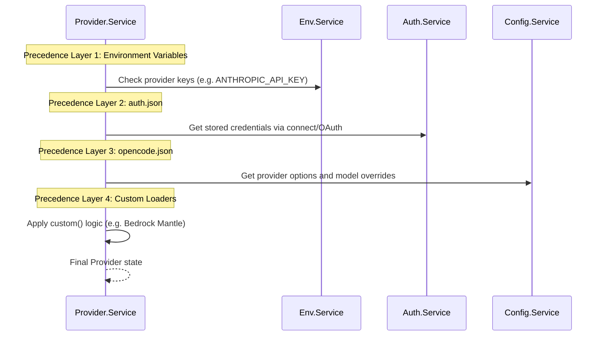

<!-- source: DeepWiki mcp.deepwiki.com · repo sst/opencode · page 4 AI Provider Integration · fetched 2026-10-26 -->

# AI Provider Integration

<details>
<summary>Relevant source files</summary>

The following files were used as context for generating this wiki page:

- [packages/opencode/src/plugin/azure.ts](packages/opencode/src/plugin/azure.ts)
- [packages/opencode/src/provider/provider.ts](packages/opencode/src/provider/provider.ts)
- [packages/opencode/src/provider/transform.ts](packages/opencode/src/provider/transform.ts)
- [packages/opencode/test/plugin/azure.test.ts](packages/opencode/test/plugin/azure.test.ts)
- [packages/opencode/test/provider/amazon-bedrock.test.ts](packages/opencode/test/provider/amazon-bedrock.test.ts)
- [packages/opencode/test/provider/gitlab-duo.test.ts](packages/opencode/test/provider/gitlab-duo.test.ts)
- [packages/opencode/test/provider/provider.test.ts](packages/opencode/test/provider/provider.test.ts)
- [packages/opencode/test/provider/transform.test.ts](packages/opencode/test/provider/transform.test.ts)
- [packages/web/src/content/docs/ecosystem.mdx](packages/web/src/content/docs/ecosystem.mdx)
- [packages/web/src/content/docs/providers.mdx](packages/web/src/content/docs/providers.mdx)
- [packages/web/src/content/docs/zh-cn/providers.mdx](packages/web/src/content/docs/zh-cn/providers.mdx)
- [packages/web/src/content/docs/zh-tw/providers.mdx](packages/web/src/content/docs/zh-tw/providers.mdx)
- [patches/@ai-sdk%2Famazon-bedrock@4.0.166.patch](patches/@ai-sdk%2Famazon-bedrock@4.0.166.patch)
- [patches/@ai-sdk%2Fanthropic@3.0.111.patch](patches/@ai-sdk%2Fanthropic@3.0.111.patch)

</details>


OpenCode integrates with **75+ LLM providers** through a unified abstraction layer built on the [AI SDK](https://ai-sdk.dev/) and `ModelsDev`. This enables provider-agnostic model selection while handling vendor-specific authentication, message formats, and API requirements.

The provider integration system consists of seven main subsystems:

1. **Provider Architecture** ([Provider Architecture](#4.1)) — Provider loading, model resolution, and SDK integration.
2. **Authentication and Authorization** ([Authentication and Authorization](#4.2)) — Credential management, OAuth flows, and environment variable precedence.
3. **Provider Transformations** ([Provider Transformations](#4.3)) — Message normalization, surrogate character sanitization, and provider-specific parameter adjustment.
4. **Supported Providers** ([Supported Providers](#4.4)) — Catalog of integrated providers (OpenAI, Anthropic, AWS Bedrock, etc.) and their specific configurations.
5. **OpenCode Zen and Go Services** ([OpenCode Zen and Go Services](#4.5)) — Managed model services providing curated, tested LLM access.
6. **LLM Core Package** ([LLM Core Package](#4.6)) — The `packages/llm` Effect Schema-first abstraction layer for requests and streaming.
7. **Core V2 Architecture** ([Core V2 Architecture](#4.7)) — The next-generation domain layer for provider discovery and account management.

**Related Pages**: See [Configuration System](3) for `opencode.json` provider configuration. See [Prompt Processing Pipeline](2.3) for how `SessionPrompt` invokes these providers.

## System Architecture

The provider integration layer sits between OpenCode's session management and external AI APIs, orchestrating configuration, authentication, model selection, and request/response transformations.

### High-Level Architecture

Provider Integration System Components

```mermaid
graph TB
    subgraph "ConfigLayer [Configuration Layer]"
        "Config[Config.Service]"
        "Auth[Auth.Service]"
        "ModelsDev[ModelsDev.Service]"
        "EnvVars[Env.Service]"
    end
    
    subgraph "CoreSystem [Provider Core (4.1)]"
        "ProviderService[Provider.Service]"
        "GetModel[Provider.getModel]"
        "SDKLoader[BUNDLED_PROVIDERS]"
        "ModelCache[Model Definitions]"
    end
    
    subgraph "AuthSystem [Authentication (4.2)]"
        "CredMgr[Auth.Service]"
        "APIKeys[auth.json]"
        "EnvAuth[Environment Variables]"
    end
    
    subgraph "TransformLayer [Transformations (4.3)]"
        "MsgTransform[ProviderTransform.normalizeMessages]"
        "Sanitize[ProviderTransform.sanitizeSurrogates]"
        "OptionsTransform[ProviderTransform.options]"
    end
    
    subgraph "AISDKLayer [AI SDK Integration]"
        "AISDK[LanguageModelV3]"
        "BundledSDK[createOpenAI/createAnthropic/etc]"
    end
    
    "Config" --> "ProviderService"
    "Auth" --> "CredMgr"
    "ModelsDev" --> "ProviderService"
    "EnvVars" --> "CredMgr"
    
    "ProviderService" --> "GetModel"
    "CredMgr" --> "GetModel"
    "GetModel" --> "SDKLoader"
    "SDKLoader" --> "AISDK"
    
    "GetModel" --> "TransformLayer"
    "TransformLayer" --> "AISDK"
    "AISDK" --> "BundledSDK"
```
The system follows a layered architecture where configuration and authentication feed into the core service `Provider.Service`, which manages SDK loading via `BUNDLED_PROVIDERS` and model definitions. Transformations adapt requests via `ProviderTransform` before invoking the AI SDK `LanguageModelV3`.
Sources: [packages/opencode/src/provider/provider.ts:107-134](), [packages/opencode/src/provider/provider.ts:13-15](), [packages/opencode/src/provider/provider.ts:28-31](), [packages/opencode/src/provider/transform.ts:101-105]()

### Provider State Initialization

Provider state is initialized via `Provider.Service`, which manages the discovery of models and resolves credentials from the `Auth` and `Env` services.

Provider Configuration Merging Flow


The merging logic performs deep merges of provider options using helper functions. Authentication priority places bearer tokens and environment variables above general configuration. The system uses `fuzzysort` for model resolution when IDs are ambiguous.
Sources: [packages/opencode/src/provider/provider.ts:4-6](), [packages/opencode/src/provider/provider.ts:112-122](), [packages/opencode/test/provider/provider.test.ts:112-122](), [packages/opencode/test/provider/provider.test.ts:180-196](), [packages/opencode/src/env/index.ts:22-25]()

## Sub-Topic Overviews

### Provider Architecture
OpenCode uses a lazy-loading mechanism for AI SDKs defined in `BUNDLED_PROVIDERS` inside [packages/opencode/src/provider/provider.ts:107-134](). When a model is requested, the system dynamically imports the required provider package (e.g., `@ai-sdk/anthropic`). The `Provider.getModel()` function resolves the specific `LanguageModelV3` instance based on the provider and model IDs.
For details, see [Provider Architecture](#4.1).
Sources: [packages/opencode/src/provider/provider.ts:107-134](), [packages/opencode/src/provider/provider.ts:154-160]()

### Authentication and Authorization
Authentication supports API keys, OAuth, and well-known credential chains. The `Auth` service manages credential resolution, while `Env` provides access to process environment variables. The system handles specific provider headers and timeout configurations (e.g., `OPENAI_HEADER_TIMEOUT_DEFAULT`). Plugin-based OAuth flows are supported for providers like Azure.
For details, see [Authentication and Authorization](#4.2).
Sources: [packages/opencode/src/provider/provider.ts:14-15](), [packages/opencode/src/provider/provider.ts:35-35](), [packages/opencode/src/plugin/azure.ts:73-104](), [packages/opencode/test/plugin/azure.test.ts:23-29]()

### Provider Transformations
The `ProviderTransform` utility handles normalization of messages and parameters. This includes `sanitizeSurrogates` to handle character encoding issues and provider-specific logic in `normalizeMessages` to filter empty content for Anthropic and Bedrock. It also manages modality mapping (image, audio, video, pdf) to ensure correct data structures are sent to the underlying SDK.
For details, see [Provider Transformations](#4.3).
Sources: [packages/opencode/src/provider/transform.ts:25-27](), [packages/opencode/src/provider/transform.ts:10-16](), [packages/opencode/src/provider/transform.ts:101-195]()

### Supported Providers
OpenCode supports a vast array of providers including Anthropic, OpenAI, AWS Bedrock, Google Vertex, Azure, and local models via `openai-compatible` endpoints. The system includes logic for continental multi-region endpoints, such as `googleVertexAnthropicBaseURL`. Specialized integrations exist for newer providers like Cerebras, DeepInfra, and TogetherAI.
For details, see [Supported Providers](#4.4).
Sources: [packages/opencode/src/provider/provider.ts:94-99](), [packages/opencode/src/provider/provider.ts:107-134](), [packages/opencode/src/provider/transform.ts:42-98](), [packages/web/src/content/docs/providers.mdx:9]()

### OpenCode Zen and Go Services
Zen and Go are managed model services. The integration layer treats them as specialized providers, often resolving through the `opencode` provider ID. These services provide curated, pay-as-you-go or subscription-based access to verified models.
For details, see [OpenCode Zen and Go Services](#4.5).
Sources: [packages/opencode/test/provider/provider.test.ts:79-83](), [packages/web/src/content/docs/providers.mdx:87-91](), [packages/web/src/content/docs/providers.mdx:124-127]()

### LLM Core Package
The `packages/llm` package provides an Effect-native abstraction for LLM interactions. It handles `LLMRequest` and `LLMResponse` logic at a lower level than the `Provider` service, serving as the foundational schema-first layer for model communication.
For details, see [LLM Core Package](#4.6).
Sources: [packages/opencode/src/provider/provider.ts:21-24](), [packages/opencode/test/provider/transform.test.ts:4-8]()

### Core V2 Architecture
The V2 architecture introduces a `Catalog` service for improved provider/model discovery and an `AccountV2` system for credential management. It leverages a `PluginV2` hook system to allow more flexible transformations and event-driven updates, utilizing `ProviderV2` and `ModelV2` definitions.
For details, see [Core V2 Architecture](#4.7).
Sources: [packages/opencode/src/provider/provider.ts:29-30](), [packages/opencode/test/provider/provider.test.ts:24-25](), [packages/opencode/test/provider/amazon-bedrock.test.ts:13-14]()

---

