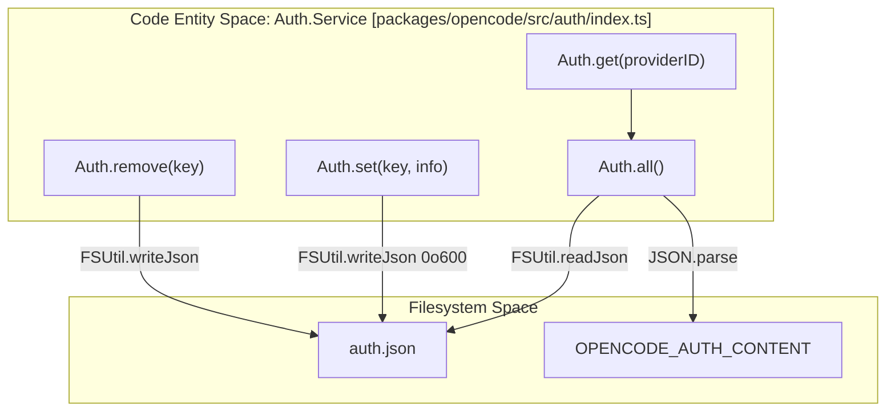
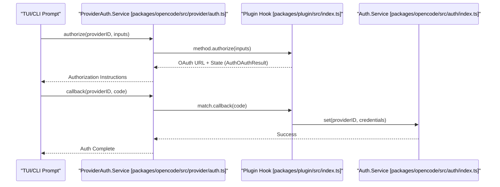
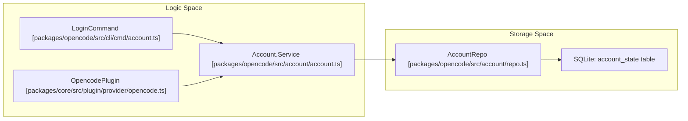

<!-- source: DeepWiki mcp.deepwiki.com · repo sst/opencode · page 4.2 Authentication and Authorization · fetched 2026-10-26 -->

# Authentication and Authorization

Relevant source files

The following files were used as context for generating this wiki page:

- [packages/core/src/open.ts](packages/core/src/open.ts)
- [packages/core/src/plugin/provider/opencode.ts](packages/core/src/plugin/provider/opencode.ts)
- [packages/core/src/provider.ts](packages/core/src/provider.ts)
- [packages/core/test/open.test.ts](packages/core/test/open.test.ts)
- [packages/core/test/plugin/provider-opencode.test.ts](packages/core/test/plugin/provider-opencode.test.ts)
- [packages/opencode/src/account/account.ts](packages/opencode/src/account/account.ts)
- [packages/opencode/src/account/repo.ts](packages/opencode/src/account/repo.ts)
- [packages/opencode/src/account/schema.ts](packages/opencode/src/account/schema.ts)
- [packages/opencode/src/account/url.ts](packages/opencode/src/account/url.ts)
- [packages/opencode/src/auth/index.ts](packages/opencode/src/auth/index.ts)
- [packages/opencode/src/cli/cmd/account.ts](packages/opencode/src/cli/cmd/account.ts)
- [packages/opencode/src/cli/cmd/import.ts](packages/opencode/src/cli/cmd/import.ts)
- [packages/opencode/src/mcp/browser.ts](packages/opencode/src/mcp/browser.ts)
- [packages/opencode/src/plugin/digitalocean.ts](packages/opencode/src/plugin/digitalocean.ts)
- [packages/opencode/src/plugin/index.ts](packages/opencode/src/plugin/index.ts)
- [packages/opencode/src/plugin/snowflake-cortex.ts](packages/opencode/src/plugin/snowflake-cortex.ts)
- [packages/opencode/src/provider/auth.ts](packages/opencode/src/provider/auth.ts)
- [packages/opencode/src/share/session.ts](packages/opencode/src/share/session.ts)
- [packages/opencode/src/share/share-next.ts](packages/opencode/src/share/share-next.ts)
- [packages/opencode/test/account/repo.test.ts](packages/opencode/test/account/repo.test.ts)
- [packages/opencode/test/account/service.test.ts](packages/opencode/test/account/service.test.ts)
- [packages/opencode/test/cli/account.test.ts](packages/opencode/test/cli/account.test.ts)
- [packages/opencode/test/cli/import.test.ts](packages/opencode/test/cli/import.test.ts)
- [packages/opencode/test/mcp/browser.test.ts](packages/opencode/test/mcp/browser.test.ts)
- [packages/opencode/test/share/share-next.test.ts](packages/opencode/test/share/share-next.test.ts)
- [packages/opencode/tsconfig.json](packages/opencode/tsconfig.json)
- [packages/plugin/src/example.ts](packages/plugin/src/example.ts)
- [packages/plugin/src/index.ts](packages/plugin/src/index.ts)
- [packages/plugin/tsconfig.json](packages/plugin/tsconfig.json)
- [packages/web/src/content/docs/commands.mdx](packages/web/src/content/docs/commands.mdx)
- [packages/web/src/content/docs/custom-tools.mdx](packages/web/src/content/docs/custom-tools.mdx)
- [packages/web/src/content/docs/gitlab.mdx](packages/web/src/content/docs/gitlab.mdx)
- [packages/web/src/content/docs/mcp-servers.mdx](packages/web/src/content/docs/mcp-servers.mdx)
- [packages/web/src/content/docs/plugins.mdx](packages/web/src/content/docs/plugins.mdx)
- [packages/web/src/content/docs/sdk.mdx](packages/web/src/content/docs/sdk.mdx)

This page documents OpenCode's authentication and authorization system. It covers credential storage, authentication flows (OAuth, API keys, and well-known), provider-specific auth hooks, and managed account services.

---

## Overview

OpenCode supports multiple AI providers through a flexible authentication system that handles three primary credential types: OAuth tokens (for browser-based services), API keys (for direct provider access), and well-known tokens for enterprise discovery.

Authentication is managed through:
- **Credential Storage**: Secure persistence in `auth.json` [packages/opencode/src/auth/index.ts:10-10]().
- **Provider Auth Hooks**: A plugin-based system for initiating and completing provider-specific auth flows [packages/opencode/src/provider/auth.ts:105-127]().
- **Account Management**: A high-level service for managing OpenCode-specific console accounts and organizations [packages/opencode/src/account/account.ts:1-50]().
- **Plugin Integration**: Built-in and external plugins that implement `AuthHook` to extend provider support [packages/opencode/src/plugin/index.ts:66-84]().

Sources: [packages/opencode/src/auth/index.ts](), [packages/opencode/src/provider/auth.ts](), [packages/opencode/src/account/account.ts](), [packages/opencode/src/plugin/index.ts]()

---

## Authentication Types and Storage

OpenCode defines core authentication structures in the `Auth` namespace using `Effect.Schema`.

### Credential Schemas

| Type | Class Name | Description |
| :--- | :--- | :--- |
| **OAuth** | `Auth.Oauth` | Stores `access` and `refresh` tokens, expiration (`expires`), and optional `accountId` or `enterpriseUrl` [packages/opencode/src/auth/index.ts:14-21](). |
| **API Key** | `Auth.Api` | Stores a simple string `key` and optional `metadata` [packages/opencode/src/auth/index.ts:23-27](). |
| **Well-Known** | `Auth.WellKnown` | Used for enterprise discovery, storing a `key` and `token` [packages/opencode/src/auth/index.ts:29-33](). |

### Storage Implementation

Credentials are persisted in a JSON file at `Global.Path.data/auth.json` [packages/opencode/src/auth/index.ts:10-10](). The `Auth.Service` provides the interface for managing these secrets with file permissions set to `0o600` for security [packages/opencode/src/auth/index.ts:79-88](). Additionally, the system can load authentication content from the `OPENCODE_AUTH_CONTENT` environment variable [packages/opencode/src/auth/index.ts:59-63]().

**Auth Service Data Flow**

Sources: [packages/opencode/src/auth/index.ts:1-97]()

**Key Normalization**: The `set` and `remove` functions normalize provider keys by stripping trailing slashes to ensure consistent lookups [packages/opencode/src/auth/index.ts:73-89]().

Sources: [packages/opencode/src/auth/index.ts:1-97]()

---

## Provider Authentication Flows

The `ProviderAuth` service bridges the core `Auth` storage with provider-specific logic defined in plugins.

### Authorization Methods

The `ProviderAuth.Method` schema defines how a provider requests credentials, supporting interactive `text` or `select` prompts with conditional `when` logic [packages/opencode/src/provider/auth.ts:11-45]().

- **`authorize()`**: Initiates the auth flow. For OAuth, it returns an `Authorization` object containing the `url`, `method` (auto or code), and instructions [packages/opencode/src/provider/auth.ts:163-186]().
- **`callback()`**: Processes the result (e.g., an OAuth code) and completes the flow via the plugin's callback hook [packages/opencode/src/provider/auth.ts:188-202]().

### Plugin Integration
OpenCode allows users to override or add provider authentication logic using plugins. The `Plugin.Service` lists active plugins, and `ProviderAuth` extracts hooks where `x.auth.provider` is defined [packages/opencode/src/provider/auth.ts:113-124](). Built-in plugins like `CodexAuthPlugin`, `CopilotAuthPlugin`, and `AzureAuthPlugin` utilize these hooks [packages/opencode/src/plugin/index.ts:66-85]().

**Provider Auth Sequence**

Sources: [packages/opencode/src/provider/auth.ts:1-206](), [packages/plugin/src/index.ts:88-163](), [packages/opencode/src/auth/index.ts:43-48](), [packages/opencode/src/plugin/index.ts:66-85]()

Sources: [packages/opencode/src/provider/auth.ts:1-206](), [packages/opencode/src/plugin/index.ts:88-163](), [packages/opencode/src/auth/index.ts:43-48](), [packages/opencode/src/plugin/index.ts:66-85]()

---

## Account and Console Authentication

OpenCode provides a dedicated `Account.Service` for interacting with the OpenCode Console (managed services).

### Device Authorization Grant
The `Account.Service` implements an OAuth 2.0 Device Authorization Grant flow:
1. **`login(url)`**: Requests a device code from the console server, typically `https://opencode.ai/console` [packages/opencode/src/account/account.ts:51-64]().
2. **Polling**: The CLI/TUI polls the `/auth/device/token` endpoint until the user completes browser authorization [packages/opencode/src/cli/cmd/account.ts:54-61]().
3. **Persistence**: Tokens are stored via `AccountRepo` into the local SQLite database in the `account` and `account_state` tables [packages/opencode/test/account/service.test.ts:27-29]().

### Organization Management
OpenCode supports multi-tenancy through organizations. The `switchEffect` in the CLI allows users to select an active account and organization pair [packages/opencode/src/cli/cmd/account.ts:121-148](). The `orgsByAccount()` function fetches all organizations associated with logged-in accounts [packages/opencode/test/account/service.test.ts:187-195]().

**Account Entity Mapping**

Sources: [packages/opencode/src/account/account.ts](), [packages/opencode/src/cli/cmd/account.ts](), [packages/opencode/test/account/service.test.ts](), [packages/core/src/plugin/provider/opencode.ts]()

Sources: [packages/opencode/src/account/account.ts](), [packages/opencode/src/cli/cmd/account.ts](), [packages/opencode/test/account/service.test.ts](), [packages/core/src/plugin/provider/opencode.ts]()

---

## Shared Session Authorization

When importing or sharing sessions via the `ShareNext` service, OpenCode uses specific authentication headers to ensure data integrity.

- **`ShareNext.request()`**: Generates request objects with appropriate headers (e.g., `authorization: Bearer <token>`, `x-org-id: <id>`) based on the active account and organization [packages/opencode/src/share/share-next.ts:206-220]().
- **Import Validation**: The `import` command checks if a share URL belongs to the same origin as the account to determine if authentication headers should be attached, preventing credential leakage to third-party domains [packages/opencode/src/cli/cmd/import.ts:33-39]().

Sources: [packages/opencode/src/share/share-next.ts](), [packages/opencode/src/cli/cmd/import.ts]()

---

