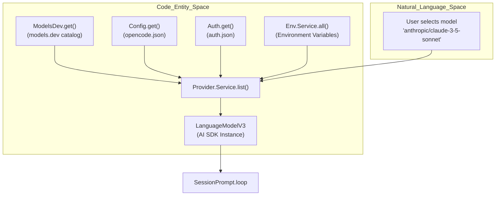
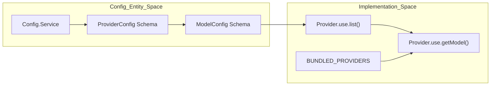

<!-- source: DeepWiki mcp.deepwiki.com · repo sst/opencode · page 4.4 Supported Providers · fetched 2026-10-26 -->

# Supported Providers

<details>
<summary>Relevant source files</summary>

The following files were used as context for generating this wiki page:

- [packages/core/src/plugin/provider/github-copilot.ts](packages/core/src/plugin/provider/github-copilot.ts)
- [packages/llm/src/providers/github-copilot.ts](packages/llm/src/providers/github-copilot.ts)
- [packages/llm/test/exports.test.ts](packages/llm/test/exports.test.ts)
- [packages/opencode/src/plugin/azure.ts](packages/opencode/src/plugin/azure.ts)
- [packages/opencode/src/plugin/github-copilot/copilot.ts](packages/opencode/src/plugin/github-copilot/copilot.ts)
- [packages/opencode/src/plugin/github-copilot/models.ts](packages/opencode/src/plugin/github-copilot/models.ts)
- [packages/opencode/src/plugin/openai/README.md](packages/opencode/src/plugin/openai/README.md)
- [packages/opencode/src/plugin/openai/codex.ts](packages/opencode/src/plugin/openai/codex.ts)
- [packages/opencode/src/plugin/openai/ws-pool.ts](packages/opencode/src/plugin/openai/ws-pool.ts)
- [packages/opencode/src/plugin/openai/ws.ts](packages/opencode/src/plugin/openai/ws.ts)
- [packages/opencode/src/provider/provider.ts](packages/opencode/src/provider/provider.ts)
- [packages/opencode/src/provider/transform.ts](packages/opencode/src/provider/transform.ts)
- [packages/opencode/src/util/proxy-env.ts](packages/opencode/src/util/proxy-env.ts)
- [packages/opencode/test/plugin/azure.test.ts](packages/opencode/test/plugin/azure.test.ts)
- [packages/opencode/test/plugin/codex.test.ts](packages/opencode/test/plugin/codex.test.ts)
- [packages/opencode/test/plugin/github-copilot-models.test.ts](packages/opencode/test/plugin/github-copilot-models.test.ts)
- [packages/opencode/test/plugin/github-copilot.test.ts](packages/opencode/test/plugin/github-copilot.test.ts)
- [packages/opencode/test/plugin/openai-ws.test.ts](packages/opencode/test/plugin/openai-ws.test.ts)
- [packages/opencode/test/provider/amazon-bedrock.test.ts](packages/opencode/test/provider/amazon-bedrock.test.ts)
- [packages/opencode/test/provider/gitlab-duo.test.ts](packages/opencode/test/provider/gitlab-duo.test.ts)
- [packages/opencode/test/provider/provider.test.ts](packages/opencode/test/provider/provider.test.ts)
- [packages/opencode/test/provider/transform.test.ts](packages/opencode/test/provider/transform.test.ts)
- [packages/web/src/content/docs/ecosystem.mdx](packages/web/src/content/docs/ecosystem.mdx)
- [packages/web/src/content/docs/providers.mdx](packages/web/src/content/docs/providers.mdx)
- [packages/web/src/content/docs/zh-cn/providers.mdx](packages/web/src/content/docs/zh-cn/providers.mdx)
- [packages/web/src/content/docs/zh-tw/providers.mdx](packages/web/src/content/docs/zh-tw/providers.mdx)
- [patches/@ai-sdk%2Famazon-bedrock@4.0.166.patch](patches/@ai-sdk%2Famazon-bedrock@4.0.166.patch)
- [patches/@ai-sdk%2Fanthropic@3.0.111.patch](patches/@ai-sdk%2Fanthropic@3.0.111.patch)

</details>


## Purpose and Scope

This page documents the multi-provider architecture and supported LLM providers in OpenCode. OpenCode integrates with over 75 LLM providers [packages/web/src/content/docs/providers.mdx:9-10]() via the AI SDK and the [Models.dev](https://models.dev) catalog, supporting both cloud-hosted APIs and local runtimes. It details specialized provider plugins (such as GitHub Copilot, Amazon Bedrock, Azure, and xAI), authentication flows, and user configuration options (`baseURL`, `whitelist`, `blacklist`) managed via `opencode.json` and `auth.json` [packages/web/src/content/docs/providers.mdx:18-47]().

Sources: [packages/web/src/content/docs/providers.mdx:9-47]()

---

## Provider System Architecture

OpenCode uses a centralized provider registry that merges static model definitions with dynamic user configuration and authentication state.

Title: Provider Resolution Data Flow


Sources: [packages/opencode/src/provider/provider.ts:108-560](), [packages/opencode/test/provider/provider.test.ts:112-122](), [packages/opencode/src/provider/transform.ts:25-27]()

The `Provider.use.list()` function is the primary entry point for resolving available providers [packages/opencode/src/provider/provider.ts:468-472](). It merges information from multiple sources:
1. **Bundled SDKs**: Hardcoded mappings to AI SDK providers like `@ai-sdk/anthropic`, `@ai-sdk/openai`, and `@ai-sdk/amazon-bedrock` [packages/opencode/src/provider/provider.ts:108-134]().
2. **Environment Variables**: Automatic detection of keys like `ANTHROPIC_API_KEY` or `OPENAI_API_KEY` via the `Env` service [packages/opencode/test/provider/provider.test.ts:112-122]().
3. **Local Auth Storage**: Credentials stored in `auth.json` via the `/connect` command [packages/opencode/src/provider/provider.ts:553-560]().
4. **Configuration**: Overrides and custom providers defined in `opencode.json` [packages/opencode/src/provider/provider.ts:482-490]().

**Key Components:**
- **`BUNDLED_PROVIDERS`**: A record of dynamic imports for various AI SDK provider factories, including `@ai-sdk/google`, `@ai-sdk/mistral`, `@ai-sdk/xai`, and `venice-ai-sdk-provider` [packages/opencode/src/provider/provider.ts:108-134]().
- **`custom()`**: A loader function that applies provider-specific logic, such as adding beta headers for Anthropic or configuring the OpenCode Zen gateway [packages/opencode/src/provider/provider.ts:157-175]().
- **`ProviderTransform`**: A service that adapts message structures, sanitizes surrogates, and manages caching strategies like `promptCacheKey` for Anthropic/OpenAI [packages/opencode/src/provider/transform.ts:25-27](), [packages/opencode/test/provider/transform.test.ts:45-52]().

Sources: [packages/opencode/src/provider/provider.ts:108-560](), [packages/opencode/test/provider/provider.test.ts:112-122](), [packages/opencode/src/provider/transform.ts:25-27]()

---

## Specialized Provider Implementations

### GitHub Copilot
**Provider ID:** `github-copilot`

The `CopilotAuthPlugin` provides deep integration with GitHub's model ecosystem, supporting both standard chat and specialized messaging endpoints [packages/opencode/src/plugin/github-copilot/copilot.ts:56-61]().

- **Dynamic Model Discovery**: The `CopilotModels.get` function fetches the latest available models from `api.githubcopilot.com`, including pricing and capability metadata [packages/opencode/src/plugin/github-copilot/models.ts:79-82]().
- **Endpoint Mapping**: Automatically routes requests to `/v1/messages` (Anthropic-style) or `/chat/completions` (OpenAI-style) based on model metadata [packages/opencode/src/plugin/github-copilot/models.ts:95-102]().
- **Request Enrichment**: Injects required headers like `x-initiator`, `Copilot-Vision-Request`, and `Openai-Intent: conversation-edits` to ensure compatibility with GitHub's backend [packages/opencode/src/plugin/github-copilot/copilot.ts:160-170]().

Sources: [packages/opencode/src/plugin/github-copilot/copilot.ts:56-170](), [packages/opencode/src/plugin/github-copilot/models.ts:79-102]()

### Amazon Bedrock
**Provider ID:** `amazon-bedrock`

Bedrock integration supports multiple authentication methods including AWS profiles, access keys, and bearer tokens [packages/web/src/content/docs/providers.mdx:208-221]().

- **Regional Endpoints**: OpenCode handles regional overrides in configuration, which take precedence over `AWS_REGION` environment variables [packages/opencode/test/provider/amazon-bedrock.test.ts:70-80]().
- **Mantle Integration**: Supports the specialized Mantle API for models like `openai.gpt-5.5` using the `@ai-sdk/amazon-bedrock/mantle` provider [packages/opencode/test/provider/amazon-bedrock.test.ts:108-126]().

Sources: [packages/web/src/content/docs/providers.mdx:208-221](), [packages/opencode/test/provider/amazon-bedrock.test.ts:70-126]()

### Microsoft Azure
**Provider ID:** `azure`

The `AzureAuthPlugin` supports both standard API key authentication and Microsoft Entra ID via the Azure CLI (`az account get-access-token`) [packages/opencode/src/plugin/azure.ts:20-23]().

- **Scope Resolution**: Dynamically determines token scopes (`AZURE_FOUNDRY_SCOPE` vs `AZURE_COGNITIVE_SERVICES_SCOPE`) depending on whether the request targets Azure AI Foundry or Azure Cognitive Services endpoints [packages/opencode/src/plugin/azure.ts:116-122]().
- **Token Refresh Buffer**: Caches and proactively refreshes CLI access tokens using a 60-second safety window [packages/opencode/src/plugin/azure.ts:10-11], [packages/opencode/src/plugin/azure.ts:31-33]().

Sources: [packages/opencode/src/plugin/azure.ts:10-122](), [packages/opencode/test/plugin/azure.test.ts:107-155]()

### xAI (Grok)
**Provider ID:** `xai`

The `XaiAuthPlugin` implements device authorization and session management for xAI models [packages/opencode/src/plugin/xai.ts:8-14]().

- **Proactive Refresh**: Checks token expiration before long-running tool execution loops [packages/opencode/test/plugin/xai.test.ts:44-57]().
- **Stateless Reasoning**: Requests `reasoning.encrypted_content` to maintain reasoning continuity across turns [packages/opencode/src/provider/transform.ts:20-23]().

Sources: [packages/opencode/src/plugin/xai.ts:8-14](), [packages/opencode/test/plugin/xai.test.ts:44-57](), [packages/opencode/src/provider/transform.ts:20-23]()

### Snowflake Cortex & DigitalOcean
- **Snowflake Cortex**: Uses `SnowflakeCortexPlugin` to manage PAT-based authentication [packages/core/src/plugin/provider/snowflake-cortex.ts:7]().
- **DigitalOcean**: Discovers inference routers via the GenAI management API [packages/opencode/src/plugin/digitalocean.ts:167-182]().

Sources: [packages/core/src/plugin/provider/snowflake-cortex.ts:7](), [packages/opencode/src/plugin/digitalocean.ts:167-182]()

---

## Provider Categories

| Category | Providers | Authentication |
|----------|-----------|----------------|
| **Managed Gateway** | OpenCode Zen, OpenCode Go | API Key via `/connect` |
| **Major Cloud** | OpenAI, Anthropic, AWS Bedrock, Google Vertex, Azure | API Key, IAM Roles, or Azure CLI |
| **Aggregators** | OpenRouter, DeepInfra, Together AI, 302.AI | API Key |
| **Local Runtime** | Ollama, LM Studio (OpenAI-compatible) | `baseURL` override |
| **Platform Integration** | GitHub Copilot, DigitalOcean, xAI | OAuth / Device Flow |

Sources: [packages/web/src/content/docs/providers.mdx:9-116](), [packages/opencode/src/provider/provider.ts:108-134]()

---

## Configuration and Overrides

Users can customize provider behavior in `opencode.json`. This includes setting custom `baseURL` values, managing model whitelists/blacklists, and defining custom aliases [packages/opencode/test/provider/provider.test.ts:155-196]().

```json title="opencode.json"
{
  "$schema": "https://opencode.ai/config.json",
  "provider": {
    "anthropic": {
      "options": {
        "baseURL": "https://api.anthropic.com/v1"
      },
      "whitelist": ["claude-sonnet-4-6"],
      "models": {
        "my-alias": {
          "id": "claude-sonnet-4-6",
          "name": "Primary Coding Model"
        }
      }
    }
  }
}
```

Title: Provider Configuration Entity Map


Sources: [packages/opencode/src/provider/provider.ts:37-134](), [packages/opencode/test/provider/provider.test.ts:155-206](), [packages/web/src/content/docs/providers.mdx:32-47]()

**Advanced Configuration Options:**
- **Custom NPM Providers**: Define a provider that uses a specific AI SDK package not bundled by default [packages/opencode/test/provider/provider.test.ts:198-206]().
- **SSE Timeouts**: The `wrapSSE` function provides a mechanism to abort long-running stream reads if they exceed a specified timeout [packages/opencode/src/provider/provider.ts:37-83]().
- **Google Vertex Anthropic**: Includes specific logic to construct regional endpoints for Anthropic models hosted on Google Vertex AI [packages/opencode/src/provider/provider.ts:94-99]().

Sources: [packages/opencode/src/provider/provider.ts:37-134](), [packages/opencode/test/provider/provider.test.ts:155-206](), [packages/web/src/content/docs/providers.mdx:32-47]()

---

