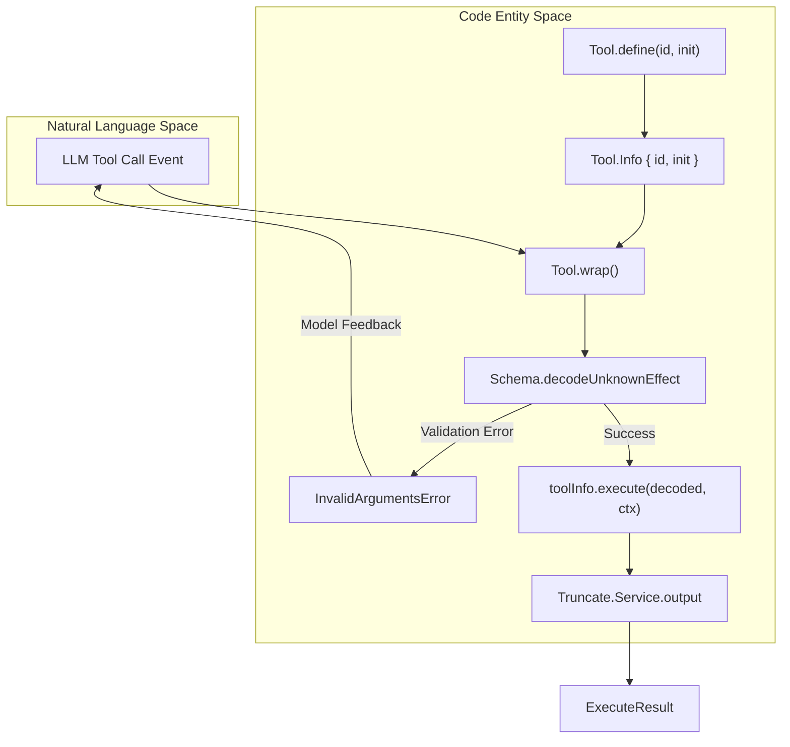
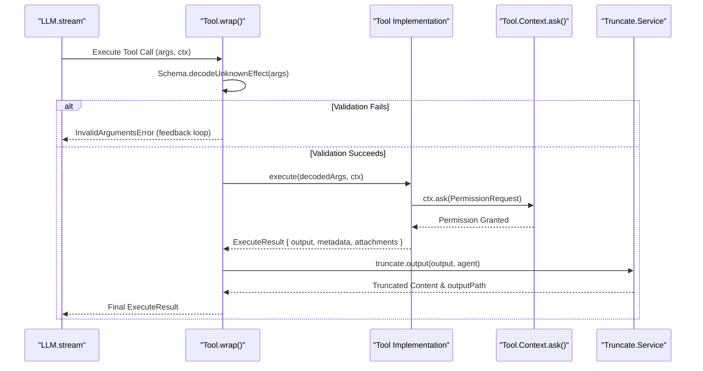

<!-- source: DeepWiki mcp.deepwiki.com · repo sst/opencode · page 5.1 Tool Architecture · fetched 2026-10-26 -->

# Tool Architecture

Relevant source files

The following files were used as context for generating this wiki page:

- [packages/opencode/src/session/compaction.ts](packages/opencode/src/session/compaction.ts)
- [packages/opencode/src/session/llm.ts](packages/opencode/src/session/llm.ts)
- [packages/opencode/src/session/llm/ai-sdk.ts](packages/opencode/src/session/llm/ai-sdk.ts)
- [packages/opencode/src/session/message-v2.ts](packages/opencode/src/session/message-v2.ts)
- [packages/opencode/src/session/processor.ts](packages/opencode/src/session/processor.ts)
- [packages/opencode/src/session/prompt.ts](packages/opencode/src/session/prompt.ts)
- [packages/opencode/src/session/session.ts](packages/opencode/src/session/session.ts)
- [packages/opencode/src/session/summary.ts](packages/opencode/src/session/summary.ts)
- [packages/opencode/src/tool/apply_patch.ts](packages/opencode/src/tool/apply_patch.ts)
- [packages/opencode/src/tool/apply_patch.txt](packages/opencode/src/tool/apply_patch.txt)
- [packages/opencode/src/tool/edit.ts](packages/opencode/src/tool/edit.ts)
- [packages/opencode/src/tool/external-directory.ts](packages/opencode/src/tool/external-directory.ts)
- [packages/opencode/src/tool/glob.ts](packages/opencode/src/tool/glob.ts)
- [packages/opencode/src/tool/grep.ts](packages/opencode/src/tool/grep.ts)
- [packages/opencode/src/tool/lsp.ts](packages/opencode/src/tool/lsp.ts)
- [packages/opencode/src/tool/read.ts](packages/opencode/src/tool/read.ts)
- [packages/opencode/src/tool/registry.ts](packages/opencode/src/tool/registry.ts)
- [packages/opencode/src/tool/skill.ts](packages/opencode/src/tool/skill.ts)
- [packages/opencode/src/tool/task.ts](packages/opencode/src/tool/task.ts)
- [packages/opencode/src/tool/tool.ts](packages/opencode/src/tool/tool.ts)
- [packages/opencode/src/tool/write.ts](packages/opencode/src/tool/write.ts)
- [packages/opencode/test/session/compaction.test.ts](packages/opencode/test/session/compaction.test.ts)
- [packages/opencode/test/session/llm.test.ts](packages/opencode/test/session/llm.test.ts)
- [packages/opencode/test/session/messages-pagination.test.ts](packages/opencode/test/session/messages-pagination.test.ts)
- [packages/opencode/test/session/processor-effect.test.ts](packages/opencode/test/session/processor-effect.test.ts)
- [packages/opencode/test/session/prompt.test.ts](packages/opencode/test/session/prompt.test.ts)
- [packages/opencode/test/session/snapshot-tool-race.test.ts](packages/opencode/test/session/snapshot-tool-race.test.ts)
- [packages/opencode/test/tool/apply_patch.test.ts](packages/opencode/test/tool/apply_patch.test.ts)
- [packages/opencode/test/tool/edit.test.ts](packages/opencode/test/tool/edit.test.ts)
- [packages/opencode/test/tool/external-directory.test.ts](packages/opencode/test/tool/external-directory.test.ts)
- [packages/opencode/test/tool/glob.test.ts](packages/opencode/test/tool/glob.test.ts)
- [packages/opencode/test/tool/grep.test.ts](packages/opencode/test/tool/grep.test.ts)
- [packages/opencode/test/tool/question.test.ts](packages/opencode/test/tool/question.test.ts)
- [packages/opencode/test/tool/read.test.ts](packages/opencode/test/tool/read.test.ts)
- [packages/opencode/test/tool/registry.test.ts](packages/opencode/test/tool/registry.test.ts)
- [packages/opencode/test/tool/skill.test.ts](packages/opencode/test/tool/skill.test.ts)
- [packages/opencode/test/tool/task.test.ts](packages/opencode/test/tool/task.test.ts)
- [packages/opencode/test/tool/tool-define.test.ts](packages/opencode/test/tool/tool-define.test.ts)
- [packages/opencode/test/tool/write.test.ts](packages/opencode/test/tool/write.test.ts)
- [packages/plugin/src/tool.ts](packages/plugin/src/tool.ts)

## Purpose and Scope

This document describes the core architecture of OpenCode's tool system, covering tool definitions, parameter schemas, execution lifecycle, result handling, and specialized implementations. Tools are the primary mechanism through which AI agents interact with the host system, inspect files, execute commands, and perform modifications.

For information about permission rules and approval workflows, see **5.2 Permission System**. For details on specific built-in tools, see **5.3 Built-in Tools Reference**. For MCP-based external tools, see **5.6 Model Context Protocol (MCP)**.

---

## Tool Definition Structure

Tools in OpenCode are defined using a standardized structure that specifies their identity, parameters, and execution logic. Each tool definition consists of key components mapped in `packages/opencode/src/tool/tool.ts` [packages/opencode/src/tool/tool.ts:55-65]():

| Component | Type | Purpose |
|-----------|------|---------|
| `id` | `string` | Unique identifier for the tool (e.g., `"bash"`, `"read"`, `"edit"`) [packages/opencode/src/tool/tool.ts:59-59]() |
| `description` | `string` | Natural language explanation of what the tool does, shown to the LLM [packages/opencode/src/tool/tool.ts:60-60]() |
| `parameters` | `Schema.Decoder` | Effect-based Schema defining input parameters [packages/opencode/src/tool/tool.ts:61-61]() |
| `execute` | `function` | Async Effect-returning function that performs the tool's operation [packages/opencode/src/tool/tool.ts:63-63]()

### Parameter Schema Definition

Tool parameters are defined using the `effect/Schema` library, which provides runtime type validation and metadata for JSON Schema generation. For example, the `ReadTool` defines parameters for `filePath`, `offset`, and `limit` using `Schema.Struct` [packages/opencode/src/tool/read.ts:28-36](). Similarly, `EditTool` [packages/opencode/src/tool/edit.ts:47-56](), `ApplyPatchTool` [packages/opencode/src/tool/apply_patch.ts:18-20](), `TaskTool` [packages/opencode/src/tool/task.ts:56-62](), `GrepTool` [packages/opencode/src/tool/grep.ts:10-18](), and `SkillTool` [packages/opencode/src/tool/skill.ts:8-10]() define typed Effect schemas.

### Tool.define Helper and Validation Wrapping

Tools are instantiated using `Tool.define`, which wraps the underlying execution logic with telemetry spans, input decoding via `Schema.decodeUnknownEffect`, error formatting, and automatic output truncation [packages/opencode/src/tool/tool.ts:99-169]().

**Diagram: Tool Definition and Validation Factory Pattern bridging natural language tool calls to typed Effect execution.**

**Sources:** [packages/opencode/src/tool/tool.ts:55-169](), [packages/opencode/src/tool/read.ts:28-36](), [packages/opencode/src/tool/edit.ts:47-56]()

---

## Execution Lifecycle and Validation

When an LLM invocation triggers a tool call, the request passes through the wrapper generated by `Tool.wrap()` in `packages/opencode/src/tool/tool.ts` [packages/opencode/src/tool/tool.ts:99-149]().

### Complete Execution Sequence

**Diagram: Sequence diagram showing data flow and error interception during tool execution.**

### Key Lifecycle Phases
1. **Input Decoding**: Arguments emitted by the LLM are validated against the tool's `parameters` schema [packages/opencode/src/tool/tool.ts:111-129](). If validation fails, an `InvalidArgumentsError` is raised, producing a model-facing error message instructing the AI to correct the input schema [packages/opencode/src/tool/tool.ts:24-34]().
2. **Context Injection**: Tools receive a `Tool.Context` object containing session identifiers, abort signals, metadata callbacks, and permission prompting utilities [packages/opencode/src/tool/tool.ts:36-46]().
3. **Permission Interception**: Tools invoke `ctx.ask()` to verify authorization before performing mutating actions (e.g., `TaskTool` prompting for subagent types [packages/opencode/src/tool/task.ts:120-129](), `EditTool` checking file permissions [packages/opencode/src/tool/edit.ts:145-153]()).
4. **Execution & Truncation**: The tool executes its business logic and returns an `ExecuteResult`. The registry wrapper automatically checks output size against context limits via `Truncate.Service`, creating output files on disk if truncation occurs [packages/opencode/src/tool/tool.ts:130-144]().

**Sources:** [packages/opencode/src/tool/tool.ts:24-149](), [packages/opencode/src/tool/task.ts:120-129](), [packages/opencode/src/tool/edit.ts:145-153]()

---

## Tool Context and Result Handling

### Tool Context (`Tool.Context`)
Defined in `packages/opencode/src/tool/tool.ts`, the `Context` interface supplies necessary runtime parameters to every tool execution [packages/opencode/src/tool/tool.ts:36-46]():
* `sessionID`: The active `SessionID` [packages/opencode/src/tool/tool.ts:37-37]().
* `messageID`: The current `MessageID` triggering the call [packages/opencode/src/tool/tool.ts:38-38]().
* `agent`: The active agent name [packages/opencode/src/tool/tool.ts:39-39]().
* `abort`: An `AbortSignal` for cancelling operations [packages/opencode/src/tool/tool.ts:40-40]().
* `messages`: Array of prior session messages (`SessionV1.WithParts[]`) [packages/opencode/src/tool/tool.ts:43-43]().
* `metadata(input)`: Effect callback to update execution metadata or titles [packages/opencode/src/tool/tool.ts:44-44]().
* `ask(input)`: Effect callback to request user approval for restricted actions [packages/opencode/src/tool/tool.ts:45-45]().

### Result Structure (`ExecuteResult`)
Tools return an `ExecuteResult` containing [packages/opencode/src/tool/tool.ts:48-53]():
* `title`: A human-readable summary of the action [packages/opencode/src/tool/tool.ts:49-49]().
* `metadata`: Tool-specific structured metadata (e.g., match counts, diff summaries) [packages/opencode/src/tool/tool.ts:50-50]().
* `output`: The primary text response fed back to the LLM [packages/opencode/src/tool/tool.ts:51-51]().
* `attachments`: Optional file or image attachments generated during execution [packages/opencode/src/tool/tool.ts:52-52]().

**Sources:** [packages/opencode/src/tool/tool.ts:36-53]()

---

## Specialized Tool Implementations

OpenCode includes several specialized core tools built upon the `Tool.define` foundation:

### 1. Subagent Delegation (`TaskTool`)
* **File**: `packages/opencode/src/tool/task.ts`
* **Purpose**: Spawns specialized subagent sessions to perform complex sub-tasks. Supports foreground execution or asynchronous background processing (`background=true`) when `OPENCODE_EXPERIMENTAL_BACKGROUND_SUBAGENTS=true` is enabled [packages/opencode/src/tool/task.ts:97-102](). Enforces subagent nesting depth limits based on configuration [packages/opencode/src/tool/task.ts:111-117]().

### 2. File Editing (`EditTool` & `ApplyPatchTool`)
* **Files**: `packages/opencode/src/tool/edit.ts`, `packages/opencode/src/tool/apply_patch.ts`
* **Purpose**: `EditTool` performs search-and-replace edits (`oldString` / `newString`) with automatic line ending normalization, BOM detection, and concurrency locking per file path [packages/opencode/src/tool/edit.ts:22-45](). `ApplyPatchTool` parses multi-hunk patch texts using `Patch.parsePatch` and applies additions, updates, deletions, or moves atomically [packages/opencode/src/tool/apply_patch.ts:38-191]().

### 3. Filesystem Reading (`ReadTool`)
* **File**: `packages/opencode/src/tool/read.ts`
* **Purpose**: Reads files or directory listings with line numbering, offset/limit pagination, and safety checks. Defaults to reading up to 2000 lines or 50 KB [packages/opencode/src/tool/read.ts:13-16](). Automatically warms up LSP connections for read files [packages/opencode/src/tool/read.ts:117-120]().

### 4. Code Search (`GrepTool`) & Skills (`SkillTool`)
* **Files**: `packages/opencode/src/tool/grep.ts`, `packages/opencode/src/tool/skill.ts`
* **Purpose**: `GrepTool` interfaces with `Ripgrep.Service` to search regex patterns across project directories with configurable limits [packages/opencode/src/tool/grep.ts:20-68](). `SkillTool` loads reusable agent instruction patterns and associated script files from `.opencode/skill/` directories [packages/opencode/src/tool/skill.ts:12-68]().

**Sources:** [packages/opencode/src/tool/task.ts:97-117](), [packages/opencode/src/tool/edit.ts:22-45](), [packages/opencode/src/tool/apply_patch.ts:38-191](), [packages/opencode/src/tool/read.ts:13-120](), [packages/opencode/src/tool/grep.ts:20-68](), [packages/opencode/src/tool/skill.ts:12-68]()

---

