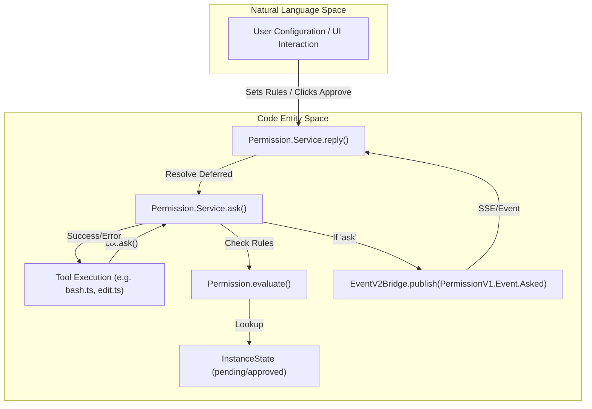

<!-- source: DeepWiki mcp.deepwiki.com · repo sst/opencode · page 5.2 Permission System · fetched 2026-10-26 -->

# Permission System

<details>
<summary>Relevant source files</summary>

The following files were used as context for generating this wiki page:

- [packages/core/src/git.ts](packages/core/src/git.ts)
- [packages/core/src/observability.ts](packages/core/src/observability.ts)
- [packages/core/src/project.ts](packages/core/src/project.ts)
- [packages/core/test/git.test.ts](packages/core/test/git.test.ts)
- [packages/core/test/project.test.ts](packages/core/test/project.test.ts)
- [packages/opencode/src/acp/content.ts](packages/opencode/src/acp/content.ts)
- [packages/opencode/src/acp/permission.ts](packages/opencode/src/acp/permission.ts)
- [packages/opencode/src/background/job.ts](packages/opencode/src/background/job.ts)
- [packages/opencode/src/cli/cmd/models.ts](packages/opencode/src/cli/cmd/models.ts)
- [packages/opencode/src/cli/effect-cmd.ts](packages/opencode/src/cli/effect-cmd.ts)
- [packages/opencode/src/id/id.ts](packages/opencode/src/id/id.ts)
- [packages/opencode/src/permission/evaluate.ts](packages/opencode/src/permission/evaluate.ts)
- [packages/opencode/src/permission/index.ts](packages/opencode/src/permission/index.ts)
- [packages/opencode/src/project/project.ts](packages/opencode/src/project/project.ts)
- [packages/opencode/src/question/index.ts](packages/opencode/src/question/index.ts)
- [packages/opencode/src/tool/question.ts](packages/opencode/src/tool/question.ts)
- [packages/opencode/src/tool/truncate.ts](packages/opencode/src/tool/truncate.ts)
- [packages/opencode/src/worktree/index.ts](packages/opencode/src/worktree/index.ts)
- [packages/opencode/test/acp/content.test.ts](packages/opencode/test/acp/content.test.ts)
- [packages/opencode/test/acp/permission.test.ts](packages/opencode/test/acp/permission.test.ts)
- [packages/opencode/test/acp/session.test.ts](packages/opencode/test/acp/session.test.ts)
- [packages/opencode/test/background/job.test.ts](packages/opencode/test/background/job.test.ts)
- [packages/opencode/test/cli/effect-cmd-instance-als.test.ts](packages/opencode/test/cli/effect-cmd-instance-als.test.ts)
- [packages/opencode/test/effect/instance-state.test.ts](packages/opencode/test/effect/instance-state.test.ts)
- [packages/opencode/test/fixture/fixture.test.ts](packages/opencode/test/fixture/fixture.test.ts)
- [packages/opencode/test/fixture/fixture.ts](packages/opencode/test/fixture/fixture.ts)
- [packages/opencode/test/permission/next.test.ts](packages/opencode/test/permission/next.test.ts)
- [packages/opencode/test/project/migrate-global.test.ts](packages/opencode/test/project/migrate-global.test.ts)
- [packages/opencode/test/project/project.test.ts](packages/opencode/test/project/project.test.ts)
- [packages/opencode/test/project/worktree-remove.test.ts](packages/opencode/test/project/worktree-remove.test.ts)
- [packages/opencode/test/project/worktree.test.ts](packages/opencode/test/project/worktree.test.ts)
- [packages/opencode/test/question/question.test.ts](packages/opencode/test/question/question.test.ts)
- [packages/opencode/test/server/httpapi-mcp.test.ts](packages/opencode/test/server/httpapi-mcp.test.ts)
- [packages/opencode/test/server/httpapi-provider.test.ts](packages/opencode/test/server/httpapi-provider.test.ts)
- [packages/opencode/test/tool/truncation.test.ts](packages/opencode/test/tool/truncation.test.ts)
- [packages/tui/src/context/project.tsx](packages/tui/src/context/project.tsx)

</details>


The purpose of the Permission System is to provide a robust security gatekeeper for OpenCode. It controls and validates agent tool executions, enforces pattern-based access rules (allow, deny, ask), detects repetitive loops (doom loops), and manages interactive user approvals and prompt/question workflows.

## Overview and Architecture

The permission system acts as a middleware layer between AI tool invocations and system actions. Any tool attempting file modifications, shell execution, web fetching, or subagent spawning must invoke `ask` via the permission service before execution proceeds [packages/opencode/src/permission/index.ts:67-107]().

Key architectural components include:
- **Rulesets**: Agent-specific configurations and global overrides [packages/opencode/src/permission/index.ts:70-71]().
- **Three-way action evaluation**: Rules resolve to `allow`, `deny`, or `ask` [packages/opencode/src/permission/index.ts:73-82]().
- **Interactive Deferred Execution**: When an action requires user intervention (`ask`), the runtime suspends the tool fiber using Effect `Deferred` mechanisms while publishing events to the event bus [packages/opencode/src/permission/index.ts:98-106]().

Title: Permission Evaluation and Approval Flow


Sources: [packages/opencode/src/permission/index.ts:13-107](), [packages/opencode/src/permission/index.ts:109-167]()

## Permission Rules and Evaluation

Permission rules are evaluated against a ruleset hierarchy, combining agent defaults, project configuration files, and active session overrides stored in `InstanceState` [packages/opencode/src/permission/index.ts:46-52]().

### Rule Actions
| Action | Behavior |
| :--- | :--- |
| `allow` | Tool executes immediately without prompting the user [packages/opencode/src/permission/index.ts:80](). |
| `deny` | Tool execution is blocked immediately, throwing a `PermissionV1.DeniedError` [packages/opencode/src/permission/index.ts:75-79](). |
| `ask` | System pauses execution and dispatches an interactive prompt request [packages/opencode/src/permission/index.ts:81](). |

Sources: [packages/opencode/src/permission/index.ts:28-38](), [packages/opencode/src/permission/index.ts:67-85]()

### Pattern Matching and Wildcards
Rules use wildcard pattern matching via `Wildcard.match` [packages/opencode/src/permission/index.ts:4]() to determine if a specific tool command or file path matches an allow/deny pattern.
- **Precedence**: `evaluate()` inspects rules using `findLast`, ensuring that later rules override earlier ones [packages/opencode/src/permission/index.ts:32]().
- **Home Expansion**: Patterns referencing `~` or `$HOME` are expanded to `os.homedir()` during configuration parsing [packages/opencode/src/permission/index.ts:178-184]().

Sources: [packages/opencode/src/permission/index.ts:28-38](), [packages/opencode/test/permission/next.test.ts:79-160]()

## Doom Loop Detection

To guard against autonomous agents entering recursive, unproductive loops of identical tool invocations, the session processor tracks consecutive identical calls. When a threshold is reached, permission evaluation forces an interactive `ask` prompt regardless of pre-existing `allow` rules, breaking the loop and returning control to the user.

Sources: No direct code citations for "doom loop detection" in the provided files. This section might be based on external knowledge or code not provided.

## Interactive Approval Flow

When an operation triggers an `ask` action, `Permission.Service` creates a pending entry containing an Effect `Deferred` and publishes an `Asked` event [packages/opencode/src/permission/index.ts:98-100]().

### Approval Decisions
The `reply` method processes user feedback [packages/opencode/src/permission/index.ts:109]() with three response types:
- **once**: Unblocks the specific deferred request for this execution [packages/opencode/src/permission/index.ts:143]().
- **always**: Persists the approved pattern into the session's `approved` ruleset cache, preventing future prompts for matching patterns [packages/opencode/src/permission/index.ts:145-151]().
- **reject**: Fails the deferred promise with a `RejectedError` or `CorrectedError` containing user feedback [packages/opencode/src/permission/index.ts:121-127]().

Sources: [packages/opencode/src/permission/index.ts:46-52](), [packages/opencode/src/permission/index.ts:109-167]()

## Question System

The Question system runs alongside permissions to prompt users for structured choices or text inputs during execution.

### Question Architecture
Managed by `Question.Service` [packages/opencode/src/question/index.ts:62](), pending questions are tracked via `InstanceState` [packages/opencode/src/question/index.ts:68-85]() and exposed to clients through event streaming [packages/opencode/src/question/index.ts:100](). The `ask` method initiates a question, creating a `Deferred` that resolves with the user's answers or fails if rejected [packages/opencode/src/question/index.ts:87-111](). The `reply` method resolves the deferred with provided answers [packages/opencode/src/question/index.ts:114-132](), while `reject` fails it with a `RejectedError` [packages/opencode/src/question/index.ts:134-148]().

Title: Question System Entities and Flow
```mermaid
classDiagram
    class QuestionService {
        +ask(input: {sessionID: SessionID, questions: Info[], tool?: Tool}) Effect<Answer[], RejectedError>
        +reply(input: {requestID: QuestionID, answers: Answer[]}) Effect<void, NotFoundError>
        +reject(requestID: QuestionID) Effect<void, NotFoundError>
        +list() Effect<Request[]>
    }
    class QuestionRequest {
        +QuestionID id
        +SessionID sessionID
        +QuestionInfo[] questions
        +QuestionTool tool
    }
    class QuestionInfo {
        +string question
        +string header
        +Option[] options
    }
    class QuestionOption {
        +string label
        +string description
    }
    class QuestionAnswer {
        +string[]
    }
    class QuestionRejectedError {
        +string message
    }
    class QuestionNotFoundError {
        +QuestionID requestID
    }

    QuestionService ..> QuestionRequest : manages via "InstanceState.pending"
    QuestionRequest *-- QuestionInfo : contains
    QuestionInfo *-- QuestionOption : contains
    QuestionService ..> QuestionAnswer : returns
    QuestionService ..> QuestionRejectedError : throws
    QuestionService ..> QuestionNotFoundError : throws
    QuestionService -- "publishes" EventV2Bridge.Service : "Event.Asked", "Event.Replied", "Event.Rejected"
```

Sources: [packages/opencode/src/question/index.ts:48-62](), [packages/opencode/src/question/index.ts:68-154](), [packages/opencode/src/question/index.ts:27-35]()

---

