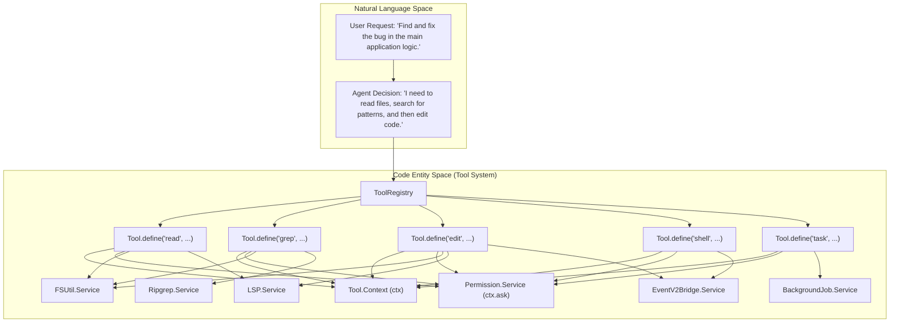
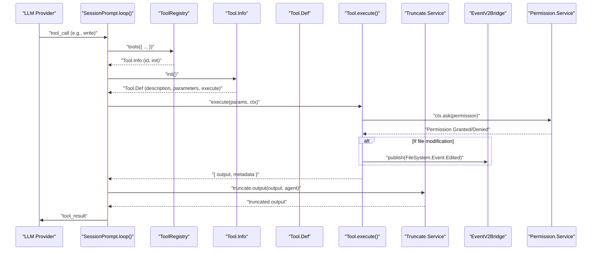

<!-- source: DeepWiki mcp.deepwiki.com · repo sst/opencode · page 5.3 Built-in Tools Reference · fetched 2026-10-26 -->

# Built-in Tools Reference

Relevant source files

The following files were used as context for generating this wiki page:

- [packages/app/e2e/regression/session-timeline-collapse-state.spec.ts](packages/app/e2e/regression/session-timeline-collapse-state.spec.ts)
- [packages/app/e2e/regression/session-timeline-context-resize.spec.ts](packages/app/e2e/regression/session-timeline-context-resize.spec.ts)
- [packages/app/e2e/smoke/session-timeline.fixture.ts](packages/app/e2e/smoke/session-timeline.fixture.ts)
- [packages/app/e2e/smoke/session-timeline.spec.ts](packages/app/e2e/smoke/session-timeline.spec.ts)
- [packages/app/e2e/utils/errors.ts](packages/app/e2e/utils/errors.ts)
- [packages/opencode/src/tool/apply_patch.ts](packages/opencode/src/tool/apply_patch.ts)
- [packages/opencode/src/tool/apply_patch.txt](packages/opencode/src/tool/apply_patch.txt)
- [packages/opencode/src/tool/edit.ts](packages/opencode/src/tool/edit.ts)
- [packages/opencode/src/tool/external-directory.ts](packages/opencode/src/tool/external-directory.ts)
- [packages/opencode/src/tool/glob.ts](packages/opencode/src/tool/glob.ts)
- [packages/opencode/src/tool/grep.ts](packages/opencode/src/tool/grep.ts)
- [packages/opencode/src/tool/lsp.ts](packages/opencode/src/tool/lsp.ts)
- [packages/opencode/src/tool/lsp.txt](packages/opencode/src/tool/lsp.txt)
- [packages/opencode/src/tool/read.ts](packages/opencode/src/tool/read.ts)
- [packages/opencode/src/tool/shell.ts](packages/opencode/src/tool/shell.ts)
- [packages/opencode/src/tool/shell/prompt.ts](packages/opencode/src/tool/shell/prompt.ts)
- [packages/opencode/src/tool/skill.ts](packages/opencode/src/tool/skill.ts)
- [packages/opencode/src/tool/task.ts](packages/opencode/src/tool/task.ts)
- [packages/opencode/src/tool/tool.ts](packages/opencode/src/tool/tool.ts)
- [packages/opencode/src/tool/webfetch.ts](packages/opencode/src/tool/webfetch.ts)
- [packages/opencode/src/tool/write.ts](packages/opencode/src/tool/write.ts)
- [packages/opencode/test/tool/__snapshots__/parameters.test.ts.snap](packages/opencode/test/tool/__snapshots__/parameters.test.ts.snap)
- [packages/opencode/test/tool/apply_patch.test.ts](packages/opencode/test/tool/apply_patch.test.ts)
- [packages/opencode/test/tool/edit.test.ts](packages/opencode/test/tool/edit.test.ts)
- [packages/opencode/test/tool/external-directory.test.ts](packages/opencode/test/tool/external-directory.test.ts)
- [packages/opencode/test/tool/glob.test.ts](packages/opencode/test/tool/glob.test.ts)
- [packages/opencode/test/tool/grep.test.ts](packages/opencode/test/tool/grep.test.ts)
- [packages/opencode/test/tool/lsp.test.ts](packages/opencode/test/tool/lsp.test.ts)
- [packages/opencode/test/tool/parameters.test.ts](packages/opencode/test/tool/parameters.test.ts)
- [packages/opencode/test/tool/question.test.ts](packages/opencode/test/tool/question.test.ts)
- [packages/opencode/test/tool/read.test.ts](packages/opencode/test/tool/read.test.ts)
- [packages/opencode/test/tool/shell.test.ts](packages/opencode/test/tool/shell.test.ts)
- [packages/opencode/test/tool/skill.test.ts](packages/opencode/test/tool/skill.test.ts)
- [packages/opencode/test/tool/task.test.ts](packages/opencode/test/tool/task.test.ts)
- [packages/opencode/test/tool/tool-define.test.ts](packages/opencode/test/tool/tool-define.test.ts)
- [packages/opencode/test/tool/webfetch.test.ts](packages/opencode/test/tool/webfetch.test.ts)
- [packages/opencode/test/tool/write.test.ts](packages/opencode/test/tool/write.test.ts)

This document provides a comprehensive reference for OpenCode's built-in tools that enable AI agents to interact with the filesystem, execute commands, search code, fetch web content, and delegate tasks. For information about the tool architecture and registration system, see [Tool Architecture](). For permission configuration and access control, see [Permission System]().

Built-in tools are directly integrated into the OpenCode core and are available to all agents by default, subject to permission rules. These tools form the foundation of OpenCode's agentic capabilities, allowing AI models to read files, make edits, execute shell commands, and coordinate complex multi-step workflows.

---

## Tool Overview

OpenCode provides several categories of built-in tools. Tools are defined using `Tool.define()` [packages/opencode/src/tool/tool.ts:151-169]() and are orchestrated during the agent loop. The `ToolRegistry` handles the instantiation and provision of these tools to the session.

| Category | Tools | Purpose | Implementation |
|----------|-------|---------|----------------|
| **File I/O** | `read`, `edit`, `write`, `apply_patch` | Read file contents, modify files via replacement, or overwrite files. | [packages/opencode/src/tool/read.ts](), [packages/opencode/src/tool/edit.ts](), [packages/opencode/src/tool/write.ts](), [packages/opencode/src/tool/apply_patch.ts]() |
| **Search** | `grep`, `glob`, `lsp` | Search text in files (ripgrep/fff), find files by pattern, or use Language Server Protocol. | [packages/opencode/src/tool/grep.ts](), [packages/opencode/src/tool/glob.ts](), [packages/opencode/src/tool/lsp.ts]() |
| **Network** | `webfetch` | Fetch web content. | [packages/opencode/src/tool/webfetch.ts]() |
| **Execution** | `shell` | Execute shell commands. | [packages/opencode/src/tool/shell.ts]() |
| **Task & Workflow** | `task`, `skill` | Delegate to subagents or load specialized instructions. | [packages/opencode/src/tool/task.ts](), [packages/opencode/src/tool/skill.ts]() |

**Diagram: Bridge between Natural Language Intent and Code Entities for Built-in Tools**

Sources: [packages/opencode/src/tool/tool.ts:151-169](), [packages/opencode/src/tool/read.ts:64-75](), [packages/opencode/src/tool/edit.ts:58-60](), [packages/opencode/src/tool/write.ts](), [packages/opencode/src/tool/apply_patch.ts:22-24](), [packages/opencode/src/tool/grep.ts:20-22](), [packages/opencode/src/tool/glob.ts](), [packages/opencode/src/tool/lsp.ts](), [packages/opencode/src/tool/webfetch.ts](), [packages/opencode/src/tool/shell.ts](), [packages/opencode/src/tool/task.ts:81-83](), [packages/opencode/src/tool/skill.ts:12-14]()

---

## File I/O Tools

### read

Reads the contents of a file or directory. Implemented in `ReadTool` [packages/opencode/src/tool/read.ts:64-75]().

**Parameters:**
- `filePath`: Absolute path to the file or directory to read [packages/opencode/src/tool/read.ts:29]().
- `offset`: The line number to start reading from (1-indexed) [packages/opencode/src/tool/read.ts:30-32]().
- `limit`: The maximum number of lines to read (defaults to 2000) [packages/opencode/src/tool/read.ts:33-35]().

**Behavior:**
- **Directory Handling**: If the path is a directory, it returns a sorted list of entries via `ReadTool.list` [packages/opencode/src/tool/read.ts:101-115]().
- **Truncation**: Automatically truncates lines longer than 2000 characters and caps total read size at 50 KB [packages/opencode/src/tool/read.ts:13-18]().
- **LSP Warmup**: Notifies the LSP of the file being touched in a background scope via `lsp.touchFile` [packages/opencode/src/tool/read.ts:117-119]().
- **Error Handling**: Provides suggestions for mistyped file paths [packages/opencode/src/tool/read.ts:91-96]().

Sources: [packages/opencode/src/tool/read.ts:13-119](), [packages/opencode/test/tool/read.test.ts:152-158]()

### edit

Modifies an existing file using a string replacement strategy. Implemented in `EditTool` [packages/opencode/src/tool/edit.ts:58-60]().

**Parameters:**
- `filePath`: The absolute path to the file to modify [packages/opencode/src/tool/edit.ts:48]().
- `oldString`: The text to replace [packages/opencode/src/tool/edit.ts:49]().
- `newString`: The text to replace it with (must be different from `oldString`) [packages/opencode/src/tool/edit.ts:50-52]().
- `replaceAll`: Replace all occurrences of `oldString` (default `false`) [packages/opencode/src/tool/edit.ts:53-55]().

**Execution Flow:**
1. **Validation**: Ensures `oldString` and `newString` are different [packages/opencode/src/tool/edit.ts:75-77]() and checks file existence [packages/opencode/src/tool/edit.ts:123-125](). `oldString` cannot be empty for existing files [packages/opencode/src/tool/edit.ts:90-95]().
2. **Locking**: Acquires a `Semaphore` lock for the specific file path via `lock(filePath)` to prevent concurrent write races [packages/opencode/src/tool/edit.ts:35-45](), [packages/opencode/src/tool/edit.ts:88-89]().
3. **Permission**: Checks `edit` permission via `ctx.ask()` before applying changes [packages/opencode/src/tool/edit.ts:145-153]().
4. **Line Endings & BOM**: Normalizes line endings and handles Byte Order Marks (BOM) using `Bom` utilities [packages/opencode/src/tool/edit.ts:23-33](), [packages/opencode/src/tool/edit.ts:126-135]().
5. **Formatting**: Automatically triggers `Format.file()` if configured [packages/opencode/src/tool/edit.ts:156-158]().
6. **Events**: Publishes `FileSystem.Event.Edited` and `Watcher.Event.Updated` events to the system `EventV2Bridge` [packages/opencode/src/tool/edit.ts:159-163]().

Sources: [packages/opencode/src/tool/edit.ts:23-163](), [packages/opencode/test/tool/edit.test.ts:105-116]()

### write

Overwrites a file with new content. Implemented in `WriteTool`.

**Parameters:**
- `filePath`: The absolute path to the file to write [packages/opencode/src/tool/write.ts:20]().
- `content`: The content to write to the file [packages/opencode/src/tool/write.ts:21]().
- `append`: If `true`, appends content to the file instead of overwriting [packages/opencode/src/tool/write.ts:22]().

**Behavior:**
- Performs an `edit` permission check via `ctx.ask` [packages/opencode/src/tool/write.ts:40-49]().
- Handles Byte Order Marks (BOM) preservation using the `Bom` utility [packages/opencode/src/tool/write.ts:51-52]().
- **LSP Diagnostics**: Returns current LSP diagnostics for the file (and up to 5 other files with errors) to the agent [packages/opencode/src/tool/write.ts:70-79]().
- **Events**: Publishes `FileSystem.Event.Edited` and `Watcher.Event.Updated` events [packages/opencode/src/tool/write.ts:64-68]().

Sources: [packages/opencode/src/tool/write.ts]()

### apply_patch

Applies a structured patch (multi-file) to the project. Implemented in `ApplyPatchTool` [packages/opencode/src/tool/apply_patch.ts:22-24]().

**Parameters:**
- `patchText`: The full patch text that describes all changes to be made [packages/opencode/src/tool/apply_patch.ts:19]().

**Features:**
- **Patch Parsing**: Uses `Patch.parsePatch` to decompose the input into hunks [packages/opencode/src/tool/apply_patch.ts:41-42]().
- **Atomic Validation**: Validates all file changes (add, update, delete, move) and permissions before applying [packages/opencode/src/tool/apply_patch.ts:58-191]().
- **Move Support**: Supports file relocation via `move_path` in hunks [packages/opencode/src/tool/apply_patch.ts:142-155]().
- **Permission**: Checks `apply_patch` permission via `ctx.ask()` [packages/opencode/src/tool/apply_patch.ts:194-202]().
- **Events**: Publishes `FileSystem.Event.Edited` and `Watcher.Event.Updated` events [packages/opencode/src/tool/apply_patch.ts:240-244]().

Sources: [packages/opencode/src/tool/apply_patch.ts:19-244]()

---

## Search and Discovery Tools

### grep

Performs regex searches across file contents using ripgrep. Implemented in `GrepTool` [packages/opencode/src/tool/grep.ts:20-22]().

**Parameters:**
- `pattern`: The regex pattern to search for in file contents [packages/opencode/src/tool/grep.ts:11]().
- `path`: The directory to search in. Defaults to the current working directory [packages/opencode/src/tool/grep.ts:12-14]().
- `include`: File pattern to include in the search (e.g. "*.js", "*.{ts,tsx}") [packages/opencode/src/tool/grep.ts:15-17]().

**Behavior:**
- **Ripgrep Integration**: Utilizes the `Ripgrep.Service` to execute searches with regex patterns [packages/opencode/src/tool/grep.ts:63-68]().
- **Truncation**: Matches are limited to 100 entries to prevent context window overflow [packages/opencode/src/tool/grep.ts:67]().
- **Permission**: Requires `grep` permission via `ctx.ask` [packages/opencode/src/tool/grep.ts:39-48]().
- **Path Resolution**: Resolves paths relative to the instance's directory and asserts external directory permissions [packages/opencode/src/tool/grep.ts:50-58]().

Sources: [packages/opencode/src/tool/grep.ts:20-112](), [packages/opencode/test/tool/grep.test.ts:80-96]()

### glob

Finds files matching glob patterns within the workspace. Implemented in `GlobTool`.

**Parameters:**
- `pattern`: The glob pattern to search for (e.g., `src/**/*.ts`) [packages/opencode/src/tool/glob.ts:11]().
- `path`: The directory to search in. Defaults to the current working directory [packages/opencode/src/tool/glob.ts:12-14]().

**Behavior:**
- Resolves target paths relative to the current working directory [packages/opencode/src/tool/glob.ts:39-41]().
- Integrates with `Ripgrep.Service` to find files [packages/opencode/src/tool/glob.ts:42-47]().
- **Permission**: Requires `glob` permission via `ctx.ask` [packages/opencode/src/tool/glob.ts:30-37]().

Sources: [packages/opencode/src/tool/glob.ts]()

### lsp

Interacts with Language Server Protocol (LSP) servers to get information about code. Implemented in `LSPTool`.

**Parameters:**
- `command`: The LSP command to execute (e.g., `definition`, `references`, `hover`, `symbols`) [packages/opencode/src/tool/lsp.ts:19]().
- `filePath`: The absolute path to the file [packages/opencode/src/tool/lsp.ts:20]().
- `line`: The 0-indexed line number [packages/opencode/src/tool/lsp.ts:21]().
- `character`: The 0-indexed character number [packages/opencode/src/tool/lsp.ts:22]().
- `query`: Optional query string for commands like `workspaceSymbols` [packages/opencode/src/tool/lsp.ts:23]().

**Behavior:**
- **LSP Service Integration**: Delegates commands to the `LSP.Service` [packages/opencode/src/tool/lsp.ts:36-37]().
- **Permission**: Requires `lsp` permission via `ctx.ask` [packages/opencode/src/tool/lsp.ts:40-49]().
- **Output Formatting**: Formats LSP responses into a readable string output [packages/opencode/src/tool/lsp.ts:51-100]().

Sources: [packages/opencode/src/tool/lsp.ts]()

---

## Network Tools

### webfetch

Fetches content from a URL. Implemented in `WebFetchTool`.

**Parameters:**
- `url`: The URL to fetch [packages/opencode/src/tool/webfetch.ts:14]().
- `selector`: Optional CSS selector to extract specific content from HTML [packages/opencode/src/tool/webfetch.ts:15]().

**Behavior:**
- **Permission**: Requires `webfetch` permission via `ctx.ask` [packages/opencode/src/tool/webfetch.ts:30-37]().
- **Content Extraction**: Uses `cheerio` for HTML parsing and selector-based content extraction [packages/opencode/src/tool/webfetch.ts:50-59]().
- **Truncation**: Truncates fetched content to prevent context window overflow [packages/opencode/src/tool/webfetch.ts:61-63]().

Sources: [packages/opencode/src/tool/webfetch.ts]()

---

## Execution Tools

### shell

Executes a shell command. Implemented in `ShellTool`.

**Parameters:**
- `command`: The shell command to execute [packages/opencode/src/tool/shell.ts:19]().
- `args`: An array of arguments for the command [packages/opencode/src/tool/shell.ts:20]().
- `cwd`: The current working directory for the command [packages/opencode/src/tool/shell.ts:21]().
- `env`: Environment variables to set for the command [packages/opencode/src/tool/shell.ts:22]().
- `stdin`: Optional input to pipe to the command's stdin [packages/opencode/src/tool/shell.ts:23]().
- `timeout`: Maximum execution time in milliseconds [packages/opencode/src/tool/shell.ts:24]().

**Behavior:**
- **Permission**: Requires `shell` permission via `ctx.ask` [packages/opencode/src/tool/shell.ts:40-49]().
- **Execution**: Uses `CrossSpawnSpawner.Service` to execute commands [packages/opencode/src/tool/shell.ts:51-52]().
- **Output Streaming**: Streams stdout and stderr to the session [packages/opencode/src/tool/shell.ts:60-61]().
- **Error Handling**: Captures exit codes and errors, providing detailed output [packages/opencode/src/tool/shell.ts:63-70]().

Sources: [packages/opencode/src/tool/shell.ts]()

---

## Task and Skill Management

### task

Delegates a prompt to a specialized subagent. Implemented in `TaskTool` [packages/opencode/src/tool/task.ts:81-83]().

**Parameters:**
- `description`: A short (3-5 words) description of the task [packages/opencode/src/tool/task.ts:44]().
- `prompt`: The task for the agent to perform [packages/opencode/src/tool/task.ts:45]().
- `subagent_type`: The type of specialized agent to use [packages/opencode/src/tool/task.ts:46]().
- `task_id`: Optional ID to resume a previous subagent session [packages/opencode/src/tool/task.ts:47-50]().
- `command`: The command that triggered this task [packages/opencode/src/tool/task.ts:51]().
- `background`: Run the agent asynchronously in the background [packages/opencode/src/tool/task.ts:58-61]().

**Behavior:**
- **Subagent Creation**: Creates a new child session via `sessions.create` [packages/opencode/src/tool/task.ts:156-172]().
- **Background Mode**: Supports launching subagents asynchronously if `experimentalBackgroundSubagents` is enabled [packages/opencode/src/tool/task.ts:97-102]().
- **Permission Mapping**: Automatically derives subagent permissions from the parent session via `deriveSubagentSessionPermission` [packages/opencode/src/tool/task.ts:139-142]().
- **Depth Limit**: Enforces a configurable `subagent_depth` to prevent infinite recursion [packages/opencode/src/tool/task.ts:111-117]().
- **Output Rendering**: Renders task status and summary in a structured XML-like format [packages/opencode/src/tool/task.ts:64-79]().

Sources: [packages/opencode/src/tool/task.ts:44-172](), [packages/opencode/test/tool/task.test.ts:170-212]()

### skill

Loads a specialized set of instructions (a "skill") into the current agent's context. Implemented in `SkillTool` [packages/opencode/src/tool/skill.ts:12-14]().

**Parameters:**
- `name`: The name of the skill from `available_skills` [packages/opencode/src/tool/skill.ts:9]().

**Behavior:**
- **Skill Retrieval**: Fetches skill content and location via `Skill.Service` [packages/opencode/src/tool/skill.ts:23-25]().
- **File Sampling**: Uses `ripgrep.find` to list files associated with the skill [packages/opencode/src/tool/skill.ts:36-43]().
- **Permission**: Requires `skill` permission for the specific skill name [packages/opencode/src/tool/skill.ts:27-32]().
- **Output Formatting**: Presents skill content and associated files in a structured XML-like format [packages/opencode/src/tool/skill.ts:47-61]().

Sources: [packages/opencode/src/tool/skill.ts:9-67](), [packages/opencode/test/tool/skill.test.ts:33-93]()

---

## Tool Execution Lifecycle

The following sequence diagram illustrates the data flow from an LLM tool call to the final output, including the mandatory truncation and permission verification steps.

**Diagram: Tool Execution Lifecycle and Data Flow**

Sources: [packages/opencode/src/tool/tool.ts:111-146](), [packages/opencode/src/tool/tool.ts:75-77](), [packages/opencode/src/tool/tool.ts:56-65](), [packages/opencode/src/tool/write.ts](), [packages/opencode/src/tool/task.ts:119-129]()

---

