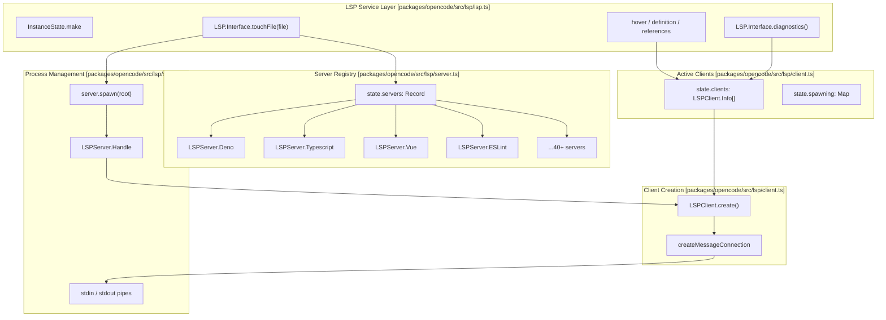
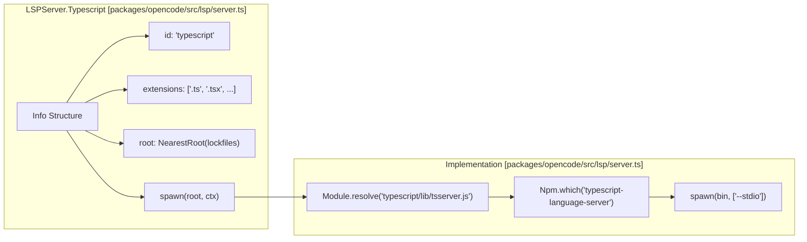
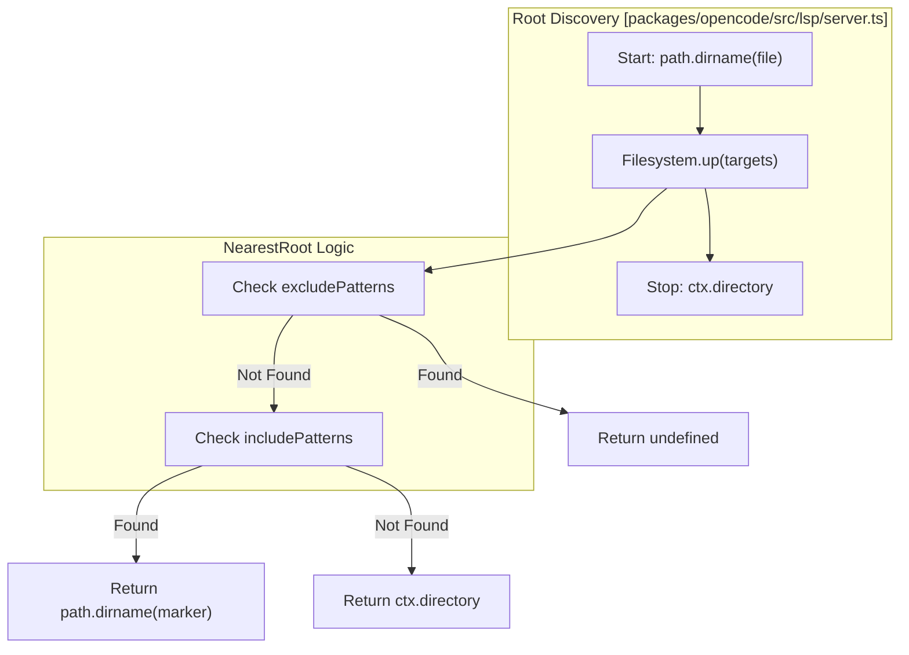
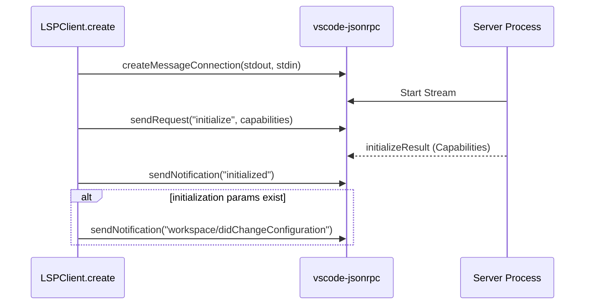
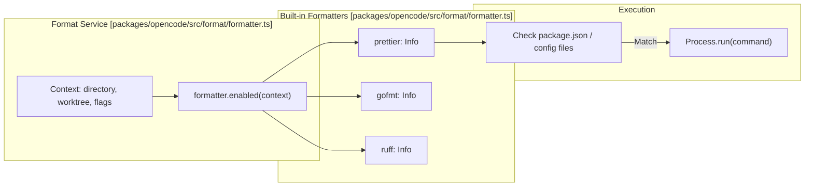

<!-- source: DeepWiki mcp.deepwiki.com · repo sst/opencode · page 5.4 Language Server Protocol Integration · fetched 2026-10-26 -->

# Language Server Protocol Integration

<details>
<summary>Relevant source files</summary>

The following files were used as context for generating this wiki page:

- [packages/opencode/src/format/formatter.ts](packages/opencode/src/format/formatter.ts)
- [packages/opencode/src/lsp/client.ts](packages/opencode/src/lsp/client.ts)
- [packages/opencode/src/lsp/language.ts](packages/opencode/src/lsp/language.ts)
- [packages/opencode/src/lsp/lsp.ts](packages/opencode/src/lsp/lsp.ts)
- [packages/opencode/src/lsp/server.ts](packages/opencode/src/lsp/server.ts)
- [packages/opencode/src/util/archive.ts](packages/opencode/src/util/archive.ts)
- [packages/opencode/src/util/filesystem.ts](packages/opencode/src/util/filesystem.ts)
- [packages/opencode/test/lsp/client.test.ts](packages/opencode/test/lsp/client.test.ts)
- [packages/opencode/test/lsp/index.test.ts](packages/opencode/test/lsp/index.test.ts)
- [packages/opencode/test/lsp/lifecycle.test.ts](packages/opencode/test/lsp/lifecycle.test.ts)
- [packages/opencode/test/util/filesystem.test.ts](packages/opencode/test/util/filesystem.test.ts)
- [packages/web/src/content/docs/formatters.mdx](packages/web/src/content/docs/formatters.mdx)
- [packages/web/src/content/docs/lsp.mdx](packages/web/src/content/docs/lsp.mdx)

</details>


OpenCode integrates with over 20 Language Server Protocol (LSP) servers to provide AI agents with code intelligence capabilities including diagnostics, hover information, symbol lookups, go-to-definition, find references, and call hierarchy analysis. The LSP integration enables agents to understand code structure and receive real-time feedback about syntax errors and type-checking issues [packages/web/src/content/docs/lsp.mdx:3-6]().

The system automatically downloads and configures LSP servers on first use, unless disabled via the `OPENCODE_DISABLE_LSP_DOWNLOAD` environment variable [packages/opencode/src/lsp/server.ts:152-152](), [packages/web/src/content/docs/lsp.mdx:53-55]().

---

## Architecture Overview

The LSP system is built on the `Effect` framework and consists of three main components: server definitions (`LSPServer.Info`), client instances (`LSPClient.Info`), and the orchestration layer (`LSP.Service`) that manages server lifecycle and request routing [packages/opencode/src/lsp/lsp.ts:136-143]().

### LSP System Component Interaction
Title: LSP System Component Interaction


Sources: [packages/opencode/src/lsp/server.ts:80-86](), [packages/opencode/src/lsp/client.ts:123-135](), [packages/opencode/src/lsp/language.ts:1-121](), [packages/opencode/src/lsp/lsp.ts:138-206]()

---

## Server Definition Model

Each LSP server is defined by an `LSPServer.Info` structure [packages/opencode/src/lsp/server.ts:80-86](). This structure defines how to identify relevant files, locate the project root, and initialize the process.

| Property | Type | Description |
|----------|------|-------------|
| `id` | `string` | Unique identifier for the server (e.g., `"typescript"`, `"deno"`) [packages/opencode/src/lsp/server.ts:81-81]() |
| `extensions` | `string[]` | File extensions this server handles [packages/opencode/src/lsp/server.ts:82-82]() |
| `global` | `boolean?` | If true, server is shared across instances [packages/opencode/src/lsp/server.ts:83-83]() |
| `root` | `RootFunction` | Determines the workspace root for a given file [packages/opencode/src/lsp/server.ts:84-84]() |
| `spawn` | `Function` | Spawns the server process and provides initialization options [packages/opencode/src/lsp/server.ts:85-85]() |

The `spawn` function returns an `LSPServer.Handle`:
- `process`: The `ChildProcessWithoutNullStreams` [packages/opencode/src/lsp/server.ts:26-26]().
- `initialization`: A record passed to the LSP `initialize` request [packages/opencode/src/lsp/server.ts:27-27]().

### TypeScript Server Definition Flow
Title: TypeScript Server Definition Flow


Sources: [packages/opencode/src/lsp/server.ts:25-28](), [packages/opencode/src/lsp/server.ts:115-142]()

---

## Root Directory Resolution

OpenCode uses the `NearestRoot` and `StrictNearestRoot` helpers to walk up the directory tree to find project markers (like `package.json` or `deno.json`). This ensures that the LSP server is started with the correct workspace context [packages/opencode/src/lsp/server.ts:32-78]().



Sources: [packages/opencode/src/lsp/server.ts:32-54]()

---

## Client Lifecycle and Initialization

The LSP client handles the JSON-RPC connection to the server process using `vscode-jsonrpc` [packages/opencode/src/lsp/client.ts:3-3](), [packages/opencode/src/lsp/client.ts:132-135](). It manages the `initialize` handshake and subsequent capability negotiations.

### Client Initialization Sequence
Title: Client Initialization Sequence


Sources: [packages/opencode/src/lsp/client.ts:123-207]()

---

## Diagnostics Collection

Clients listen for `textDocument/publishDiagnostics` notifications from the server [packages/opencode/src/lsp/client.ts:160-160](). These are cached and published to the internal system via `diagnosticListeners` [packages/opencode/src/lsp/client.ts:144-144]().

- **Debounce:** Diagnostics processing typically involves waiting for fresh pushes [packages/opencode/src/lsp/client.ts:13-15]().
- **Deduplication:** Diagnostics are deduped based on code, severity, message, source, and range before storage [packages/opencode/src/lsp/client.ts:91-105]().
- **Special Handling:** The TypeScript LSP is "seeded" on the first push to ensure diagnostics are available immediately [packages/opencode/src/lsp/client.ts:119-122]().

Sources: [packages/opencode/src/lsp/client.ts:13-15](), [packages/opencode/src/lsp/client.ts:91-105](), [packages/opencode/src/lsp/client.ts:160-172]()

---

## Automatic Server Installation

OpenCode can automatically provision missing LSP servers. This is triggered within the `spawn` function of specific server definitions.

- **NPM-based:** Servers like Vue check for local binaries via `which` and fall back to `Npm.which("@vue/language-server")` [packages/opencode/src/lsp/server.ts:149-155]().
- **GitHub/Archive-based:** The ESLint server implementation downloads the `vscode-eslint` source from GitHub, extracts it, and runs `npm install` and `npm run compile` to build the server locally [packages/opencode/src/lsp/server.ts:180-209]().

Sources: [packages/opencode/src/lsp/server.ts:148-171](), [packages/opencode/src/lsp/server.ts:173-222]()

---

## Built-in Language Servers

OpenCode provides native support for over 20 languages out of the box [packages/web/src/content/docs/lsp.mdx:14-49]().

| Server ID | Extensions | Requirements / Logic |
| :--- | :--- | :--- |
| `typescript` | `.ts`, `.tsx`, `.js`, `.jsx`, `.mjs`, `.cjs`, `.mts`, `.cts` | Resolves `tsserver.js` from project dependencies [packages/opencode/src/lsp/server.ts:115-142]() |
| `deno` | `.ts`, `.tsx`, `.js`, `.jsx`, `.mjs` | Detects `deno.json` or `deno.jsonc` [packages/opencode/src/lsp/server.ts:88-113]() |
| `vue` | `.vue` | Uses `@vue/language-server` [packages/opencode/src/lsp/server.ts:144-171]() |
| `eslint` | `.ts`, `.js`, `.vue`, etc. | Downloads and builds VS Code ESLint server if missing [packages/opencode/src/lsp/server.ts:173-222]() |
| `oxlint` | `.ts`, `.tsx`, `.js`, `.jsx`, `.mjs`, `.cjs`, `.mts`, `.cts`, `.vue`, `.astro`, `.svelte` | Detects `.oxlintrc.json` or project lockfiles [packages/web/src/content/docs/lsp.mdx:35-35]() |

Sources: [packages/opencode/src/lsp/server.ts:88-235](), [packages/web/src/content/docs/lsp.mdx:14-49]()

---

## Code Formatting Integration

While primarily an LSP feature, formatting is handled by a parallel formatting service layer [packages/opencode/src/format/formatter.ts:1-12](). When a file is edited, the system identifies the appropriate formatter (e.g., `prettier`, `gofmt`, `ruff`) and runs it against the file [packages/opencode/src/format/formatter.ts:38-216]().

### Formatter Selection Logic
Title: Formatter Selection Logic


Sources: [packages/opencode/src/format/formatter.ts:1-248]()

---

## Configuration and Customization

The LSP system can be configured via the `lsp` property in `opencode.json`. Users can disable built-in servers or define custom ones by providing the executable `command` and handled `extensions` [packages/web/src/content/docs/lsp.mdx:76-96]().

```json
{
  "lsp": {
    "typescript": {
      "disabled": false,
      "command": ["typescript-language-server", "--stdio"]
    },
    "custom-server": {
      "command": ["my-lsp-bin", "--serve"],
      "extensions": [".custom"]
    }
  }
}
```

Sources: [packages/web/src/content/docs/lsp.mdx:76-96](), [packages/opencode/src/lsp/lsp.ts:160-182]()

---

