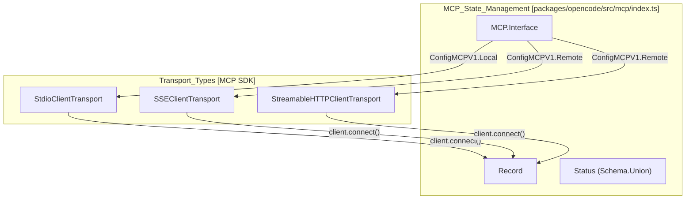
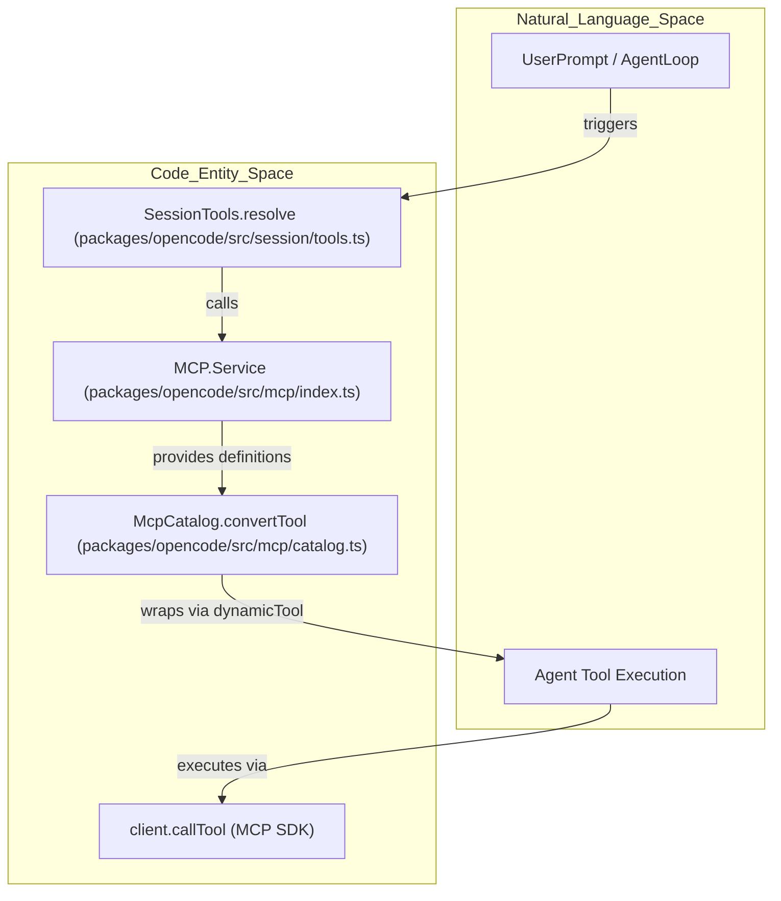
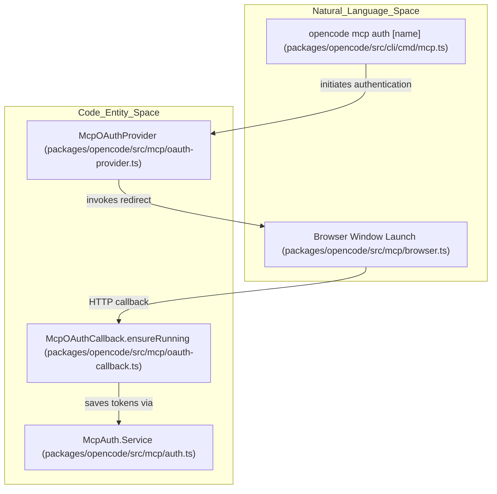

<!-- source: DeepWiki mcp.deepwiki.com · repo sst/opencode · page 5.6 Model Context Protocol (MCP) · fetched 2026-10-26 -->

# Model Context Protocol (MCP)

Relevant source files

The following files were used as context for generating this wiki page:

- [packages/opencode/src/cli/cmd/mcp.ts](packages/opencode/src/cli/cmd/mcp.ts)
- [packages/opencode/src/mcp/auth.ts](packages/opencode/src/mcp/auth.ts)
- [packages/opencode/src/mcp/catalog.ts](packages/opencode/src/mcp/catalog.ts)
- [packages/opencode/src/mcp/index.ts](packages/opencode/src/mcp/index.ts)
- [packages/opencode/src/mcp/oauth-callback.ts](packages/opencode/src/mcp/oauth-callback.ts)
- [packages/opencode/src/mcp/oauth-provider.ts](packages/opencode/src/mcp/oauth-provider.ts)
- [packages/opencode/src/server/routes/instance/httpapi/handlers/event.ts](packages/opencode/src/server/routes/instance/httpapi/handlers/event.ts)
- [packages/opencode/src/session/tools.ts](packages/opencode/src/session/tools.ts)
- [packages/opencode/test/AGENTS.md](packages/opencode/test/AGENTS.md)
- [packages/opencode/test/fixture/mcp-lifecycle-stdio.ts](packages/opencode/test/fixture/mcp-lifecycle-stdio.ts)
- [packages/opencode/test/fixture/mcp-session-recovery.ts](packages/opencode/test/fixture/mcp-session-recovery.ts)
- [packages/opencode/test/lib/effect.ts](packages/opencode/test/lib/effect.ts)
- [packages/opencode/test/mcp/catalog.test.ts](packages/opencode/test/mcp/catalog.test.ts)
- [packages/opencode/test/mcp/headers.test.ts](packages/opencode/test/mcp/headers.test.ts)
- [packages/opencode/test/mcp/lifecycle.test.ts](packages/opencode/test/mcp/lifecycle.test.ts)
- [packages/opencode/test/mcp/oauth-auto-connect.test.ts](packages/opencode/test/mcp/oauth-auto-connect.test.ts)
- [packages/opencode/test/mcp/oauth-browser.test.ts](packages/opencode/test/mcp/oauth-browser.test.ts)
- [packages/opencode/test/mcp/oauth-callback.test.ts](packages/opencode/test/mcp/oauth-callback.test.ts)
- [packages/opencode/test/mcp/oauth-provider.test.ts](packages/opencode/test/mcp/oauth-provider.test.ts)
- [packages/opencode/test/mcp/session-recovery.test.ts](packages/opencode/test/mcp/session-recovery.test.ts)
- [packages/opencode/test/mcp/transport.test.ts](packages/opencode/test/mcp/transport.test.ts)
- [packages/opencode/test/server/httpapi-event.test.ts](packages/opencode/test/server/httpapi-event.test.ts)
- [packages/opencode/test/session/tools.test.ts](packages/opencode/test/session/tools.test.ts)
- [patches/@modelcontextprotocol%2Fsdk@1.29.0.patch](patches/@modelcontextprotocol%2Fsdk@1.29.0.patch)

The purpose of this page is to detail the Model Context Protocol (MCP) integration within OpenCode. This includes server connections (`stdio`, `SSE`, and `StreamableHTTP`), OAuth authentication flows and credential persistence, catalog discovery for tools, prompts, and resources, and how external MCP capabilities are integrated into agent execution loops via `SessionTools.resolve` [packages/opencode/src/session/tools.ts:41-49]().

For information about OpenCode's built-in tools, see [5.3 Built-in Tools Reference](). For tool permission management, see [5.2 Permission System]().

---

## Purpose and Scope

MCP integration in OpenCode enables:

- **External Resource Access**: AI agents can read from external resources (databases, APIs, file systems) exposed by MCP servers using `client.listResources()` and related catalog methods [packages/opencode/src/mcp/index.ts:115-116](), [packages/opencode/src/mcp/catalog.ts:129-143]().
- **Custom Tools**: Organizations can implement domain-specific tools using the MCP protocol without modifying OpenCode source code [packages/opencode/src/mcp/catalog.ts:42-83]().
- **Standardized Transport Layer**: MCP provides a protocol-level abstraction supporting `StdioClientTransport`, `SSEClientTransport`, and `StreamableHTTPClientTransport` [packages/opencode/src/mcp/index.ts:7-9]().
- **Dynamic Prompts & Resources**: MCP servers can supply prompt templates and resource schemas that integrate directly into the OpenCode UI and session context [packages/opencode/src/mcp/index.ts:169-173](), [packages/opencode/src/mcp/catalog.ts:121-143]().

Sources: [packages/opencode/src/mcp/index.ts:7-173](), [packages/opencode/src/mcp/catalog.ts:42-143](), [packages/opencode/src/session/tools.ts:41-49]()

---

## Configuration and State Management

MCP servers are configured in the user or project configuration file (`opencode.json`). The `MCP` namespace manages the lifecycle of `Client` instances from the `@modelcontextprotocol/sdk` package [packages/opencode/src/mcp/index.ts:73-80]().

### Configuration Status & Schema

The status of each MCP server is represented as a discriminated union `Status` schema (`StatusConnected`, `StatusDisabled`, `StatusFailed`, `StatusNeedsAuth`, `StatusNeedsClientRegistration`) [packages/opencode/src/mcp/index.ts:83-106](). Local servers execute as child processes using `StdioClientTransport` via `ChildProcessSpawner` and `CrossSpawnSpawner` [packages/opencode/src/mcp/index.ts:32-33](), while remote servers use streamable HTTP or SSE transports [packages/opencode/src/mcp/index.ts:7-9]().

Title: MCP State and Transport Mapping

Sources: [packages/opencode/src/mcp/index.ts:7-9](), [packages/opencode/src/mcp/index.ts:32-33](), [packages/opencode/src/mcp/index.ts:83-106](), [packages/opencode/src/mcp/index.ts:164-173]()

Sources: [packages/opencode/src/mcp/index.ts:7-33](), [packages/opencode/src/mcp/index.ts:83-106](), [packages/opencode/src/mcp/index.ts:164-173]()

---

## Architecture: Natural Language Space to Code Entity Space

The MCP system bridges natural language agent tasks to external protocol servers through defined catalog services and effect operations.

Title: MCP Tool Discovery and Execution Bridge

Sources: [packages/opencode/src/session/tools.ts:41-176](), [packages/opencode/src/mcp/index.ts:164-173](), [packages/opencode/src/mcp/catalog.ts:38-83]()

### Catalog and Pagination

The `McpCatalog` module handles pagination for large lists of tools, prompts, and resources, enforcing a maximum limit of 1,000 pages (`MAX_LIST_PAGES`) to prevent infinite recursion [packages/opencode/src/mcp/catalog.ts:18-36](). Tool schemas returned by MCP servers are converted via `McpCatalog.convertTool` into `ai` SDK compatible `Tool` objects with strict additional property checks [packages/opencode/src/mcp/catalog.ts:42-83]().

Sources: [packages/opencode/src/mcp/catalog.ts:18-83]()

---

## OAuth Authentication Flow and Credential Persistence

For remote servers requiring authentication, OpenCode provides an OAuth 2.0 integration managed by `McpAuth`, `McpOAuthProvider`, and `McpOAuthCallback` [packages/opencode/src/mcp/auth.ts:40-53](), [packages/opencode/src/mcp/oauth-provider.ts:26-181](), [packages/opencode/src/mcp/oauth-callback.ts:105-131]().

Title: MCP OAuth Flow and Persistence Bridge

Sources: [packages/opencode/src/cli/cmd/mcp.ts:170-180](), [packages/opencode/src/mcp/oauth-provider.ts:26-181](), [packages/opencode/src/mcp/oauth-callback.ts:105-131](), [packages/opencode/src/mcp/auth.ts:40-53]()

### Authentication Lifecycle Details

1.  **Detection**: OpenCode identifies server authentication requirements via `StatusNeedsAuth` or `StatusNeedsClientRegistration` [packages/opencode/src/mcp/index.ts:92-98]().
2.  **Provider Implementation**: `McpOAuthProvider` implements the MCP SDK's `OAuthClientProvider` interface, managing `clientInformation()`, `saveTokens()`, `redirectToAuthorization()`, and state generation [packages/opencode/src/mcp/oauth-provider.ts:26-181]().
3.  **Callback Server**: `McpOAuthCallback.ensureRunning()` starts a local HTTP listener on port `19876` (or configured port) at `OAUTH_CALLBACK_PATH` to capture authorization codes securely while verifying state parameters against CSRF attacks [packages/opencode/src/mcp/oauth-callback.ts:42-131]().
4.  **Storage**: Tokens, client metadata, code verifiers, and OAuth states are persisted in `mcp-auth.json` inside the global data directory (`Global.Path.data`) [packages/opencode/src/mcp/auth.ts:37-38]() using `EffectFlock` for concurrency control [packages/opencode/src/mcp/auth.ts:63-82]().

Sources: [packages/opencode/src/mcp/auth.ts:37-82](), [packages/opencode/src/mcp/oauth-provider.ts:26-181](), [packages/opencode/src/mcp/oauth-callback.ts:42-131]()

---

## Tool System Integration

MCP tools and resources are resolved alongside built-in tools when constructing agent execution turns in `SessionTools.resolve` [packages/opencode/src/session/tools.ts:41-49]().

- **Resource Tools**: If any connected MCP server declares resource capabilities (`client.getServerCapabilities()?.resources`), OpenCode injects helper tools (`list_mcp_resources`, `list_mcp_resource_templates`, and `read_mcp_resource`) [packages/opencode/src/session/tools.ts:27-31](), [packages/opencode/src/session/tools.ts:136-138]().
- **Attachment Limits**: `read_mcp_resource` supports binary file attachments for allowed MIME types (e.g., PDF, PNG, JPEG, WEBP) up to `10 * 1024 * 1024` bytes (10MB) [packages/opencode/src/session/tools.ts:32-39]().

Sources: [packages/opencode/src/session/tools.ts:27-176]()

---

## CLI Management Commands

The CLI provides administrative commands under `opencode mcp` for managing server configurations and authentications [packages/opencode/src/cli/cmd/mcp.ts:95-107]().

| Command | Description | Code Reference |
| :--- | :--- | :--- |
| `opencode mcp list` | Lists all configured servers and their connection/auth status | [packages/opencode/src/cli/cmd/mcp.ts:109-168]() |
| `opencode mcp auth [name]` | Initiates interactive OAuth login for a remote MCP server | [packages/opencode/src/cli/cmd/mcp.ts:170-180]() |
| `opencode mcp logout` | Revokes and clears stored credentials | [packages/opencode/src/cli/cmd/mcp.ts:103]() |
| `opencode mcp debug` | Outputs verbose logs and diagnostic traces | [packages/opencode/src/cli/cmd/mcp.ts:104]() |

Sources: [packages/opencode/src/cli/cmd/mcp.ts:95-180]()

---

