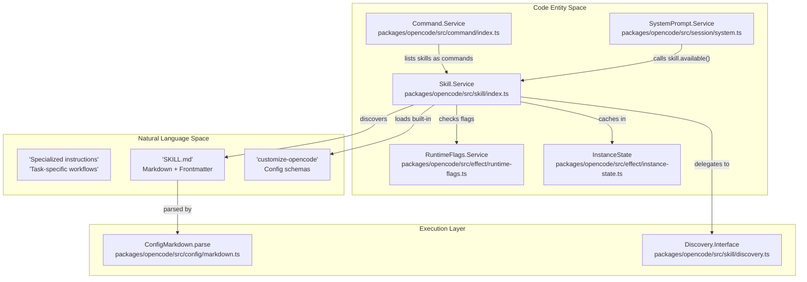
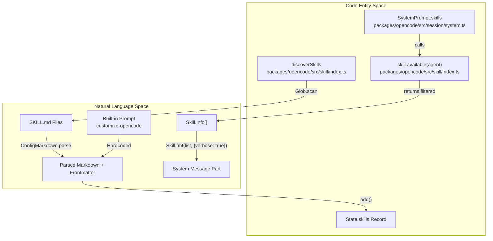

<!-- source: DeepWiki mcp.deepwiki.com · repo sst/opencode · page 5.7 Skills System · fetched 2026-10-26 -->

# Skills System

Relevant source files

The following files were used as context for generating this wiki page:

- [.github/ISSUE_TEMPLATE/config.yml](.github/ISSUE_TEMPLATE/config.yml)
- [.github/workflows/close-prs.yml](.github/workflows/close-prs.yml)
- [.github/workflows/compliance-close.yml](.github/workflows/compliance-close.yml)
- [.github/workflows/docs-update.yml](.github/workflows/docs-update.yml)
- [.github/workflows/duplicate-issues.yml](.github/workflows/duplicate-issues.yml)
- [.github/workflows/notify-discord.yml](.github/workflows/notify-discord.yml)
- [.github/workflows/pr-management.yml](.github/workflows/pr-management.yml)
- [.github/workflows/pr-standards.yml](.github/workflows/pr-standards.yml)
- [.github/workflows/review.yml](.github/workflows/review.yml)
- [.github/workflows/triage.yml](.github/workflows/triage.yml)
- [packages/core/src/flag/flag.ts](packages/core/src/flag/flag.ts)
- [packages/opencode/src/command/index.ts](packages/opencode/src/command/index.ts)
- [packages/opencode/src/effect/runtime-flags.ts](packages/opencode/src/effect/runtime-flags.ts)
- [packages/opencode/src/session/prompt/codex.txt](packages/opencode/src/session/prompt/codex.txt)
- [packages/opencode/src/session/prompt/meta.txt](packages/opencode/src/session/prompt/meta.txt)
- [packages/opencode/src/session/system.ts](packages/opencode/src/session/system.ts)
- [packages/opencode/src/skill/index.ts](packages/opencode/src/skill/index.ts)
- [packages/opencode/src/util/queue.ts](packages/opencode/src/util/queue.ts)
- [packages/opencode/test/effect/runtime-flags.test.ts](packages/opencode/test/effect/runtime-flags.test.ts)
- [packages/opencode/test/preload.ts](packages/opencode/test/preload.ts)
- [packages/opencode/test/session/structured-output-integration.test.ts](packages/opencode/test/session/structured-output-integration.test.ts)
- [packages/opencode/test/session/system.test.ts](packages/opencode/test/session/system.test.ts)
- [packages/opencode/test/skill/skill.test.ts](packages/opencode/test/skill/skill.test.ts)
- [packages/web/src/content/docs/skills.mdx](packages/web/src/content/docs/skills.mdx)
- [script/github/close-issues.ts](script/github/close-issues.ts)
- [script/github/close-prs.ts](script/github/close-prs.ts)

## Purpose and Scope

The Skills System provides reusable agent patterns and command templates that can be invoked during agent execution. Skills are composable units that encapsulate specialized instructions, common workflows, or interaction patterns. They serve as a bridge between high-level agent goals and specific tool executions, allowing agents to load specialized instructions dynamically when a task matches its description [packages/opencode/src/skill/index.ts:102-102]().

The system is integrated into the prompt processing pipeline via the `SystemPrompt.Service`, where available skills are injected into the system prompt to inform the LLM of its extended capabilities [packages/opencode/src/session/system.ts:107-119](). A notable built-in skill, `customize-opencode`, provides the LLM with accurate schemas for OpenCode's own configuration files (e.g., `opencode.json`, `opencode.jsonc`) to prevent model hallucinations during self-configuration tasks [packages/opencode/src/skill/index.ts:32-35]().

Sources: [packages/opencode/src/skill/index.ts:32-35](), [packages/opencode/src/skill/index.ts:102-102](), [packages/opencode/src/session/system.ts:107-119]()

## Architecture Overview

The skills system is managed by the `Skill.Service`, which handles discovery, parsing, and filtering of skills based on agent permissions and runtime flags [packages/opencode/src/skill/index.ts:97-103](). It works in conjunction with the `Command.Service` to expose skills as executable command templates [packages/opencode/src/command/index.ts:134-152]().

### System Components and Code Entities

**Skill System Integration Architecture**

Sources: [packages/opencode/src/skill/index.ts:97-103](), [packages/opencode/src/command/index.ts:134-152](), [packages/opencode/src/session/system.ts:107-119](), [packages/opencode/src/skill/index.ts:173-182]()

## Skill Discovery and Definition

Skills are defined as Markdown files following naming patterns like `SKILL.md`. These files contain YAML frontmatter specifying the skill's name and description.

### Discovery Logic
The `Skill.Service` scans for skills across multiple scopes, controlled by `RuntimeFlags` and the environment [packages/opencode/src/skill/index.ts:173-182]():

1.  **Global Scopes**: Scans standard directories like `~/.claude` (`CLAUDE_EXTERNAL_DIR`) and `~/.agents` (`AGENTS_EXTERNAL_DIR`) for the pattern `skills/**/SKILL.md` [packages/opencode/src/skill/index.ts:21-23](), [packages/opencode/src/skill/index.ts:187-194]().
2.  **Project Scopes**: Searches upwards from the current directory to the worktree root for external skill folders [packages/opencode/src/skill/index.ts:196-203]().
3.  **Configured Paths**: Directories explicitly defined in OpenCode configuration folders are scanned for `{skill,skills}/**/SKILL.md` [packages/opencode/src/skill/index.ts:24-25](), [packages/opencode/src/skill/index.ts:205-208]().
4.  **Discovery Service**: Integrates with the `Discovery` interface to find additional matches [packages/opencode/src/skill/index.ts:210-210]().

### Core Data Structures

| Class/Type | Source | Description |
| :--- | :--- | :--- |
| `Skill.Info` | [packages/opencode/src/skill/index.ts:37-42]() | Schema for a skill including `name`, `description`, `location`, and `content`. |
| `Skill.Service` | [packages/opencode/src/skill/index.ts:97-103]() | Interface for retrieving (`get`), requiring (`require`), and listing available skills. |
| `InvalidError` | [packages/opencode/src/skill/index.ts:61-65]() | Tagged error for skill files that fail validation or parsing. |
| `Command.Info` | [packages/opencode/src/command/index.ts:22-32]() | Schema that wraps skills when they are exposed as interactive commands. |

Sources: [packages/opencode/src/skill/index.ts:21-42](), [packages/opencode/src/skill/index.ts:61-80](), [packages/opencode/src/skill/index.ts:97-103](), [packages/opencode/src/command/index.ts:22-32]()

## Skill Loading and Interaction

The system uses `ConfigMarkdown.parse` to extract metadata and content from the skill files [packages/opencode/src/skill/index.ts:106-109](). If a skill name collision occurs, the existing skill is preserved and a warning is logged [packages/opencode/src/skill/index.ts:125-131]().

### Data Flow: Discovery to LLM Prompt

**Skill Resolution Flow**

Sources: [packages/opencode/src/skill/index.ts:105-140](), [packages/opencode/src/command/index.ts:134-152](), [packages/opencode/src/session/system.ts:107-119]()

## Command Integration

Skills are automatically converted into command templates by the `Command.Service`. This allows users to invoke skills directly from the CLI or TUI [packages/opencode/src/command/index.ts:134-152]().

*   **Template Resolution**: When a skill is used as a command, its `template` property is populated with the skill's content [packages/opencode/src/command/index.ts:141-149]().
*   **Context Injection**: For non-built-in skills, the system appends the base directory for the skill to ensure the LLM understands relative paths for scripts or references [packages/opencode/src/command/index.ts:143-148]().
*   **Conflict Resolution**: If a native command and a skill share the same name, the native command takes precedence [packages/opencode/src/command/index.ts:135-135]().

Sources: [packages/opencode/src/command/index.ts:134-152]()

## External Compatibility and Flags

OpenCode maintains compatibility with external skill ecosystems through environment-driven runtime flags:

*   **Claude Code Compatibility**: OpenCode scans `.claude` directories for skills by default [packages/opencode/src/skill/index.ts:21](). This can be disabled via `disableClaudeCodeSkills` in `RuntimeFlags` [packages/opencode/src/skill/index.ts:179-187](), [packages/opencode/src/effect/runtime-flags.ts:27-30]().
*   **External Skills**: The flag `OPENCODE_DISABLE_EXTERNAL_SKILLS` completely halts scanning of global and project-level external skill directories [packages/opencode/src/skill/index.ts:178-186](), [packages/opencode/src/effect/runtime-flags.ts:21-21]().
*   **Pure Mode**: When `OPENCODE_PURE` is enabled, external skill discovery is skipped [packages/opencode/src/skill/index.ts:215-215](), [packages/opencode/src/effect/runtime-flags.ts:18-18]().

Sources: [packages/opencode/src/skill/index.ts:21-25](), [packages/opencode/src/skill/index.ts:173-215](), [packages/opencode/src/effect/runtime-flags.ts:18-30]()

## Configuration and Permissions

Skills are governed by the agent-level permission system:

*   **Agent Filtering**: The `available(agent)` method allows the system to filter which skills are visible to a specific agent based on its metadata and permissions [packages/opencode/src/skill/index.ts:102-102]().
*   **Permission Check**: The `SystemPrompt.skills` function explicitly checks if skills are disabled in the agent's permission ruleset [packages/opencode/src/session/system.ts:107-109]().
*   **Error Handling**: If an agent attempts to access a skill that does not exist, the service returns a `NotFoundError` containing a list of valid available skills to help the agent recover [packages/opencode/src/skill/index.ts:73-80]().

Sources: [packages/opencode/src/skill/index.ts:73-80](), [packages/opencode/src/skill/index.ts:102-102](), [packages/opencode/src/session/system.ts:107-119]()

---

