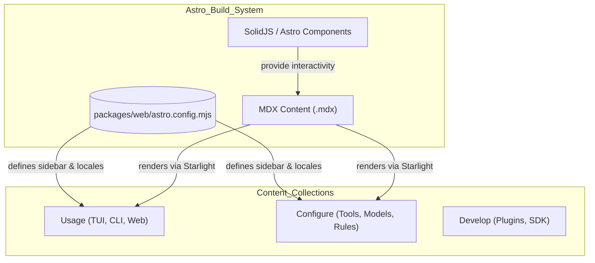
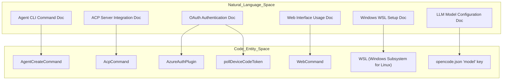

<!-- source: DeepWiki mcp.deepwiki.com · repo sst/opencode · page 6.11 Web Documentation Site · fetched 2026-10-26 -->

# Web Documentation Site

Relevant source files

The following files were used as context for generating this wiki page:

- [README.md](README.md)
- [packages/web/astro.config.mjs](packages/web/astro.config.mjs)
- [packages/web/src/assets/web/web-homepage-active-session.png](packages/web/src/assets/web/web-homepage-active-session.png)
- [packages/web/src/assets/web/web-homepage-new-session.png](packages/web/src/assets/web/web-homepage-new-session.png)
- [packages/web/src/assets/web/web-homepage-see-servers.png](packages/web/src/assets/web/web-homepage-see-servers.png)
- [packages/web/src/components/Footer.astro](packages/web/src/components/Footer.astro)
- [packages/web/src/components/Lander.astro](packages/web/src/components/Lander.astro)
- [packages/web/src/components/LanguageSelect.astro](packages/web/src/components/LanguageSelect.astro)
- [packages/web/src/components/PageFrame.astro](packages/web/src/components/PageFrame.astro)
- [packages/web/src/components/V2Banner.astro](packages/web/src/components/V2Banner.astro)
- [packages/web/src/content/docs/index.mdx](packages/web/src/content/docs/index.mdx)
- [packages/web/src/content/docs/models.mdx](packages/web/src/content/docs/models.mdx)
- [packages/web/src/content/docs/troubleshooting.mdx](packages/web/src/content/docs/troubleshooting.mdx)
- [packages/web/src/content/docs/web.mdx](packages/web/src/content/docs/web.mdx)
- [packages/web/src/content/docs/windows-wsl.mdx](packages/web/src/content/docs/windows-wsl.mdx)
- [packages/web/src/styles/custom.css](packages/web/src/styles/custom.css)

The web documentation site is an Astro-based platform deployed at `opencode.ai` that provides user-facing documentation, guides, and interactive landing pages for OpenCode. It utilizes **Astro Starlight** as the documentation framework and integrates **SolidJS** for dynamic UI components. The site is configured for Server-Side Rendering (SSR) and deployed using the Cloudflare adapter [packages/web/astro.config.mjs:3-19]().

---

## Architectural Overview

The documentation site serves as the central hub for OpenCode's ecosystem, providing installation instructions, configuration references, and extension guides.

### Documentation Structure and Flow
The site organizes its content via Starlight content collections, mapping markdown and MDX files to structured sidebar items covering usage guides, configuration rules, and development architectures [packages/web/astro.config.mjs:33-251](). The main landing page for the documentation is `packages/web/src/content/docs/index.mdx` [packages/web/src/content/docs/index.mdx:1-360]().

**Documentation Navigation and Content Flow**

Sources: [packages/web/astro.config.mjs:33-251](), [packages/web/src/content/docs/index.mdx:1-360]()

---

## Astro Configuration and Localization

The site relies heavily on Astro's modern configuration pipeline defined in `packages/web/astro.config.mjs`.

### Key Configuration Elements
*   **SSR and Cloudflare Adapter:** Configured with `output: "server"` and the Cloudflare adapter with a `passthrough` image service for optimal edge performance [packages/web/astro.config.mjs:13-19]().
*   **Markdown Extensions:** Integrates `@astrojs/markdown-remark` with `rehypeHeadingIds` and `rehypeAutolinkHeadings` set to `wrap` mode to facilitate deep linking within documents [packages/web/astro.config.mjs:8-9, 26-28]().
*   **Internationalization (i18n):** Supports 18+ localized languages under Starlight's locale registry, including Arabic (`ar`), Bosnian (`bs`), Danish (`da`), German (`de`), Spanish (`es`), French (`fr`), Italian (`it`), Japanese (`ja`), Korean (`ko`), Norwegian (`nb`), Polish (`pl`), Portuguese (`pt-br`), Russian (`ru`), Thai (`th`), Turkish (`tr`), Simplified Chinese (`zh-cn`), and Traditional Chinese (`zh-tw`) [packages/web/astro.config.mjs:36-127]().
*   **Custom CSS:** The site uses `packages/web/src/styles/custom.css` for custom styling, overriding Starlight's default theme variables and applying specific styles for elements like headers, sidebars, and search buttons [packages/web/src/styles/custom.css:1-431]().
*   **V2 Banner:** A `V2Banner.astro` component is used to display a fixed announcement bar for OpenCode v2, positioned below the main header [packages/web/src/components/V2Banner.astro:1-82](), [packages/web/src/components/PageFrame.astro:10]().

Sources: [packages/web/astro.config.mjs:1-127](), [packages/web/src/styles/custom.css:1-431](), [packages/web/src/components/V2Banner.astro:1-82](), [packages/web/src/components/PageFrame.astro:10]()

---

## Natural Language Space to Code Entity Space

To help developers trace documentation topics back to actual implementation modules, the documentation references map directly to internal packages and CLI commands.

**Documentation to Code Mapping**
| Documentation Topic / Concept | Code Entity / Symbol | Context / File Path |
| :--- | :--- | :--- |
| **CLI Agent Management** | `AgentCreateCommand` | [packages/opencode/src/cli/cmd/agent.ts:33]() |
| **ACP Protocol Integration** | `AcpCommand` | [packages/opencode/src/cli/cmd/acp.ts:9]() |
| **Web Server Mode** | `WebCommand` | [packages/opencode/src/cli/cmd/web.ts:31]() |
| **Authentication & Connect** | `Auth.Service` / `AzureAuthPlugin` | [packages/opencode/src/plugin/azure.ts:20]() |
| **Device Code OAuth (xAI)** | `pollDeviceCodeToken` | [packages/opencode/src/plugin/xai.ts:148]() |
| **Web Interface Usage** | `opencode web` command | [packages/web/src/content/docs/web.mdx:14-16]() |
| **Windows WSL Setup** | `Windows Subsystem for Linux (WSL)` | [packages/web/src/content/docs/windows-wsl.mdx:8]() |
| **LLM Model Configuration** | `opencode.json` `model` key | [packages/web/src/content/docs/models.mdx:54-58]() |

**Bridge Diagram: Documentation Concepts to Code Entities**

Sources: [packages/web/astro.config.mjs:174-272](), [packages/opencode/src/plugin/azure.ts:20-23](), [packages/opencode/src/plugin/xai.ts:148-151](), [packages/web/src/content/docs/web.mdx:14-16](), [packages/web/src/content/docs/windows-wsl.mdx:8](), [packages/web/src/content/docs/models.mdx:54-58]()

---

## Deployment and Infrastructure

The web application is packaged for edge deployment via Cloudflare Workers and Pages.

*   **Build Output:** Generates server-rendered outputs optimized for Cloudflare's runtime environment using `@astrojs/cloudflare` [packages/web/astro.config.mjs:16-19]().
*   **Asset Management:** Uses custom favicons and head injection scripts defined in the Starlight integration config [packages/web/astro.config.mjs:128-155]().
*   **Theme and Styling:** Leverages `toolbeam-docs-theme` alongside custom CSS styling rules located in `./src/styles/custom.css` [packages/web/astro.config.mjs:6, 168](). The `Footer.astro` component [packages/web/src/components/Footer.astro:1-125]() and `Lander.astro` component [packages/web/src/components/Lander.astro:1-190]() also contribute to the site's visual presentation and functionality.

Sources: [packages/web/astro.config.mjs:1-174](), [packages/web/src/components/Footer.astro:1-125](), [packages/web/src/components/Lander.astro:1-190]()

---

