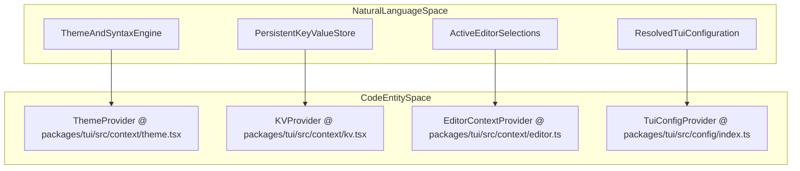
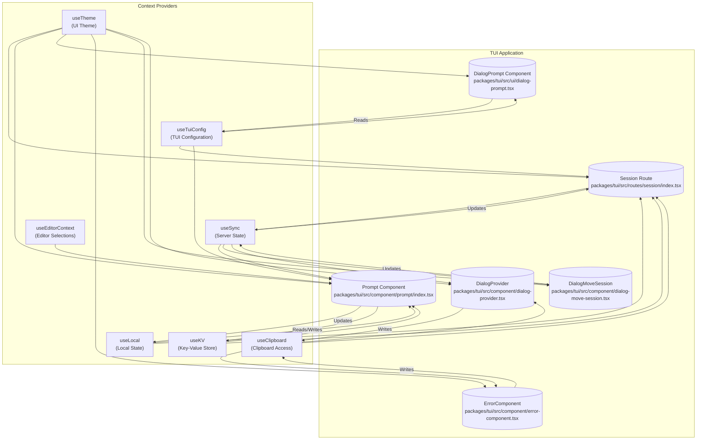

<!-- source: DeepWiki mcp.deepwiki.com · repo sst/opencode · page 6.3 TUI State Management · fetched 2026-10-26 -->

# TUI State Management

Relevant source files

The following files were used as context for generating this wiki page:

- [packages/opencode/src/effect/config-service.ts](packages/opencode/src/effect/config-service.ts)
- [packages/opencode/src/server/routes/instance/httpapi/groups/pty.ts](packages/opencode/src/server/routes/instance/httpapi/groups/pty.ts)
- [packages/opencode/src/server/routes/instance/httpapi/handlers/pty.ts](packages/opencode/src/server/routes/instance/httpapi/handlers/pty.ts)
- [packages/opencode/src/server/routes/instance/httpapi/middleware/authorization.ts](packages/opencode/src/server/routes/instance/httpapi/middleware/authorization.ts)
- [packages/opencode/test/cli/tui/editor-context-zed.test.ts](packages/opencode/test/cli/tui/editor-context-zed.test.ts)
- [packages/opencode/test/cli/tui/editor-context.test.tsx](packages/opencode/test/cli/tui/editor-context.test.tsx)
- [packages/opencode/test/server/httpapi-authorization.test.ts](packages/opencode/test/server/httpapi-authorization.test.ts)
- [packages/opencode/test/server/httpapi-pty.test.ts](packages/opencode/test/server/httpapi-pty.test.ts)
- [packages/tui/src/clipboard.ts](packages/tui/src/clipboard.ts)
- [packages/tui/src/component/dialog-console-org.tsx](packages/tui/src/component/dialog-console-org.tsx)
- [packages/tui/src/component/dialog-move-session.tsx](packages/tui/src/component/dialog-move-session.tsx)
- [packages/tui/src/component/dialog-provider.tsx](packages/tui/src/component/dialog-provider.tsx)
- [packages/tui/src/component/dialog-skill.tsx](packages/tui/src/component/dialog-skill.tsx)
- [packages/tui/src/component/dialog-workspace-list.tsx](packages/tui/src/component/dialog-workspace-list.tsx)
- [packages/tui/src/component/error-component.tsx](packages/tui/src/component/error-component.tsx)
- [packages/tui/src/component/prompt/index.tsx](packages/tui/src/component/prompt/index.tsx)
- [packages/tui/src/component/startup-loading.tsx](packages/tui/src/component/startup-loading.tsx)
- [packages/tui/src/context/editor.ts](packages/tui/src/context/editor.ts)
- [packages/tui/src/context/kv.tsx](packages/tui/src/context/kv.tsx)
- [packages/tui/src/context/theme.tsx](packages/tui/src/context/theme.tsx)
- [packages/tui/src/feature-plugins/system/diff-viewer.tsx](packages/tui/src/feature-plugins/system/diff-viewer.tsx)
- [packages/tui/src/feature-plugins/system/plugins.tsx](packages/tui/src/feature-plugins/system/plugins.tsx)
- [packages/tui/src/plugin/adapters.tsx](packages/tui/src/plugin/adapters.tsx)
- [packages/tui/src/routes/session/index.tsx](packages/tui/src/routes/session/index.tsx)
- [packages/tui/src/ui/dialog-prompt.tsx](packages/tui/src/ui/dialog-prompt.tsx)
- [packages/tui/test/cli/tui/__snapshots__/inline-tool-wrap-snapshot.test.tsx.snap](packages/tui/test/cli/tui/__snapshots__/inline-tool-wrap-snapshot.test.tsx.snap)
- [packages/tui/test/cli/tui/diff-viewer-file-tree.test.tsx](packages/tui/test/cli/tui/diff-viewer-file-tree.test.tsx)
- [packages/tui/test/cli/tui/diff-viewer.test.tsx](packages/tui/test/cli/tui/diff-viewer.test.tsx)
- [packages/tui/test/cli/tui/inline-tool-wrap-snapshot.test.tsx](packages/tui/test/cli/tui/inline-tool-wrap-snapshot.test.tsx)

This document details the reactive state management architecture used in the OpenCode Terminal User Interface (`packages/tui`). The system leverages SolidJS context providers and reactive primitives (`createSignal`, `createMemo`, `createStore`) to manage styling, key-value preferences, editor context, configurations, and server synchronization.

---

## State Architecture Overview

The TUI separates concerns into specialized context providers initialized at the root application level in `packages/tui/src/app.tsx` [packages/tui/src/app.tsx:53-68](). These providers expose hooks for child components to consume theme definitions, persistent key-value states, active editor selections, user configurations, and server-synchronized session data.

**TUI Context Providers & Code Entity Mapping**

Sources: [packages/tui/src/context/theme.tsx](), [packages/tui/src/context/kv.tsx](), [packages/tui/src/context/editor.ts](), [packages/tui/src/app.tsx:53-68]()

---

## Theme Provider and Styling State (`theme.tsx`)

The `ThemeProvider` manages the visual presentation of the TUI, supplying active color palettes, syntax highlighting styles, and contrast helpers to all renderable components.

### Core Functions and State
*   `useTheme()`: Exposes the current theme object and syntax styles to components [packages/tui/src/routes/session/index.tsx:26]().
*   `createSyntaxStyleMemo()`: Constructs optimized syntax highlighting memos based on the active theme [packages/tui/src/routes/session/index.tsx:26]().
*   `selectedForeground()`: Computes contrast-aware text foreground colors for selected or focused elements [packages/tui/src/routes/session/index.tsx:26]().

**TUI Reactive Data Flow & Synchronization**

Sources: [packages/tui/src/context/theme.tsx](), [packages/tui/src/routes/session/index.tsx:26](), [packages/tui/src/component/prompt/index.tsx](), [packages/tui/src/ui/dialog-prompt.tsx](), [packages/tui/src/component/error-component.tsx](), [packages/tui/src/component/dialog-move-session.tsx](), [packages/tui/src/component/dialog-provider.tsx](), [packages/tui/src/context/sync.tsx](), [packages/tui/src/context/local.tsx](), [packages/tui/src/context/kv.tsx](), [packages/tui/src/context/editor.ts](), [packages/tui/src/config/index.ts](), [packages/tui/src/context/clipboard.ts]()

---

## Key-Value Storage and Ephemeral Settings (`kv.tsx`)

The `KVProvider` (consumed via `useKV`) provides persistent local key-value storage within the TUI. It is utilized across components to track UI state flags, user dismissals, and feature toggles.

### Key Usage Patterns
*   **Animation Toggles**: Stores and retrieves flags such as `animations_enabled` to dynamically enable or disable terminal spinners and fade-in effects [packages/tui/src/component/prompt/index.tsx:174]().
*   **Upsell Tracking**: Manages timestamps and dismissal states for feature prompts like `go_upsell_last_seen_at` and `go_upsell_dont_show` [packages/tui/src/routes/session/index.tsx:87-92]().

Sources: [packages/tui/src/context/kv.tsx](), [packages/tui/src/component/prompt/index.tsx:174](), [packages/tui/src/routes/session/index.tsx:87-92]()

---

## Editor Context and Code Ranges (`editor.ts`)

The `EditorContextProvider` manages active file editor selections, line ranges, and external editor integrations within the TUI session environment [packages/tui/src/app.tsx:33]().

### Selection State Management
*   `useEditorContext()`: Provides access to current file paths, cursor positions, and selected text ranges [packages/tui/src/component/prompt/index.tsx:156]().
*   `editorSelectionKey()`: Generates unique keys representing active editor selections for caching and prompt injection [packages/tui/src/component/prompt/index.tsx:28]().
*   **Range Formatting**: Extracts line numbers and code snippets from selected ranges to inject context headers (`<system-reminder>`) into user prompts [packages/tui/src/component/prompt/index.tsx:115-139]().
*   **Zed Editor Integration**: The TUI includes specific logic to detect and integrate with the Zed editor, resolving selections from its SQLite database [packages/tui/test/cli/tui/editor-context-zed.test.ts:111-131](). This involves converting Zed's UTF-8 byte offsets to string offsets for accurate range representation [packages/tui/test/cli/tui/editor-context-zed.test.ts:175-193]().

Sources: [packages/tui/src/context/editor.ts](), [packages/tui/src/component/prompt/index.tsx:28](), [packages/tui/src/component/prompt/index.tsx:115-139](), [packages/tui/test/cli/tui/editor-context-zed.test.ts:111-131](), [packages/tui/test/cli/tui/editor-context-zed.test.ts:175-193]()

---

## Configuration and Keybindings (`config`)

The `TuiConfigProvider` loads, resolves, and distributes user-defined terminal configurations and keybinding maps [packages/tui/src/app.tsx:68]().

### Configuration Flow
*   `useTuiConfig()`: Returns the resolved TUI configuration (`TuiConfig.Resolved`), including cursor styles, layout options, and custom shortcuts [packages/tui/src/component/prompt/index.tsx:55]().
*   **Keymap Integration**: Works alongside `useBindings()` and `useOpencodeKeymap()` to map keyboard events to domain commands (e.g., `dialog.prompt.submit`, `agent.cycle`) [packages/tui/src/component/prompt/index.tsx:54](), [packages/tui/src/ui/dialog-prompt.tsx:33-47]().

Sources: [packages/tui/src/config/]() [packages/tui/src/app.tsx:68](), [packages/tui/src/component/prompt/index.tsx:54-55](), [packages/tui/src/ui/dialog-prompt.tsx:33-47]()

---

