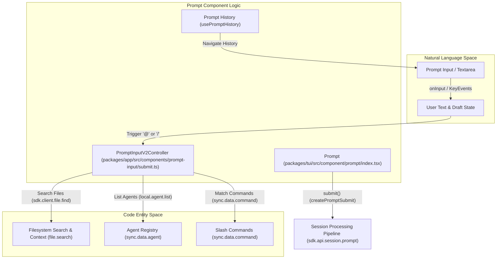
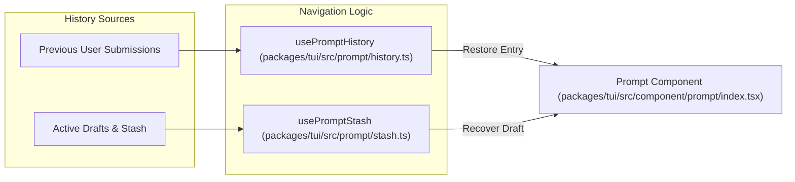

<!-- source: DeepWiki mcp.deepwiki.com · repo sst/opencode · page 6.5 TUI Prompt Component · fetched 2026-10-26 -->

# TUI Prompt Component

Relevant source files

The following files were used as context for generating this wiki page:

- [packages/app/src/components/prompt-input/submit.test.ts](packages/app/src/components/prompt-input/submit.test.ts)
- [packages/app/src/components/prompt-input/submit.ts](packages/app/src/components/prompt-input/submit.ts)
- [packages/app/src/components/session/session-sortable-terminal-tab.tsx](packages/app/src/components/session/session-sortable-terminal-tab.tsx)
- [packages/app/src/components/terminal.tsx](packages/app/src/components/terminal.tsx)
- [packages/app/src/context/file.tsx](packages/app/src/context/file.tsx)
- [packages/app/src/context/local.tsx](packages/app/src/context/local.tsx)
- [packages/app/src/context/permission-auto-respond.test.ts](packages/app/src/context/permission-auto-respond.test.ts)
- [packages/app/src/context/permission-auto-respond.ts](packages/app/src/context/permission-auto-respond.ts)
- [packages/app/src/context/permission.tsx](packages/app/src/context/permission.tsx)
- [packages/app/src/context/prompt.tsx](packages/app/src/context/prompt.tsx)
- [packages/app/src/context/terminal.tsx](packages/app/src/context/terminal.tsx)
- [packages/app/src/pages/directory-layout.tsx](packages/app/src/pages/directory-layout.tsx)
- [packages/app/src/pages/session/session-model-helpers.test.ts](packages/app/src/pages/session/session-model-helpers.test.ts)
- [packages/app/src/pages/session/session-model-helpers.ts](packages/app/src/pages/session/session-model-helpers.ts)
- [packages/app/src/pages/session/terminal-panel.tsx](packages/app/src/pages/session/terminal-panel.tsx)
- [packages/tui/src/component/dialog-console-org.tsx](packages/tui/src/component/dialog-console-org.tsx)
- [packages/tui/src/component/dialog-move-session.tsx](packages/tui/src/component/dialog-move-session.tsx)
- [packages/tui/src/component/dialog-provider.tsx](packages/tui/src/component/dialog-provider.tsx)
- [packages/tui/src/component/dialog-skill.tsx](packages/tui/src/component/dialog-skill.tsx)
- [packages/tui/src/component/dialog-workspace-list.tsx](packages/tui/src/component/dialog-workspace-list.tsx)
- [packages/tui/src/component/error-component.tsx](packages/tui/src/component/error-component.tsx)
- [packages/tui/src/component/prompt/index.tsx](packages/tui/src/component/prompt/index.tsx)
- [packages/tui/src/component/startup-loading.tsx](packages/tui/src/component/startup-loading.tsx)
- [packages/tui/src/feature-plugins/system/diff-viewer.tsx](packages/tui/src/feature-plugins/system/diff-viewer.tsx)
- [packages/tui/src/feature-plugins/system/plugins.tsx](packages/tui/src/feature-plugins/system/plugins.tsx)
- [packages/tui/src/plugin/adapters.tsx](packages/tui/src/plugin/adapters.tsx)
- [packages/tui/src/routes/session/index.tsx](packages/tui/src/routes/session/index.tsx)
- [packages/tui/src/ui/dialog-prompt.tsx](packages/tui/src/ui/dialog-prompt.tsx)
- [packages/tui/test/cli/tui/__snapshots__/inline-tool-wrap-snapshot.test.tsx.snap](packages/tui/test/cli/tui/__snapshots__/inline-tool-wrap-snapshot.test.tsx.snap)
- [packages/tui/test/cli/tui/diff-viewer-file-tree.test.tsx](packages/tui/test/cli/tui/diff-viewer-file-tree.test.tsx)
- [packages/tui/test/cli/tui/diff-viewer.test.tsx](packages/tui/test/cli/tui/diff-viewer.test.tsx)
- [packages/tui/test/cli/tui/inline-tool-wrap-snapshot.test.tsx](packages/tui/test/cli/tui/inline-tool-wrap-snapshot.test.tsx)

The TUI Prompt component is the primary interface for user interaction in OpenCode's Terminal User Interface (`packages/tui`) and session UI (`packages/session-ui`). It handles text entry, autocomplete for files and agents, prompt history navigation, and attachment of various content types using specialized renderables and interaction machines.

## Component Architecture

The prompt system is implemented using SolidJS across multiple packages, connecting terminal text areas or contenteditable blocks with session state and back-end APIs.

| Component / Module | File | Purpose |
|-------------------|------|---------|
| `Prompt` | [packages/tui/src/component/prompt/index.tsx:143-174]() | TUI-specific prompt input component managing text areas, history, and keybindings. |
| `PromptInputV2` | `packages/session-ui/src/v2/components/prompt-input/index.tsx` | Universal/web session prompt input component supporting attachments, comments, and suggestions. |
| `PromptInputV2Controller` | `packages/session-ui/src/v2/components/prompt-input/interaction.ts` | Manages state transitions, autocomplete lists, and command dispatches for the prompt. |
| `PromptHistory` | `packages/tui/src/prompt/history.ts` | Logic for navigating previous user submissions and history information. |

**Sources:** [packages/tui/src/component/prompt/index.tsx:143-174]()

### Component Data Flow

The following diagram illustrates how the prompt component bridges the user's input with code entities like files and agents using SDK clients and sync state.

Title: Prompt Interaction and Entity Mapping

**Sources:** [packages/tui/src/component/prompt/index.tsx:143-174](), [packages/app/src/components/prompt-input/submit.ts:210-213](), [packages/app/src/context/local.tsx:118-126](), [packages/app/src/context/file.tsx:206-223](), [packages/app/src/context/sync.tsx:120]()

---

## State and Data Model

The prompt state tracks raw text input alongside structured parts that represent attachments, file mentions, and references.

### Prompt Store Structure
*   **Parts & Drafts**: The `PromptStore` in `packages/app/src/context/prompt.tsx` maintains the current prompt content, including text and various `ContextItem` types. The `createPromptSession` function manages the lifecycle of this state. [packages/app/src/context/prompt.tsx:19-20]()
*   **Modes**: The TUI `Prompt` component can adapt its behavior based on context, though explicit "modes" like `normal` or `shell` are more prominent in the web UI. The TUI prompt handles shell commands via `pastedFilepath` logic. [packages/tui/src/component/prompt/index.tsx:78-86]()
*   **Popovers**: The `Autocomplete` component in the TUI prompt handles dynamic suggestions for files, commands, and agents. [packages/tui/src/component/prompt/index.tsx:38]()

**Sources:** [packages/app/src/context/prompt.tsx:19-20](), [packages/tui/src/component/prompt/index.tsx:38](), [packages/tui/src/component/prompt/index.tsx:78-86]()

---

## Editor DOM and Attachment System

The prompt components support rich text handling, local file attachments, and image previews.

### Attachment Handling
*   **File Selection**: The `readLocalAttachment` function in `packages/tui/src/component/prompt/local-attachment.ts` handles reading local files for attachment. [packages/tui/src/component/prompt/index.tsx:58]()
*   **Attachment Cards**: The `Prompt` component in the TUI renders attachments as part of the `PromptInfo` structure. The `buildRequestParts` function in `packages/app/src/components/prompt-input/submit.ts` processes these attachments for submission. [packages/app/src/components/prompt-input/submit.ts:120-128]()

**Sources:** [packages/tui/src/component/prompt/index.tsx:58](), [packages/app/src/components/prompt-input/submit.ts:120-128]()

---

## Autocomplete and Slash Commands

The prompt controllers provide filtered lists for context items and slash commands.

### 1. Trigger System
*   The `Autocomplete` component in `packages/tui/src/component/prompt/autocomplete.tsx` is responsible for displaying suggestions based on user input, including triggers like `@` for agents or `/` for commands. [packages/tui/src/component/prompt/index.tsx:38]()

### 2. Search and Filtering
*   The `useLocal` context provides access to the list of available agents (`local.agent.list()`) for autocomplete suggestions. [packages/app/src/context/local.tsx:118]()
*   The `useFile` context provides file search capabilities (`file.search()`) for context items. [packages/app/src/context/file.tsx:206]()
*   The `useSync` context provides the list of available commands (`sync().data.command`) for slash command autocomplete. [packages/app/src/context/sync.tsx:120]()

**Sources:** [packages/tui/src/component/prompt/index.tsx:38](), [packages/app/src/context/local.tsx:118](), [packages/app/src/context/file.tsx:206](), [packages/app/src/context/sync.tsx:120]()

---

## History and Navigation

The prompt subsystem implements history tracking and stash mechanisms so users can store and retrieve previous drafts or submissions.

### History Navigation
*   **History Store**: The `usePromptHistory` hook in `packages/tui/src/prompt/history.ts` manages the history of submitted prompts. [packages/tui/src/component/prompt/index.tsx:164]()
*   **Stash Management**: The `usePromptStash` hook in `packages/tui/src/prompt/stash.ts` allows users to temporarily save and restore prompt drafts. The `DialogStash` component provides the UI for this. [packages/tui/src/component/prompt/index.tsx:36-37]()

Title: History and Stash Data Flow

**Sources:** [packages/tui/src/component/prompt/index.tsx:36-37](), [packages/tui/src/component/prompt/index.tsx:164]()

---

## Submission Pipeline

When a user submits a prompt, the controller validates the draft state and invokes the submission handler.

1.  **Draft Evaluation**: The `createPromptSubmit` function in `packages/app/src/components/prompt-input/submit.ts` evaluates the prompt content, checking for commands or regular text. [packages/app/src/components/prompt-input/submit.ts:77-80]()
2.  **Dispatch**: The `sendFollowupDraft` function handles the actual dispatch, either as a command or a prompt. [packages/app/src/components/prompt-input/submit.ts:58-208]()
3.  **Backend Request**: The `sdk.api.session.command` or `sdk.api.session.prompt` methods are invoked to send the user's input to the backend session processing pipeline. [packages/app/src/components/prompt-input/submit.ts:88-105](), [packages/app/src/components/prompt-input/submit.ts:168-199]()

**Sources:** [packages/app/src/components/prompt-input/submit.ts:58-208](), [packages/app/src/components/prompt-input/submit.ts:77-80](), [packages/app/src/components/prompt-input/submit.ts:88-105](), [packages/app/src/components/prompt-input/submit.ts:168-199]()

---

