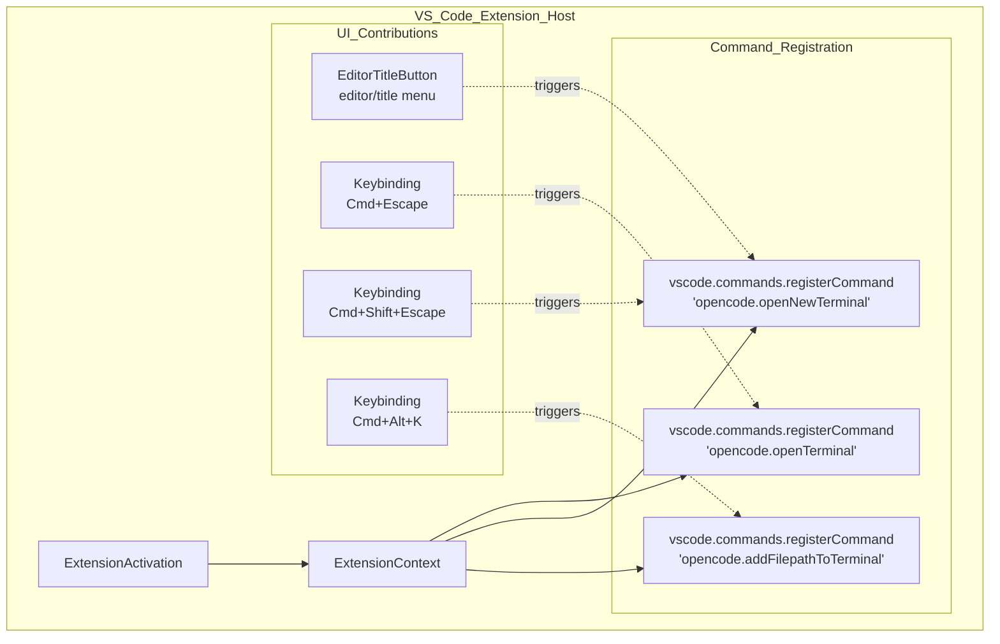
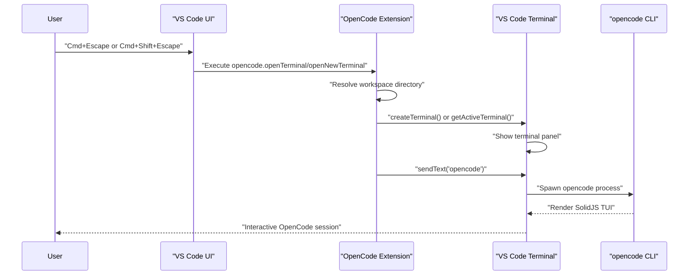
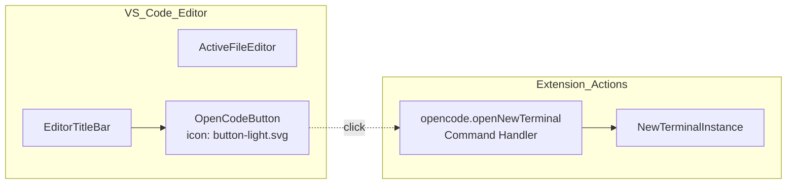
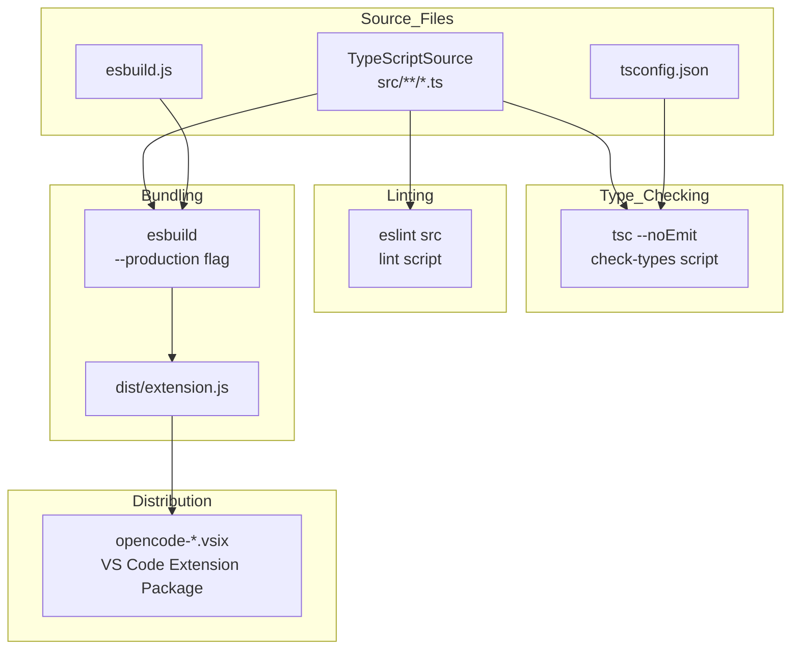
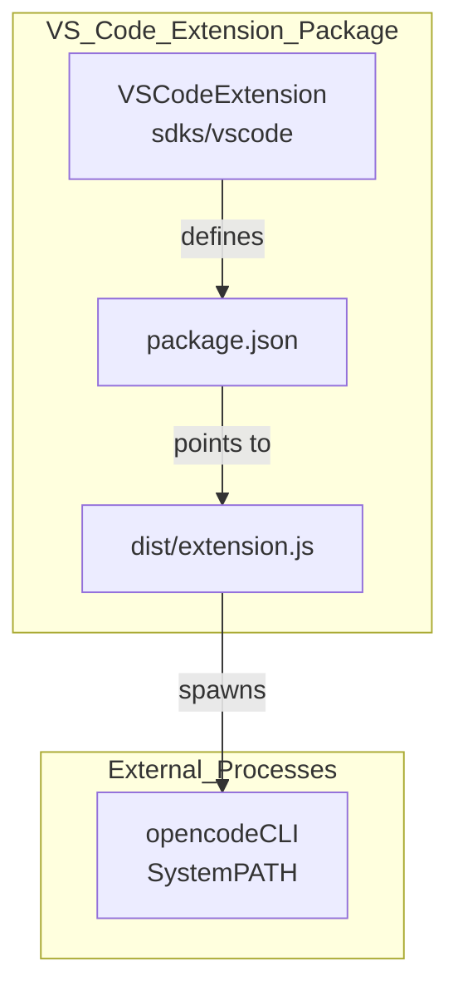

<!-- source: DeepWiki mcp.deepwiki.com · repo sst/opencode · page 6.6 VS Code Extension · fetched 2026-10-26 -->

# VS Code Extension

Relevant source files

The following files were used as context for generating this wiki page:

- [sdks/vscode/package.json](sdks/vscode/package.json)

## Purpose and Scope

This document describes the OpenCode Visual Studio Code extension located in `sdks/vscode`, which provides seamless integration between VS Code and the OpenCode AI coding agent. The extension enables users to launch OpenCode sessions directly from VS Code via terminal integration, with keyboard shortcuts and UI commands for quick access.

The extension acts as a bridge between the VS Code environment and the OpenCode CLI, facilitating a workflow where the AI agent has direct access to the developer's workspace while running in a native integrated terminal.

**Sources:** [sdks/vscode/package.json:1-5]()

---

## Extension Overview

The VS Code extension for OpenCode is a lightweight wrapper that spawns the OpenCode CLI process within VS Code's integrated terminal. It does not implement AI functionality directly; instead, it provides convenient access points and workspace integration to launch and interact with OpenCode sessions.

**Key Capabilities:**
- Launch OpenCode in existing or new terminal tabs via commands [sdks/vscode/package.json:28-42]().
- Quick keyboard shortcuts for common actions (e.g., `Cmd+Escape`) [sdks/vscode/package.json:56-81]().
- Context menu integration for adding file paths to OpenCode prompts [sdks/vscode/package.json:44-46]().
- Automatic workspace path detection.
- Editor toolbar buttons for instant access [sdks/vscode/package.json:48-55]().

The extension is published under the identifier `sst-dev.opencode` on the Visual Studio Marketplace and distributed as a `.vsix` package in GitHub releases [sdks/vscode/package.json:1-10]().

**Sources:** [sdks/vscode/package.json:1-108]()

---

## Extension Metadata and Distribution

| Property | Value |
|----------|-------|
| Extension ID | `sst-dev.opencode` [sdks/vscode/package.json:2-6]() |
| Display Name | `opencode` [sdks/vscode/package.json:3-3]() |
| Minimum VS Code Version | `^1.94.0` [sdks/vscode/package.json:18-18]() |
| Main Entry Point | `./dist/extension.js` [sdks/vscode/package.json:24-24]() |
| Icon | `images/icon.png` [sdks/vscode/package.json:12-12]() |
| Category | Other [sdks/vscode/package.json:20-22]() |
| License | MIT [sdks/vscode/package.json:11-11]() |

The extension is built using:
- **esbuild** for bundling the TypeScript source into `dist/extension.js` [sdks/vscode/package.json:103-103]().
- **TypeScript** for type checking [sdks/vscode/package.json:104-104]().
- **ESLint** for linting [sdks/vscode/package.json:102-102]().

Build commands:
- `bun run package` - Production build with type checking and linting [sdks/vscode/package.json:88-88]().
- `bun run compile` - Development build [sdks/vscode/package.json:85-85]().
- `bun run watch:esbuild` - Watch mode for development [sdks/vscode/package.json:86-86]().

**Sources:** [sdks/vscode/package.json:1-24](), [sdks/vscode/package.json:83-94](), [sdks/vscode/package.json:102-104]()

---

## Commands and Keybindings

The extension contributes three primary commands to VS Code's command palette and UI [sdks/vscode/package.json:25-47]().

### Command Reference

| Command ID | Title | Default Keybinding | Description |
|------------|-------|-------------------|-------------|
| `opencode.openTerminal` | Open opencode | Cmd+Escape (Mac) Ctrl+Escape (Win/Linux) | Opens OpenCode in the active terminal or creates a new one if none exists [sdks/vscode/package.json:28-34](), [sdks/vscode/package.json:57-64](). |
| `opencode.openNewTerminal` | Open opencode in new tab | Cmd+Shift+Escape (Mac) Ctrl+Shift+Escape (Win/Linux) | Always creates a new terminal tab for OpenCode [sdks/vscode/package.json:36-42](), [sdks/vscode/package.json:66-72](). |
| `opencode.addFilepathToTerminal` | Add Filepath to Terminal | Cmd+Alt+K (Mac) Ctrl+Alt+K (Win/Linux) | Inserts the current file path as an @-mention in the OpenCode prompt [sdks/vscode/package.json:44-46](), [sdks/vscode/package.json:75-75](). |

**Sources:** [sdks/vscode/package.json:26-47](), [sdks/vscode/package.json:56-81]()

### Command Registration Diagram

**Sources:** [sdks/vscode/package.json:24-81]()

---

## Terminal Integration Architecture

The extension's primary function is to spawn and manage OpenCode CLI processes within VS Code's integrated terminal. This architecture allows OpenCode's TUI to run natively within the VS Code environment while maintaining access to workspace context.

### Terminal Spawning Flow

The extension interacts with the `opencode` binary typically installed on the user's system and defined in the monorepo's core package.

**Sources:** [sdks/vscode/package.json:26-46]()

---

## Editor Integration Features

### Toolbar Button

The extension adds a button to the editor title bar (top-right of each file editor) that triggers the `opencode.openNewTerminal` command. This provides one-click access to OpenCode without memorizing keyboard shortcuts [sdks/vscode/package.json:48-55]().

The button displays different icons based on VS Code's theme:
- **Light theme:** `images/button-dark.svg` [sdks/vscode/package.json:31-31]()
- **Dark theme:** `images/button-light.svg` [sdks/vscode/package.json:32-32]()

**Sources:** [sdks/vscode/package.json:30-55]()

### File Path Context

The `opencode.addFilepathToTerminal` command enables users to quickly reference files in OpenCode prompts [sdks/vscode/package.json:44-46](). When invoked, it retrieves the active editor's file path, formats it as an @-mention (e.g., `@src/index.ts`), and sends the text to the active terminal [sdks/vscode/package.json:75-75]().

This integrates with OpenCode's file attachment and context system, allowing users to reference files without typing full paths manually.

**Sources:** [sdks/vscode/package.json:43-46](), [sdks/vscode/package.json:73-80]()

---

## Build and Packaging System

### Build Pipeline

**Sources:** [sdks/vscode/package.json:83-94](), [sdks/vscode/package.json:102-104]()

### Build Scripts

| Script | Purpose |
|--------|---------|
| `vscode:prepublish` | Pre-packaging hook (runs `package` script) [sdks/vscode/package.json:84-84](). |
| `package` | Production build: type check → lint → esbuild with `--production` [sdks/vscode/package.json:88-88](). |
| `compile` | Development build without production optimizations [sdks/vscode/package.json:85-85](). |
| `watch:esbuild` | Continuous build in watch mode [sdks/vscode/package.json:86-86](). |
| `check-types` | Run TypeScript type checking without emitting files [sdks/vscode/package.json:92-92](). |
| `lint` | Run ESLint on `src` directory [sdks/vscode/package.json:93-93](). |

**Sources:** [sdks/vscode/package.json:83-94]()

---

## Relationship to OpenCode Architecture

The VS Code extension is a lightweight launcher. It delegates the UI and logic to the OpenCode CLI.

### Code Entity Mapping

| System Name | Code Entity |
|-------------|-------------|
| Extension Entry | `sdks/vscode/src/extension.ts` (implied by `main` in [sdks/vscode/package.json:24-24]()) |
| VSCode Metadata | `sdks/vscode/package.json` [sdks/vscode/package.json:1-108]() |
| Build Config | `sdks/vscode/esbuild.js` [sdks/vscode/package.json:103-103]() |

**Sources:** [sdks/vscode/package.json:1-108]()

---

## Dependencies and Requirements

### Runtime Dependencies

The extension has **no runtime dependencies** beyond VS Code itself. It relies on the OpenCode CLI (`opencode`) being available in the system PATH.

### Development Dependencies

| Package | Version | Purpose |
|---------|---------|---------|
| `@types/vscode` | `^1.94.0` | VS Code API type definitions [sdks/vscode/package.json:97-97](). |
| `esbuild` | `^0.25.3` | Fast JavaScript bundler [sdks/vscode/package.json:103-103](). |
| `typescript` | `^5.8.3` | TypeScript compiler [sdks/vscode/package.json:104-104](). |
| `eslint` | `^9.25.1` | JavaScript linter [sdks/vscode/package.json:102-102](). |

**Sources:** [sdks/vscode/package.json:96-107]()

---

