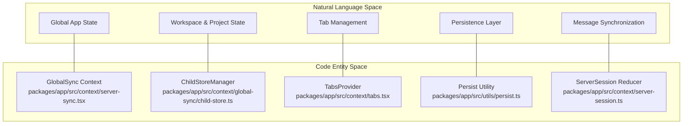
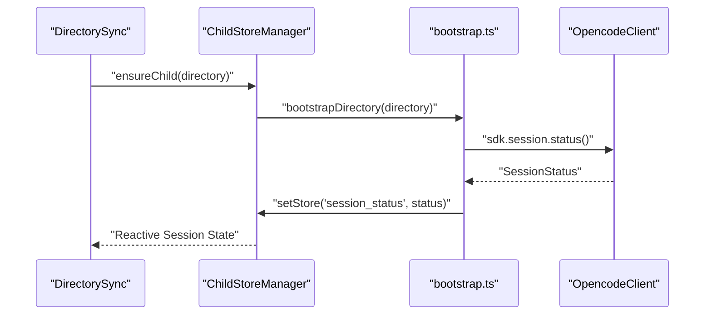

<!-- source: DeepWiki mcp.deepwiki.com · repo sst/opencode · page 6.8 Desktop State Management · fetched 2026-10-26 -->

# Desktop State Management

Relevant source files

The following files were used as context for generating this wiki page:

- [packages/app/e2e/performance/timeline-stability/fixture.ts](packages/app/e2e/performance/timeline-stability/fixture.ts)
- [packages/app/e2e/performance/timeline/session-parent-hydration-benchmark.spec.ts](packages/app/e2e/performance/timeline/session-parent-hydration-benchmark.spec.ts)
- [packages/app/e2e/performance/timeline/session-tab-switch-metrics.ts](packages/app/e2e/performance/timeline/session-tab-switch-metrics.ts)
- [packages/app/e2e/performance/timeline/session-tab-switch-probe.ts](packages/app/e2e/performance/timeline/session-tab-switch-probe.ts)
- [packages/app/e2e/performance/unit/mock-server.test.ts](packages/app/e2e/performance/unit/mock-server.test.ts)
- [packages/app/e2e/performance/unit/session-tab-switch-metrics.test.ts](packages/app/e2e/performance/unit/session-tab-switch-metrics.test.ts)
- [packages/app/e2e/performance/unit/session-tab-switch-probe.test.ts](packages/app/e2e/performance/unit/session-tab-switch-probe.test.ts)
- [packages/app/e2e/regression/review-line-comment.spec.ts](packages/app/e2e/regression/review-line-comment.spec.ts)
- [packages/app/e2e/regression/session-list-path-loading.spec.ts](packages/app/e2e/regression/session-list-path-loading.spec.ts)
- [packages/app/e2e/regression/session-timeline-history-root.spec.ts](packages/app/e2e/regression/session-timeline-history-root.spec.ts)
- [packages/app/e2e/regression/session-timeline-transport.spec.ts](packages/app/e2e/regression/session-timeline-transport.spec.ts)
- [packages/app/e2e/utils/sse-transport.ts](packages/app/e2e/utils/sse-transport.ts)
- [packages/app/src/components/prompt-input/slash-popover.tsx](packages/app/src/components/prompt-input/slash-popover.tsx)
- [packages/app/src/context/directory-sync.ts](packages/app/src/context/directory-sync.ts)
- [packages/app/src/context/global-sync/bootstrap.test.ts](packages/app/src/context/global-sync/bootstrap.test.ts)
- [packages/app/src/context/global-sync/bootstrap.ts](packages/app/src/context/global-sync/bootstrap.ts)
- [packages/app/src/context/global-sync/child-store.test.ts](packages/app/src/context/global-sync/child-store.test.ts)
- [packages/app/src/context/global-sync/child-store.ts](packages/app/src/context/global-sync/child-store.ts)
- [packages/app/src/context/global-sync/event-reducer.test.ts](packages/app/src/context/global-sync/event-reducer.test.ts)
- [packages/app/src/context/global-sync/event-reducer.ts](packages/app/src/context/global-sync/event-reducer.ts)
- [packages/app/src/context/global-sync/session-cache.test.ts](packages/app/src/context/global-sync/session-cache.test.ts)
- [packages/app/src/context/global-sync/session-cache.ts](packages/app/src/context/global-sync/session-cache.ts)
- [packages/app/src/context/global-sync/types.ts](packages/app/src/context/global-sync/types.ts)
- [packages/app/src/context/prompt-state.test.ts](packages/app/src/context/prompt-state.test.ts)
- [packages/app/src/context/sdk.tsx](packages/app/src/context/sdk.tsx)
- [packages/app/src/context/server-sdk.test.ts](packages/app/src/context/server-sdk.test.ts)
- [packages/app/src/context/server-sdk.tsx](packages/app/src/context/server-sdk.tsx)
- [packages/app/src/context/server-session.test.ts](packages/app/src/context/server-session.test.ts)
- [packages/app/src/context/server-session.ts](packages/app/src/context/server-session.ts)
- [packages/app/src/context/server-sync.tsx](packages/app/src/context/server-sync.tsx)
- [packages/app/src/context/sync.tsx](packages/app/src/context/sync.tsx)
- [packages/app/src/context/tab-memory.ts](packages/app/src/context/tab-memory.ts)
- [packages/app/src/context/tab-migration.ts](packages/app/src/context/tab-migration.ts)
- [packages/app/src/context/tabs.test.ts](packages/app/src/context/tabs.test.ts)
- [packages/app/src/context/tabs.tsx](packages/app/src/context/tabs.tsx)
- [packages/app/src/pages/session/use-session-hash-scroll.ts](packages/app/src/pages/session/use-session-hash-scroll.ts)
- [packages/app/src/utils/persist.test.ts](packages/app/src/utils/persist.test.ts)
- [packages/app/src/utils/persist.ts](packages/app/src/utils/persist.ts)
- [packages/app/src/utils/refcount.test.ts](packages/app/src/utils/refcount.test.ts)
- [packages/app/src/utils/refcount.ts](packages/app/src/utils/refcount.ts)
- [packages/app/vite.js](packages/app/vite.js)
- [packages/session-ui/src/components/tool-error-card.tsx](packages/session-ui/src/components/tool-error-card.tsx)

This page details the client-side state management architecture for OpenCode desktop applications. The system utilizes a multi-layered context architecture built on SolidJS reactive primitives, coordinating data between the local server backend and the user interface via Server-Sent Events (SSE), TanStack Query, and persistent local storage.

## State Architecture Overview

The desktop application employs a hierarchical context structure to manage state at different scopes, ranging from global application settings to workspace-specific data and ephemeral UI state like tabs.

**Desktop State Entity Map**

Sources: [packages/app/src/context/server-sync.tsx:1-41](), [packages/app/src/context/global-sync/child-store.ts:23-37](), [packages/app/src/context/tabs.tsx:52-55](), [packages/app/src/utils/persist.ts:10-24](), [packages/app/src/context/server-session.ts:188-195]()

## Core State Management Systems

### Global and Child Stores
The state is bifurcated into global data (shared across all projects) and directory-specific data (isolated per workspace). This is orchestrated by `createChildStoreManager` [packages/app/src/context/global-sync/child-store.ts:23-37]().

*   **Global Bootstrap**: `bootstrapGlobal` fetches cross-cutting configuration, including global AI provider lists, user configuration, and the master project list [packages/app/src/context/global-sync/bootstrap.ts:143-173]().
*   **Directory Isolation**: Child stores are created for each directory. They manage their own instances of VCS info, project metadata, and local icons via `ensureChild`, ensuring that working in one project does not bloat the state of another [packages/app/src/context/global-sync/child-store.ts:153-182]().
*   **Eviction Logic**: To maintain performance, the system implements an eviction policy. Stores that are not "pinned" (currently active in the UI) and exceed the `DIR_IDLE_TTL_MS` are disposed of via `pickDirectoriesToEvict` [packages/app/src/context/global-sync/child-store.ts:135-150]().
*   **Pinning Mechanism**: Directories are "pinned" when they are active in the viewport or referenced by an owner component. `pinForOwner` uses `onCleanup` to automatically unpin directories when components unmount [packages/app/src/context/global-sync/child-store.ts:83-101]().

Sources: [packages/app/src/context/global-sync/child-store.ts:23-182](), [packages/app/src/context/global-sync/bootstrap.ts:143-173]()

### Session State and Synchronization
Individual session data is managed by `createServerSession`, which handles the complex logic of merging server-side events with local optimistic updates [packages/app/src/context/server-session.ts:188-196]().

*   **V2 Event Reduction**: The system uses `createV2SessionReducer` to project incoming server events into the reactive message state [packages/app/src/context/server-session.ts:23-24]().
*   **Optimistic UI**: `mergeOptimisticPage` allows the UI to render user messages and assistant placeholders immediately before they are confirmed by the backend [packages/app/src/context/server-session.ts:107-133]().
*   **Reconciliation**: `reconcileFetched` ensures that data fetched via HTTP does not overwrite fresher state received via SSE during the request lifecycle [packages/app/src/context/server-session.ts:151-184]().

Sources: [packages/app/src/context/server-session.ts:23-24](), [packages/app/src/context/server-session.ts:107-133](), [packages/app/src/context/server-session.ts:151-196]()

### Tab and Navigation State
The application uses a custom tab system managed by the `TabsProvider`. Unlike traditional browser tabs, these are deeply integrated with the OpenCode session model [packages/app/src/context/tabs.tsx:52-55]().

*   **Tab Types**: The system supports `session` tabs (linked to an existing session ID) and `draft` tabs (ephemeral state for a session being composed) [packages/app/src/context/tabs.tsx:16-31]().
*   **Persistence**: Tabs are persisted across application restarts using `Persist.window("tabs")`. This includes metadata like titles and directory paths to allow for instant rendering [packages/app/src/context/tabs.tsx:60-68]().
*   **Tab Navigation**: Navigation is handled via `navigateTab`, which updates the "recent" tab key and triggers the Solid Router [packages/app/src/context/tabs.tsx:149-153]().

Sources: [packages/app/src/context/tabs.tsx:16-68](), [packages/app/src/context/tabs.tsx:149-153]()

## Persistence Layer

OpenCode uses a robust persistence utility that bridges SolidJS stores with various storage backends (Local Storage, Session Storage, or custom file-based storage).

### Storage Implementation
The `persisted` function wraps a SolidJS store, providing automatic synchronization and a `ready` signal for handling asynchronous hydration [packages/app/src/utils/persist.ts:10-15]().

*   **Resilience and Quota Management**: The system includes logic to handle `QuotaExceededError`. If storage is full, it attempts to evict older or larger items via `evict` to make room for new state [packages/app/src/utils/persist.ts:112-142]().
*   **Migration Support**: The persistence layer supports a `migrate` hook, allowing developers to transform legacy data structures into current schemas during hydration [packages/app/src/utils/persist.ts:209-215]().
*   **Scoped Storage**: State can be scoped to the "window" (UI state), "server" (connection info), or "workspace" (project-specific settings) [packages/app/src/utils/persist.ts:17-25]().

Sources: [packages/app/src/utils/persist.ts:10-25](), [packages/app/src/utils/persist.ts:112-142](), [packages/app/src/utils/persist.ts:209-215]()

## UI State Integration

The state is consumed by UI components which react to changes in the underlying stores via `useServerSync` and related hooks.

**State Flow: Directory Synchronization**

Sources: [packages/app/src/context/global-sync/child-store.ts:153-155](), [packages/app/src/context/global-sync/bootstrap.ts:143-173](), [packages/app/src/context/server-sync.tsx:40-41]()

### Notification and Working Indicators
*   **Working State**: Components query `session_working(id)` which checks `session_status[id]` to display spinners providing immediate feedback on agent activity [packages/app/src/context/global-sync/bootstrap.test.ts:57-59]().
*   **Event Reduction**: Incoming SSE events update the local store in real-time through dedicated event reduction logic.

Sources: [packages/app/src/context/global-sync/bootstrap.test.ts:57-59]()

## Key Components and Logic

| Entity | File Path | Role |
| :--- | :--- | :--- |
| `createChildStoreManager` | [packages/app/src/context/global-sync/child-store.ts:23-37]() | Factory for managing isolated workspace stores and their lifecycle. |
| `bootstrapGlobal` | [packages/app/src/context/global-sync/bootstrap.ts:143-153]() | Initial data fetch for the entire application (config, providers, projects). |
| `createServerSession` | [packages/app/src/context/server-session.ts:188-195]() | Manages state for a specific session, including message and part reconciliation. |
| `TabsProvider` | [packages/app/src/context/tabs.tsx:52-55]() | Manages the tab bar, including session/draft navigation and persistence. |
| `persisted` | [packages/app/src/utils/persist.ts:10-24]() | High-level utility for creating reactive, storage-backed SolidJS stores. |

Sources: [packages/app/src/context/global-sync/child-store.ts:23-37](), [packages/app/src/context/global-sync/bootstrap.ts:143-153](), [packages/app/src/context/server-session.ts:188-195](), [packages/app/src/context/tabs.tsx:52-55](), [packages/app/src/utils/persist.ts:10-24]()

---

