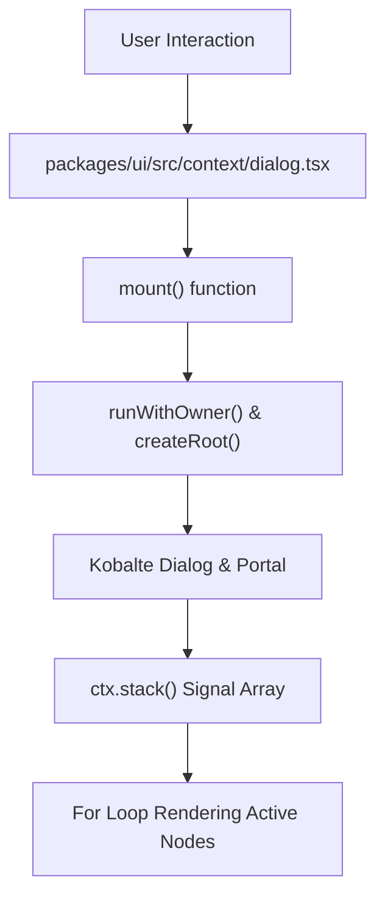

<!-- source: DeepWiki mcp.deepwiki.com · repo sst/opencode · page 6.9 UI Component Library · fetched 2026-10-26 -->

# UI Component Library

<details>
<summary>Relevant source files</summary>

The following files were used as context for generating this wiki page:

- [packages/app/index.html](packages/app/index.html)
- [packages/app/public/oc-theme-preload.js](packages/app/public/oc-theme-preload.js)
- [packages/app/src/assets/help/home.png](packages/app/src/assets/help/home.png)
- [packages/app/src/assets/help/introducing-tabs.mp4](packages/app/src/assets/help/introducing-tabs.mp4)
- [packages/app/src/assets/help/placeholder.png](packages/app/src/assets/help/placeholder.png)
- [packages/app/src/assets/help/tabs.png](packages/app/src/assets/help/tabs.png)
- [packages/app/src/components/help-button.tsx](packages/app/src/components/help-button.tsx)
- [packages/app/src/components/prompt-input/context-items.tsx](packages/app/src/components/prompt-input/context-items.tsx)
- [packages/app/src/components/ui/drawer.tsx](packages/app/src/components/ui/drawer.tsx)
- [packages/app/src/utils/toast.tsx](packages/app/src/utils/toast.tsx)
- [packages/app/test-browser/toast-owner.test.ts](packages/app/test-browser/toast-owner.test.ts)
- [packages/desktop/src/renderer/index.html](packages/desktop/src/renderer/index.html)
- [packages/enterprise/src/app.tsx](packages/enterprise/src/app.tsx)
- [packages/enterprise/src/entry-server.tsx](packages/enterprise/src/entry-server.tsx)
- [packages/sdk/js/src/v2/gen/client/client.gen.ts](packages/sdk/js/src/v2/gen/client/client.gen.ts)
- [packages/sdk/js/src/v2/gen/core/serverSentEvents.gen.ts](packages/sdk/js/src/v2/gen/core/serverSentEvents.gen.ts)
- [packages/session-ui/src/components/basic-tool.css](packages/session-ui/src/components/basic-tool.css)
- [packages/session-ui/src/components/file.tsx](packages/session-ui/src/components/file.tsx)
- [packages/session-ui/src/components/markdown-inline-code-kind.test.ts](packages/session-ui/src/components/markdown-inline-code-kind.test.ts)
- [packages/session-ui/src/components/markdown-inline-code-kind.ts](packages/session-ui/src/components/markdown-inline-code-kind.ts)
- [packages/session-ui/src/pierre/index.ts](packages/session-ui/src/pierre/index.ts)
- [packages/session-ui/src/v2/components/line-comment-annotations-v2.tsx](packages/session-ui/src/v2/components/line-comment-annotations-v2.tsx)
- [packages/storybook/.storybook/mocks/app/context/prompt.ts](packages/storybook/.storybook/mocks/app/context/prompt.ts)
- [packages/ui/script/colors.txt](packages/ui/script/colors.txt)
- [packages/ui/src/assets/favicon/site.webmanifest](packages/ui/src/assets/favicon/site.webmanifest)
- [packages/ui/src/components/button.css](packages/ui/src/components/button.css)
- [packages/ui/src/components/button.tsx](packages/ui/src/components/button.tsx)
- [packages/ui/src/components/checkbox.css](packages/ui/src/components/checkbox.css)
- [packages/ui/src/components/collapsible.css](packages/ui/src/components/collapsible.css)
- [packages/ui/src/components/collapsible.tsx](packages/ui/src/components/collapsible.tsx)
- [packages/ui/src/components/dropdown-menu.css](packages/ui/src/components/dropdown-menu.css)
- [packages/ui/src/components/icon-button.css](packages/ui/src/components/icon-button.css)
- [packages/ui/src/components/icon-button.tsx](packages/ui/src/components/icon-button.tsx)
- [packages/ui/src/components/icon.css](packages/ui/src/components/icon.css)
- [packages/ui/src/components/image-preview.tsx](packages/ui/src/components/image-preview.tsx)
- [packages/ui/src/components/popover.css](packages/ui/src/components/popover.css)
- [packages/ui/src/components/popover.tsx](packages/ui/src/components/popover.tsx)
- [packages/ui/src/components/select.css](packages/ui/src/components/select.css)
- [packages/ui/src/components/select.tsx](packages/ui/src/components/select.tsx)
- [packages/ui/src/components/switch.css](packages/ui/src/components/switch.css)
- [packages/ui/src/components/text-field.css](packages/ui/src/components/text-field.css)
- [packages/ui/src/components/text-field.tsx](packages/ui/src/components/text-field.tsx)
- [packages/ui/src/components/toast.css](packages/ui/src/components/toast.css)
- [packages/ui/src/components/toast.tsx](packages/ui/src/components/toast.tsx)
- [packages/ui/src/components/tooltip.css](packages/ui/src/components/tooltip.css)
- [packages/ui/src/components/tooltip.tsx](packages/ui/src/components/tooltip.tsx)
- [packages/ui/src/context/i18n.tsx](packages/ui/src/context/i18n.tsx)
- [packages/ui/src/styles/tailwind/colors.css](packages/ui/src/styles/tailwind/colors.css)
- [packages/ui/src/styles/tailwind/index.css](packages/ui/src/styles/tailwind/index.css)
- [packages/ui/src/styles/theme.css](packages/ui/src/styles/theme.css)
- [packages/ui/src/theme/context.tsx](packages/ui/src/theme/context.tsx)
- [packages/ui/src/theme/default-themes.ts](packages/ui/src/theme/default-themes.ts)
- [packages/ui/src/theme/index.ts](packages/ui/src/theme/index.ts)
- [packages/ui/src/theme/themes/amoled.json](packages/ui/src/theme/themes/amoled.json)
- [packages/ui/src/theme/themes/aura.json](packages/ui/src/theme/themes/aura.json)
- [packages/ui/src/theme/themes/carbonfox.json](packages/ui/src/theme/themes/carbonfox.json)
- [packages/ui/src/theme/themes/gruvbox.json](packages/ui/src/theme/themes/gruvbox.json)
- [packages/ui/src/theme/themes/nightowl.json](packages/ui/src/theme/themes/nightowl.json)
- [packages/ui/src/theme/themes/oc-2.json](packages/ui/src/theme/themes/oc-2.json)
- [packages/ui/src/theme/themes/vesper.json](packages/ui/src/theme/themes/vesper.json)
- [packages/ui/src/theme/v2/default-primitives.ts](packages/ui/src/theme/v2/default-primitives.ts)
- [packages/ui/src/theme/v2/foreground.ts](packages/ui/src/theme/v2/foreground.ts)
- [packages/ui/src/theme/v2/mapping.ts](packages/ui/src/theme/v2/mapping.ts)
- [packages/ui/src/theme/v2/resolve.ts](packages/ui/src/theme/v2/resolve.ts)
- [packages/ui/src/v2/components/file-tree-v2.css](packages/ui/src/v2/components/file-tree-v2.css)
- [packages/ui/src/v2/components/toast-v2.css](packages/ui/src/v2/components/toast-v2.css)
- [packages/ui/src/v2/components/toast-v2.stories.tsx](packages/ui/src/v2/components/toast-v2.stories.tsx)
- [packages/ui/src/v2/components/toast-v2.tsx](packages/ui/src/v2/components/toast-v2.tsx)
- [packages/ui/src/v2/styles/colors.css](packages/ui/src/v2/styles/colors.css)
- [packages/ui/src/v2/styles/theme.css](packages/ui/src/v2/styles/theme.css)

</details>


## Purpose and Scope

The `@opencode-ai/ui` package provides a comprehensive component library, theming system, and UI utilities shared across OpenCode's desktop and web applications. This package contains reusable SolidJS components, context providers, hooks, icon systems, internationalization, and styling infrastructure.

For information about the high-level app structure that uses these components, see [6.12 Shared App Package](). For details on session-specific rendering components, see [6.10 Session Rendering Components]().

Sources: [packages/ui/src/styles/index.css:1-53]()

---

## Package Structure and Exports

The `@opencode-ai/ui` package is organized into distinct export categories, each serving a specific purpose in the UI layer.

### Export Categories

```mermaid
graph TB
    UIPackage["@opencode-ai/ui"]
    
    subgraph "Component Exports"
        Components["packages/ui/src/components/index.tsx"]
    end
    
    subgraph "Hooks"
        Hooks["packages/ui/src/hooks/index.ts"]
    end
    
    subgraph "Context Providers"
        Context["packages/ui/src/context/index.ts"]
        DialogContext["packages/ui/src/context/dialog.tsx"]
    end
    
    subgraph "Styling"
        Styles["packages/ui/src/styles/index.css"]
    end
    
    subgraph "Theming"
        Theme["packages/ui/src/theme/index.ts"]
    end
    
    UIPackage --> Components
    UIPackage --> Hooks
    UIPackage --> Context
    UIPackage --> DialogContext
    UIPackage --> Styles
    UIPackage --> Theme
```

**Export Mapping Table**

| Export Path | File Path | Purpose |
|------------|-----------|---------|
| `./*` | `packages/ui/src/components/*.tsx` | Individual UI primitives and components |
| `./hooks` | `packages/ui/src/hooks/index.ts` | Reactivity and list filtering hooks (e.g. `useFilteredList`) |
| `./context` | `packages/ui/src/context/index.ts` | Context providers (Dialog, I18n, etc.) |
| `./styles` | `packages/ui/src/styles/index.css` | Global CSS layer entry point |
| `./theme` | `packages/ui/src/theme/index.ts` | Theme utilities, token definitions, and JSON themes |

Sources: [packages/ui/src/styles/index.css:1-53](), [packages/ui/src/components/list.tsx:1-8](), [packages/ui/src/hooks/use-filtered-list.tsx:1-20]()

---

## Theming System and CSS Architecture

The theming system provides dark/light mode support, color customization, and CSS variable management via a layered CSS setup [packages/ui/src/styles/index.css:1-4]().

### Theme Architecture

```mermaid
graph TD
    subgraph "Theme Definitions"
        Colors["packages/ui/src/styles/tailwind/colors.css"]
        ThemeVars["packages/ui/src/styles/theme.css"]
        V2ThemeVars["packages/ui/src/v2/styles/theme.css"]
        JsonTheme["packages/ui/src/theme/themes/oc-2.json"]
    end
    
    subgraph "Component Styles"
        CompStyles["packages/ui/src/styles/tailwind/index.css"]
        ButtonCSS["packages/ui/src/components/button.css"]
        SelectCSS["packages/ui/src/components/select.css"]
        TextFieldCSS["packages/ui/src/components/text-field.css"]
        ToastCSS["packages/ui/src/components/toast.css"]
        IconButtonCSS["packages/ui/src/components/icon-button.css"]
        TooltipCSS["packages/ui/src/components/tooltip.css"]
        CollapsibleCSS["packages/ui/src/components/collapsible.css"]
        DropdownMenuCSS["packages/ui/src/components/dropdown-menu.css"]
        SwitchCSS["packages/ui/src/components/switch.css"]
        IconCSS["packages/ui/src/components/icon.css"]
        PopoverCSS["packages/ui/src/components/popover.css"]
    end
    
    subgraph "Application"
        Root[":root CSS Variables"]
        Components["UI Components"]
    end
    
    Colors --> ThemeVars
    V2ThemeVars --> ThemeVars
    JsonTheme --> ThemeVars
    ThemeVars --> Root
    CompStyles --> Components
    ButtonCSS --> Components
    SelectCSS --> Components
    TextFieldCSS --> Components
    ToastCSS --> Components
    IconButtonCSS --> Components
    TooltipCSS --> Components
    CollapsibleCSS --> Components
    DropdownMenuCSS --> Components
    SwitchCSS --> Components
    IconCSS --> Components
    PopoverCSS --> Components
    Root --> Components
```



**Implementation Details:**
- **CSS Layers**: Uses CSS cascade layers (`theme`, `base`, `components`, `utilities`) defined in `packages/ui/src/styles/tailwind/index.css:1-4` and `packages/ui/src/styles/index.css:1-4`.
- **CSS Variables**: Defines global custom properties for typography (e.g., `--font-family-sans`), spacing units, breakpoints, border radii, and multi-layered shadows in `packages/ui/src/styles/theme.css:1-88`.
- **Theme JSON Configuration**: Predefined themes such as `oc-2.json` provide explicit palette definitions, light/dark overrides, syntax highlighting variables, and v2 token mappings (`packages/ui/src/theme/themes/oc-2.json:1-181`). The `ThemeProvider` in `packages/ui/src/theme/context.tsx` manages loading and applying these themes, including caching generated CSS for performance [packages/ui/src/theme/context.tsx:162-172]().
- **Default Themes**: A comprehensive list of default themes is available in `packages/ui/src/theme/default-themes.ts`, which imports various JSON theme files [packages/ui/src/theme/default-themes.ts:1-116]().

Sources: [packages/ui/src/styles/index.css:1-53](), [packages/ui/src/styles/theme.css:1-163](), [packages/ui/src/theme/themes/oc-2.json:1-181](), [packages/ui/src/theme/context.tsx:162-172](), [packages/ui/src/theme/default-themes.ts:1-116](), [packages/ui/src/styles/tailwind/index.css:1-4]()

---

## Core UI Components

### List and Filter System
The `List` component provides a searchable, groupable, and keyboard-navigable interface for collections [packages/ui/src/components/list.tsx:58]().

- **Fuzzy Search Integration**: Backed by the `useFilteredList` hook, which uses `fuzzysort` to query items across designated keys [packages/ui/src/hooks/use-filtered-list.tsx:1-45]().
- **Grouping and Sorting**: Supports hierarchical display via `groupBy`, `sortBy`, and `sortGroupsBy` props [packages/ui/src/hooks/use-filtered-list.tsx:48-51]().
- **Virtual Scrolling Alignment**: Implements programmatic scrolling via `scrollIntoView` to ensure active items remain in the viewport during keyboard interaction [packages/ui/src/components/list.tsx:71-88]().

**Natural Language to Code Entity Space: List Navigation**

| System Name | Code Entity | File Path |
|-------------|-------------|-----------|
| Filter Hook | `useFilteredList` | [packages/ui/src/hooks/use-filtered-list.tsx:20-134]() |
| Search Engine | `fuzzysort.go` | [packages/ui/src/hooks/use-filtered-list.tsx:44]() |
| List Component | `List<T>` | [packages/ui/src/components/list.tsx:58-394]() |
| Group Header | `GroupHeader` | [packages/ui/src/components/list.tsx:215]() |

Sources: [packages/ui/src/components/list.tsx:58-215](), [packages/ui/src/hooks/use-filtered-list.tsx:1-134]()

### Select Component
The `Select` component is a high-level wrapper around `@kobalte/core/select` [packages/ui/src/components/select.tsx:1-25]().

- **Trigger Styles**: Supports multiple visual styles, including a dedicated `"settings"` variant for configuration inputs [packages/ui/src/components/select.css:48-92]().
- **Highlight Tracking**: Uses `onHighlight` to execute side effects when options are hovered or focused, such as rendering live model tooltips [packages/ui/src/components/select.tsx:58-70]().
- **Grouped Options**: Automatically groups option arrays using `remeda` grouping utilities [packages/ui/src/components/select.tsx:74-83]().

Sources: [packages/ui/src/components/select.tsx:1-174](), [packages/ui/src/components/select.css:1-201]()

### Buttons and Icon Systems
Interactive elements are structured for consistent accessibility and state management.

- **Button Variants**: Implements `primary`, `secondary`, and `ghost` variants with dedicated styling for `:hover`, `:active`, `:focus-visible`, and `:disabled` states [packages/ui/src/components/button.css:14-107]().
- **Button Sizes**: Standardizes heights and padding across `small` (24px), `normal` (28px), and `large` (32px) sizes [packages/ui/src/components/button.css:109-165]().
- **Icon Registry**: Provides inline SVG elements for common navigational and operational UI tokens [packages/ui/src/components/icon.tsx:3-35]().
- **IconButton**: A specialized button for icons, supporting `primary`, `secondary`, and `ghost` variants and various sizes (`normal`, `small`, `large`) [packages/ui/src/components/icon-button.css:1-145](). It also includes specific styling for titlebar icons [packages/ui/src/components/icon-button.css:165-181]().

Sources: [packages/ui/src/components/button.css:1-194](), [packages/ui/src/components/icon.tsx:1-35](), [packages/ui/src/components/icon-button.css:1-181]()

### Text Field
The `TextField` component provides a flexible input field with support for labels, descriptions, error messages, and copy functionality [packages/ui/src/components/text-field.tsx:34-128]().

- **Variants**: Supports `normal` and `ghost` variants for different visual presentations [packages/ui/src/components/text-field.tsx:28]().
- **Copyable**: Includes an optional copy button that copies the input value to the clipboard and provides visual feedback via a tooltip [packages/ui/src/components/text-field.tsx:56-75](), [packages/ui/src/components/text-field.tsx:108-120]().
- **Multiline**: Can render as a `Kobalte.TextArea` for multiline input with auto-resizing [packages/ui/src/components/text-field.tsx:103-106]().

Sources: [packages/ui/src/components/text-field.tsx:34-128](), [packages/ui/src/components/text-field.css:1-100]()

### Tooltip
The `Tooltip` component provides contextual information on hover or focus [packages/ui/src/components/tooltip.tsx:35-162]().

- **Keybind Tooltip**: A specialized `TooltipKeybind` component displays a title and a keybind, useful for keyboard shortcuts [packages/ui/src/components/tooltip.tsx:20-32]().
- **Open/Close Logic**: Manages its open state, including handling `forceOpen` and `inactive` props, and interacts with `KobalteTooltip` for accessibility [packages/ui/src/components/tooltip.tsx:115-124]().
- **Mutation Observer**: Uses a `MutationObserver` to detect changes in `aria-expanded` or `data-expanded` attributes on its trigger, ensuring the tooltip state is synchronized with interactive elements [packages/ui/src/components/tooltip.tsx:89-99]().

Sources: [packages/ui/src/components/tooltip.tsx:35-162](), [packages/ui/src/components/tooltip.css:1-74]()

### Toast
The `Toast` component provides transient, non-disruptive messages to the user [packages/ui/src/components/toast.tsx:1-100]().

- **Toast Region**: A `ToastRegion` component acts as a container for toasts, managing their positioning and stacking [packages/ui/src/components/toast.css:1-30]().
- **Animations**: Includes CSS keyframe animations (`toastPopIn`, `toastPopOut`, `toastSwipeOut`) for smooth entry, exit, and swipe-to-dismiss effects [packages/ui/src/components/toast.css:56-74](), [packages/ui/src/components/toast.css:207-236]().
- **Progress Bar**: Features an optional progress bar to indicate the remaining display time of the toast [packages/ui/src/components/toast.css:188-204]().

Sources: [packages/ui/src/components/toast.tsx:1-100](), [packages/ui/src/components/toast.css:1-236]()

---

## Dialog Management and Composition System

Complex dialogs in the application layer (such as settings and model selectors) compose multiple primitives from `@opencode-ai/ui`.

### Dialog Stack Architecture



- **Dialog Provider**: The `DialogProvider` context manages a reactive stack of active dialog elements, handling z-indexing layers and backdrop dismissal [packages/ui/src/context/dialog.tsx:30-168]().
- **Esc Key and Focus Handling**: Automatically registers global keydown listeners to trap `Escape` events and dismiss the topmost modal [packages/ui/src/context/dialog.tsx:65-76]().
- **Component Composition Example**: `DialogSettings` uses `Dialog`, `Tabs`, and `Icon` components to build a tabbed preferences modal [packages/app/src/components/dialog-settings.tsx:25-92](), while `ModelSelectorPopover` combines Kobalte popovers, `List`, and `ModelTooltip` [packages/app/src/components/dialog-select-model.tsx:47-112]().
- **Drawer Component**: The `Drawer` component, built on top of `@kobalte/core/dialog`, provides a side-panel interface, used for example in `TabsInfoPopup` to display help content [packages/app/src/components/ui/drawer.tsx:1-100](), [packages/app/src/components/help-button.tsx:25-142]().

**Natural Language to Code Entity Space: Model Selector Pipeline**

| System Name | Code Entity | File Path |
|-------------|-------------|-----------|
| Model Selector Popover | `ModelSelectorPopover` | [packages/app/src/components/dialog-select-model.tsx:119-156]() |
| Model List Component | `ModelList` | [packages/app/src/components/dialog-select-model.tsx:47-113]() |
| Base UI List | `List<T>` | [packages/ui/src/components/list.tsx:58]() |
| Dialog Context | `useDialog` | [packages/ui/src/context/dialog.tsx:170-197]() |

Sources: [packages/ui/src/context/dialog.tsx:30-197](), [packages/app/src/components/dialog-settings.tsx:14-94](), [packages/app/src/components/dialog-select-model.tsx:47-156](), [packages/app/src/components/ui/drawer.tsx:1-100](), [packages/app/src/components/help-button.tsx:25-142]()

---

