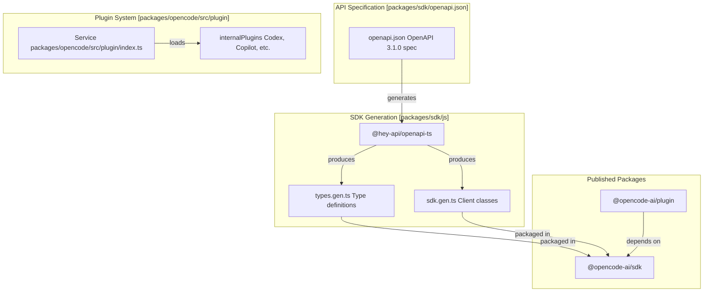
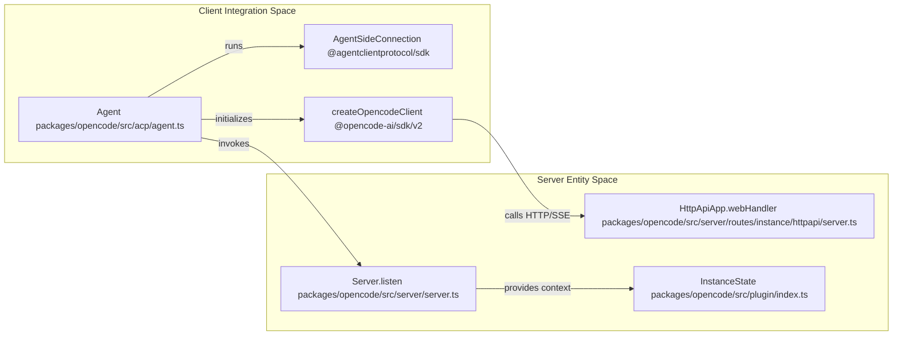

<!-- source: DeepWiki mcp.deepwiki.com · repo sst/opencode · page 7 SDKs and Extension Points · fetched 2026-10-26 -->

# SDKs and Extension Points

Relevant source files

The following files were used as context for generating this wiki page:

- [packages/opencode/src/acp/agent.ts](packages/opencode/src/acp/agent.ts)
- [packages/opencode/src/agent/agent.ts](packages/opencode/src/agent/agent.ts)
- [packages/opencode/src/config/config.ts](packages/opencode/src/config/config.ts)
- [packages/opencode/src/server/server.ts](packages/opencode/src/server/server.ts)
- [packages/opencode/test/agent/agent.test.ts](packages/opencode/test/agent/agent.test.ts)
- [packages/opencode/test/config/config.test.ts](packages/opencode/test/config/config.test.ts)
- [packages/sdk/js/src/v2/gen/sdk.gen.ts](packages/sdk/js/src/v2/gen/sdk.gen.ts)
- [packages/sdk/js/src/v2/gen/types.gen.ts](packages/sdk/js/src/v2/gen/types.gen.ts)
- [packages/sdk/openapi.json](packages/sdk/openapi.json)
- [perf/test-suite.md](perf/test-suite.md)

OpenCode provides a structured extensibility layer that enables developers to integrate with and extend its functionality. The extensibility system consists of programmatic interfaces for external applications, specification-driven SDK generation, protocol bridges, and a plugin framework.

The core of this system is built around:
- **`@opencode-ai/sdk`** — Type-safe JavaScript/TypeScript SDK for API integration, generated from the OpenAPI specification (`packages/sdk/openapi.json`). [packages/sdk/js/src/v2/gen/sdk.gen.ts:1-245](), [packages/sdk/js/src/v2/gen/types.gen.ts:1-296]()
- **OpenAPI Specification** — The OpenAPI 3.1 contract exposed by the server at `/doc` and defined via Effect HttpApi (`packages/opencode/src/server/server.ts`). [packages/sdk/openapi.json:1-7](), [packages/opencode/src/server/server.ts:67-69]()
- **Plugin System** — A framework for extending OpenCode with custom tools, auth methods, and hooks (`packages/opencode/src/plugin/index.ts`). [packages/opencode/src/agent/agent.ts:93-93]()
- **Agent Client Protocol (ACP)** — A standardized protocol implemented by `AcpCommand` (`packages/opencode/src/acp/agent.ts`) for integrating OpenCode with ACP-compatible editors. [packages/opencode/src/acp/agent.ts:1-30]()

For detailed information about each component, see the sub-pages:
- [JavaScript/TypeScript SDK](#7.1) — `@opencode-ai/sdk` package, client generation, and API methods.
- [OpenAPI Specification](#7.2) — Detail the API specification, endpoints, and request/response schemas.
- [Plugin System](#7.3) — Explain plugin architecture, hooks, and custom plugin development.
- [Agent Client Protocol (ACP)](#7.4) — Document the ACP implementation for integrating with editors like Zed.
- [GitHub Action Integration](#7.5) — Document the `opencode` GitHub Action for CI/CD workflows.
- [Slack Integration](#7.6) — Document the `@opencode-ai/slack` bot package for threaded sessions.
- [Sharing and Enterprise Share Viewer](#7.7) — Document session sharing and enterprise share viewer deployments.

---

## Architecture and Code Bridge

OpenCode's extensibility architecture separates API specification, SDK codegen, and runtime protocol/plugin integration. Below is the mapping between natural language system names and their code entities.

### Diagram: Extensibility and Codegen Pipeline

Sources: [packages/sdk/openapi.json:1-8](), [packages/sdk/js/src/v2/gen/sdk.gen.ts:1-5](), [packages/opencode/src/agent/agent.ts:93-93]()

### Diagram: Protocol and Server Extension Mapping

Sources: [packages/opencode/src/acp/agent.ts:1-30](), [packages/opencode/src/server/server.ts:56-81]()

---

## Summary of Extension Points

### JavaScript/TypeScript SDK
The `@opencode-ai/sdk` package provides generated client objects (via `createOpencodeClient`) that map to the underlying HTTP API routes. It supports typed request/response objects, error interceptors, and streaming methods. The SDK includes generated types for events (`Event`) and authentication (`Auth`).
For details, see [JavaScript/TypeScript SDK](#7.1).
Sources: [packages/sdk/js/src/v2/gen/sdk.gen.ts:1-245](), [packages/sdk/js/src/v2/gen/types.gen.ts:1-296]()

### OpenAPI Specification
The server hosts an OpenAPI 3.1.0 specification at `/doc` (implemented via `Server.openapi()` using `OpenApi.fromApi(PublicApi)`), detailing endpoints, parameters, schemas, and event payloads (`Event`, `Auth`, `Session`). The `openapi.json` file defines the API structure.
For details, see [OpenAPI Specification](#7.2).
Sources: [packages/sdk/openapi.json:1-7](), [packages/opencode/src/server/server.ts:67-69]()

### Plugin System
OpenCode supports extension via internal and external plugins. The `Plugin.Service` manages plugin loading and execution. Plugins can define hooks for various functionalities, such as `auth.loader` for authentication, `chat.params` for chat message processing, and `tool.execute` for custom tool implementations.
For details, see [Plugin System](#7.3).
Sources: [packages/opencode/src/agent/agent.ts:93-93]()

### Agent Client Protocol (ACP)
The ACP integration allows OpenCode to act as an agent backend for compatible editors. The `Agent` class in `packages/opencode/src/acp/agent.ts` implements the `ACPAgent` interface, handling requests like `initialize`, `newSession`, `prompt`, and `cancel` using an `OpencodeClient` instance.
For details, see [Agent Client Protocol (ACP)](#7.4).
Sources: [packages/opencode/src/acp/agent.ts:1-86]()

### GitHub Action Integration
The OpenCode GitHub Action automates CI/CD workflows and issue/PR management by spinning up the CLI/SDK environment via `action.yml`. This allows OpenCode to be integrated directly into development pipelines.
For details, see [GitHub Action Integration](#7.5).
Sources: [perf/test-suite.md:57-58]()

### Slack Integration
The `@opencode-ai/slack` package implements a Slack bot that handles workspace events, manages OAuth scopes, and creates threaded OpenCode sessions from incoming messages using the SDK. This enables interactive OpenCode sessions directly within Slack.
For details, see [Slack Integration](#7.6).
Sources: [packages/sdk/js/src/v2/gen/sdk.gen.ts:1-245]()

### Sharing and Enterprise Share Viewer
Session sharing allows users to publish session snapshots (`session.share`) and view them via the enterprise share viewer route or self-hosted deployments. The `SessionShareResponses` type in the SDK indicates the structure of a shared session.
For details, see [Sharing and Enterprise Share Viewer](#7.7).
Sources: [packages/sdk/js/src/v2/gen/sdk.gen.ts:210-211]()

---

