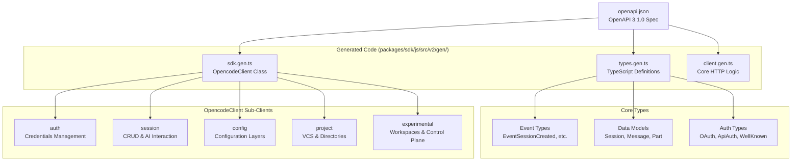
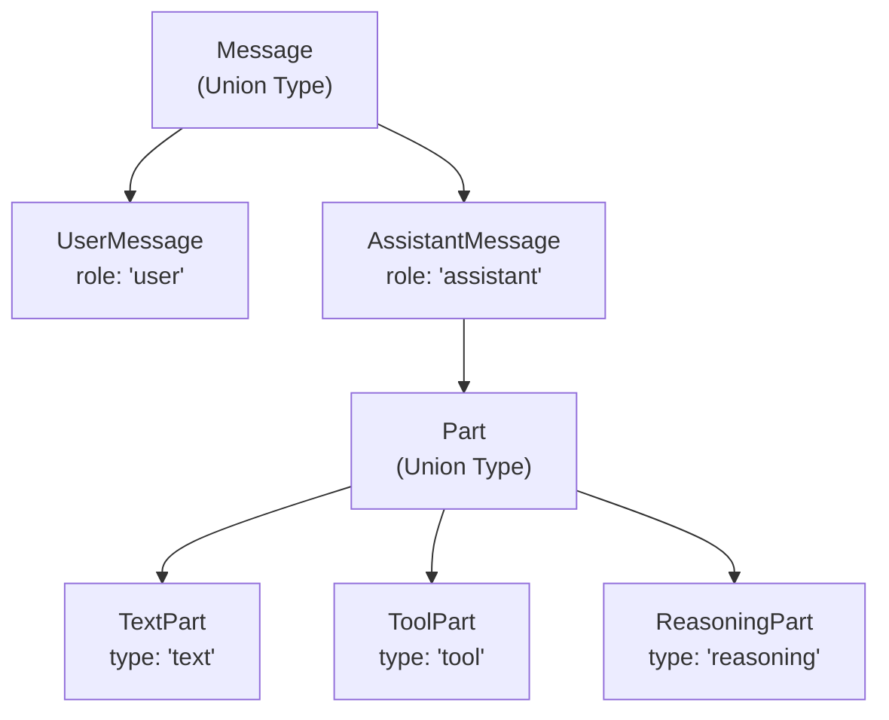
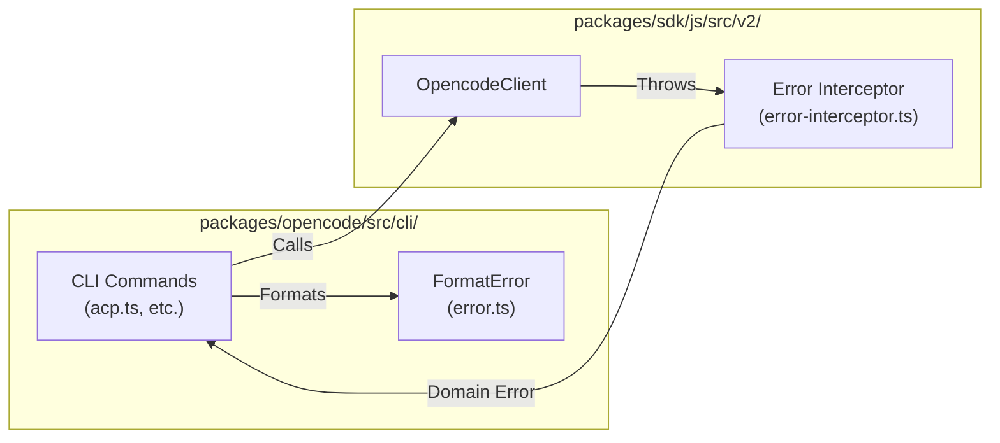

<!-- source: DeepWiki mcp.deepwiki.com · repo sst/opencode · page 7.1 JavaScript/TypeScript SDK · fetched 2026-10-26 -->

# JavaScript/TypeScript SDK

<details>
<summary>Relevant source files</summary>

The following files were used as context for generating this wiki page:

- [packages/opencode/src/acp/agent.ts](packages/opencode/src/acp/agent.ts)
- [packages/opencode/src/agent/agent.ts](packages/opencode/src/agent/agent.ts)
- [packages/opencode/src/cli/error.ts](packages/opencode/src/cli/error.ts)
- [packages/opencode/src/cli/logo.ts](packages/opencode/src/cli/logo.ts)
- [packages/opencode/src/cli/ui.ts](packages/opencode/src/cli/ui.ts)
- [packages/opencode/src/config/config.ts](packages/opencode/src/config/config.ts)
- [packages/opencode/src/server/server.ts](packages/opencode/src/server/server.ts)
- [packages/opencode/src/util/error.ts](packages/opencode/src/util/error.ts)
- [packages/opencode/test/agent/agent.test.ts](packages/opencode/test/agent/agent.test.ts)
- [packages/opencode/test/cli/error.test.ts](packages/opencode/test/cli/error.test.ts)
- [packages/opencode/test/config/config.test.ts](packages/opencode/test/config/config.test.ts)
- [packages/opencode/test/util/error.test.ts](packages/opencode/test/util/error.test.ts)
- [packages/sdk/js/src/client.ts](packages/sdk/js/src/client.ts)
- [packages/sdk/js/src/error-interceptor.ts](packages/sdk/js/src/error-interceptor.ts)
- [packages/sdk/js/src/v2/client.ts](packages/sdk/js/src/v2/client.ts)
- [packages/sdk/js/src/v2/gen/sdk.gen.ts](packages/sdk/js/src/v2/gen/sdk.gen.ts)
- [packages/sdk/js/src/v2/gen/types.gen.ts](packages/sdk/js/src/v2/gen/types.gen.ts)
- [packages/sdk/openapi.json](packages/sdk/openapi.json)
- [perf/test-suite.md](perf/test-suite.md)

</details>


The `@opencode-ai/sdk` package provides a type-safe TypeScript/JavaScript client for interacting with the OpenCode HTTP server. This SDK is automatically generated from the OpenAPI specification and offers full type safety for all API operations, request parameters, and response types.

For information about the HTTP server and API endpoints, see [2.6 HTTP Server and API](). For details about the OpenAPI specification, see [7.2 OpenAPI Specification]().

## Overview

The SDK serves as the primary programmatic interface for:
- Client applications (Desktop, Web, TUI).
- UI component libraries such as `@opencode-ai/ui`.
- Custom integrations and extensions (e.g., ACP, Slack).

It abstracts the HTTP communication layer and provides strongly-typed methods for all OpenCode operations including session management, message handling, configuration, provider authentication, and event streaming.

Sources: [packages/sdk/js/src/v2/gen/sdk.gen.ts:1-200](), [packages/sdk/js/src/v2/client.ts:1-93]()

## Package Structure

The SDK is organized into generated code that mirrors the OpenCode API structure, with specialized sub-clients for different domains.

Title: "SDK Generation and Module Flow"


Sources: [packages/sdk/openapi.json:1-123](), [packages/sdk/js/src/v2/gen/types.gen.ts:1-100](), [packages/sdk/js/src/v2/gen/sdk.gen.ts:1-210]()

## Client Architecture

### Initialization and Interceptors

The primary entry point is `createOpencodeClient`. This function configures the underlying HTTP client with specific headers and interceptors required for OpenCode's multi-workspace and multi-directory architecture.

- **`createOpencodeClient`**: Configures a custom `fetch` implementation to handle timeouts and adds `x-opencode-directory` or `x-opencode-workspace` headers if provided [packages/sdk/js/src/v2/client.ts:50-75]().
- **Request Interceptor**: Uses a `rewrite` function to move directory and workspace context from headers into query parameters for `GET` and `HEAD` requests, ensuring compatibility with server-side routing [packages/sdk/js/src/v2/client.ts:18-48]().
- **Error Interceptor**: Uses `wrapClientError` to transform raw HTTP errors into domain-specific error types defined in the SDK [packages/sdk/js/src/v2/client.ts:91]().

### Sub-Client Mapping

The `OpencodeClient` class aggregates multiple specialized sub-clients:

| Sub-Client | Purpose | File Reference |
|-------|---------|-------------|
| `auth` | Manage provider credentials (set/remove) | [packages/sdk/openapi.json:9-123]() |
| `session` | Session lifecycle, prompts, and history | [packages/sdk/js/src/v2/gen/sdk.gen.ts:194-225]() |
| `config` | Manage global and project configuration | [packages/sdk/js/src/v2/gen/sdk.gen.ts:20-26]() |
| `project` | Detect git roots and list directories | [packages/sdk/js/src/v2/gen/sdk.gen.ts:134-144]() |
| `experimental` | Control plane operations and workspace management | [packages/sdk/js/src/v2/gen/sdk.gen.ts:39-62]() |

Sources: [packages/sdk/js/src/v2/gen/sdk.gen.ts:1-262](), [packages/sdk/js/src/v2/client.ts:77-93]()

## Type System and Data Models

### Message and Part Structure

The SDK defines a rich hierarchy for AI interactions, specifically distinguishing between `UserMessage` and `AssistantMessage`, and breaking them down into `Part` components.

Title: "Message and Part Entity Relationship"


- **`UserMessage`**: Includes the `agent`, `model`, and optional `tools` enabled for the turn [packages/sdk/js/src/v2/gen/types.gen.ts:239-262]().
- **`Session`**: Represents the root container for a conversation, including `projectID`, `workspaceID`, and model metadata [packages/sdk/js/src/v2/gen/types.gen.ts:170-221]().
- **`Auth`**: A union of `OAuth`, `ApiAuth`, and `WellKnownAuth` used for setting credentials [packages/sdk/js/src/v2/gen/types.gen.ts:109-132]().

Sources: [packages/sdk/js/src/v2/gen/types.gen.ts:170-262]()

### Event System

The SDK provides types for over 90 different event types that can be received via the `/global/event` SSE stream.

- **Session Lifecycle**: `EventSessionCreated`, `EventSessionUpdated`, `EventSessionDeleted` [packages/sdk/js/src/v2/gen/types.gen.ts:12-14]().
- **AI Streaming**: `EventSessionNextTextDelta`, `EventSessionNextToolInputDelta`, `EventSessionNextReasoningDelta` [packages/sdk/js/src/v2/gen/types.gen.ts:32-38]().
- **System & Workspace**: `EventWorkspaceReady`, `EventInstallationUpdated`, `EventLspUpdated` [packages/sdk/js/src/v2/gen/types.gen.ts:54-92]().

Sources: [packages/sdk/js/src/v2/gen/types.gen.ts:7-97]()

## Usage Examples

### Client Initialization

The `createOpencodeClient` helper ensures the client is properly configured for the local or remote server.

```typescript
import { createOpencodeClient } from "@opencode-ai/sdk/v2"

const client = createOpencodeClient({
  baseUrl: "http://localhost:4096",
  directory: "/Users/dev/project",
  experimental_workspaceID: "workspace_123"
})
```
Sources: [packages/sdk/js/src/v2/client.ts:50-93]()

### Creating a Session and Sending a Prompt

Sessions are the primary context for AI agent interactions.

```typescript
// Create a new session
const { data: session } = await client.session.create({
  body: {
    title: "Refactor API",
    agent: "build"
  }
})

// Send a prompt
await client.session.prompt({
  path: { sessionID: session.id },
  body: {
    parts: [{ type: "text", text: "Fix the types in user.ts" }]
  }
})
```
Sources: [packages/sdk/js/src/v2/gen/sdk.gen.ts:184-207]()

### Handling Authentication

Credentials can be managed programmatically for different AI providers.

```typescript
await client.auth.set({
  path: { providerID: "anthropic" },
  body: {
    type: "api",
    key: "sk-ant-..."
  }
})
```
Sources: [packages/sdk/openapi.json:9-70](), [packages/sdk/js/src/v2/gen/types.gen.ts:118-124]()

### CLI and Error Handling

The SDK is used extensively in the OpenCode CLI to handle server interactions. Errors are formatted using domain-specific logic to provide actionable feedback.

Title: "CLI to SDK Interaction and Error Formatting"


- **Error Formatting**: The CLI uses `FormatError` to interpret SDK errors like `ProviderModelNotFoundError` or `ConfigInvalidError` into human-readable strings [packages/opencode/src/cli/error.ts:35-126]().
- **Interactive UI**: The CLI provides `UI` helpers for prompts and logging that consume SDK data [packages/opencode/src/cli/ui.ts:14-132]().

Sources: [packages/opencode/src/cli/error.ts:1-130](), [packages/opencode/src/cli/ui.ts:1-132](), [packages/sdk/js/src/v2/client.ts:91-92]()

---

