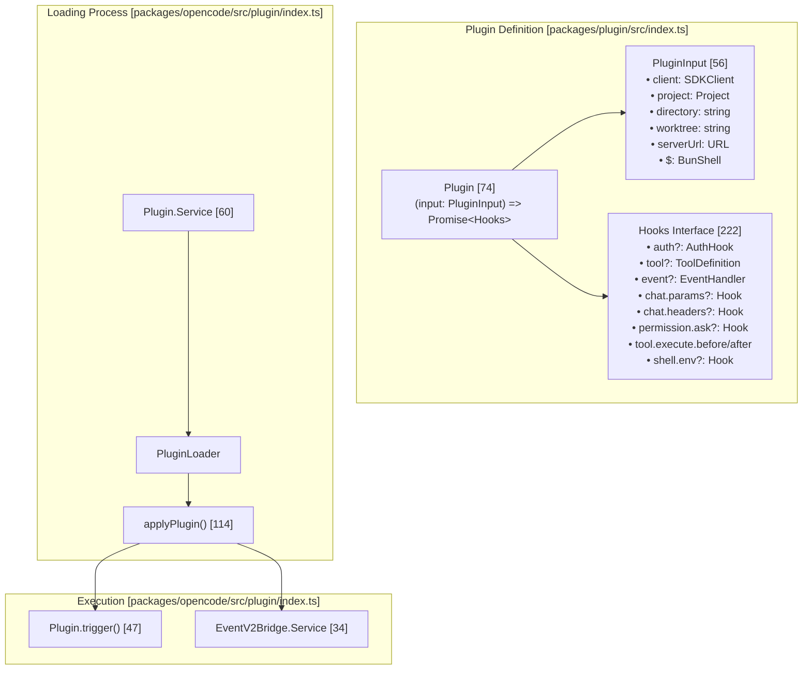
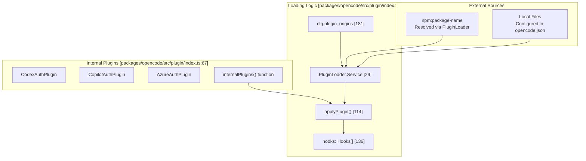
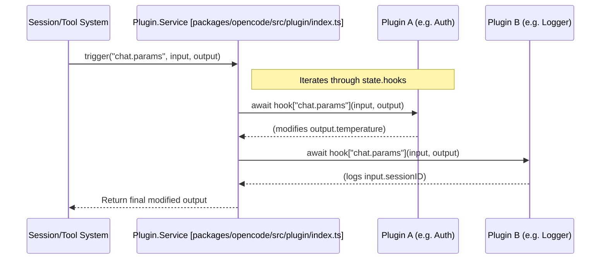

<!-- source: DeepWiki mcp.deepwiki.com · repo sst/opencode · page 7.3 Plugin System · fetched 2026-10-26 -->

# Plugin System

<details>
<summary>Relevant source files</summary>

The following files were used as context for generating this wiki page:

- [.opencode/plugins/tui-smoke.tsx](.opencode/plugins/tui-smoke.tsx)
- [packages/opencode/specs/tui-plugins.md](packages/opencode/specs/tui-plugins.md)
- [packages/opencode/src/auth/index.ts](packages/opencode/src/auth/index.ts)
- [packages/opencode/src/cli/cmd/plug.ts](packages/opencode/src/cli/cmd/plug.ts)
- [packages/opencode/src/plugin/index.ts](packages/opencode/src/plugin/index.ts)
- [packages/opencode/src/plugin/install.ts](packages/opencode/src/plugin/install.ts)
- [packages/opencode/src/plugin/loader.ts](packages/opencode/src/plugin/loader.ts)
- [packages/opencode/src/plugin/shared.ts](packages/opencode/src/plugin/shared.ts)
- [packages/opencode/src/provider/auth.ts](packages/opencode/src/provider/auth.ts)
- [packages/opencode/test/cli/tui/plugin-add.test.ts](packages/opencode/test/cli/tui/plugin-add.test.ts)
- [packages/opencode/test/cli/tui/plugin-install.test.ts](packages/opencode/test/cli/tui/plugin-install.test.ts)
- [packages/opencode/test/cli/tui/plugin-loader-entrypoint.test.ts](packages/opencode/test/cli/tui/plugin-loader-entrypoint.test.ts)
- [packages/opencode/test/cli/tui/plugin-loader-pure.test.ts](packages/opencode/test/cli/tui/plugin-loader-pure.test.ts)
- [packages/opencode/test/cli/tui/plugin-loader.test.ts](packages/opencode/test/cli/tui/plugin-loader.test.ts)
- [packages/opencode/test/cli/tui/plugin-toggle.test.ts](packages/opencode/test/cli/tui/plugin-toggle.test.ts)
- [packages/opencode/test/fixture/tui-plugin.ts](packages/opencode/test/fixture/tui-plugin.ts)
- [packages/opencode/test/fixture/tui-runtime.ts](packages/opencode/test/fixture/tui-runtime.ts)
- [packages/opencode/test/plugin/install.test.ts](packages/opencode/test/plugin/install.test.ts)
- [packages/opencode/test/plugin/loader-shared.test.ts](packages/opencode/test/plugin/loader-shared.test.ts)
- [packages/plugin/src/example.ts](packages/plugin/src/example.ts)
- [packages/plugin/src/index.ts](packages/plugin/src/index.ts)
- [packages/plugin/src/tui.ts](packages/plugin/src/tui.ts)
- [packages/plugin/tsconfig.json](packages/plugin/tsconfig.json)
- [packages/web/src/content/docs/commands.mdx](packages/web/src/content/docs/commands.mdx)
- [packages/web/src/content/docs/custom-tools.mdx](packages/web/src/content/docs/custom-tools.mdx)
- [packages/web/src/content/docs/gitlab.mdx](packages/web/src/content/docs/gitlab.mdx)
- [packages/web/src/content/docs/mcp-servers.mdx](packages/web/src/content/docs/mcp-servers.mdx)
- [packages/web/src/content/docs/plugins.mdx](packages/web/src/content/docs/plugins.mdx)
- [packages/web/src/content/docs/sdk.mdx](packages/web/src/content/docs/sdk.mdx)

</details>


The plugin system provides a flexible extension mechanism for OpenCode through hooks. Plugins can intercept and modify behavior at key points in the execution lifecycle, including authentication flows, chat parameters, tool execution, and workspace management. This system enables both first-party integrations (like Codex, Copilot, and Azure authentication) and third-party extensibility through npm packages or local files.

Sources: [packages/opencode/src/plugin/index.ts:1-39](), [packages/plugin/src/index.ts:1-75]()

---

## Plugin Architecture

### Core Types and Lifecycle

The plugin system is built around the `Plugin` type, which is a function that receives a `PluginInput` and returns a `Hooks` object [packages/plugin/src/index.ts:74](). All plugins follow the same initialization pattern.

The `PluginInput` provides plugins with the necessary context to interact with the system, including an SDK `client`, the current `project` metadata, and Bun's `$` shell for command execution [packages/plugin/src/index.ts:56-66]().

Title: Plugin Architecture Overview


Sources: [packages/plugin/src/index.ts:56-74](), [packages/plugin/src/index.ts:222-264](), [packages/opencode/src/plugin/index.ts:47-130]()

---

### Plugin Loading Mechanism

Plugins are loaded during the initialization of the `Plugin.Service` layer using an `InstanceState` effect [packages/opencode/src/plugin/index.ts:127-134](). The system supports several sources: internal (built-in), npm packages, and local files.

1.  **Internal Plugins**: Built-in plugins like `CodexAuthPlugin`, `CopilotAuthPlugin`, `AzureAuthPlugin`, and `XaiAuthPlugin` are loaded from the `internalPlugins` function [packages/opencode/src/plugin/index.ts:67-86]().
2.  **External Resolution**: `PluginLoader` handles the discovery and loading of plugins specified in configuration origins [packages/opencode/src/plugin/index.ts:29]().
3.  **Application**: `applyPlugin` handles the specific logic for importing the module and pushing the resulting `Hooks` into the service state, supporting both V1 plugin modules and legacy function exports [packages/opencode/src/plugin/index.ts:114-125]().

Title: Plugin Discovery and Loading


Sources: [packages/opencode/src/plugin/index.ts:29](), [packages/opencode/src/plugin/index.ts:67-86](), [packages/opencode/src/plugin/index.ts:114-125](), [packages/opencode/src/plugin/index.ts:181-185]()

---

## Hook Reference

### Core Hooks
The `Hooks` interface defines the interaction points between the core system and plugins [packages/plugin/src/index.ts:222]().

| Hook Name | Description | Data Flow |
| :--- | :--- | :--- |
| `auth` | Defines auth methods (OAuth/API) and credential loaders [packages/plugin/src/index.ts:229](). | `AuthHook` definition |
| `provider` | Allows plugins to provide custom model lists for specific providers [packages/plugin/src/index.ts:230](). | `ProviderHook` |
| `chat.message` | Triggered when a new message is received [packages/plugin/src/index.ts:234](). | `(input, output) => Promise<void>` |
| `chat.params` | Modifies LLM parameters like temperature or topP [packages/plugin/src/index.ts:247](). | `(input, output) => Promise<void>` |
| `tool.execute.before` | Intercepts tool calls to modify arguments or validate | `(input, output) => Promise<void>` |
| `tool.execute.after` | Modifies tool output or metadata after execution | `(input, output) => Promise<void>` |

Sources: [packages/plugin/src/index.ts:222-250]()

---

### Hook Execution Model

Hooks are triggered via `Service.trigger(name, input, output)`. This method iterates through all registered plugin instances in the state and executes the specific hook if defined [packages/opencode/src/plugin/index.ts:47-55]().

Title: Hook Execution Sequence


Sources: [packages/opencode/src/plugin/index.ts:47-55]()

---

## Custom Plugin Development

### Basic Plugin Template
A plugin is an asynchronous function exporting `Hooks`.

```typescript
import type { Plugin } from "@opencode-ai/plugin"

export const MyPlugin: Plugin = async ({ project, client, $, directory }) => {
  // Initialization logic here
  
  return {
    "tool.execute.before": async (input, output) => {
      if (input.tool === "bash") {
        console.log(`Executing command in session`)
      }
    }
  }
}
```

Sources: [packages/web/src/content/docs/plugins.mdx:106-114]()

### Authentication Plugins
Plugins like `CodexAuthPlugin` implement the `auth` hook to provide custom OAuth flows. They define `methods` (OAuth or API) and `authorize` functions that handle challenges and token exchanges [packages/plugin/src/index.ts:91-162](). The plugin also supports `loader` hooks to inject credentials into provider requests [packages/plugin/src/index.ts:90]().

The `ProviderAuth.Service` manages these hooks, providing methods to list auth methods, authorize, and handle callbacks [packages/opencode/src/provider/auth.ts:90-98]().

Sources: [packages/opencode/src/provider/auth.ts:90-98](), [packages/plugin/src/index.ts:88-163]()

---

### Custom Tools in Plugins
Plugins can extend the AI's capabilities by defining custom tools. These tools are registered via the `tool` map in the `Hooks` object [packages/plugin/src/index.ts:226]().

Sources: [packages/plugin/src/index.ts:226-228]()

---

## Event Distribution

Plugins can listen to all system events via the `event` hook [packages/plugin/src/index.ts:224](). The `Plugin.Service` allows plugins to subscribe to the global event bridge indirectly through this hook.

If a plugin encounters an error during execution, the system catches it and publishes a `Session.Event.Error` to the global bridge via the `EffectBridge` to notify the user [packages/opencode/src/plugin/index.ts:137-141]().

Sources: [packages/opencode/src/plugin/index.ts:137-141](), [packages/plugin/src/index.ts:224]()

---

