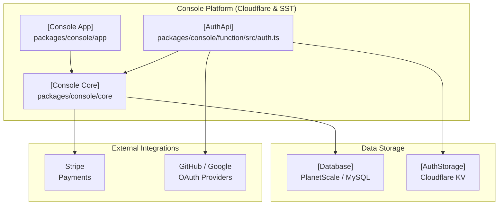
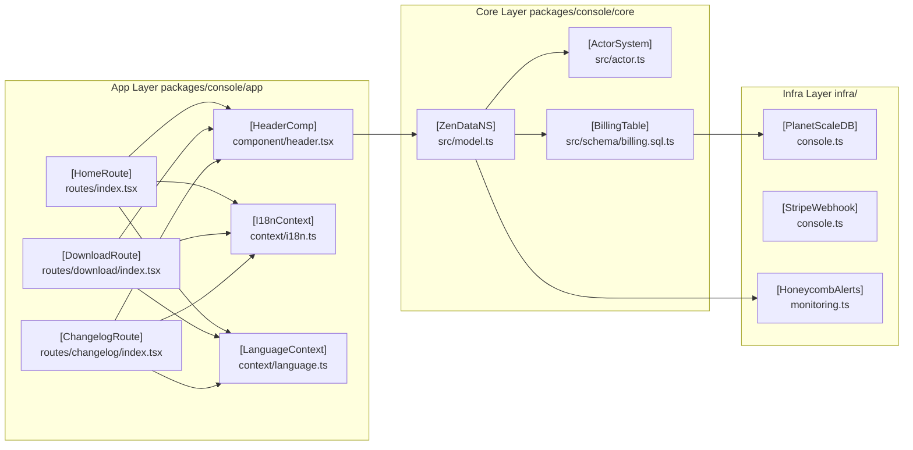

<!-- source: DeepWiki mcp.deepwiki.com · repo sst/opencode · page 8 Console Services · fetched 2026-10-26 -->

# Console Services

Relevant source files

The following files were used as context for generating this wiki page:

- [packages/console/app/src/asset/lander/desktop-app-icon.png](packages/console/app/src/asset/lander/desktop-app-icon.png)
- [packages/console/app/src/asset/lander/opencode-desktop-icon.png](packages/console/app/src/asset/lander/opencode-desktop-icon.png)
- [packages/console/app/src/component/footer.tsx](packages/console/app/src/component/footer.tsx)
- [packages/console/app/src/component/header.tsx](packages/console/app/src/component/header.tsx)
- [packages/console/app/src/lib/changelog.ts](packages/console/app/src/lib/changelog.ts)
- [packages/console/app/src/routes/brand/index.css](packages/console/app/src/routes/brand/index.css)
- [packages/console/app/src/routes/changelog.json.ts](packages/console/app/src/routes/changelog.json.ts)
- [packages/console/app/src/routes/changelog/index.css](packages/console/app/src/routes/changelog/index.css)
- [packages/console/app/src/routes/changelog/index.tsx](packages/console/app/src/routes/changelog/index.tsx)
- [packages/console/app/src/routes/download/index.css](packages/console/app/src/routes/download/index.css)
- [packages/console/app/src/routes/download/index.tsx](packages/console/app/src/routes/download/index.tsx)
- [packages/console/app/src/routes/download/types.ts](packages/console/app/src/routes/download/types.ts)
- [packages/console/app/src/routes/enterprise/index.css](packages/console/app/src/routes/enterprise/index.css)
- [packages/console/app/src/routes/feishu.ts](packages/console/app/src/routes/feishu.ts)
- [packages/console/app/src/routes/index.css](packages/console/app/src/routes/index.css)
- [packages/console/app/src/routes/index.tsx](packages/console/app/src/routes/index.tsx)
- [packages/console/app/src/routes/temp.tsx](packages/console/app/src/routes/temp.tsx)
- [packages/console/app/src/routes/zen/index.css](packages/console/app/src/routes/zen/index.css)
- [packages/console/app/src/routes/zen/index.tsx](packages/console/app/src/routes/zen/index.tsx)
- [packages/web/config.mjs](packages/web/config.mjs)

The Console Services system provides the hosted platform for managing OpenCode Zen and Go subscriptions, team workspaces, billing, and model access. It is built as a multi-tier serverless application serving as the administrative and marketing interface at `opencode.ai`.

For information about the AI provider integration that these services enable, see [AI Provider Integration](#4). For details about the Zen and Go model offerings themselves, see [OpenCode Zen and Go Services](#4.5).

---

## Console Platform Overview

The Console platform manages the lifecycle of users, workspaces, and AI model configurations. It is deployed using **SST** on Cloudflare infrastructure, integrating with PlanetScale for relational data, Stripe for billing, and utilizing **OpenAuth** for identity management. The frontend application handles marketing views, downloads, changelogs, and workspace management [packages/console/app/src/routes/index.tsx:29-162](), [packages/console/app/src/routes/download/index.tsx:40-121](), [packages/console/app/src/routes/changelog/index.tsx:101-176]().

**Console System Context**

Sources: [packages/web/config.mjs:1-14]()

---

## Three-Tier Architecture

The Console Services follow a strict separation between the frontend presentation, shared core logic, and specialized serverless functions.

### Tier 1: Presentation Layer (`console/app`)
The frontend is a **SolidJS** application (using SolidStart) providing the user interface for workspace management, billing dashboards, internationalized pages, and the landing site [packages/console/app/src/routes/index.tsx:29-53](), [packages/console/app/src/component/header.tsx:38-42]().

- **Routing and Marketing**: Implements landing pages (`Home`), download utilities (`Download`), changelog viewers (`Changelog`), and specialized Zen/Go portals [packages/console/app/src/routes/index.tsx:29]() (home), [packages/console/app/src/routes/download/index.tsx:28]() (download), [packages/console/app/src/routes/changelog/index.tsx:101]() (changelog), [packages/console/app/src/routes/zen/index.tsx:31]() (Zen).
- **Navigation & Layout**: Manages global headers, internationalization dictionaries, and locale routing via `Header` and `useLanguage` [packages/console/app/src/component/header.tsx:38-42]().

### Tier 2: Core Logic Layer (`console/core`)
The core package encapsulates business logic, database interactions via Drizzle ORM, and identity actors.

- **Model Management**: Handles parsing and validating model configurations and SST secrets.
- **Actor Pattern**: Uses an `Actor` system to assert permissions, such as verifying admin status before modifying model availability.

### Tier 3: Functions and Workers (`console/function`)
Serverless workers handle specialized tasks like authentication flows and API endpoints.

- **Authentication**: Implements an OpenAuth issuer (linked as `AuthApi` in infra) supporting GitHub and Google providers.
- **Monitoring**: Integrated with Honeycomb for observability, tracking model errors and TPS across tiers.

For details, see [Console Architecture](#8.1).

Sources: [packages/console/app/src/routes/index.tsx:29-53](), [packages/console/app/src/component/header.tsx:38-42](), [packages/console/app/src/routes/download/index.tsx:28](), [packages/console/app/src/routes/changelog/index.tsx:101](), [packages/console/app/src/routes/zen/index.tsx:31]()

---

## Database and Data Services

The platform utilizes a relational database (PlanetScale) accessed through Drizzle ORM to maintain strict consistency for billing and model configurations.

### Key Entities
- **Models**: Managed via the `ModelTable`, allowing workspaces to enable or disable specific AI models.
- **Billing & Usage**: Tracks credits and usage through billing and subscription tables.
- **Secrets Management**: Sensitive configuration, such as Stripe keys and model definitions, are managed as SST Secrets.

For details, see [Database and Billing Services](#8.3).

Sources: 

---

## Enterprise Features and Billing

OpenCode Console manages team collaboration and usage-based billing through deep Stripe integration, alongside enterprise controls like BYOK and role-based access control.

### Subscription Tiers & Controls
- **OpenCode Go & Zen**: Tiered subscription plans for individual developers and teams.
- **Model Controls**: Admins can programmatically enable or disable models for their workspace.
- **Provider Routing**: Supports sticky provider tracking and normalized request routing.

For details, see [Enterprise Features](#8.4) and [Console API and Zen Gateway](#8.2).

Sources: 

---

## System Integration Diagram

The following diagram bridges high-level console concepts to specific code entities and infrastructure definitions across the application and core layers.

**Code Entity and Infrastructure Relationship**

Sources: [packages/console/app/src/routes/index.tsx:29-53](), [packages/console/app/src/routes/download/index.tsx:28-30](), [packages/console/app/src/routes/changelog/index.tsx:101-104](), [packages/console/app/src/component/header.tsx:38-42]()

---

## Child Pages
- [Console Architecture](#8.1) — Explain the three-tier console architecture (app, core, function), marketing/download/changelog routes, i18n, and deployment model.
- [Console API and Zen Gateway](#8.2) — Document the Zen/Go inference proxy handlers, provider adapters (OpenAI/Anthropic/Google/compatible), request body normalization, trial limiting, sticky provider routing, and log processing.
- [Database and Billing Services](#8.3) — Detail the console database schema, Drizzle migrations, model catalog scripts, Stripe billing/webhooks, referrals, and OpenAuth integration.
- [Enterprise Features](#8.4) — Document team workspaces, role-based access control, BYOK, lite/Go workspace sections, and managed configurations.

---

