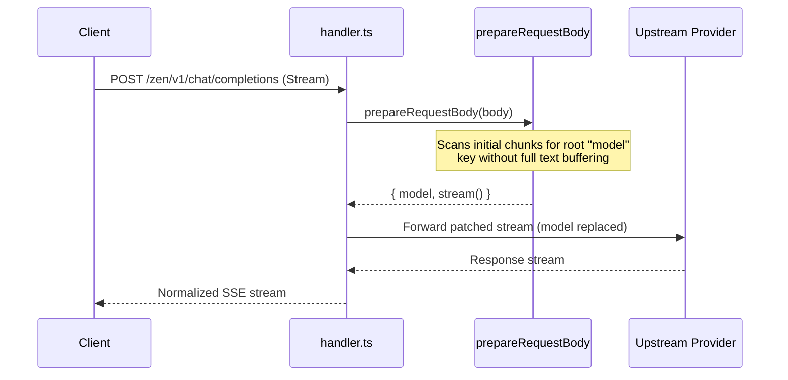
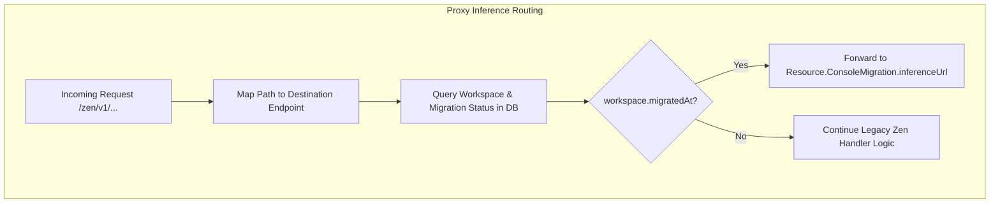
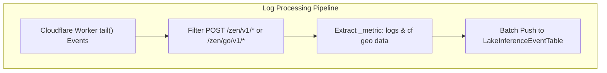

<!-- source: DeepWiki mcp.deepwiki.com · repo sst/opencode · page 8.2 Console API and Zen Gateway · fetched 2026-10-26 -->

# Console API and Zen Gateway

Relevant source files

The following files were used as context for generating this wiki page:

- [artifacts/glm52-rise-video/sst-env.d.ts](artifacts/glm52-rise-video/sst-env.d.ts)
- [infra/stats.ts](infra/stats.ts)
- [packages/codemode/sst-env.d.ts](packages/codemode/sst-env.d.ts)
- [packages/console/app/src/component/icon.tsx](packages/console/app/src/component/icon.tsx)
- [packages/console/app/src/lib/inference-proxy.ts](packages/console/app/src/lib/inference-proxy.ts)
- [packages/console/app/src/lib/server-action.ts](packages/console/app/src/lib/server-action.ts)
- [packages/console/app/src/middleware.ts](packages/console/app/src/middleware.ts)
- [packages/console/app/src/routes/auth/status.ts](packages/console/app/src/routes/auth/status.ts)
- [packages/console/app/src/routes/workspace/[id]/billing/monthly-limit-section.tsx](packages/console/app/src/routes/workspace/[id]/billing/monthly-limit-section.tsx)
- [packages/console/app/src/routes/workspace/[id]/billing/reload-section.tsx](packages/console/app/src/routes/workspace/[id]/billing/reload-section.tsx)
- [packages/console/app/src/routes/workspace/[id]/keys/key-section.tsx](packages/console/app/src/routes/workspace/[id]/keys/key-section.tsx)
- [packages/console/app/src/routes/workspace/[id]/members/member-section.tsx](packages/console/app/src/routes/workspace/[id]/members/member-section.tsx)
- [packages/console/app/src/routes/workspace/[id]/model-section.tsx](packages/console/app/src/routes/workspace/[id]/model-section.tsx)
- [packages/console/app/src/routes/workspace/[id]/provider-section.tsx](packages/console/app/src/routes/workspace/[id]/provider-section.tsx)
- [packages/console/app/src/routes/zen/go/v1/chat/completions.ts](packages/console/app/src/routes/zen/go/v1/chat/completions.ts)
- [packages/console/app/src/routes/zen/go/v1/messages.ts](packages/console/app/src/routes/zen/go/v1/messages.ts)
- [packages/console/app/src/routes/zen/go/v1/models.ts](packages/console/app/src/routes/zen/go/v1/models.ts)
- [packages/console/app/src/routes/zen/go/v1/systemone.ts](packages/console/app/src/routes/zen/go/v1/systemone.ts)
- [packages/console/app/src/routes/zen/go/v1/usage.ts](packages/console/app/src/routes/zen/go/v1/usage.ts)
- [packages/console/app/src/routes/zen/util/handler.ts](packages/console/app/src/routes/zen/util/handler.ts)
- [packages/console/app/src/routes/zen/util/modelsHandler.ts](packages/console/app/src/routes/zen/util/modelsHandler.ts)
- [packages/console/app/src/routes/zen/util/provider/anthropic.ts](packages/console/app/src/routes/zen/util/provider/anthropic.ts)
- [packages/console/app/src/routes/zen/util/provider/google.ts](packages/console/app/src/routes/zen/util/provider/google.ts)
- [packages/console/app/src/routes/zen/util/provider/openai-compatible.ts](packages/console/app/src/routes/zen/util/provider/openai-compatible.ts)
- [packages/console/app/src/routes/zen/util/provider/openai.ts](packages/console/app/src/routes/zen/util/provider/openai.ts)
- [packages/console/app/src/routes/zen/util/provider/provider.ts](packages/console/app/src/routes/zen/util/provider/provider.ts)
- [packages/console/app/src/routes/zen/util/provider/systemone.ts](packages/console/app/src/routes/zen/util/provider/systemone.ts)
- [packages/console/app/src/routes/zen/util/requestBody.ts](packages/console/app/src/routes/zen/util/requestBody.ts)
- [packages/console/app/src/routes/zen/util/stickyProviderTracker.ts](packages/console/app/src/routes/zen/util/stickyProviderTracker.ts)
- [packages/console/app/src/routes/zen/util/trialLimiter.ts](packages/console/app/src/routes/zen/util/trialLimiter.ts)
- [packages/console/app/src/routes/zen/util/variant.ts](packages/console/app/src/routes/zen/util/variant.ts)
- [packages/console/app/src/routes/zen/v1/chat/completions.ts](packages/console/app/src/routes/zen/v1/chat/completions.ts)
- [packages/console/app/src/routes/zen/v1/messages.ts](packages/console/app/src/routes/zen/v1/messages.ts)
- [packages/console/app/src/routes/zen/v1/models.ts](packages/console/app/src/routes/zen/v1/models.ts)
- [packages/console/app/src/routes/zen/v1/models/[model].ts](packages/console/app/src/routes/zen/v1/models/[model].ts)
- [packages/console/app/src/routes/zen/v1/responses.ts](packages/console/app/src/routes/zen/v1/responses.ts)
- [packages/console/app/src/routes/zen/v1/systemone.ts](packages/console/app/src/routes/zen/v1/systemone.ts)
- [packages/console/app/test/providerUsage.test.ts](packages/console/app/test/providerUsage.test.ts)
- [packages/console/app/test/requestBody.test.ts](packages/console/app/test/requestBody.test.ts)
- [packages/console/app/test/serverAction.test.ts](packages/console/app/test/serverAction.test.ts)
- [packages/console/core/test/model.test.ts](packages/console/core/test/model.test.ts)
- [packages/console/function/src/log-processor.ts](packages/console/function/src/log-processor.ts)
- [packages/schema/sst-env.d.ts](packages/schema/sst-env.d.ts)
- [packages/session-ui/sst-env.d.ts](packages/session-ui/sst-env.d.ts)

This document covers the Console system's HTTP API layer, focusing on the serverless functions and handlers that power OpenCode's managed AI services (**Zen** for curated models and **Go** for open models), inference proxying, multi-provider request normalization, rate/trial limiting, and log processing.

## Purpose and Scope

The Console API and Zen Gateway subsystem provides:
- **Zen & Go Inference Proxies**: High-performance multi-provider LLM routing gateways supporting Anthropic, OpenAI, Google, and OpenAI-compatible providers [packages/console/app/src/routes/zen/util/handler.ts:68-123]().
- **Request Body Normalization**: Zero-buffer stream patching (`prepareRequestBody`) that dynamically updates the model field and injects streaming options without buffering large message payloads [packages/console/app/src/routes/zen/util/requestBody.ts:4-105]().
- **Migrated Workspace Routing**: Seamless proxying (`proxyInference`) for migrated workspaces to backend inference endpoints [packages/console/app/src/lib/inference-proxy.ts:19-110]().
- **Provider Adapters & Usage Parsing**: Protocol translation and usage token extraction for OpenAI, Anthropic (including AWS Bedrock/Databricks binary decoding), and compatible endpoints [packages/console/app/src/routes/zen/util/provider/anthropic.ts:19-41](), [packages/console/app/src/routes/zen/util/provider/openai.ts:16-22](), [packages/console/app/src/routes/zen/util/provider/openai-compatible.ts:26-38]().
- **Log Processing & Analytics**: Cloudflare Workers tail event processing (`log-processor.ts`) to stream metrics and request logs into lake/datalake backends [packages/console/function/src/log-processor.ts:4-86]().

**Sources:**
- [packages/console/app/src/routes/zen/util/handler.ts:68-123]()
- [packages/console/app/src/routes/zen/util/requestBody.ts:4-105]()
- [packages/console/app/src/lib/inference-proxy.ts:19-110]()
- [packages/console/function/src/log-processor.ts:4-86]()

---

## Architecture and Proxy Flow

The Zen Gateway routes incoming chat and completion requests to underlying upstream LLM providers while enforcing billing, trial limits, and regional constraints. 

### System Entity Mapping

The following diagram associates the functional components of the Zen Gateway to their concrete code implementations.

```mermaid
graph TB
    subgraph "Natural Language Space"
        ClientReq["Incoming Client LLM Request"]
        ProxyRouter["Zen & Go Proxy Gateway"]
        BodyParser["Request Stream Patching"]
        ProviderAdapters["Provider Protocol Adapters"]
        MetricsCollector["Metrics & Log Processing"]
    end

    subgraph "Code Entity Space"
        HandlerFn["handler.ts<br/>packages/console/app/src/routes/zen/util/handler.ts"]
        ProxyInferenceFn["proxyInference<br/>packages/console/app/src/lib/inference-proxy.ts"]
        PrepareBodyFn["prepareRequestBody<br/>packages/console/app/src/routes/zen/util/requestBody.ts"]
        AnthropicHelper["anthropicHelper<br/>packages/console/app/src/routes/zen/util/provider/anthropic.ts"]
        OpenAiHelper["openaiHelper<br/>packages/console/app/src/routes/zen/util/provider/openai.ts"]
        OaCompatHelper["oaCompatHelper<br/>packages/console/app/src/routes/zen/util/provider/openai-compatible.ts"]
        LogProcessor["logTail<br/>packages/console/function/src/log-processor.ts"]
    end

    ClientReq --> HandlerFn
    ProxyRouter --> ProxyInferenceFn
    BodyParser --> PrepareBodyFn
    ProviderAdapters --> AnthropicHelper
    ProviderAdapters --> OpenAiHelper
    ProviderAdapters --> OaCompatHelper
    MetricsCollector --> LogProcessor
```

**Sources:**
- [packages/console/app/src/routes/zen/util/handler.ts:68-141]()
- [packages/console/app/src/lib/inference-proxy.ts:19-110]()
- [packages/console/app/src/routes/zen/util/requestBody.ts:4-105]()
- [packages/console/function/src/log-processor.ts:4-86]()

---

## Request Body Normalization and Streaming

To support fast proxying without holding full request payloads in memory, `prepareRequestBody` scans and mutates incoming `ReadableStream<Uint8Array>` bodies on the fly.

### Key Implementation Details
- **Zero-Buffer Scanning**: `prepareRequestBody` reads chunks incrementally, tracking JSON nesting depth and string states to locate the root `model` attribute efficiently [packages/console/app/src/routes/zen/util/requestBody.ts:19-70]().
- **Model Substitution**: The `stream()` method replaces the client-specified model ID with the provider's mapped model identifier (`providerModel`) on the fly using chunk-level transformations [packages/console/app/src/routes/zen/util/requestBody.ts:94-104]() [packages/console/app/src/routes/zen/util/requestBody.ts:122-139]().
- **Usage Options Injection**: When `includeUsage` is enabled, it appends `stream_options: { include_usage: true }` right before the end of JSON request objects [packages/console/app/src/routes/zen/util/requestBody.ts:173-205]().

**Sources:**
- [packages/console/app/src/routes/zen/util/requestBody.ts:4-105]()

---

## Provider Adapters and Protocol Translation

The Zen Gateway abstracts multiple vendor APIs into unified handlers using helper objects defined in `packages/console/app/src/routes/zen/util/provider/`.

### Supported Adapters
1. **Anthropic & AWS Bedrock (`anthropicHelper`)**: Translates standard messages, handles Anthropic beta headers (such as `context-1m`), and decodes AWS Bedrock binary event streams via `@smithy/eventstream-codec` [packages/console/app/src/routes/zen/util/provider/anthropic.ts:19-141]().
2. **OpenAI (`openaiHelper`)**: Configures requests against the OpenAI Responses API format, extracting and normalizing input/output tokens and cache detail fields [packages/console/app/src/routes/zen/util/provider/openai.ts:16-64]().
3. **OpenAI-Compatible (`oaCompatHelper`)**: Standardizes third-party providers (Moonshot, xAI, Alibaba Qwen, DeepSeek) with Bearer token authentication, session affinity (`x-session-affinity`), and automatic usage extraction [packages/console/app/src/routes/zen/util/provider/openai-compatible.ts:26-80]().

**Sources:**
- [packages/console/app/src/routes/zen/util/provider/anthropic.ts:19-141]()
- [packages/console/app/src/routes/zen/util/provider/openai.ts:16-64]()
- [packages/console/app/src/routes/zen/util/provider/openai-compatible.ts:26-80]()

---

## Migrated Workspace Routing (`proxyInference`)

For workspaces that have completed migration, `proxyInference` intercepts incoming Zen routes and forwards them directly to the console migration inference destination [packages/console/app/src/lib/inference-proxy.ts:19-110]().

- **Path Mapping**: Maps paths like `POST /zen/v1/chat/completions` to `/openai/v1/chat/completions` or custom connection URIs [packages/console/app/src/lib/inference-proxy.ts:7-17]().
- **Header Sanitization**: Removes internal gateway headers (`x-zen`, `host`, `content-length`) while preserving user authentication and propagating client IP and request IDs [packages/console/app/src/lib/inference-proxy.ts:93-108]().

**Sources:**
- [packages/console/app/src/lib/inference-proxy.ts:19-110]()

---

## Log Processing and Analytics

The console platform captures execution telemetry through Cloudflare Worker tail events in `log-processor.ts` and batches them into Iceberg datalakes [packages/console/function/src/log-processor.ts:4-86]().

### Telemetry Fields and Datalake Schema
The `log-processor.ts` tail handler processes worker logs, extracts `_metric:` JSON payloads, computes stable IP prefixes (collapsing IPv6 `/64` blocks for privacy), and streams formatted events into Apache Iceberg tables defined in `infra/stats.ts` [packages/console/function/src/log-processor.ts:24-86]() [infra/stats.ts:14-90]().

**Sources:**
- [packages/console/function/src/log-processor.ts:4-86]()
- [infra/stats.ts:14-90]()

---

