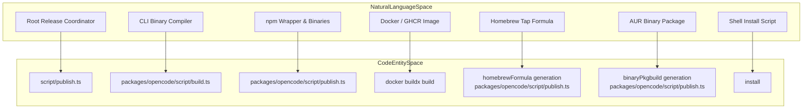
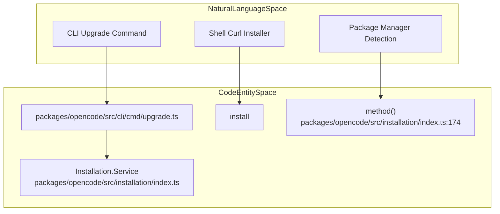

<!-- source: DeepWiki mcp.deepwiki.com · repo sst/opencode · page 9.3 Distribution Channels · fetched 2026-10-26 -->

# Distribution Channels

Relevant source files

The following files were used as context for generating this wiki page:

- [.github/workflows/publish.yml](.github/workflows/publish.yml)
- [.gitignore](.gitignore)
- [.opencode/command/changelog.md](.opencode/command/changelog.md)
- [packages/desktop/scripts/finalize-latest-json.ts](packages/desktop/scripts/finalize-latest-json.ts)
- [packages/docs/openapi.json](packages/docs/openapi.json)
- [packages/opencode/script/build.ts](packages/opencode/script/build.ts)
- [packages/opencode/script/publish.ts](packages/opencode/script/publish.ts)
- [packages/opencode/src/cli/cmd/generate.ts](packages/opencode/src/cli/cmd/generate.ts)
- [packages/opencode/src/cli/cmd/uninstall.ts](packages/opencode/src/cli/cmd/uninstall.ts)
- [packages/opencode/src/cli/cmd/upgrade.ts](packages/opencode/src/cli/cmd/upgrade.ts)
- [packages/opencode/src/cli/upgrade.ts](packages/opencode/src/cli/upgrade.ts)
- [packages/opencode/src/format/index.ts](packages/opencode/src/format/index.ts)
- [packages/opencode/src/installation/index.ts](packages/opencode/src/installation/index.ts)
- [packages/opencode/src/snapshot/index.ts](packages/opencode/src/snapshot/index.ts)
- [packages/opencode/src/util/process.ts](packages/opencode/src/util/process.ts)
- [packages/opencode/test/format/format.test.ts](packages/opencode/test/format/format.test.ts)
- [packages/opencode/test/installation/installation.test.ts](packages/opencode/test/installation/installation.test.ts)
- [packages/opencode/test/server/project-init-git.test.ts](packages/opencode/test/server/project-init-git.test.ts)
- [packages/opencode/test/snapshot/snapshot.test.ts](packages/opencode/test/snapshot/snapshot.test.ts)
- [packages/opencode/test/util/process.test.ts](packages/opencode/test/util/process.test.ts)
- [packages/plugin/script/publish.ts](packages/plugin/script/publish.ts)
- [packages/script/package.json](packages/script/package.json)
- [packages/script/src/index.ts](packages/script/src/index.ts)
- [packages/sdk/js/script/build.ts](packages/sdk/js/script/build.ts)
- [packages/sdk/js/script/publish.ts](packages/sdk/js/script/publish.ts)
- [packages/sdk/js/src/v2/gen/client/types.gen.ts](packages/sdk/js/src/v2/gen/client/types.gen.ts)
- [packages/sdk/js/tsconfig.json](packages/sdk/js/tsconfig.json)
- [script/changelog.ts](script/changelog.ts)
- [script/publish.ts](script/publish.ts)
- [script/raw-changelog.ts](script/raw-changelog.ts)
- [script/version.ts](script/version.ts)
- [sdks/vscode/package.json](sdks/vscode/package.json)

This page documents the publishing infrastructure, distribution channels, packaging formats, and installation/upgrade mechanisms for OpenCode. It covers npm publication, Docker/GHCR container images, Homebrew taps, AUR packages, GitHub Releases, the shell install script (`install`), and the programmatic in-app upgrade system (`packages/opencode/src/installation/index.ts`).

For information about the build pipeline that creates these artifacts, see [9.2 Release Pipeline](). For platform-specific build targets and C library variants (musl/glibc, AVX2 baseline), see [9.4 Platform-Specific Builds]().

---

## 1. Overview and Distribution Architecture

OpenCode distributes pre-compiled standalone binaries and packages across multiple channels to support diverse user environments. All distribution channels are orchestrated from root and package-level publishing scripts that consume build outputs from `packages/opencode/dist/` [packages/opencode/script/publish.ts:26-30]().

Diagram 1 bridges the natural language conceptual space of distribution channels to specific code entities and files in the repository.

**Sources:** [script/publish.ts:1-70](), [packages/opencode/script/build.ts:53-135](), [packages/opencode/script/publish.ts:26-195](), [install:1-26]()

---

## 2. npm Registry Distribution

The npm distribution model decouples the primary installation wrapper (`opencode-ai`) from platform-specific binary optional dependencies (`opencode-darwin-arm64`, `opencode-linux-x64-baseline`, etc.).

### Package Structure and Wrapper Generation

The publishing script `packages/opencode/script/publish.ts` builds a tarball for each target architecture and constructs the `opencode-ai` npm package dynamically [packages/opencode/script/publish.ts:54-73]().

- **Main Package Name:** `opencode-ai` [packages/opencode/script/publish.ts:57]()
- **Binary Mapping:** Configures `bin` to point to a stub executable `./bin/opencode.exe` [packages/opencode/script/publish.ts:58-60]() which errors if the postinstall script was bypassed with `--ignore-scripts` [packages/opencode/script/publish.ts:38-52]().
- **Optional Dependencies:** Populates `optionalDependencies` with all compiled binary package names and versions [packages/opencode/script/publish.ts:68]().

### Post-Install Resolution

When a user executes `npm install -g opencode-ai`, npm installs the matching optional dependency for the host operating system, architecture, libc variant (`musl`/`glibc`), and CPU feature flags (`avx2` baseline) [packages/opencode/script/build.ts:53-114](). The accompanying `postinstall.mjs` script links or copies the binary into the active execution path [packages/opencode/script/publish.mjs:1-189]().

**Sources:** [packages/opencode/script/publish.ts:26-79](), [packages/opencode/script/postinstall.mjs:1-189]()

---

## 3. GitHub Releases and Standalone Binaries

GitHub Releases hosts cross-platform archives (`.tar.gz` for Linux, `.zip` for macOS) and Windows executables [packages/opencode/script/publish.ts:90-93]().

### Compilation Targets

`packages/opencode/script/build.ts` compiles binaries using `Bun.build` with the `compile` target option across 12 distinct OS/Architecture/ABI/Baseline configurations [packages/opencode/script/build.ts:53-181]().

### Windows Binary Signing

For Windows releases, the CI pipeline (`.github/workflows/publish.yml`) downloads the unsigned Windows CLI artifacts [ .github/workflows/publish.yml:136-139](), authenticates with Azure [ .github/workflows/publish.yml:148-154](), and applies Authenticode signing using `azure/artifact-signing-action` before release packaging [ .github/workflows/publish.yml:155-174]().

### Changelog Automation

Release notes and changelogs are generated automatically prior to publishing via `script/changelog.ts`, which invokes the `opencode run` agent command with the `changelog` prompt template [script/changelog.ts:51-53]().

**Sources:** [packages/opencode/script/build.ts:53-202](), [.github/workflows/publish.yml:120-189](), [script/changelog.ts:1-76]()

---

## 4. Docker Container Registry (GHCR)

OpenCode provides an official container image distributed via the GitHub Container Registry (`ghcr.io/anomalyco/opencode`) [packages/opencode/script/publish.ts:81]() supporting multi-architecture deployments (`linux/amd64` and `linux/arm64`) [packages/opencode/script/publish.ts:82]() via `docker buildx build` [packages/opencode/script/publish.ts:88]().

**Sources:** [packages/opencode/script/publish.ts:81-88]()

---

## 5. Platform-Specific Package Managers

OpenCode automates updates to community-maintained package registries as part of the publishing script `packages/opencode/script/publish.ts` [packages/opencode/script/publish.ts:98-195]().

### Arch User Repository (AUR)

The publishing workflow updates the `opencode-bin` package on the AUR [packages/opencode/script/publish.ts:127]():
1. Clones the AUR Git repository over SSH [packages/opencode/script/publish.ts:131]().
2. Generates a dynamic `PKGBUILD` containing correct `aarch64` and `x86_64` source URLs and SHA256 checksums [packages/opencode/script/publish.ts:98-125]().
3. Runs `makepkg --printsrcinfo > .SRCINFO` [packages/opencode/script/publish.ts:134]().
4. Commits and pushes changes to `aur.archlinux.org/opencode-bin.git` [packages/opencode/script/publish.ts:135-138]().

### Homebrew Tap

The publishing script generates a Ruby Homebrew formula (`class Opencode < Formula`) [packages/opencode/script/publish.ts:147-152]() mapping macOS and Linux Intel/ARM architectures to their respective GitHub Release zip/tarball URLs and SHA256 hashes [packages/opencode/script/publish.ts:159-195]().

**Sources:** [packages/opencode/script/publish.ts:98-195]()

---

## 6. Installer Script and In-App Upgrade System

End users can install and upgrade OpenCode via shell curl scripts or the built-in CLI upgrade command.

Diagram 2 illustrates the mapping between upgrade user actions and the underlying installation service implementation.

### Shell Installer Script

The `install` script handles one-line installations (`curl -fsSL https://opencode.ai/install | bash`) [install:23](). It performs:
- OS and architecture detection (`uname -s`, `uname -m`) [install:79-93]().
- Rosetta translation detection on macOS [install:95-100]().
- Libc (`musl` vs `glibc`) detection on Linux [install:117-128]().
- CPU capability probing for AVX2 instruction sets to select `-baseline` builds when necessary [install:130-158]().
- Binary extraction into `$HOME/.opencode/bin` [install:68]().

### Runtime Upgrade Service

The `Installation` service (`packages/opencode/src/installation/index.ts`) manages in-app version checks and upgrades [packages/opencode/src/installation/index.ts:75-80](). It inspects the executable path to determine the installation method (`curl`, `npm`, `yarn`, `pnpm`, `bun`, `brew`, `scoop`, `choco`) [packages/opencode/src/installation/index.ts:174-185]() and executes the appropriate upgrade routine [packages/opencode/src/installation/index.ts:79]().

**Sources:** [install:1-205](), [packages/opencode/src/installation/index.ts:75-165]()

---

## 7. Versioning and Release Channels

Versioning is governed by the `Script` utility (`packages/script/src/index.ts`), which evaluates environment variables (`OPENCODE_CHANNEL`, `OPENCODE_BUMP`, `OPENCODE_VERSION`, `OPENCODE_RELEASE`) and git state [packages/script/src/index.ts:20-31]().

| Channel | Trigger Condition | Version Resolution Logic |
| :--- | :--- | :--- |
| `latest` | Production release (`OPENCODE_RELEASE` set) | Increments SemVer patch/minor/major based on `OPENCODE_BUMP` [packages/script/src/index.ts:44-47]() |
| `preview` | Any development or feature branch | Snapshot timestamp format: `0.0.0-[branch]-[timestamp]` [packages/script/src/index.ts:36]() |

**Sources:** [packages/script/src/index.ts:20-76](), [script/publish.ts:1-70]()

---

