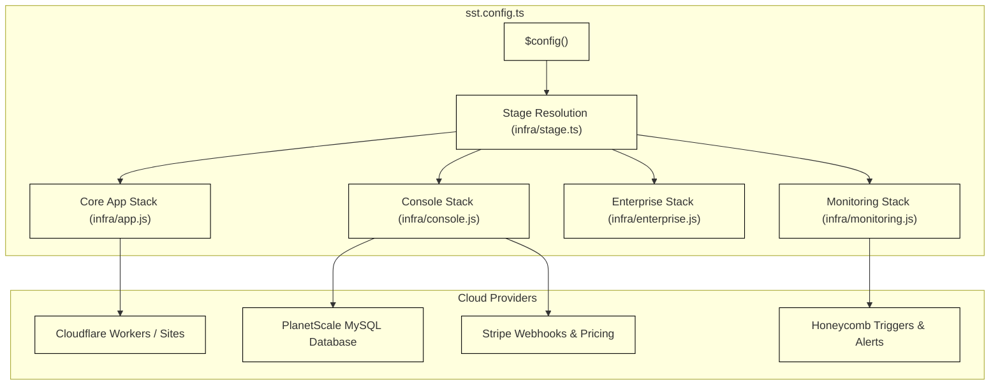
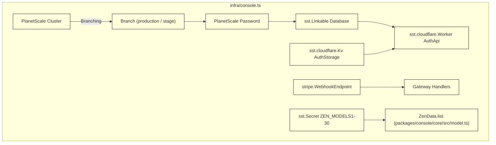
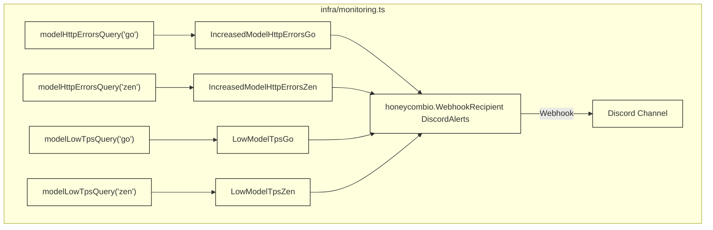
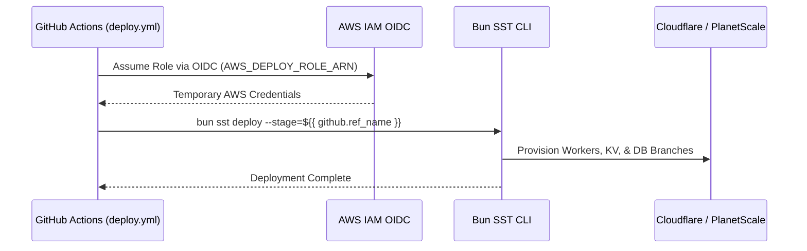

<!-- source: DeepWiki mcp.deepwiki.com · repo sst/opencode · page 9.5 Cloud Infrastructure (SST) · fetched 2026-10-26 -->

# Cloud Infrastructure (SST)

<details>
<summary>Relevant source files</summary>

The following files were used as context for generating this wiki page:

- [.dockerignore](.dockerignore)
- [.github/workflows/deploy.yml](.github/workflows/deploy.yml)
- [infra/console.ts](infra/console.ts)
- [infra/enterprise.ts](infra/enterprise.ts)
- [infra/monitoring.ts](infra/monitoring.ts)
- [infra/stage.ts](infra/stage.ts)
- [packages/console/app/src/routes/auth/[...callback].ts](packages/console/app/src/routes/auth/[...callback].ts)
- [packages/console/app/src/routes/enterprise/index.tsx](packages/console/app/src/routes/enterprise/index.tsx)
- [packages/console/app/src/routes/honeycomb/webhook.ts](packages/console/app/src/routes/honeycomb/webhook.ts)
- [packages/console/app/src/routes/t/[...path].tsx](packages/console/app/src/routes/t/[...path].tsx)
- [packages/console/app/src/routes/zen/util/logger.ts](packages/console/app/src/routes/zen/util/logger.ts)
- [packages/console/app/vite.config.ts](packages/console/app/vite.config.ts)
- [packages/console/core/script/promote-models.ts](packages/console/core/script/promote-models.ts)
- [packages/console/core/script/pull-models.ts](packages/console/core/script/pull-models.ts)
- [packages/console/core/script/update-models.ts](packages/console/core/script/update-models.ts)
- [packages/console/core/src/model.ts](packages/console/core/src/model.ts)
- [packages/console/core/src/util/crypto.ts](packages/console/core/src/util/crypto.ts)
- [packages/console/core/sst-env.d.ts](packages/console/core/sst-env.d.ts)
- [packages/console/function/sst-env.d.ts](packages/console/function/sst-env.d.ts)
- [packages/console/resource/sst-env.d.ts](packages/console/resource/sst-env.d.ts)
- [packages/enterprise/src/routes/index.tsx](packages/enterprise/src/routes/index.tsx)
- [packages/enterprise/sst-env.d.ts](packages/enterprise/sst-env.d.ts)
- [packages/enterprise/vite.config.ts](packages/enterprise/vite.config.ts)
- [packages/function/sst-env.d.ts](packages/function/sst-env.d.ts)
- [packages/llm/script/recording-cost-report.ts](packages/llm/script/recording-cost-report.ts)
- [packages/stats/app/tsconfig.json](packages/stats/app/tsconfig.json)
- [packages/ui/vite.config.ts](packages/ui/vite.config.ts)
- [sst-env.d.ts](sst-env.d.ts)
- [sst.config.ts](sst.config.ts)

</details>


## Purpose and Scope
This section details the cloud infrastructure and infrastructure-as-code (IaC) configuration for OpenCode, managed via the SST (Serverless Stack) framework [sst.config.ts:1-53](). It covers multi-cloud orchestration across Cloudflare (hosting SolidStart applications, Astro documentation sites, Workers, and KV storage), AWS (data lake and analytics stats infrastructure), PlanetScale (MySQL serverless database branches), Stripe (billing webhooks and subscription products), and Honeycomb (observability and alerting triggers).

---

## 1. SST App Configuration and Architecture

The root orchestration file `sst.config.ts` initializes the SST application named `opencode`, configuring removal policies, protection rules for production environments, and external provider versions (AWS, Stripe, Random, PlanetScale, Honeycomb) [sst.config.ts:3-29]().

Depending on the deployment stage (`production`, `dev`, or custom ephemeral stages managed via `infra/stage.ts`), the configuration dynamically provisions services such as the core console, enterprise workspaces, metrics ingestion lake, and telemetry monitoring [sst.config.ts:30-53]().


*Figure 1: SST deployment orchestration flow connecting `sst.config.ts` to cloud provider stacks.*

Sources: [sst.config.ts:1-53](), [infra/stage.ts:1-40]()

---

## 2. Console Stack & Database Infrastructure

The console stack defined in `infra/console.ts` manages database provisioning, authentication endpoints, Stripe billing resources, and AI inference configuration secrets (`ZEN_MODELS1` through `ZEN_MODELS30`) [infra/console.ts:11-214]().

### Database Provisioning
OpenCode utilizes PlanetScale for serverless MySQL hosting. For production, it binds directly to the `production` branch; for non-production stages, it creates ephemeral branches parented off production [infra/console.ts:16-28](). Database credentials are exposed to services via `sst.Linkable` [infra/console.ts:36-44]():

```typescript
export const database = new sst.Linkable("Database", {
  properties: {
    host: password.accessHostUrl,
    database: cluster.name,
    username: password.username,
    password: password.plaintext,
    port: 3306,
  },
})
```
[infra/console.ts:36-44]()

### Authentication and Gateway Workers
Authentication is handled by a Cloudflare Worker (`AuthApi`) linked to the PlanetScale database and Cloudflare KV (`AuthStorage`) [infra/console.ts:63-68](). Stripe integration registers a webhook endpoint (`StripeWebhookEndpoint`) [infra/console.ts:74-104]() listening to subscription lifecycle events, alongside product tiers such as `OpenCode Go` (`zenLiteProduct`) and `OpenCode Black` (`zenBlackProduct`) [infra/console.ts:106-185]().

The `ZEN_MODELS` secrets (e.g., `ZEN_MODELS1` to `ZEN_MODELS23`) are used to store configuration for Zen and Go models, which are then parsed and validated by `ZenData.list` in `packages/console/core/src/model.ts` [infra/console.ts:188-214](), [packages/console/core/src/model.ts:85-117]().


*Figure 2: Component topology within `infra/console.ts` showing database branching, auth workers, and model secrets.*

Sources: [infra/console.ts:1-214](), [packages/console/core/src/model.ts:85-117]()

---

## 3. Monitoring and Observability Stacks

The monitoring infrastructure defined in `infra/monitoring.ts` interfaces with Honeycomb to configure observability triggers, anomaly detection, and webhook notifications routed to Discord [infra/monitoring.ts:1-224]().

### Triggers and Error Queries
Error rates and performance metrics (such as tokens-per-second, or TPS) are continuously queried and evaluated. For example, `modelHttpErrorsQuery` calculates failed HTTP status codes excluding authorized rate limits (`GoUsageLimitError`, `FreeUsageLimitError`) [infra/monitoring.ts:41-86](). Triggers such as `IncreasedModelHttpErrorsGo`, `IncreasedModelHttpErrorsZen`, `LowModelTpsGo`, and `LowModelTpsZen` automatically fire alerts when thresholds are breached in production [infra/monitoring.ts:160-224]().


*Figure 3: Honeycomb trigger pipeline and alerting workflow defined in `infra/monitoring.ts`.*

Sources: [infra/monitoring.ts:1-224]()

---

## 4. Deployment Workflow and CI/CD Pipeline

Cloud infrastructure deployments are automated via GitHub Actions (`.github/workflows/deploy.yml`) [[.github/workflows/deploy.yml:1-49]()]. Pushes to the `dev` or `production` branches trigger the deployment workflow, which assumes an AWS IAM role via OpenID Connect (OIDC) and executes the SST deployment CLI command [payload instructions in [.github/workflows/deploy.yml:12-36]()].


*Figure 4: Sequence diagram illustrating the OIDC authentication and infrastructure deployment lifecycle.*

Sources: [[.github/workflows/deploy.yml:1-49]]()

---

