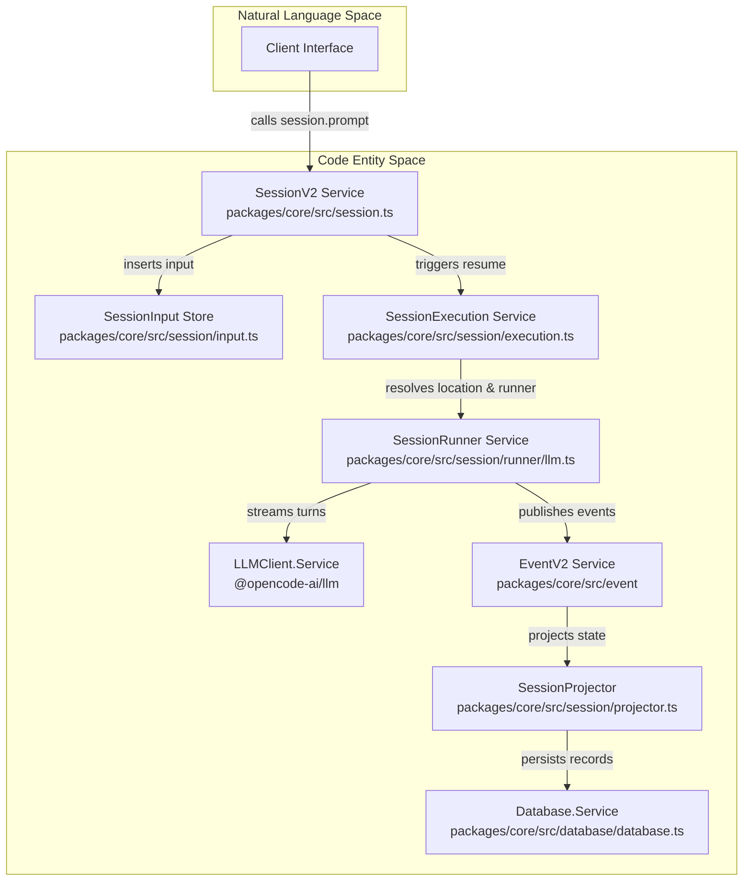
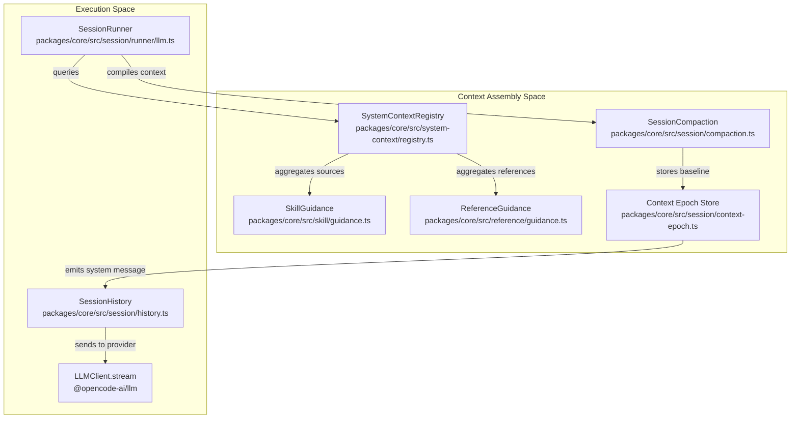

<!-- source: DeepWiki mcp.deepwiki.com · repo sst/opencode · page 9.7 Effect Migration Specs · fetched 2026-10-26 -->

# Effect Migration Specs

<details>
<summary>Relevant source files</summary>

The following files were used as context for generating this wiki page:

- [CONTEXT.md](CONTEXT.md)
- [packages/core/src/session.ts](packages/core/src/session.ts)
- [packages/core/src/session/compaction.ts](packages/core/src/session/compaction.ts)
- [packages/core/src/session/event.ts](packages/core/src/session/event.ts)
- [packages/core/src/session/execution.ts](packages/core/src/session/execution.ts)
- [packages/core/src/session/execution/local.ts](packages/core/src/session/execution/local.ts)
- [packages/core/src/session/message-updater.ts](packages/core/src/session/message-updater.ts)
- [packages/core/src/session/projector.ts](packages/core/src/session/projector.ts)
- [packages/core/src/session/run-coordinator.ts](packages/core/src/session/run-coordinator.ts)
- [packages/core/src/session/runner/llm.ts](packages/core/src/session/runner/llm.ts)
- [packages/core/src/v1/config/config.ts](packages/core/src/v1/config/config.ts)
- [packages/core/test/session-compaction.test.ts](packages/core/test/session-compaction.test.ts)
- [packages/core/test/session-create.test.ts](packages/core/test/session-create.test.ts)
- [packages/core/test/session-projector.test.ts](packages/core/test/session-projector.test.ts)
- [packages/core/test/session-prompt.test.ts](packages/core/test/session-prompt.test.ts)
- [packages/core/test/session-run-coordinator.test.ts](packages/core/test/session-run-coordinator.test.ts)
- [packages/core/test/session-runner-recorded.test.ts](packages/core/test/session-runner-recorded.test.ts)
- [packages/core/test/session-runner.test.ts](packages/core/test/session-runner.test.ts)
- [packages/core/test/session-todo.test.ts](packages/core/test/session-todo.test.ts)
- [packages/opencode/specs/effect/error-boundaries-plan.md](packages/opencode/specs/effect/error-boundaries-plan.md)
- [packages/opencode/specs/effect/errors.md](packages/opencode/specs/effect/errors.md)
- [packages/opencode/specs/effect/facades.md](packages/opencode/specs/effect/facades.md)
- [packages/opencode/specs/effect/guide.md](packages/opencode/specs/effect/guide.md)
- [packages/opencode/specs/effect/instance-context.md](packages/opencode/specs/effect/instance-context.md)
- [packages/opencode/specs/effect/loose-ends.md](packages/opencode/specs/effect/loose-ends.md)
- [packages/opencode/specs/effect/migration.md](packages/opencode/specs/effect/migration.md)
- [packages/opencode/specs/effect/routes.md](packages/opencode/specs/effect/routes.md)
- [packages/opencode/specs/effect/schema.md](packages/opencode/specs/effect/schema.md)
- [packages/opencode/specs/effect/server-package.md](packages/opencode/specs/effect/server-package.md)
- [packages/opencode/specs/effect/todo.md](packages/opencode/specs/effect/todo.md)
- [packages/opencode/specs/effect/tools.md](packages/opencode/specs/effect/tools.md)
- [packages/opencode/src/agent/prompt/compaction.txt](packages/opencode/src/agent/prompt/compaction.txt)
- [packages/opencode/src/effect/promise.ts](packages/opencode/src/effect/promise.ts)
- [packages/opencode/src/server/routes/instance/httpapi/middleware/compression.ts](packages/opencode/src/server/routes/instance/httpapi/middleware/compression.ts)
- [packages/opencode/test/patch/patch.test.ts](packages/opencode/test/patch/patch.test.ts)
- [packages/opencode/test/server/httpapi-compression.test.ts](packages/opencode/test/server/httpapi-compression.test.ts)
- [specs/v2/schema-changelog.md](specs/v2/schema-changelog.md)
- [specs/v2/session.md](specs/v2/session.md)
- [specs/v2/todo.md](specs/v2/todo.md)

</details>


The purpose and scope of this page is to summarize the architectural refactor and v2 migration design documents located across `packages/opencode/specs/effect` and `specs/v2`. These specs govern the transition of OpenCode's backend core and server infrastructure to an Effect-native, schema-first, strongly-typed architecture.

Sources: `[packages/opencode/specs/effect/todo.md:1-41](), [specs/v2/todo.md:1-55]()`

---

## 1. Architectural Philosophy and Design Principles

The Effect refactor establishes strict design patterns across domain services:
- **Effect-First Return Types**: Service methods return `Effect.Effect<A, E, R>` rather than raw Promises or unhandled exceptions `[packages/opencode/specs/effect/migration.md:9-10]()`.
- **Function Tracing**: Methods are instrumented with `Effect.fn("Domain.method")` for telemetry and call-stack tracing `[packages/opencode/specs/effect/migration.md:10-11]()`.
- **Typed Error Channels**: Expected domain failures are modeled as typed errors on the Effect error channel (`E`), eliminating raw thrown exceptions or untyped strings `[packages/opencode/specs/effect/migration.md:11-12]()`.
- **Explicit Layer Wiring**: Dependencies are declared via Effect `Layer` and yielded once at layer construction, closed over by service implementation methods `[packages/opencode/specs/effect/migration.md:12-16]()`.

Sources: `[packages/opencode/specs/effect/migration.md:1-17]()`

---

## 2. Schema-First Domain Modeling

Effect Schema is the single source of truth for domain models, DTOs, branded identifiers, inputs, outputs, and expected errors `[packages/opencode/specs/effect/schema.md:1-5]`.

### Preferred Data Shapes
- **`Schema.Class`**: Used for exported data objects with a clear domain identity, such as `SessionV2.Info` or `ProjectV2.Info` `[packages/opencode/specs/effect/schema.md:10-20]()`.
- **`Schema.Struct`**: Used for local shapes, inputs, and simple nested data structures `[packages/opencode/specs/effect/schema.md:21-30]()`.
- **`Schema.TaggedErrorClass`**: Used for expected domain failures, ensuring proper serialization and pattern matching `[packages/opencode/specs/effect/schema.md:31-38]()`.
- **Branded Identifiers**: Single-value domain identifiers use branded schema types (e.g., `SessionV2.ID`, `SessionMessage.ID`) `[packages/opencode/specs/effect/schema.md:39-40]()`.

### Boundary Rules
Effect Schema owns the type system across boundaries, with intentional compatibility shims:
- Public plugin tools may temporarily expose Zod through `tool.schema = z` `[packages/opencode/specs/effect/schema.md:43-50]()`.
- Tool parameters utilize JSON Schema helpers `[packages/opencode/specs/effect/schema.md:50-51]()`.
- Public configuration and TUI schemas generate through designated compilation scripts `[packages/opencode/specs/effect/schema.md:51-52]()`.

Sources: `[packages/opencode/specs/effect/schema.md:1-56]()`

---

## 3. Priority Roadmap and Work Paths

The migration work is categorized into prioritized work paths in `packages/opencode/specs/effect/todo.md`:

```text
P0: ERR + RENDER + HTTP  -> Typed expected errors, structured rendering, explicit HTTP error contracts
P1: TEST                 -> Effect-native test suites (`testEffect`, `it.effect`, explicit layers)
P2: RF                   -> Mutable runtime flags migrated to typed runtime/config services
P3: GLOBAL               -> Explicit global path state, removing import-time side effects
P4: INST + BRIDGE        -> Remove ambient Instance coupling while maintaining interop
P5: PROC + FS            -> Replace raw process/filesystem edges with `AppProcess.Service` and `FSUtil.Service`
P6: OA                   -> Shrink OpenAPI compatibility shims
```

Sources: `[packages/opencode/specs/effect/todo.md:16-41]()`

---

## 4. V2 Domain Architecture and Session Orchestration

The v2 architecture decouples session prompt admission from agent execution `[specs/v2/session.md:5-7]()`.

### Session Inbox and Execution Pipeline
1. **Prompt Admission**: Clients invoke `sessions.prompt(...)` (`[packages/core/src/session.ts:147-153]()`), which records input into the durable `session_input` table (`[specs/v2/session.md:35-36]()`).
2. **Execution Dispatch**: Background or requested runs invoke `SessionExecution.resume(sessionID)` (`[specs/v2/session.md:39-46]()`).
3. **Runner Loop**: Cached Location-scoped `SessionRunner` instances resolve model catalogs and stream provider turns via `LLMClient.stream(request)` (`[packages/core/src/session/runner/llm.ts:93-114](), [specs/v2/todo.md:18-24]()`).
4. **Projector Integration**: `SessionProjector` listens to `EventV2` publications (`[packages/core/src/session/projector.ts:111-115]()`) to atomically project messages, tool calls, and state changes into SQLite tables (`[packages/core/src/session/projector.ts:111-131]()`).

Sources: `[specs/v2/session.md:1-50](), [specs/v2/todo.md:1-35]()`

---

## 5. Architecture Diagrams

### Diagram 1: Session Execution and Prompt Flow
The following diagram maps natural language session flows to concrete code entities in `packages/core/src/session`.

Title: "Session Execution and Prompt Pipeline"



Sources: `[packages/core/src/session.ts:113-170](), [packages/core/src/session/runner/llm.ts:93-114](), [packages/core/src/session/projector.ts:111-131]()`

---

### Diagram 2: Context Epoch and System State Architecture
This diagram illustrates how system context and registries feed into session execution.

Title: "Context Epoch Assembly Architecture"



Sources: `[packages/core/src/session/runner/llm.ts:93-114](), [specs/v2/session.md:54-80]()`

---

