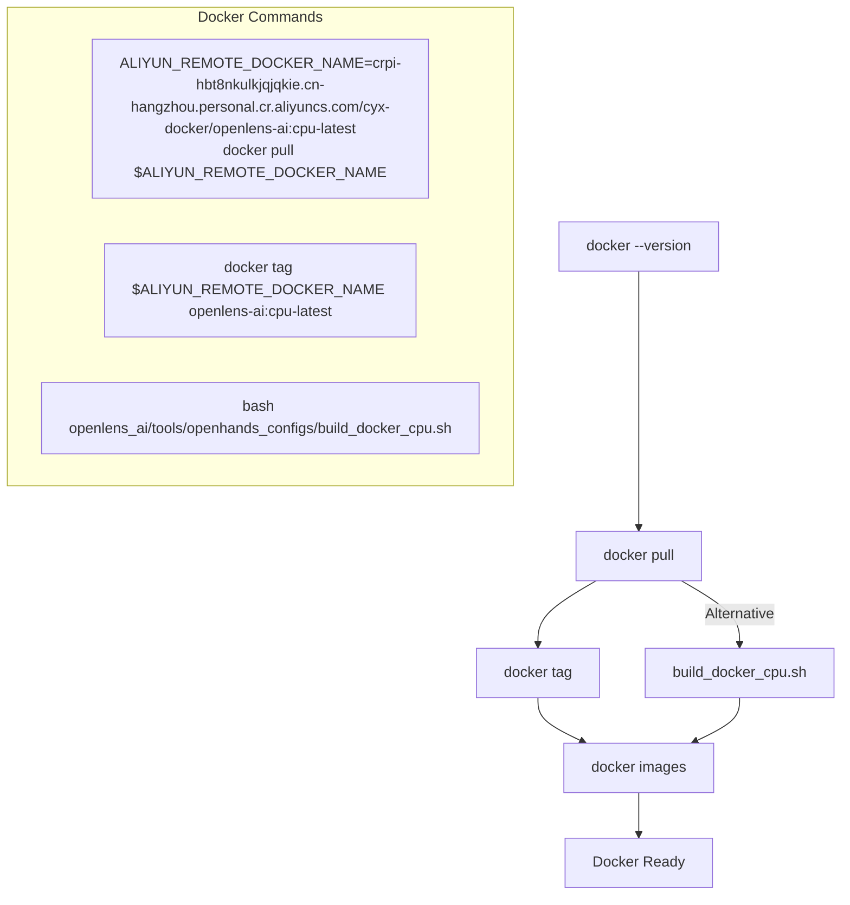
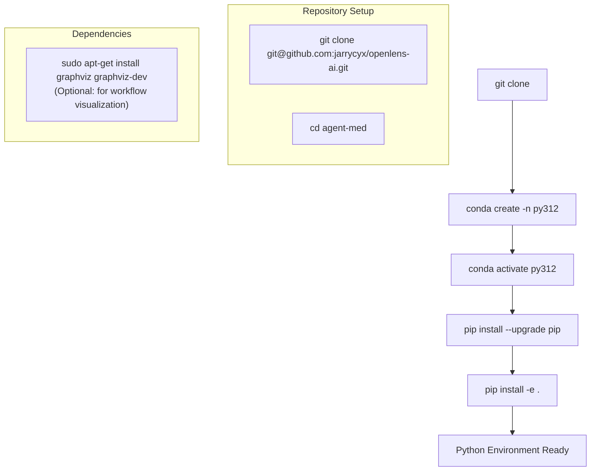
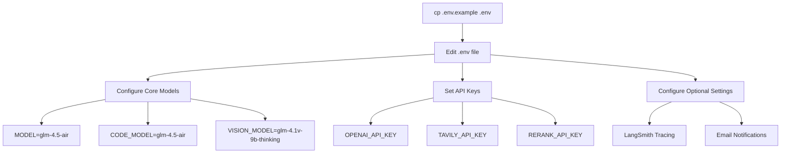
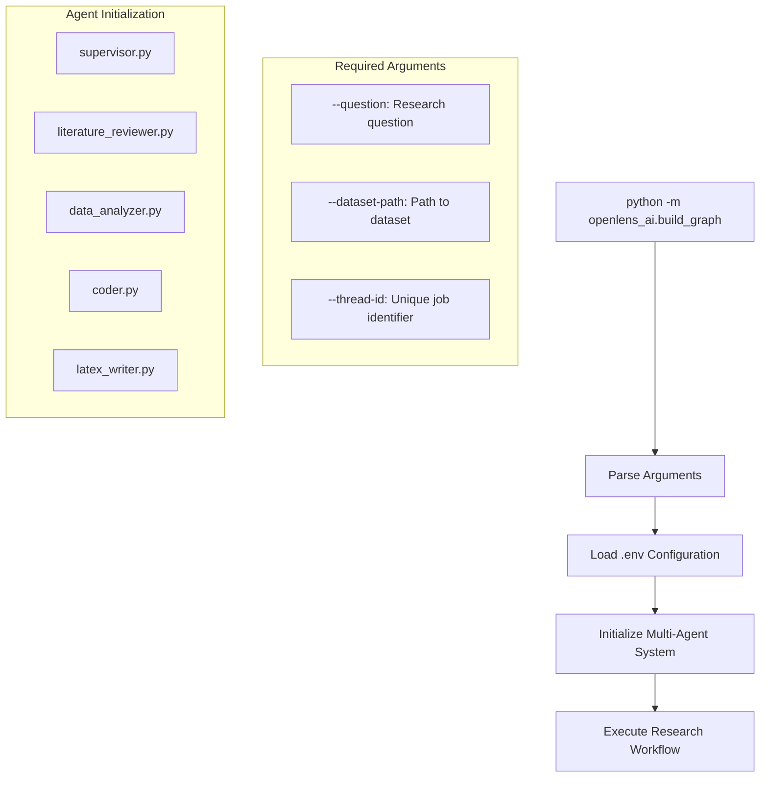
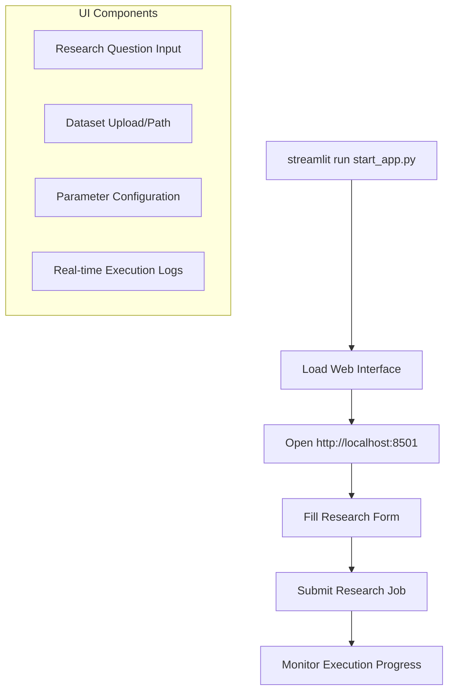
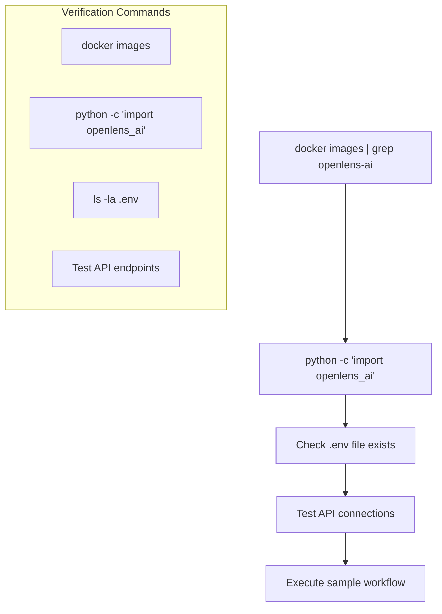

<!-- source: DeepWiki mcp.deepwiki.com · repo jarrycyx/openlens-ai · page 2 Getting Started · fetched 2026-10-26 -->

# Getting Started

<details>
<summary>Relevant source files</summary>

The following files were used as context for generating this wiki page:

- [.env.example](.env.example)
- [README.md](README.md)

</details>


This document provides step-by-step instructions for installing, configuring, and running OpenLens AI for the first time. It covers the essential setup process from initial installation through executing your first research workflow.

For detailed configuration options and parameters, see [Configuration](#2.1). For development environment setup including OpenHands integration, see [Development Environment](#6).

## Prerequisites

OpenLens AI requires the following components to be installed on your system:

| Component | Version | Purpose |
|-----------|---------|---------|
| Python | 3.9+ | Core runtime environment |
| Docker | Latest | OpenHands code execution sandbox |
| Git | Latest | Repository cloning and version control |

### Required API Keys

The system integrates with several external services that require API keys:

| Service | Required For | Environment Variable |
|---------|--------------|---------------------|
| LLM Provider (e.g., Infini AI, DeepSeek) | Core language model operations | `OPENAI_API_KEY` |
| Reranking Service | Literature search result optimization | `RERANK_API_KEY` |
| Tavily Search | Web search and literature discovery | `TAVILY_API_KEY` |

**Optional Services:**

| Service | Purpose | Environment Variable |
|---------|---------|---------------------|
| LangSmith | Workflow tracing and debugging | `LANGSMITH_API_KEY` |
| SMTP Server | Email notifications | `EMAIL_USER`, `EMAIL_PASSWORD` |

## Installation Workflow

### Docker Environment Setup

OpenLens AI uses Docker containers for secure code execution through OpenHands integration.



**Docker Setup Commands:**

Sources: [README.md:74-85]()

```bash
# Verify Docker installation
docker --version

# Pull pre-built Docker image
ALIYUN_REMOTE_DOCKER_NAME=crpi-hbt8nkulkjqjqkie.cn-hangzhou.personal.cr.aliyuncs.com/cyx-docker/openlens-ai:cpu-latest
docker pull $ALIYUN_REMOTE_DOCKER_NAME
docker tag $ALIYUN_REMOTE_DOCKER_NAME openlens-ai:cpu-latest

# Alternative: Build from source
bash openlens_ai/tools/openhands_configs/build_docker_cpu.sh
```

### Python Environment Setup



**Installation Commands:**

Sources: [README.md:87-102]()

```bash
# Clone repository
git clone git@github.com:jarrycyx/openlens-ai.git
cd agent-med

# Create Python environment
conda create -n py312 python=3.12
conda activate py312

# Install dependencies
pip install --upgrade pip
pip install -e .

# Optional: Install graphviz for workflow visualization
sudo apt-get install graphviz graphviz-dev
```

## Configuration Setup

### Environment File Creation

The configuration process involves copying and customizing the environment template:



**Configuration Steps:**

Sources: [.env.example:1-38](), [README.md:104-151]()

```bash
# Create configuration file
cp .env.example .env
```

### Core Configuration Parameters

Edit the `.env` file with the following essential parameters:

| Parameter | Example Value | Description |
|-----------|---------------|-------------|
| `MODEL` | `"glm-4.5-air"` | Primary language model for general tasks |
| `CODE_MODEL` | `"glm-4.5-air"` | Language model for code generation |
| `VISION_MODEL` | `"glm-4.1v-9b-thinking"` | Vision model for image analysis |
| `OPENAI_API_KEY` | `"<YOUR API KEY>"` | API key for language model access |
| `BASE_URL` | `"https://cloud.infini-ai.com/maas/v1/"` | API service base URL |
| `TAVILY_API_KEY` | `"<YOUR API KEY>"` | Tavily search service key |
| `DOCKER_NAME` | `"agent-med-cpu"` | Docker container name |

### Advanced Configuration Parameters

| Parameter | Default Value | Purpose |
|-----------|---------------|---------|
| `MAX_CONTEXT_TOKEN_CNT` | `32000` | Normal operation context limit |
| `MAX_CONTEXT_TOKEN_CNT_LARGE` | `96000` | Large operation context limit |
| `OPENHANDS_MAX_ITER` | `100` | Maximum OpenHands execution iterations |
| `MAX_SUBTASK_REDO` | `2` | Maximum subtask retry attempts |
| `MAX_LATEX_POLISH_ROUND` | `2` | LaTeX document polishing rounds |

Sources: [.env.example:13-24]()

## First Execution

### Command Line Interface

OpenLens AI provides a command-line interface through the `build_graph` module:



**Basic Usage:**

Sources: [README.md:155-164]()

```bash
python -m openlens_ai.build_graph \
    --question "Your research question" \
    --dataset-path "path/to/dataset" \
    --thread-id "unique_job_id"
```

**Example Execution:**

```bash
python -m openlens_ai.build_graph \
    --question "What is the prediction precision of AKI based on historical 2 day data?" \
    --dataset-path "datasets/mimic" \
    --thread-id "test_000"
```

### Web Interface

For interactive usage, OpenLens AI provides a Streamlit-based web interface:



**Web Interface Startup:**

Sources: [README.md:167-172]()

```bash
streamlit run start_app.py
```

Then navigate to `http://localhost:8501` in your web browser.

## Verification Steps

### System Health Check

After installation, verify that all components are working correctly:



**Verification Commands:**

```bash
# Verify Docker image
docker images | grep openlens-ai

# Verify Python package installation
python -c "import openlens_ai; print('Installation successful')"

# Check configuration file
ls -la .env

# Test with a simple question
python -m openlens_ai.build_graph \
    --question "Test question" \
    --dataset-path "." \
    --thread-id "health_check"
```

### Common Configuration Issues

| Issue | Symptom | Solution |
|-------|---------|----------|
| Missing API keys | Authentication errors | Verify all required API keys in `.env` |
| Docker not running | Container startup failures | Ensure Docker daemon is running |
| Python version | Import errors | Confirm Python 3.9+ is being used |
| Missing dependencies | Module not found errors | Re-run `pip install -e .` |

## Next Steps

After successful installation and configuration:

1. **Explore the Multi-Agent System**: Learn about the five specialized agents in [Multi-Agent System](#3)
2. **Configure Advanced Settings**: Customize model parameters and execution limits in [Configuration](#2.1)
3. **Set up Development Environment**: For code contributions, see [Development Environment](#6)
4. **Run Evaluation Tests**: Validate your setup using the evaluation framework in [Evaluation Framework](#5)

Sources: [README.md:1-259](), [.env.example:1-38]()

---

