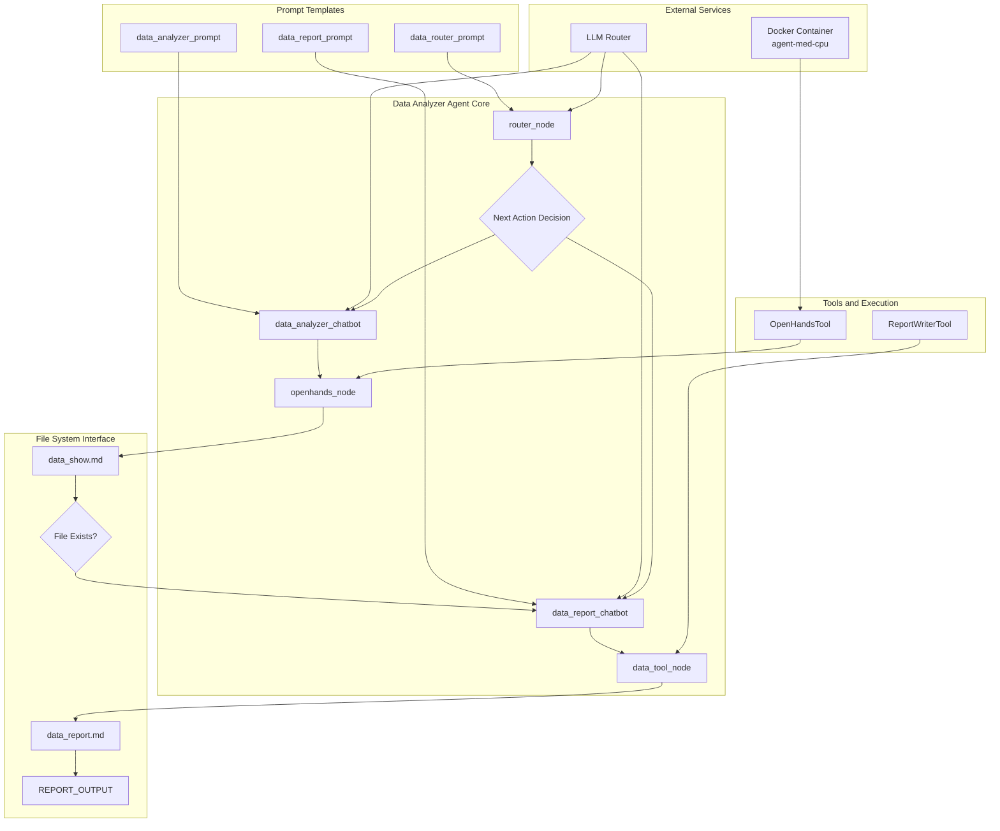
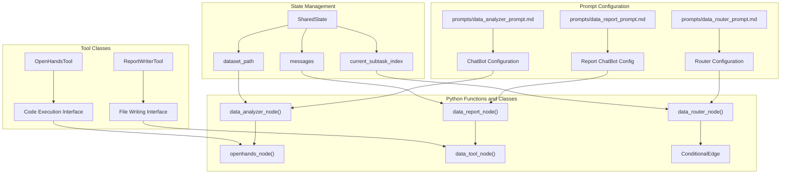
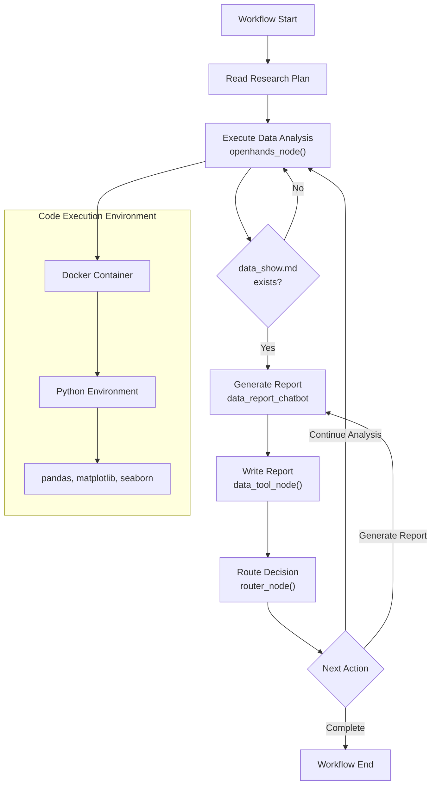
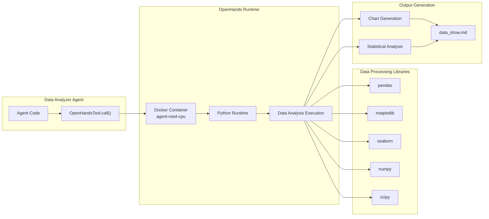
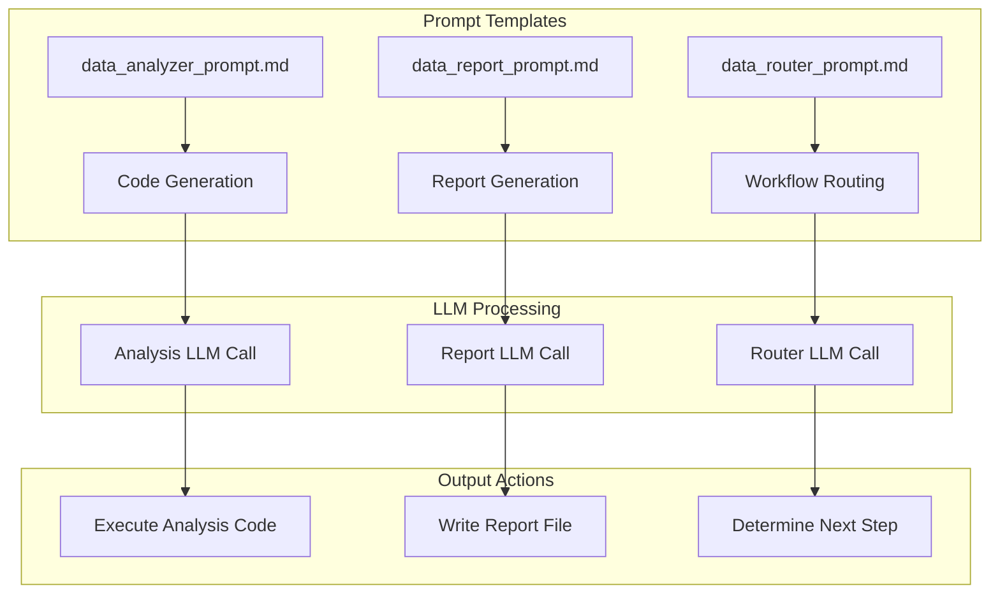

<!-- source: DeepWiki mcp.deepwiki.com · repo jarrycyx/openlens-ai · page 3.3 Data Analyzer Agent · fetched 2026-10-26 -->

# Data Analyzer Agent

Relevant source files

The following files were used as context for generating this wiki page:

- [modules.md](modules.md)

## Purpose and Scope

The Data Analyzer Agent is one of five specialized agents in the OpenLens AI multi-agent research system, responsible for processing user-provided datasets, performing statistical analysis, creating visualizations, and generating comprehensive data analysis reports. This document covers the agent's architecture, workflow, tools, and integration within the broader research automation pipeline.

For information about the overall multi-agent system architecture, see [Multi-Agent System](#3). For details about the code execution environment, see [OpenHands Integration](#6.1). For the supervisor that coordinates this agent, see [Supervisor Agent](#3.1).

## Agent Overview

The Data Analyzer Agent serves as the data processing specialist within the OpenLens AI research workflow. It operates within a sandboxed code execution environment and generates both analytical insights and visual representations of datasets to support the research process.

### Core Responsibilities

| Responsibility | Description |
|---|---|
| Dataset Processing | Analyze user-provided datasets using statistical methods |
| Data Visualization | Create charts, graphs, and visual representations of data patterns |
| Statistical Analysis | Perform quantitative analysis and hypothesis testing |
| Report Generation | Produce structured data analysis reports in markdown format |

## Architecture and Implementation

### Data Analyzer Agent Architecture

Sources: [modules.md:87-117]()

### Code Entity Mapping

Sources: [modules.md:101-117]()

## Workflow and Process Flow

### Data Analysis Workflow

The Data Analyzer Agent follows a structured workflow that processes datasets through multiple phases:

Sources: [modules.md:110-117]()

### Processing Phases

| Phase | Node | Purpose | Output |
|---|---|---|---|
| **Analysis** | `openhands_node` | Execute data processing code | Analysis results, visualizations |
| **Validation** | File system check | Verify analysis completion | Boolean state |
| **Reporting** | `data_report_chatbot` | Generate comprehensive report | Structured markdown report |
| **Writing** | `data_tool_node` | Write report to file system | `data_report.md` file |
| **Routing** | `router_node` | Determine next workflow step | Routing decision |

## Tools and Integration

### OpenHands Integration

The Data Analyzer Agent leverages the OpenHands tool for secure code execution within a containerized environment:

Sources: [modules.md:103-109]()

### Tool Configuration

The agent uses several key tools integrated through the OpenLens AI framework:

| Tool | Class/Function | Purpose |
|---|---|---|
| **Code Execution** | `OpenHandsTool` | Execute Python data analysis code |
| **Report Writing** | `ReportWriterTool` | Write analysis reports to files |
| **File Reading** | File system operations | Check for analysis completion markers |
| **LLM Integration** | LLM router | Generate analysis code and reports |

### Prompt System

The agent operates using three specialized prompt templates:

Sources: [modules.md:105-108]()

## State Management and Coordination

The Data Analyzer Agent operates within the shared state system managed by LangGraph, enabling coordination with other agents in the research pipeline:

### Shared State Components

| State Component | Purpose | Usage |
|---|---|---|
| `dataset_path` | Dataset file location | Input for analysis operations |
| `current_subtask_index` | Current workflow position | Progress tracking |
| `messages` | Communication history | Context for report generation |
| `research_question` | Research objective | Guide analysis direction |

### Inter-Agent Communication

The Data Analyzer Agent produces outputs that are consumed by other agents in the research workflow:

- **For Coder Agent**: Provides data insights for experimental design (see [Coder Agent](#3.4))
- **For LaTeX Writer**: Supplies analysis results and visualizations for paper generation (see [LaTeX Writer Agent](#3.5))
- **From Supervisor**: Receives task assignments and research plan guidance (see [Supervisor Agent](#3.1))

Sources: [modules.md:87-117](), [modules.md:199-210]()

---

